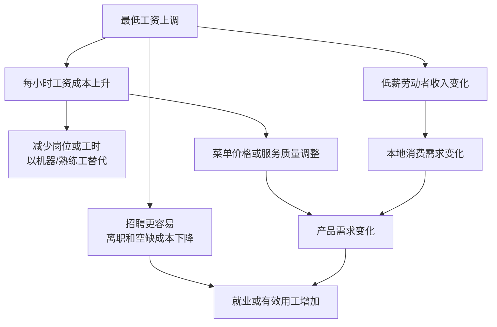

# 先定义效应再选对照：同一次加薪可以有相反就业机制

## 先把“影响就业多少”拆成可回答的问题

本案例的基本单位是**餐馆门店**，不是员工个人，也不是整州。处理是新泽西在1992年4月1日把法定最低工资由4.25美元提高到5.05美元；对照是同期最低工资保持4.25美元的宾夕法尼亚东部。第一轮调查在2月15日至3月4日，第二轮在11月5日至12月31日。

结果变量定义为每店全职当量就业：

$$
FTE=全职员工+经理+0.5\times兼职员工.
$$

目标量可写成：对政策前已在样本框中的新泽西四家连锁品牌门店，政策后店均FTE相对于“未上调时”的平均变化。它接近一个门店样本上的ATT，却不包括新开门店，不能直接叫“全州就业效应”。原文明确承认主分析只追踪政策前已营业门店，可能遗漏新店进入。

## 为什么机制方向不止一个

最低工资提高后，至少有以下路径同时存在：

在完全竞争、其他条件固定且工资被外生推高的简单模型里，企业沿劳动需求曲线减少用工。若雇主面临向上倾斜的劳动供给、招聘摩擦或高离职成本，一个适度工资底线也可能扩大招聘或减少空缺。企业还可调整工时、价格、员工构成、福利、培训、服务速度、利润和开店关店。**观察到就业不降，不能单凭结果认定垄断买方模型正确；观察到就业下降，也不能单凭结果排除其他机制。**

Card 与 Krueger 原文第VIII节正面比较竞争模型与替代模型，并在结论中说他们的数据难以被任一简单模型完整解释。机制需要更多中间结果和不同研究设计，而不是由一个DID符号反推。

## 三种不够的比较

### 只看新泽西前后

若新泽西FTE从20.44增至21.03，前后差约+0.59。但经济周期、季节、连锁策略和产品需求也在变。原文指出1992年前后中大西洋地区经济仍弱；政策不是唯一时间变化。

### 只看政策后两州

政策后新泽西21.03、宾州21.17，水平相近。这不能说明政策没有影响，因为政策前宾州门店本来更大：23.33对20.44。DID允许水平不同，关心的是未处理变化能否由对照变化近似。

### 只看起薪与就业相关

高工资店可能位于需求更强的地区、规模更大、管理更好；低工资店也可能因缺工才提高工资。工资与就业同升既可能是政策，也可能是共同需求冲击或反向因果。

## DID真正借来的反事实

记 $NJ=1$ 为新泽西，$Post=1$ 为第二轮。两组两期DID：

$$
\widehat\tau=
(\bar Y_{NJ,post}-\bar Y_{NJ,pre})-
(\bar Y_{PA,post}-\bar Y_{PA,pre}).
$$

它把宾州同期变化 $-2.166$ 借给新泽西，构造无政策反事实：

$$
20.439-2.166=18.274.
$$

新泽西实际为21.027，差约2.754。核心假设不是“两州完全一样”，而是若没有上调，新泽西样本门店的平均FTE会发生与宾州样本门店相同的变化。

## 设计卡

| 项目 | 本案例定义 | 没有覆盖什么 |
| --- | --- | --- |
| 单位 | Burger King、KFC、Roy Rogers、Wendy’s门店 | McDonald’s、其他行业、员工个人 |
| 处理 | NJ法定最低工资4.25→5.05美元/小时 | 不同幅度、执法、豁免和工资结构 |
| 对照 | 宾州东部样本门店 | 一个随机分配的平行世界 |
| 时间 | 1992年初到1992年末，约8个月 | 长期自动化、进入退出与职业路径 |
| 结果 | 店均FTE；兼职权重0.5 | 总工时、员工人数、家庭收入、福利 |
| 主要目标 | 样本中既有NJ门店的短期相对变化 | 全国所有低工资劳动者的ATE |

继续到[[社会科学/40-公共政策与社会学/20-最低工资与就业证据/02-真实数据DID逐步复算|真实数据DID逐步复算]]，把这张设计卡落实到410行公开记录。

## 来源定位

- Card & Krueger (1994), pp. 772–775：政策时间、样本框、两轮调查和跟访；pp. 778–781：FTE、DID与回归；pp. 790–793：竞争模型、替代模型与结论。
