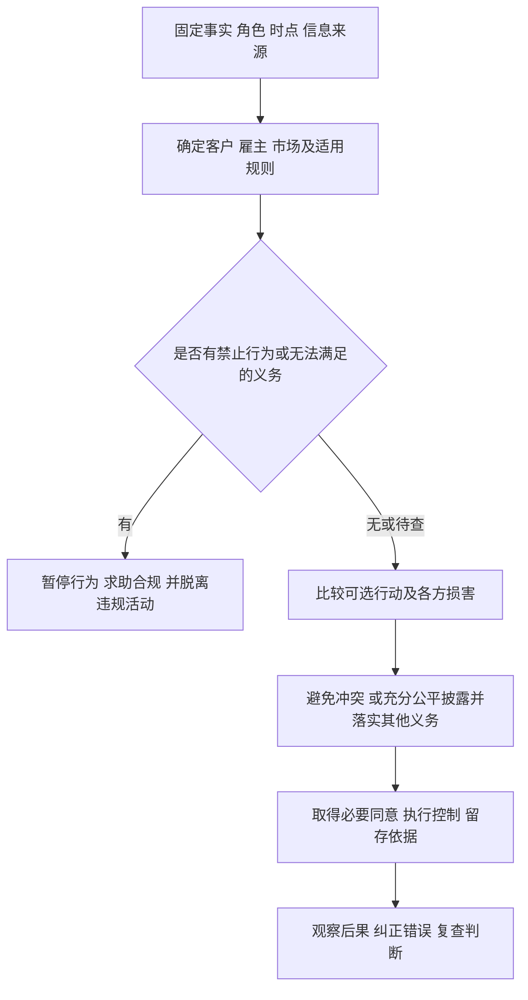

# 职业伦理：从谁受影响到应该采取什么行动

客户同意、主管批准、当地没有禁止，能否证明一个投资行为合规？必须先问**对谁负有什么责任**。客户可能无法判断隐藏费用，主管可能受发行收入激励，交易可能利用未公开的重要信息。三个人都同意，也不能替市场其他参与者放弃保护。

本课以 CFA Institute **2024年1月1日生效的 Code and Standards、2024年第12版 Standards of Practice Handbook**为基线。以下是中文教学解释和原创情景，不是官方题或法律意见。第11版已不再是现行主文件；本次核对日为2026-09-17。[正式版本与手册入口](https://www.cfainstitute.org/standards/professionals/code-ethics-standards)。2026与2027考试纲要组织方式的区别见[[社会科学/50-CFA课程/00-CFA课程-MOC|课程入口]]。

## 现行修订与准则的执行

第12版的三项关键修订是：新增I(E)胜任能力；V(B)明确增加服务性质和相关客户成本披露；VI(A)改为Avoid or Disclose Conflicts。旧题或旧总结若漏了这些，不能直接充当现行规则。手册前言ppvii–ix（PDF显示第9–11页）说明修订方向。[第12版前言](https://www.cfainstitute.org/sites/default/files/-/media/documents/code/code-ethics-standards/standards-practice-handbook-12th-edition.pdf)。

Professional Conduct Program不是由客户是否满意决定：Board of Governors承担监督，Professional Conduct工作人员调查涉嫌不当行为，Disciplinary Review Committee参与审理及处分。程序依Bylaws与Rules of Procedure处理调查、违规认定、处分及披露；可能影响会员身份、资格使用权或候选人参与项目的资格。调查可来自自报事项、书面投诉和其他信息，调查与最后处分应区分；本课不据一个怀疑情景宣称任何现实人员已经受处分。[现行Professional Conduct入口](https://www.cfainstitute.org/standards/professionals/conduct)、[第12版前言ppix–xi](https://www.cfainstitute.org/sites/default/files/-/media/documents/code/code-ethics-standards/standards-practice-handbook-12th-edition.pdf)。

## 六项基本准则给判断方向

Code of Ethics 的六项承诺可概括为：以诚信、胜任能力、勤勉、尊重和伦理态度对待公众及职业相关各方；把职业诚信和客户利益置于个人利益之前；在分析和行动中谨慎并独立判断；自己遵守并促进他人的伦理行为；维护资本市场的诚信、可持续性及社会利益；持续提高自己并支持其他投资专业人员提高胜任能力。它们解释为什么要有规则，七类 Standards 则把责任落实到具体行为。[现行两页正式准则](https://www.cfainstitute.org/sites/default/files/-/media/documents/ethics-in-practice/code_of_ethics_and_standards_of_professional_conduct_2024.pdf)。

伦理问题的难处通常不是记不住“要诚信”，而是短期奖金、群体压力和已有承诺使人忽略受损者。下列程序强迫我们把这些因素写出来。**最低合规**是满足所有适用义务；**伦理审慎**还考虑可避免的依赖、认知负担和长期伤害。推荐措施不自动变成强制条款，但披露也不能替代一条已经禁止该行为的标准。

图是本课的判断工具，不声称为 CFA Institute 官方框架的逐字重现。“有疑问”不能直接当作“未违规”；应列出会改变结论的缺失事实。答题写成：**行为＋责任对象＋标准＋关键事实＋下一步**，比只写编号更容易检查。

## I 专业精神：法律、独立性与胜任能力

**I(A) Knowledge of the Law**要求了解并遵守直接适用于职业活动的法律、监管及职业规则；冲突时遵守更严格的适用要求，不能明知参与、协助违规，且须脱离违规活动。“更严格”不意味着任意挑全球最严法律，应先确定哪个法域的规则适用。跨境或报告义务不明确时向合规与法律人员求证；咨询不免除责任。[I(A)正文及guidance](https://www.cfainstitute.org/standards/professionals/code-ethics-standards/standards-of-practice-i-a)。

原创例：分析师已知广告把净亏损写成正收益，主管说“很难被查到”。继续发送构成明知协助；应要求更正、上报，未解决时停止使用并脱离该活动。仅递交投诉后照常发送仍不足。不参加并记录理由符合脱离方向；外部监管举报是否强制取决于适用法律，不能把它写成所有案例的统一要求。

**I(B) Independence and Objectivity**保护专业判断免受礼物、发行人、客户或内部业务压力左右；**I(C) Misrepresentation**禁止职业活动中的虚假、误导和剽窃，包括资历、服务、业绩和投资特征；**I(D) Misconduct**涉及欺诈、不诚实及损害职业信誉、诚信或胜任能力的行为；**I(E) Competence**要求在实际职责中维持所需知识、技能和能力，不能仅靠获得资格时的知识。[I(B)](https://www.cfainstitute.org/standards/professionals/code-ethics-standards/standards-of-practice-i-b)、[I(C)](https://www.cfainstitute.org/standards/professionals/code-ethics-standards/standards-of-practice-i-c)、[I(D)](https://www.cfainstitute.org/standards/professionals/code-ethics-standards/standards-of-practice-i-d)、[I(E)](https://www.cfainstitute.org/standards/professionals/code-ethics-standards/standards-of-practice-i-e)。

原创例：发行人用豪华度假交换看多报告，拒绝该安排、保持证据判断符合独立性方向；接受后写出真实数字，也未解决诱导判断的问题。把第三方模型报告改名为自己原创违反I(C)，明确归属并核查其适用性才可使用。伪造研究费用违反I(D)；对政策作诚实的公开批评不能仅凭“不讨喜”判为职业不当。第一次负责复杂信用产品，承认能力缺口、完成训练并获得适当专家支持符合I(E)方向；不懂模型却向客户断言安全不符合要求。预防措施是礼物审批、研究与业务隔离、来源署名及随职责更新训练，不能把某个固定学时数编成准则要求。

## II 资本市场诚信：信息与操纵

**II(A) Material Nonpublic Information**禁止利用重要非公开信息交易或促使他人交易；重要性关乎合理投资者是否重视及对价格的影响，非公开不能等同“网上搜不到”。合规的 mosaic 分析可组合公开信息和非重要非公开信息，但不能用“拼图”洗掉一条本身重要非公开的消息。**II(B) Market Manipulation**禁止以误导市场参与者为目的扭曲价格或人为放大交易量；应分析目的与行为，正常大额交易的价格影响不自动是操纵。[II(A)](https://www.cfainstitute.org/standards/professionals/code-ethics-standards/standards-of-practice-ii-a)、[II(B)](https://www.cfainstitute.org/standards/professionals/code-ethics-standards/standards-of-practice-ii-b)。

原创例：董事私下告知尚未宣布的并购，经理替客户买入，“客户会受益”不能解除对市场的义务。先停止相关交易，交由合规限制访问与处理披露问题。若研究员依据公开订单及非重要的门店观察独立推断增长，则不因结论精确而成为内幕交易。为了吸引跟风者，在控制账户间循环买卖制造活跃度违反II(B)；为履行真实投资目标而正常成交，虽影响价格，题设不足以认定操纵。限制名单、信息隔离和异常订单审查可预防，市场效率理论不是这些义务的替代；机制背景见[[社会科学/30-金融市场与风险/05-有效市场信息价格与异常|信息集与价格检验]]。

## III 对客户的责任：从真正受益者出发

**III(A) Loyalty, Prudence, and Care**要求忠诚、谨慎和合理注意，把客户利益置于雇主或自己利益之前；养老金等安排须识别最终受益者，不能只把付钱的发起人当责任对象。**III(B) Fair Dealing**要求在分析、建议和投资行动中公平客观地对待客户；公平不等于所有账户得到完全相同投资或同时收到完全相同服务，但服务差异不能使其他客户处于不利地位或受到负面影响；各档服务须向所有客户开放，不能选择性提供，并应向客户与潜在客户披露。[III(A)](https://www.cfainstitute.org/standards/professionals/code-ethics-standards/standards-of-practice-iii-a)、[III(B)](https://www.cfainstitute.org/standards/professionals/code-ethics-standards/standards-of-practice-iii-b)。

原创例：养老金发起人要求高价买其关联公司股票以支持融资，经理未经受益者利益分析便照办，违背III(A)。改为先按基金目标、风险、价格和授权评估，并拒绝无法合理支持的购买，才保护客户。稀缺IPO先给自己的高奖金客户，剩余给其他同样适合账户，违反公平；事前一致的公平分配政策且考虑账户适合性可符合要求。预防是识别受益者、最佳执行评估及分配规则，而非“收益最后涨了就没事”。

**III(C) Suitability**在咨询关系中要求合理了解并更新客户经验、风险与回报目标和财务约束，在建议/行动前检验适当性，并从总组合判断；管理既定授权的组合则要使投资符合该授权。纯执行或面向公众的卖方研究角色不能一概套用同一种个人咨询责任。**III(D) Performance Presentation**要求业绩公平、准确、完整；**III(E) Preservation of Confidentiality**保护当前、潜在与已离开的客户信息，例外涉及客户违法活动、法律要求或客户许可，适用法律可能进一步限制披露。[III(C)](https://www.cfainstitute.org/standards/professionals/code-ethics-standards/standards-of-practice-iii-c)、[III(D)](https://www.cfainstitute.org/standards/professionals/code-ethics-standards/standards-of-practice-iii-d)、[III(E)](https://www.cfainstitute.org/standards/professionals/code-ethics-standards/standards-of-practice-iii-e)。

原创例：客户一年后要支付学费，经理只因客户说“我敢冒险”就买无法提前赎回的三年产品，未处理流动性约束，不满足III(C)。先收集并更新目标、比较总组合再建议，属于符合义务的路径。只展示还留在公司的赢家账户误导历史表现，违反III(D)；完整交代计算口径和代表范围才可判断。老客户已解约，向营销人员发其资产明细仍可能违反III(E)；在有效授权范围内共享或依法履行特定义务才有依据。预防采用IPS审查、业绩复核及按职责限制访问。更复杂的改变条件题见[[社会科学/50-CFA课程/02-利益冲突适当性信息与客户责任案例|客户与冲突案例]]，机构业绩报告见[[社会科学/50-CFA课程/03-GIPS业绩呈现范围与误导识别|GIPS范围]]。

## IV 对雇主的责任：忠诚并不授权伤害客户

**IV(A) Loyalty**要求不剥夺雇主应得的技能和能力，不泄露机密或损害其利益；离职准备与带走资料、在任抢客户须区分。为保护客户和市场而采取必要行动，与为自己利益竞争不是一回事。**IV(B) Additional Compensation Arrangements**对可能与雇主利益冲突的额外利益要求事先取得有关各方书面同意，非现金福利也属于考虑范围。**IV(C) Responsibilities of Supervisors**要求对受监督或权限内人员采取合理努力，确保遵守适用法律和准则；职位名称和一份手册不构成免责。[IV(A)](https://www.cfainstitute.org/standards/professionals/code-ethics-standards/standards-of-practice-iv-a)、[IV(B)](https://www.cfainstitute.org/standards/professionals/code-ethics-standards/standards-of-practice-iv-b)、[IV(C)](https://www.cfainstitute.org/standards/professionals/code-ethics-standards/standards-of-practice-iv-c)。

原创例：离职前复制雇主客户资料，并以此招揽，违反忠诚与机密保护；在自己的时间作合法的新公司准备且不抢业务、不用雇主财产，不因“准备离职”本身违规。客户许诺达到回报目标后送旅行，经理仅口头向同事提起，不满足额外报酬的书面同意要求；事前披露条款并取得必要同意，再检查对其他客户是否公平，才可继续。主管发现交易预审被绕过却只发通告，合理努力不足；应调查、限制相关活动并修补实施机制。预防措施是明确外部业务协议、报酬审批及可执行的监督；具体雇佣和举报法律须另按法域核对。

## V 分析、建议和行动：依据、沟通与留存

**V(A) Diligence and Reasonable Basis**要求勤勉、独立、充分研究支持合理依据；可依赖第三方研究但须评价质量，不能盲转。**V(B) Communication with Clients and Prospective Clients**要求披露服务性质、客户承担的成本，解释投资过程、重要改变、重大风险/限制，区分事实和观点。**V(C) Record Retention**要求保存支持分析、建议、行动及相关沟通的适当记录；具体保存期限结合适用法律和雇主政策，不把推荐期限当统一法律。[V(A)](https://www.cfainstitute.org/standards/professionals/code-ethics-standards/standards-of-practice-v-a)、[V(B)](https://www.cfainstitute.org/standards/professionals/code-ethics-standards/standards-of-practice-v-b)、[V(C)](https://www.cfainstitute.org/standards/professionals/code-ethics-standards/standards-of-practice-v-c)。

原创例：经理只凭一段无出处的模型输出荐股，不满足V(A)；检查数据、估值假设、敏感性及第三方研究方法，才建立依据。把“预计增长8%”称为“公司已实现增长8%”，混淆观点与事实；明确预测及假设、更换策略时及时说明影响，是符合V(B)的路径。报告结论正确但销毁支撑材料，仍可能违反V(C)；保存可定位的数据版本、研究和沟通，而非只留最终买卖指令。预防是研究复核、成本/风险沟通模板和有权限管理的档案，不要求客户读完所有技术细节才履责。

## VI 利益冲突：披露之后仍要满足其他责任

现行 **VI(A) Avoid or Disclose Conflicts**要求避免或充分、公平披露合理可能损害独立客观、或干扰对客户/潜在客户/雇主责任的事项；披露应醒目、用清楚语言有效表达。官方导航仍可能显示旧短名“Disclosure of Conflicts”，应以现行条文的“avoid or disclose”为准。**VI(B) Priority of Transactions**给予客户和雇主交易优先于专业人员作为受益所有人的交易；**VI(C) Referral Fees**要求向雇主、客户及潜在客户适当披露因推荐产品/服务收到或支付的对价。[VI(A)](https://www.cfainstitute.org/standards/professionals/code-ethics-standards/standards-of-practice-vi-a)、[VI(B)](https://www.cfainstitute.org/standards/professionals/code-ethics-standards/standards-of-practice-vi-b)、[VI(C)](https://www.cfainstitute.org/standards/professionals/code-ethics-standards/standards-of-practice-vi-c)。

原创例：研究员持有推荐证券，却把关系埋在客户难以发现的附录，可能未有效披露；转交无冲突研究员是更审慎的选择，若仍负责，应清楚披露并保持合理依据。提前给配偶受益账户买入，再为客户下单，不能因“已披露持股”免除VI(B)；先满足客户和雇主交易、执行预审/限制政策才符合方向。推荐托管商而隐瞒转介报酬违反VI(C)；在建立关系前让潜在客户理解报酬安排才可评价建议动机。非现金利益也可构成对价，不能只看手续费。

## VII CFA身份与考试责任：不能以资格暗示保证

**VII(A) Conduct as Participants in CFA Institute Programs**保护项目诚信，禁止泄露受保护考试内容及不当行为；**VII(B) Reference to CFA Institute, the CFA Designation, and the CFA Program**禁止夸大会员、资格或候选人身份的意义。[VII(A)](https://www.cfainstitute.org/standards/professionals/code-ethics-standards/standards-of-practice-vii-a)、[VII(B)](https://www.cfainstitute.org/standards/professionals/code-ethics-standards/standards-of-practice-vii-b)。

原创例：考后公开具体题目和某知识点是否被考，可能泄露受保护信息；谈考试压力而不披露内容可符合要求。说“已通过Level II考试”若事实准确，可以描述；写“获得CFA二级资格”或“CFA保证我的投资能力/收益”误导资格含义。控制宣传模板并遵守当年候选人协议可预防。本库习题全部原创，不以考试回忆题充当证据。

## 三方责任冲突时怎么排序

| 情境 | 客户义务 | 雇主义务 | 市场/公众义务 | 合适路径 |
|---|---|---|---|---|
| 内幕消息可让客户获利 | 保护客户不等于可违法获利 | 公司要成交也不授权违规 | 不利用重要非公开信息 | 暂停、限制交易、求助合规 |
| 销售自家高费产品 | 检验适当性、合理依据、成本 | 公司营收不是唯一目标 | 真实宣传、独立判断 | 比较替代方案、披露并满足其他标准 |
| 雇主要求发送假业绩 | 公平准确完整呈现 | 不参与违规，必要时脱离 | 不损害市场信任 | 更正、上报、停止使用 |
| 客户要求保密其违法活动 | 保密有标准例外及法律边界 | 依法执行内部程序 | 法定报告可能存在 | 先核定适用法律与披露范围 |

“客户利益优先”不能推出每个客户指令都执行；“对雇主忠诚”不能推出必须参与违规；“透明”不能推出可以公开全部机密。

## 小练习与解答

1. **合法但有转介费**：题设明确当地规则不要求披露；标准是否仍要求？答：要求按VI(C)披露，I(A)不能用较宽法律降低职业义务。更审慎地提供无利益关系的备选及比较依据；题设尚不足以断定某一产品不适当。
2. **预测最后实现**：无合理依据时推荐证券，半年后盈利。是否补救了原违规？答：没有；V(A)评估决策时研究依据，结果不能倒推程序合规。应建立依据并向受影响客户纠正误导，而不是只展示获利。
3. **主管批准并披露后抢先买入**：是否足够？答：不够；VI(B)保护交易优先，批准和VI(A)披露不豁免它。停止个人抢先交易，核查受益账户与预审程序。

继续去[[社会科学/50-CFA课程/02-利益冲突适当性信息与客户责任案例|多事实案例]]练习“一个事实改变哪条结论”，或到[[社会科学/50-CFA课程/03-GIPS业绩呈现范围与误导识别|GIPS]]区分个人呈现义务与机构合规声明。
