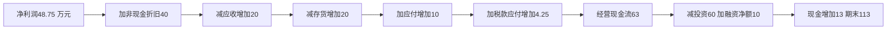

# 三张财务报表、权责发生与现金勾稽

公司说“赚了48.75万元”，银行账户却只多了13万元，是否互相矛盾？先把**某日有多少**与**一年发生多少**分开。资产负债表是时点存量；利润表说明报告期内确认的经营成果；现金流量表说明同期现金的来源与用途。权责发生制把交易的经济影响放在发生期，即使现金在别的期间才收付。三张表描述同一批交易的不同侧面。[IAS 7官方介绍](https://www.ifrs.org/issued-standards/list-of-standards/ias-7-statement-of-cash-flows/)明确直接法、间接法及三类现金流的联系。

本课用**澄河制造**贯穿本组课程。它是原创合成公司，金额均为万元；2026年1月1日期初，12月31日期末，年度收入与现金流覆盖两日之间。假设人民币功能货币、持续经营、无外汇折算、其他综合收益、并购、坏账或关联公司；全部销售已履约，存货采用FIFO，制造费用已含采购成本，折旧统一列经营费用。税率25%，基线没有永久或暂时性税差。利息付现列经营活动、股利付现列融资活动，是本例固定展示政策。不要把这一政策推广为所有年度或所有报告体系的唯一分类。

## 1. 期初是一张已经平衡的照片

| 2026-01-01资产 | 金额 | 负债和权益 | 金额 |
|---|---:|---|---:|
| 现金 | 100 | 应付供应商账款 | 50 |
| 应收客户账款 | 40 | 有息长期债务 | 150 |
| 存货 | 60 | 股本 | 160 |
| 固定资产净额 | 200 | 留存收益 | 40 |
| **总资产** | **400** | **总负债＋权益** | **400** |

资产是公司已经控制的资源，不等于“已经付过钱”；负债是已有义务，不等于“今年已经付掉的费用”。股本160与留存收益40合为账面权益200。恒等式 $A=L+E$ 来自记录方式，不能据此推论资产公允价值或公司偿债能力。

## 2. 把每笔交易留下的痕迹找齐

下表是本例**全部**年度交易与期末调整。借方/贷方是记录方向：资产和费用一般借方增加，负债、权益和收入一般贷方增加；借贷相等才是一笔完整分录。表中“＋/－”表示科目金额变化，收入费用最终归入留存收益。

| # | 交易或调整 | 资产变化 | 负债、权益或损益变化 | 实际现金流 |
|---|---|---|---|---:|
| 1 | 已交付产品，全部赊销500 | 应收＋500 | 收入＋500 | 0 |
| 2 | 收客户款480，含以前欠款 | 现金＋480；应收－480 | 无新收入 | ＋480经营 |
| 3 | 采购存货300，全部赊购 | 存货＋300 | 应付＋300 | 0 |
| 4 | 支付供应商290 | 现金－290 | 应付－290 | －290经营 |
| 5 | 发出已售存货成本280 | 存货－280 | 销售成本＋280 | 0 |
| 6 | 工资、行政等费用100，当期付清 | 现金－100 | 经营费用＋100 | －100经营 |
| 7 | 买设备60，当期付清 | 固定资产＋60；现金－60 | 无立即损益 | －60投资 |
| 8 | 年度折旧40 | 固定资产净额－40 | 折旧费用＋40 | 0 |
| 9 | 支付并确认利息15 | 现金－15 | 利息费用＋15 | －15经营 |
| 10 | 所得税费用16.25，实际付12 | 现金－12 | 所得税费用＋16.25；应付所得税＋4.25 | －12经营 |
| 11 | 新借50、偿还本金20 | 现金净＋30 | 有息债务净＋30 | ＋30融资 |
| 12 | 宣告并支付股利20 | 现金－20 | 留存收益－20 | －20融资 |

收款480不是新增收入480；买设备60不是立即费用60；偿还债务本金20不是利息费用20；股利20不是利润表费用。这四种混淆会让三表失联。旧固定资产期初净额200，新设备60与全年总折旧40是给定账本输入；具体资产寿命另见下一课，不从这两个数倒推一条统一折旧率。

## 3. 利润先算清，再问它去了哪里

| 2026年度利润表 | 金额 | 算法 |
|---|---:|---|
| 营业收入 | 500 | 已履约销售 |
| 销售成本 | －280 | 已售存货账面成本 |
| **毛利** | **220** | 500－280 |
| 其他经营费用 | －100 | 本例均付现 |
| 折旧 | －40 | 资产成本分期消耗 |
| **息税前利润 EBIT** | **80** | 220－100－40 |
| 利息费用 | －15 | 债权人的当期报酬 |
| **税前利润** | **65** | 80－15 |
| 所得税费用 | －16.25 | 65×25% |
| **净利润 NI** | **48.75** | 65－16.25 |

净利润归入留存收益，再扣分派：$RE_1=40+48.75-20=68.75$。股本仍160，期末权益228.75。若有其他综合收益、增发、回购等，权益变动需要另加相应项目；本例不省略一个真实项目，而是明确这些项目没有发生。

## 4. 两条路算出同一个经营现金流

直接法沿银行收付走：

$$CFO=480-290-100-15-12=63.$$

间接法从净利润走回现金：折旧已扣利润但没有付现，故加回40；应收增加20表示确认收入超过收款，故减20；存货增加20吸收资金，故减20；应付增加10表示采购的一部分尚未付现，故加10；税费大于已付税4.25，故加4.25。

$$CFO=48.75+40-20-20+10+4.25=63.$$

这里营运科目的增量 $\Delta X=X_1-X_0$ 是**期末减期初**。若存在并购、非现金重分类、减值、汇率变化，应先剔除其影响，不能把整张资产负债表差额直接塞进现金流。下一课专门演示减值怎样避免加回两次。

这是金额勾稽桥，箭头表示计算顺序。它没有识别“改变折旧会创造40万元现金”的因果效果。

## 5. 现金流量表和期末资产负债表

| 2026年度现金流量表 | 金额 |
|---|---:|
| 经营 CFO | 63 |
| 购买设备 CFI | －60 |
| 借款50－还本20－股利20：CFF | 10 |
| **现金净变动** | **13** |
| 期初现金 | 100 |
| **期末现金** | **113** |

| 2026-12-31资产 | 金额 | 负债和权益 | 金额 |
|---|---:|---|---:|
| 现金 | 113 | 应付供应商账款 | 60 |
| 应收客户账款 | 60 | 应付所得税 | 4.25 |
| 存货 | 80 | 有息长期债务 | 180 |
| 固定资产净额 | 220 | 股本 | 160 |
| — | — | 留存收益 | 68.75 |
| **总资产** | **473** | **总负债＋权益** | **473** |

再验三条独立路径：资产 $113+60+80+220=473$；负债 $60+4.25+180=244.25$ 加权益228.75等于473；现金 $100+63-60+10=113$。会计账平仍可能有误：把费用错误资本化，同时增加资产和利润，仍能让等式成立。分析还要看凭证、履约事实、会计政策和附注。

## 6. 练习与解答

**题1：** 如果12月客户少付10，仍已交货，其他输入不变，哪几项变？**解：** 收款470，应收期末70，CFO53，期末现金103；利润和权益不变，总资产仍473。钱从现金变成应收，现金下降不能单独证明销售下降。

**题2：** 如果取消20股利而不是减少收入20，会发生什么？**解：** 利润仍48.75；CFF30，期末现金133；留存收益88.75、权益248.75，总资产493。把取消分派记成收入，会重复增加利润。

**题3：** 供应商延迟收到10，可否说经营改善？**解：** 应付70、CFO73、现金123，利润不变。短期现金改善来自付款时点，需要查看到期义务、折扣损失和供应商风险，不能凭CFO上升认定可持续性。

## 7. 继续读哪里，年度定位到哪里

去[[社会科学/50-CFA课程/11-收入存货长期资产与报表调整|收入、存货、长期资产与报表调整]]，看经济事实不变时确认与计量怎样改变利润、资产和税；去[[社会科学/50-CFA课程/12-现金流比率盈利质量与分析边界|现金流、比率与盈利质量]]，把本账本变成诊断指标。可在[[社会科学/50-CFA课程/80-三表与资本预算复算|复算实验]]执行完整账本。

官方年度指针：[2026 Level I纲要](https://www.cfainstitute.org/sites/default/files/docs/programs/cfa-program/2026-l1-topics-combined.pdf)显示页11–12（PDF从1计），Introduction to Financial Statement Analysis、Analyzing Income Statements、Analyzing Statements of Cash Flows I；[2027 Level I纲要](https://www.cfainstitute.org/sites/default/files/2027levelitopicoutline_online.pdf)显示页11–12对应模块。本课兑现基础三表联结和直接/间接法数例，未覆盖审计意见分类、全部披露、EPS、综合收益或全部LOS。IAS 7官方介绍在2026-09-17打开；页面历史说明IFRS 18已修改现金流起点与利息/股利要求，所以本例政策固定在2026且假设未提前采用IFRS 18，不能自动搬到2027生效框架。
