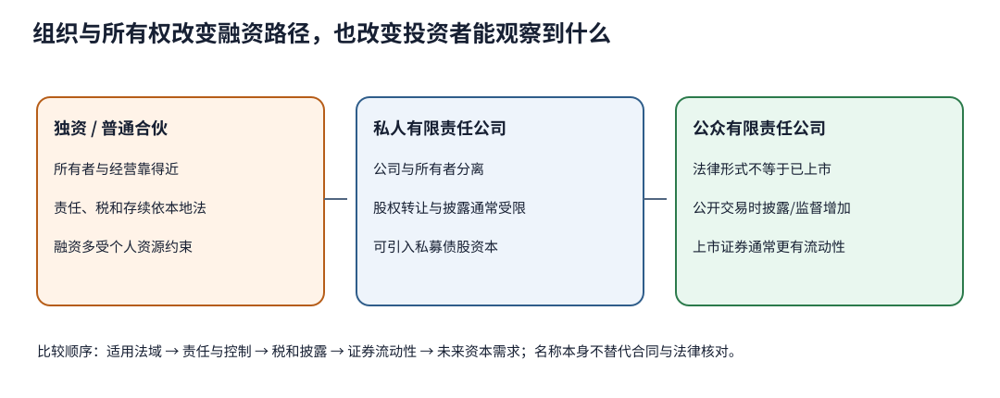

# 组织形式、所有权与融资：有限责任为何不等于风险消失

澄桥的创始人有40百万元，但建设、研发和首批营运资金需要120。产品还可能产生质量索赔。她应该独资、与两位工程师合伙，还是设立有限责任公司？答案不是“公司一定最好”，而是先问：谁拥有资产、谁能签约、谁承担债务、谁控制决策、利润如何征税、所有权能否转让，以及未来资本从哪里来。

## 先分开三个容易混淆的维度

**法律组织形式**描述企业与所有者的法律关系，如独资、普通合伙和有限责任公司。**所有权状态**描述股权集中在少数私人持有人，还是可由公众持有。**证券交易状态**描述股份是否在公开市场上市交易。三者相关却不相同：公众有限责任公司未必已经上市，私人公司也可以从私人债权人和股权投资人融资。

[CFA Institute的2026公开模块](https://www.cfainstitute.org/insights/professional-learning/refresher-readings/2026/organizational-forms-corporate-issuer-features-and-ownership)明确提醒组织形式具有法域差异，其通用比较围绕法律身份、所有者与管理者关系、责任、税和融资渠道。本课沿这些轴分析；不提供某一国家的设立、穿透责任、证券发行或税务结论。

| 比较轴 | 独资 | 普通合伙 | 有限责任公司的一般特征 |
|---|---|---|---|
| 法律身份与存续 | 常与所有者紧密相连 | 依合伙协议与本地法共同经营 | 公司通常为与股东分离的法律主体，存续可与个别股东脱离 |
| 管理与控制 | 所有与管理集中 | 合伙人共享或按协议分工 | 股东选举董事，董事监督并任命管理层；控制与日常管理可能分离 |
| 企业债务责任 | 所有者通常承担广泛个人责任 | 普通合伙人通常承担广泛个人责任 | 股东责任通常限于投入，但担保、违法行为及当地规则可能改变结果 |
| 所有权转让 | 难与本人分离 | 常受其他合伙人及协议约束 | 股份较易分割；私人公司常有限制，公众公司通常更适合广泛持有 |
| 税务 | 依当地法，常在所有者层面 | 依当地法，常见穿透处理 | 公司层与股东层是否重复征税、是否可穿透，完全取决于法域和具体类型 |
| 融资 | 受所有者财产、信用和现金流约束 | 可汇集合伙人资源，但退出和控制会影响新资金 | 可发行债股、分散所有权；同时增加设立、治理、披露和代理成本 |

表中“通常”是通用特征，不是实际合同答案。例如创始人为公司贷款提供个人保证后，股东有限责任并没有让该项个人风险消失；董事、经理对自己的违法或失职也不能靠公司壳自动免责。相反，独资并不意味一定融不到钱：有稳定现金、抵押和信誉时，贷款人仍可能提供资本，只是风险与控制集中。

## 把120资本缺口拆成权利与代价

澄桥需要120，创始人只有40，外部缺口80。可选方案不是单看“资金够不够”：

1. **创始人借款80。** 若以个人名义或提供全额个人保证，控制权保留，但本人承担偿付与抵押风险；企业现金波动会直接威胁个人资产。利率、契约和到期再融资也构成约束。
2. **普通合伙人各投入40。** 资金凑齐且技能互补，但盈利、表决、退出、竞业和新增负债权限必须由协议及适用法明确。一个合伙人的行为可能影响其他人，不能只看出资比例。
3. **设私人有限责任公司：创始人40、外部股权80。** 公司获得120且无固定还本，但创始人稀释控制与未来现金权。若创始人与外部投资人同价出资，创始人仅占三分之一；实际估值、股份类别和表决权可能使经济权与控制权不同。
4. **公司股权40、公司债80。** 形式上把债放在公司，但贷款人可能要求担保、限制分派或新增债务。经营现金必须覆盖利息与本金；“有限责任”没有替公司消除破产与失去资产的风险。

这四条只是资金权利示意，没有给出税、发行成本、估值、票息和法定资本要求，因此不能计算唯一最优解。应把控制、剩余索取权、固定偿付、信息权和退出权写进同一张条款表，再去[[社会科学/50-CFA课程/21-WACC资本结构分派与治理|21课]]分析债股成本及治理冲突。

## 私人和公众所有权改变“看得到什么”

私人发行人股权常集中、转让受限，市场报价与交易频率低；大股东可能直接监督管理，也可能形成对小股东的信息与控制优势。公众有限责任公司通常更适合广泛持有与融资，但它不必然已经上市。只有证券进入公开交易或上市市场时，公开报价、二级市场流动性与价格透明度通常才更强；相应的披露、审计、投资者关系和治理成本也会提高，管理与所有权分离还可能扩大代理问题。

“上市”不会让基本面风险消失，公开价格也不是无误的内在价值。“私人”也不等于没有专业治理：债权契约、投资人董事席位、股东协议和审计安排同样可能产生监督。比较融资能力时至少查：证券能否转让、投资者能否退出、信息是否对称、未来还能否追加资本、以及控制权变更会触发什么条件。

## 改变条件后的答案

**情景A：** 澄桥只需10、产品风险低且创始人不准备引入他人。独资的设立与治理成本可能较低；不能因为公司通常融资更广就认定现在必须公司化。

**情景B：** 仍需120，客户要求十年维护，创始人可能两年后退出。可转让所有权、持续存续和治理安排更重要；但具体公司类型与退出机制须由当地专业人士核对。

**情景C：** 公司已经成立，银行仍要求创始人保证80。公司股东对一般公司债务的责任和该创始人的合同保证是两件事；分析时分别列公司偿付能力与个人保证暴露。

**情景D：** 一家公司有500名股东但股份从不公开交易。所有权分散不等于已经上市；证券流动性、披露义务和公开融资资格须查实际法律状态。

## 练习与答案

1. **为什么有限责任可能提高融资能力？** 投资人的最大一般股权损失较可界定，股份可分割并转让，便于汇集更多资本；但债权人会以担保、契约、利率和优先权重新定价风险。
2. **把公司税率低直接写成“公司形式税更少”有什么问题？** 漏了法域、实体类型、股东层税、亏损利用与分派时点。CFA公开模块给的是常见属性，不是普遍税法。
3. **公众所有权一定减少代理冲突吗？** 不一定。公开披露与市场监督可能改善信息，但所有权分散也可能使单个股东监督动力不足；须看董事会、投票权、激励、控制股东与执行机制。

下一课[[社会科学/50-CFA课程/10-公司与收入分析/02-商业模式竞争与资本需求|商业模式、竞争与资本需求]]把“能从哪里融资”接到“业务究竟为什么需要这些资本”。年度定位限于2026/2027一级公开纲要的组织形式、发行人特征和公私所有权三项；本课不是公司法、证券法或税法意见，也未覆盖全部股份类别、合资、有限合伙、合作社、非营利组织或跨境结构。
