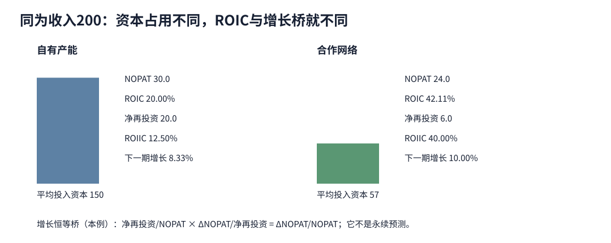

# ROIC、再投资与增长：高回报为何仍不能直接证明价值创造

上一课的合作网络ROIC高于自有产能，能否立刻给它更高估值？不能。先固定经营利润、投入资本、期间和单位，再区分已有资本的综合回报与新投入资本的增量回报。价值还取决于资本成本、可再投资规模、竞争持续性、会计测量和现金时点。

## 分子与分母必须属于同一经营范围

本课定义经营税后利润：

$$
NOPAT=EBIT\times(1-T_{operating}).
$$

题设税率25%、无特殊税项，所以自有产能EBIT40对应NOPAT30，合作网络EBIT32对应NOPAT24。真实分析应从税率调节、亏损和非经营项目重建规范化经营税率，不能把现金税率、法定税率和有效税率随机替换。

经营投入资本可从经营资产侧或融资侧勾稽：

$$
IC=\text{经营资产}-\text{无息经营负债}
  =\text{有息资本}+\text{权益}-\text{非经营资产}.
$$

两边必须使用相同合并范围。经营必需现金留在IC，剩余现金剔除；合同资产、应收和存货属于经营占用，合同负债和应付通常降低净经营资本；租赁、养老金、少数股权及资本化调整须与NOPAT口径一致。不能从资产侧剔除租赁使用权，却让EBIT继续扣其折旧。

期间ROIC使用期间利润对期间平均资本：

$$
ROIC_t=\frac{NOPAT_t}{(IC_{t-1}+IC_t)/2}.
$$

NOPAT单位是百万元/年，平均IC是百万元，所以ROIC单位是每年比例。若资本在年内集中投入、并购或处置很大，简单期初期末平均会失真，应使用月度/季度时间加权或明确替代近似；期末IC分母回答的是另一个问题。

## 同一收入下的复算

| 项目 | 自有产能 | 合作网络 |
|---|---:|---:|
| NOPAT（百万元/年） | 30 | 24 |
| 期初IC（百万元） | 140 | 54 |
| 期末IC（百万元） | 160 | 60 |
| 平均IC（百万元） | 150 | 57 |
| ROIC | 20.0000% | 42.1053% |
| 假设资本成本 | 11% | 11% |
| 经济利润 $NOPAT-k\bar IC$ | 13.50 | 17.73 |

本例合作网络利润更低，却因资本占用小而ROIC和经济利润更高。这只是在**给定11%适配两种风险**时的年度比较。若合作网络供应商依赖使风险更高，资本成本需另估；若资产轻来自研发费用化，账面IC可能偏低。高于资本成本是必要的价值线索，却不是估值结论。

## 增长要看增量回报，不拿综合ROIC代替

本例净再投资定义为期末IC减期初IC，且题设没有并购、汇率、重估或其他资本变动。下一期NOPAT分别为32.5与26.4。于是：

$$
\text{再投资率}=\frac{\text{净再投资}_t}{NOPAT_t},
\qquad
ROIIC=\frac{NOPAT_{t+1}-NOPAT_t}{\text{净再投资}_t}.
$$

只要分子分母来自同一范围且净再投资非零，下式在本例是代数恒等：

$$
\frac{NOPAT_{t+1}-NOPAT_t}{NOPAT_t}
=\frac{\text{净再投资}_t}{NOPAT_t}
\times
\frac{NOPAT_{t+1}-NOPAT_t}{\text{净再投资}_t}.
$$

| 增长桥 | 自有产能 | 合作网络 |
|---|---:|---:|
| 净再投资 | 20 | 6 |
| 再投资率 | 66.6667% | 25.0000% |
| NOPAT增加 | 2.5 | 2.4 |
| ROIIC | 12.5000% | 40.0000% |
| NOPAT增长 | 8.3333% | 10.0000% |

自有产能需要更多资本取得接近的利润增加；合作网络的增量效率更高。预测时常写“增长≈再投资率×未来增量回报”，但竞争、投资时滞、收购、价格变化和会计重分类会破坏稳定条件。若净再投资为零或负数，比例可能无定义或需要单独解释；不能让程序输出一个漂亮百分比掩盖资本收缩。

## 高综合ROIC也会隐藏坏项目

假设自有产能原有平均IC150、NOPAT30，综合ROIC20%。管理层再投20，只增加1.5 NOPAT：

$$
ROIIC=1.5/20=7.5\%<11\%,
$$

$$
\Delta EP=1.5-20\times11\%=-0.7.
$$

若下一期平均IC为160、NOPAT31.5，综合ROIC仍有19.6875%，看起来远高于11%。旧业务的高回报遮住了新项目的负经济利润。资本分配应看增量现金流、风险与项目NPV；[[社会科学/50-CFA课程/20-资本预算增量现金流与项目选择|20课]]承担完整NPV/IRR比较，ROIC不替代贴现现金流。

反过来，低初期ROIC也不必然是坏投资：建设期资本已进入分母、利润尚未爬坡时，年度ROIC会暂时低。只有把利用率、投产时点、未来现金和失败状态写清，才能评价。不能为了“正常化”任意删掉真实建设资本。

## 从ROIC到估值还缺四层

1. **可持续性：** 竞争、替代、客户集中与监管会决定现有超额回报能维持多久。
2. **可扩张性：** 60%ROIC的小业务若没有可投项目，创造的总价值可能小于15%ROIC但可长期大量再投资的业务。
3. **测量：** 研发、品牌、租赁、并购商誉、通胀与减值改变NOPAT和IC；比较公司须解释调整而非秘密改写。
4. **资本成本和现金时点：** ROIC是会计期间回报，WACC是机会成本估计；两者口径适配才可比较。估值仍须预测FCFF、终值和索取权桥，详见[[社会科学/50-CFA课程/61-公司估值多信息案例与模型选择|61课]]。

`ROIC>WACC`并不保证每一项新投资创造价值，也不保证股票价格低于内在价值；`ROIC<WACC`也不能脱离投资阶段和测量判断。股票是否值得买还要比较估值与市场价格。

## 改变条件与答案

1. **把自有产能分母改为期末160，ROIC是多少？** 18.75%。它不是本课20%的计算错误，而是不同分母口径；报告时必须命名，不能跨公司混用。
2. **下一期NOPAT仍为30，净再投资20，增长桥给什么？** ROIIC为0、增长0、再投资率66.67%。资本没有产生新增经营利润，不能继续用历史20%综合ROIC预测13.33%增长。
3. **合作网络的历史研发全部费用化，能否直接把任意五年研发加回IC？** 不能。需明确哪些支出形成仍在使用的经营资产、失败率、受益期、摊销和税效应，并同时调整NOPAT；否则只是把想要的结果写进分母。
4. **ROIC 42.1%是否证明合作网络估值更高？** 不证明。还缺风险适配的资本成本、可持续期、可再投资规模、未来现金、债务和价格。它只是本例年度资本效率信号。

到[[社会科学/50-CFA课程/10-公司与收入分析/04-客户合同履约义务与收入确认|客户合同与收入确认]]，看ROIC分子中的收入何时真正形成。本课补2026/2027一级资本分配模块中的ROIC计算与使用对比，但不宣称完成全部资本分配流程、真实公司调整或估值。

