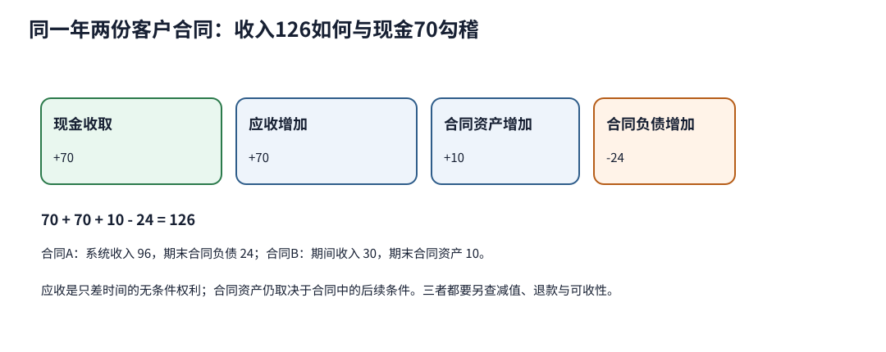

# 客户合同、履约义务与收入确认：签约、开票、收钱和赚钱是四件事

澄桥在10月收到客户60，12月又开票60。它能在2026年确认120收入吗？付款与发票说明现金和收款权，收入还要看合同是否进入IFRS 15范围、承诺怎样拆成履约义务、交易价怎样分配，以及客户何时取得每项商品或服务的控制。

[IFRS 15官方入口](https://www.ifrs.org/issued-standards/list-of-standards/ifrs-15-revenue-from-contracts-with-customers/)概括核心原则和五步模型。以下段落号定位于IFRS Foundation公开的[2021 issued text](https://www.ifrs.org/content/dam/ifrs/publications/pdf-standards/english/2021/issued/part-a/ifrs-15-revenue-from-contracts-with-customers.pdf)；实际报表须核对报告期生效版本、当地采用文本和具体事实。本课仅处理与客户的普通合同，不覆盖租赁、保险、金融工具等IFRS 15范围例外。

## 第一步：先确认存在可核算的客户合同

IFRS 15.9要求的合同条件包括：各方批准并承诺履行、能够识别商品/服务权利、能够识别付款条款、合同有商业实质，以及对将转移商品/服务对应的对价很可能可收。可执行权利义务取决于法律（IFRS 15.10），因此本例明确假设：

- 客户是取得澄桥日常产出的一方，不是共同承担研发风险的合作方；
- 双方已批准合同，系统、监测服务与付款条款可识别；
- 合同改变双方未来现金流，客户有能力且有意支付；
- 合同固定价120，无重大融资成分、退货、非现金对价、应付客户款或可变对价。

缺少这些条件时，收款不能仅因进入银行账户就自动成为收入。合同的法律可执行性不是财务分析者凭标题决定的；争议、取消权、价格优惠和可收性变化须读合同并查适用法。

## 第二步：承诺不是按发票行数机械拆分

合同A承诺：设备、安装整合和2027年12个月监测。客户不能在安装前从设备获得题设用途，且澄桥提供显著整合服务，所以设备与安装在本例合并为一个“可运行系统”履约义务。监测可在系统交付后单独受益，且合同中与系统承诺可区分，因此是第二项履约义务。这个判断使用IFRS 15.22–30的distinct框架；事实改变会改变结论。

若客户能自行安装且安装只是例行服务，设备与安装可能分别可区分；若监测持续修改系统并构成整体整合输出，也可能不能简单拆开。发票写一行不等于一个履约义务，写三行也不保证三个履约义务。

## 第三、四步：交易价120按相对单独售价分配

可运行系统的可观察单独售价120，12个月监测单独售价30，总和150；打包合同价120。因此按IFRS 15.73–80的相对单独售价基础：

$$
P_{system}=120\times\frac{120}{120+30}=96,
$$

$$
P_{monitoring}=120\times\frac{30}{120+30}=24.
$$

分配的是合同交易价，不是成本，也不是管理层希望本年确认的金额。合同价120是单独售价合计150的80%，即存在20%组合折扣；本题按相对售价分给两项，因为没有证据表明折扣只属于其中一项。若某项单独售价不可观察，应按分配目标估计；若折扣或可变对价满足特定归属条件，才可能不按这个简单比例。

**改变条件：** 若另有最高12的运行奖金，须先估计可变对价，并按IFRS 15.56–58只纳入“极可能不会发生重大转回”的部分。本题没有概率、历史和条件证据，不能直接把12全加到交易价。保守地写0也不是永恒答案：每个报告期应随事实更新。

## 第五步：控制转移决定时点或期间收入

### 合同A：系统在时点确认，监测在期间确认

12月31日客户验收可运行系统，题设表明控制在该时点转移；2026确认系统收入96、结转系统成本55，毛利41。监测服务从2027年1月开始，2026尚未履约，所以分配的24留作合同负债。收款/开票与履约的简化分录为：

| 事件 | 借方 | 贷方 | 2026意义 |
|---|---|---|---|
| 10月预收 | 现金60 | 合同负债60 | 有现金，尚未履约 |
| 12月余款无条件到期 | 应收60 | 合同负债60 | 形成无条件收款权，仍先体现未履约 |
| 系统验收 | 合同负债96 | 收入96 | 该履约义务控制转移 |
| 结转系统成本 | 销售成本55 | 存货55 | 与系统收入配对的题设成本 |

期末余额为现金60、应收60、合同负债24；监测的2027实际服务成本未给，不能用收入24直接推算下一期利润。若验收只是形式且客户此前已控制资产，时点可能不同；若有退货、保证、融资或回购条款，要重做判断。

### 合同B：满足期间条件后才使用进度

合同B是在客户自有生产线上实施定制改造，客户在履约过程中控制被增强的资产。题设因此满足IFRS 15.35(b)的期间履约条件。固定交易价80；预计总成本48，2026已投入符合进度衡量的成本18，且成本—进度关系适当、能够合理计量。采用投入法：

$$
progress=18/48=37.5\%,
$$

$$
revenue=80\times37.5\%=30.
$$

确认成本18，毛利12。累计开票20、收现10；收入超过开票10形成合同资产，开票未收10形成应收。简化滚动为：确认收入时借合同资产30、贷收入30；开票时借应收20、贷合同资产20；收款时借现金10、贷应收10。期末合同资产10、应收10。

进度法不是因为项目“很长”就自动允许。若客户不随履约控制资产，且IFRS 15.35其他期间条件也不满足，应在控制时点确认；本题程序会拒绝直接计算期间收入。届时已发生成本如何列报须按适用准则和合同成本条件另判，不能把18自动变收入。

## 合同资产、应收和合同负债回答不同问题

IFRS 15.105–109按履约与付款关系列报合同余额：

- **应收**是无条件对价权，除时间流逝外无需再满足条件；仍要按IFRS 9评估减值。
- **合同资产**是已转移商品/服务换来的对价权，但该权利仍取决于除时间以外的条件；本例合同B还要达到开票里程碑。
- **合同负债**表示已收或已到期的对价对应尚待转移的商品/服务；本例合同A还欠监测服务。

合同资产不是“更好的应收”，合同负债也不等同金融借款。二者都会影响资本占用、未来收入和现金预测。公司使用其他名称时，披露仍应让读者区分这些性质。

## 改变条件与完整答案

1. **客户10月付足120，其他条件不变。** 2026收入仍96；现金120、应收0、合同负债24。收现提前改变现金和合同负债，不改变已履约系统的分配收入。
2. **监测从2026年12月1日开始，按月均匀履约。** 若12个月从该日开始且进度按时间适当，2026确认监测2（24/12），合同A总收入98、期末合同负债22；必须同时确认相应服务成本，金额需另给。
3. **系统12月发货但客户尚未验收，验收是实质控制条件。** 2026不能确认系统96；现金/应收合计120对应合同负债120。货物位置不替代控制判断。
4. **合同B资产不由客户控制，且公司可转用该资产、没有对已完成履约的可执行付款权。** 期间条件不满足，2026的30收入不能沿用；要到控制转移时点再判断。
5. **期末合同资产10能否并入应收报告？** 分析底稿不应混并。应收只差时间，合同资产还依履约/里程碑条件，风险与现金时点不同；正式列报名称可不同，但披露应可区分。

下一课[[社会科学/50-CFA课程/10-公司与收入分析/05-利润质量现金勾稽与估值限制|利润质量、现金勾稽与估值限制]]把两份合同汇总，并解释为什么符合准则的利润仍未必可持续。2026/2027一级公开纲要用于FSA收入确认与分析导航；本课未覆盖全部合同修改、许可、保证、退货、主代理、融资成分、不可退前端费、合同成本、披露或US GAAP差异。
