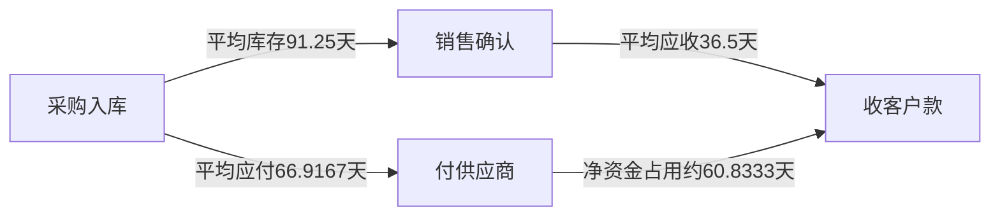

# 现金流、比率、盈利质量与分析边界

“净利润增长”“现金充足”“债务可控”是三个不同问题。分析师先写决策目的：贷不贷款、评估周转还是预测股东现金？再确认期间、币种、合并范围和会计政策，取报表、附注与经营证据，调整后比较，最后指出结论依赖哪些条件。比率把报表压缩成一个数，也把季节性、一次性交易和政策差异压掉了，因而需要回到原交易解释。

本课所有数例来自[[社会科学/50-CFA课程/10-三张财务报表权责发生与现金勾稽|澄河制造2026主账本]]，**不叠加11课调整**。金额万元，一年365天。全年全额销售500为赊销；采购300为赊购。年内分布暂按平稳处理，均值取期初期末算术平均。它是合成教学输入，不是同行行业标准。

## 1. 先给指标一个能复算的口径

| 原始量 | 本例数值 | 为什么这样取 |
|---|---:|---|
| 平均应收 | (40＋60)/2＝50 | 一年收入对应期间占用 |
| 平均存货 | (60＋80)/2＝70 | 销售成本对应期间库存 |
| 平均应付供应商 | (50＋60)/2＝55 | 不含债务与所得税 |
| 平均资产 | (400＋473)/2＝436.5 | 年利润对应期间资产 |
| 平均账面权益 | (200＋228.75)/2＝214.375 | 不拿市场股价作ROE分母 |
| 期末流动资产 | 113＋60＋80＝253 | 本例无其他流动资产 |
| 期末流动负债 | 60＋4.25＝64.25 | 有息债180全部在一年之后到期 |

“流动”依到期/经营周期分类，不是科目名称永远固定。若债务180中50在未来一年到期，流动负债应变114.25，不能继续沿用64.25。若存在存货减值或季节销售，须回看11课或月度均值。

## 2. 周转为什么最终变成现金转换周期

赊销使现金晚到，应收天数DSO估算这段等待；库存要先采购，存货天数DIO估算售前资金占用；供应商允许赊购，应付天数DPO抵消部分等待。近似的现金转换周期为

$$CCC=DSO+DIO-DPO.$$

本例 $DSO=365\times50/500=36.5$天；$DIO=365\times70/280=91.25$天；**用赊购额作分母** $DPO=365\times55/300=66.9167$天，故CCC＝60.8333天。DPO也常用COGS代理采购额，但本例库存增加，300不等于280；用COGS会得71.6964天、CCC56.0536天。两种口径都要明确，比较公司时不能混用。本例有完整采购，所以不需要代理。

图表示稳定条件下的平均周转近似，不是一张真实单笔付款日期表。CCC可为负：例如现金零售先收款、库存快周转而供应商账期长；不自动意味着可无限扩张。延长应付可能失去折扣或拖累供应链；加速应收可能以折价保理为代价。平稳周转假设失效时，以现金预算按月列真实收付。

## 3. 流动性、偿债和盈利相互补充

| 指标 | 算例 | 能回答与不能回答 |
|---|---:|---|
| 流动比率 | 253/64.25＝3.9377 | 流动资产对流动义务覆盖；不保证能按账面额及时变现 |
| 速动比率 | (113＋60)/64.25＝2.6926 | 排除本例存货；仍依应收可收性 |
| 现金比率 | 113/64.25＝1.7588 | 本例均非受限现金；未含未来资本开支 |
| 有息债务/账面权益 | 180/228.75＝0.7869 | 此处“债务”仅金融债180；若用全部负债需另命名 |
| EBIT利息保障 | 80/15＝5.3333倍 | 经营利润覆盖利息；不含偿还本金、现金税与再投资 |
| 毛利率 | 220/500＝44% | 产品成本与售价结果；受存货成本方法影响 |
| 净利率 | 48.75/500＝9.75% | 包含融资与税负；不能单独衡量经营效率 |
| ROA（本课NI口径） | 48.75/436.5＝11.1684% | NI相对平均总资产；不同NI/EBIT口径不能混比 |
| ROE | 48.75/214.375＝22.7405% | 账面股东资本回报；不等于投资者股价回报或资本成本 |

DuPont三项拆分不是额外假设，只是在分母非零时约掉相同量：

$$ROE=\frac{NI}{Sales}\times\frac{Sales}{\overline A}\times\frac{\overline A}{\overline E}
=9.75\%\times1.1455\times2.0362\approx22.7405\%.$$

它把净利率、资产周转、权益乘数的联系摆出来。债务上升通常改变利息与利润，不能固定前两项只增加第三项就宣称可提高ROE。权益为0时ROE无定义，权益负值时常规倍数解释失效；报告该事实，不能把负ROE当成可正常排名的收益率。

## 4. 从CFO接到自由现金流，先核对税与融资

本例经营营运资本只取 $NWC=AR+Inventory-AP$，排除现金、金融债和所得税余额：期初50，期末80，增加30。**按25%规范化税负、忽略当期税付款时差**的经营自由现金流为

$$FCFF_{norm}=EBIT(1-T)+Dep-Capex-\Delta NWC
=80\times0.75+40-60-30=10.$$

FCFF是融资前、可供债与股共同分配的经营现金流；折旧加回后仍要扣再投资。不要把利润80直接当作可分现金80。对应规范化股东现金流

$$FCFE_{norm}=NI+Dep-Capex-\Delta NWC+NetBorrowing
=48.75+40-60-30+30=28.75.$$

历史已付税12比费用16.25少4.25，因此**本年度实际现金口径**：$FCFE_{cash}=CFO-Capex+NetBorrowing=63-60+30=33$。若假设利息税盾3.75本期可立即利用，构造不含融资的本期税为 $12+15\times25\%=15.75$，则 $FCFF_{cash}=CFO+15(1-25\%)-60=14.25$。10与14.25相差4.25来自税款支付时差；28.75与33也是如此。这里税盾利用是条件，真实现金税应从附注和税规则推算，不能把现金税永远固定为 $EBIT\times T$。

本组估值与WACC若使用长期规范化经营预测，应使用一贯的税与NWC约定。历史FCFF14.25不等于未来每年14.25；未来借款30也不能无条件永续添加到FCFE。至[[社会科学/50-CFA课程/21-WACC资本结构分派与治理|资本成本与估值桥]]，看FCFF/WACC与FCFE/股权成本的配对以及现金集合。

## 5. 盈利质量与报表质量要分开判断

“盈利质量”关心经济结果是否可持续、能否转成现金；“报告质量”关心报表是否忠实提供决策所需信息。公司可能真实经历一次性高利润、报告很诚实但结果不可持续；也可能业务稳健而使用误导性披露。[CFA Institute 2026 Financial Reporting Quality](https://www.cfainstitute.org/insights/professional-learning/refresher-readings/2026/financial-reporting-quality)的公开内容支持这一区别及警示信号路线。本节检查表是分析提问，不能凭一个信号宣判舞弊。

澄河 $NI-CFO=-14.25$；以平均资产归一，简单应计指标为－3.2646%。它只说明这一年CFO高于NI，不证明未来现金优质。基线税款未付4.25、供应商余额增加10已把今年CFO托高；下一年付掉便可能反向影响。高CFO也可能来自削减必要库存或延迟付款。

对收入增长，应把客户、数量、单价、折扣、退货和期末应收连起来；对利润增长，拆成本方法、折旧寿命、资本化和一次性处置；对CFO，拆收付款时点、保理、供应商融资及分类；对调整后利润，逐项对照GAAP/IFRS利润、现金、持续性和管理层选择。审计提供特定范围合理保证，不能被写成“未来预测已经保证”。

11课的FIFO→平均情景，现金未变但利润与库存下降，ROE和周转都会改变；税折旧情景NI未变却出现DTL；租赁情景CFO53、CFF－40，若把本金50重新列经营则CFO3、CFF10、总现金仍53。后者只是为比较“全部租赁支付出现金”重分类的工作底稿，不能说IFRS报告应如此列。分析师若只比较CFO会把分类差异当经济优势。

## 6. 三道情景题和答案

**题1：** 澄河年末供应商同意把10应付延到明年支付，原利润不变。财务主管说CFO增加10证明毛利提高，哪里错？**解：** 只是付款晚了，CFO与现金各增10、应付增10；毛利仍220。要核对供应商期限、折扣和持续性。应付升高也不能单独证明违约。

**题2：** 将债务180中的50改为一年内到期，速动比率是多少？**解：** $173/114.25=1.5142$。资产、利润、总负债和权益不变；短期义务压力上升。把负债期限变化当新增负债会重复记录。

**题3：** 两份分析分别报告FCFE28.75与33，谁一定算错？**解：** 都未必。前者按完整费用税负规范化，后者沿真实已付税；必须交代4.25当前税支付差和未来付款，不应在同一估值预测内随机切换。本例已付股利20小于两者，但可分派能力还受契约与现金预算约束。

将资金占用和盈利解释用于[[社会科学/50-CFA课程/20-资本预算增量现金流与项目选择|资本预算]]，在项目预测里列出真实增量营运资本；同源源码见[[社会科学/50-CFA课程/80-三表与资本预算复算|复算实验]]。

年度指针：[2026一级纲要](https://www.cfainstitute.org/sites/default/files/docs/programs/cfa-program/2026-l1-topics-combined.pdf)及[2027一级纲要](https://www.cfainstitute.org/sites/default/files/2027levelitopicoutline_online.pdf)显示页10（Working Capital and Liquidity）、12–14（现金流II、Financial Reporting Quality、Financial Analysis Techniques）。本课没有完成全行业比率、财报预测、非GAAP调整规则、真实公司尽调或二级vignette能力验收；官方模块名用于导航，未声称全LOS覆盖。
