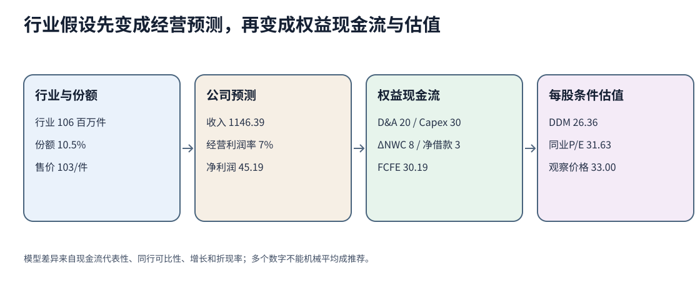

# 权益市场与估值：从一笔交易走到一份条件价值

同一只股票可以同时出现在盘口、指数、公司报表和估值模型里，但四个数字回答不同问题：成交价说明某笔交易在哪里完成，指数说明一组证券按什么规则聚合，报表预测说明公司可能产生什么利润与现金流，估值说明在给定现金流和折现假设下得到什么条件价值。本组把它们接成一条可复算的链，避免看到“股价33”就跳过中间口径。

> [!info] 用途边界
> 全部公司、报价和行业数字都是原创合成资料，金额默认是百万元本币，股数是百万股，每股量另行标明。本组不接实时行情，不推荐证券，不替代正式CFA课程、官方题库、当地证券规则、会计审计或适合性判断。

## 从读者问题进入

| 读者问题 | 去哪里读 | 得到什么 |
|---|---|---|
| 普通股、优先股、公开与私人股权的现金权利为何不同？一笔市场买单实际付出什么？ | [[社会科学/50-CFA课程/20-权益市场与估值/01-权益工具市场组织订单与交易成本\|权益工具、订单与成本]] | 区分工具权利、一级/二级市场、市场结构、市场单/限价单和显隐交易成本 |
| 三只股票都涨跌同样幅度，为什么指数回报不同？拆股为何不能制造指数收益？ | [[社会科学/50-CFA课程/20-权益市场与估值/02-指数加权除数与回报口径\|指数加权、除数与回报]] | 手算价格加权、等权、市值加权、价格/总回报及拆股除数调整 |
| 市场有效是否表示价格永远正确？模型价值高于价格能否直接买入？ | [[社会科学/50-CFA课程/20-权益市场与估值/03-市场效率与投资结论边界\|效率与结论边界]] | 把信息集、预期收益模型、交易成本、主动/被动选择与异常证据分开 |
| 行业增长、份额、价格和利润率怎样进入公司预测及FCFE？ | [[社会科学/50-CFA课程/20-权益市场与估值/04-行业公司分析预测与权益现金流\|行业、公司、预测与权益现金流]] | 从行业边界和竞争机制走到收入、净利润、再投资与FCFE |
| DDM和可比倍数为什么会给出不同价值？何时不能用？ | [[社会科学/50-CFA课程/20-权益市场与估值/05-DDM相对估值与模型失效\|DDM、相对估值与失效条件]] | 固定时点、分子/分母、同行和增长假设，比较条件价值而不机械平均 |
| 想逐项复算全部数字、改输入并检查错误条件 | [[社会科学/50-CFA课程/20-权益市场与估值/90-权益市场与估值复算\|复算与源码镜像]] | 标准库实验、独立oracle、三张同源SVG及完整数值答案 |

## 与已有主解释的分工

- [[社会科学/30-金融市场与风险/03-股票所有权现金流与估值|股票所有权、现金流与估值]]已经承担账面权益/市场价值、经营价值桥、现金一次计入、Gordon式来源和稀释的主解释；本组只把这些工具用于一级权益分析链。
- [[社会科学/30-金融市场与风险/05-有效市场信息价格与异常|有效市场、信息、价格与异常]]已经承担Fama联合检验、信息成本和异常审计的主解释；03页只回答这些命题怎样限制投资结论。
- [[社会科学/50-CFA课程/10-公司与收入分析/03-ROIC再投资增长与价值判断|ROIC、再投资与增长]]承担ROIC/ROIIC主解释；04页只检查预测资本需求是否与增长一致。
- [[社会科学/50-CFA课程/61-公司估值多信息案例与模型选择|二级公司估值案例]]承担FCFF、复杂股权桥、剩余收益和二级模型选择；本组不平行复制。

## 同一数值链

合成公司“星桥设备”拆股后有20百万股，观察价33/股。盘口bid/ask为32.90/33.10；买1,000股的市场单在33.10成交并付佣金20。星桥同时与河谷、远岚构成三股指数：星桥先做2拆1，再与另外两股分别取得+10%、−10%、+10%的价格回报，因此价格加权、等权和市值加权指数得到不同结果。

公司预测从行业106百万件、份额10.5%、均价103出发，得到收入1,146.39；按题设7%经营利润率、利息20、25%税率得到净利润45.185475。扣除再投资并加入净借款后，FCFE为30.185475，即1.509274/股。估值页分别使用两阶段DDM、规范化前瞻P/E和P/S；它们给出26.36、31.63和31.53/股，而观察价格是33。差异是模型输入与适用性问题，不是自动交易指令。

## 2026与2027公开模块怎样对应

2026 Level I公开纲要在显示页14–16将权益主题列为`Market Organization and Structure`、`Security Market Indexes`、`Market Efficiency`、`Overview of Equity Securities`、公司/行业/预测三模块及`Equity Valuation: Concepts and Basic Tools`。本组01–05依次落到这些尚欠部分。

2027 Level I在显示页14–16改称`Equities`并重组为`Equity Instrument Features`、`Equity Jurisdictions, Classes, and the Voting Process`、`Equity Issuance and Trading`、`Sources of Equity Returns`、DCF/相对估值、报表预测、行业/公司分析和研究报告等模块。2027公开表没有按2026原名称单列`Market Efficiency`，也只在发行交易模块明确“描述权益指数类型”，不能据此声称两年模块逐项相同。本组记录的是公开定位和一条原创学习链，不是全LOS逐条签收。

## 阅读完成后应能检查什么

1. 给定bid/ask、成交价、佣金和决策价，分别算点差成本与decision shortfall，并说明限价单的未成交风险。
2. 对同一三股样本手算三种加权回报，遇拆股先调除数；明确价格回报和总回报的分红差。
3. 面对“价值高于价格”，先列现金流、增长、折现率、同行、信息时点和交易成本，而不是直接下买卖结论。
4. 把行业规模、份额、量价、利润率、营运资本和资本支出写成可检查预测；改变竞争条件后重算。
5. 说明DDM、FCFE、P/E、P/S和资产基础法各自需要什么输入、何时会失效。
