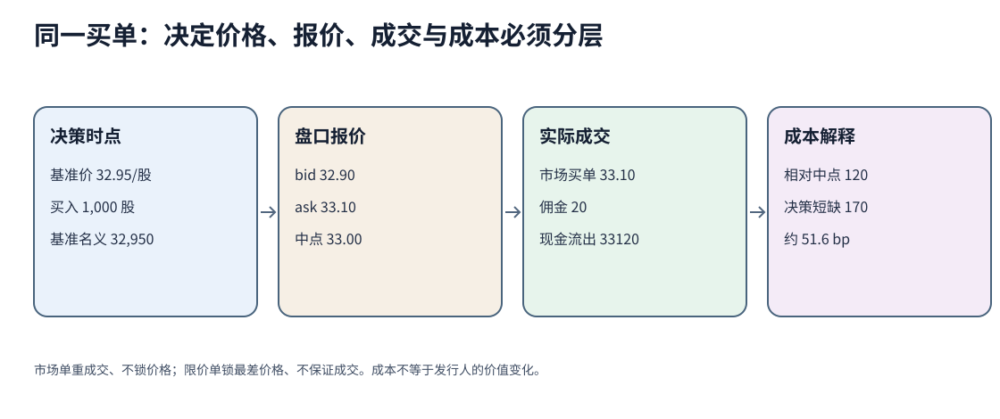

# 权益工具、市场组织、订单与交易成本

公司发行一股、投资者买入一股、经纪商执行一笔订单是三件事。权益工具决定所有权和现金权利；一级市场把新资本交给发行人；二级市场让现有持有人交易。二级成交价影响融资条件和财富，却不会让每次交易款都流入公司。

## 1. 先辨认工具所承诺的权利

| 工具/状态 | 典型权利 | 不能据名称直接推断 |
|---|---|---|
| 普通股 | 剩余索取、可能的表决权、董事会决定后的股息 | 固定股息、一定清算回收、每股同票权 |
| 优先股 | 分派或清算通常优先于普通股；可有累积、参与、赎回或转换条款 | 等同债券、永远固定现金、没有权益风险 |
| 不同普通股类别 | 经济权与投票权可不相同 | 价格相同、控制权相同 |
| 私人股权 | 股份转让和公开报价通常较少，协议权利重要 | 没有专业投资者、一定缺治理 |
| 公开上市股权 | 可进入公开交易场所并受相应披露/市场规则约束 | 高流动性、价格无偏或没有控制股东 |
| 存托凭证 | 本地交易的凭证代表外国发行人的经济权益 | 消除汇率、托管、法域和基础股份风险 |

股权为公司资产融资，但会计ROE、股权资本成本和投资者要求回报不是一个量。ROE用会计净利润除账面权益；股权资本成本是前瞻机会成本；投资者实现回报还取决于买入价格、卖出价格和分派。已有[[社会科学/50-CFA课程/10-公司与收入分析/03-ROIC再投资增长与价值判断|ROIC主解释]]说明“高历史回报不证明新增投资创造价值”，本页不重复推导。

## 2. 一级与二级、三种成交组织

- **一级市场**处理新证券发行，发行所得按条款进入发行人；承销、配售或竞价方式依市场和法域而异。
- **二级市场**让已发行证券转手。流动的二级市场可能降低投资者退出摩擦并支持一级融资，但不能保证任何时点有足够深度。
- **订单驱动市场**把买卖订单按规则匹配；**报价驱动市场**由交易商报出愿买愿卖价格并以自身库存承接；**经纪市场**由经纪人寻找交易对手。现实市场可以混合这些机制。

交易所、场外、做市商、经纪商和清算结算分别处理挂牌规则、撮合/报价、寻找对手、持有库存以及最终交割。把“下单成功”当“已经成交并结算”会漏掉拒单、部分成交、撤单、结算和对手风险。

## 3. 市场单与限价单交换了什么

SEC Investor.gov的公开说明把市场单描述为要求立即买卖但不保证成交价，把限价买单描述为只在限价或更低价格成交，却不保证成交。本例盘口为：

| bid | ask | 中点 |
|---:|---:|---:|
| 32.90/股 | 33.10/股 | 33.00/股 |

投资者决定买1,000股时的基准价为32.95，市场买单在33.10成交，佣金20。现金流出为：

$$
33.10\times1{,}000+20=33{,}120.
$$

报价点差是：

$$
33.10-32.90=0.20\text{／股}.
$$

买方相对中点多付0.10/股，即100；连佣金的中点成本为120。常见的每股有效点差是往返尺度：

$$
2(33.10-33.00)=0.20\text{／股}.
$$

从32.95的决策价量到实际成交并计佣金，decision shortfall为：

$$
(33.10-32.95)\times1{,}000+20=170,
$$

相对决策名义32,950约为51.6bp。三个成本量的基准不同，不能混称“点差”。若挂33.00的限价买单，最高买价被限制，却可能完全不成交；市场随后上涨时，未成交的机会成本不能从已成交样本里消失。

## 4. 显性和隐性成本怎样改变结论

显性成本包括佣金、费用和税；隐性成本包括买卖价差、冲击、延迟和未成交机会成本。大订单可能吃掉多档报价，平均成交价不等于屏幕最佳ask。经纪人的执行地点、订单规模、速度和价格改善都可能影响总成本。

交易成本影响策略净回报，却不直接改变公司经营现金流。估值为35、盘口33也不表示存在2/股无风险利润：模型误差、信息更新、成交冲击、持有期、借券/融资和退出成本都在两者之间。

## 5. 完整答案与改变条件

**题1。** 若1,000股全部在33.25成交，其他不变，决策短缺是多少？

**答。** $(33.25-32.95)\times1,000+20=320$。成交价相对ask又恶化0.15/股，可能是盘口深度不足或价格移动；仅看佣金20会严重低估实施成本。

**题2。** 33.00限价买单一定优于33.10市场单吗？

**答。** 不能。限价单若成交，价格不高于33.00，但没有成交保证；若信息到来后价格跳至35，等待的机会成本可能超过节省的0.10/股。比较要同时固定成交概率、时间要求和未成交后续规则。

**题3。** 公司在二级市场有1,000股以33.10成交，公司现金增加33,100吗？

**答。** 通常不会。这是旧股东与新买方的二级转让；只有公司作为发行人出售新股或库存股等具体交易时，资金才按相应条款进入公司。

## 来源定位与未覆盖

CFA Institute 2026 `Market Organization and Structure`公开页的Introduction、LOS与Summary用于金融中介、订单、一级/二级和订单驱动/报价驱动/经纪市场定位；`Overview of Equity Securities`用于普通/优先、公开/私人、存托凭证和融资角色。Investor.gov `Types of Orders`与`Executing an Order`用于市场单价格不保证、限价单成交不保证和执行地点影响成本的公开说明。公式和数字是本课合成推演。

未覆盖保证金追缴完整计算、卖空借券、全部指令、具体交易所优先规则、结算周期、做市义务、最佳执行法律测试和真实订单簿。不同法域和经纪商规则须查当期正式文本。

