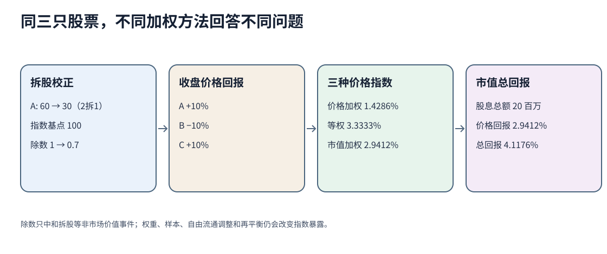

# 指数加权、除数与回报口径

指数不是“市场本身”，而是对目标市场、样本、权重、公司行动和维护规则的一套计算。相同三只股票可以给出不同指数回报，因为每种方法在回答不同的聚合问题。

## 1. 固定样本、时点和拆股后的可比价格

起点价格和股份如下；股份单位为百万股。星桥发生2拆1，拆股前60变为参考价30，股份10变为20。拆股本身没有改变总市值600。

| 公司 | 起点价格 | 起点股份 | 拆股因子 | 拆股后参考价 | 收盘价 | 每股股息 | 收盘股份 |
|---|---:|---:|---:|---:|---:|---:|---:|
| 星桥A | 60 | 10 | 2 | 30 | 33 | 0.50 | 20 |
| 河谷B | 30 | 20 | 1 | 30 | 27 | 0 | 20 |
| 远岚C | 10 | 50 | 1 | 10 | 11 | 0.20 | 50 |

拆股后至收盘的价格回报分别为+10%、−10%、+10%。总回报还包括股息：A为11.6667%，B为−10%，C为12%。

## 2. 价格加权指数先处理除数

设起点指数为100，拆股前价格和为100，故起点除数$d_0=1$。拆股后价格和变成70；若仍除以1，指数会无经济理由从100跌到70。令新除数$d_1$保持事件前后指数连续：

$$
\frac{30+30+10}{d_1}=100
\quad\Rightarrow\quad
d_1=0.7.
$$

收盘价格加权指数及回报为：

$$
I_1=\frac{33+27+11}{0.7}=101.428571,
$$

$$
R_{price\ weighted}=\frac{101.428571}{100}-1=1.428571\%.
$$

除数调整中和拆股造成的机械价格变化，不中和真实价格涨跌。价格较高的股票权重更大，但价格高不等于公司经济规模更大；拆股还会改变其表面权重，因此这种指数的经济解释有限。

## 3. 等权指数把每只股票放在相同起点权重

等权价格回报是个股价格回报的算术平均：

$$
R_{equal,price}
=\frac{10\%-10\%+10\%}{3}
=3.333333\%.
$$

等权总回报为：

$$
R_{equal,total}
=\frac{11.666667\%-10\%+12\%}{3}
=4.555556\%.
$$

价格变化后权重会漂移；要维持等权，需要定期卖出相对上涨者、买入相对下跌者。计算中的“定期再平衡”会产生换手和实施成本，真实产品净回报不能忽略这些成本。

## 4. 市值加权先明确股份集合

拆股前总市值为：

$$
60\times10+30\times20+10\times50=1{,}700.
$$

收盘总市值为：

$$
33\times20+27\times20+11\times50=1{,}750.
$$

故市值加权价格回报为：

$$
R_{cap,price}=\frac{1{,}750}{1{,}700}-1=2.941176\%.
$$

分红总额为$0.5\times20+0\times20+0.2\times50=20$，假设分红在期间末计入并再投资的单期总回报为：

$$
R_{cap,total}=\frac{1{,}750+20}{1{,}700}-1=4.117647\%.
$$

现实市值指数可能使用自由流通市值、封顶权重和外资可投资比例。本例用总发行股份；不能把2.941176%称为某真实指数回报。

## 5. 指数用途决定“合适”是什么意思

| 用途 | 必须检查的指数属性 |
|---|---|
| 描述目标市场 | 样本是否覆盖目标地区、规模、行业和可投资证券 |
| 业绩基准 | 风险暴露、币种、再投资、税前/税后和可实施性是否匹配 |
| 资产配置代理 | 是否代表可投资集合，历史序列是否有回填和分类变化 |
| 指数产品 | 跟踪方法、费用、换手、流动性和再平衡冲击 |

**再平衡**恢复目标权重，**再构成**改变成分以继续代表目标市场。两者都可能制造交易。指数纳入导致的成交需求不是发行人经营价值自动改变；指数上涨也可能由少数大权重公司驱动。

## 6. 完整答案与反例

**题1。** 若不改除数，拆股瞬间价格加权指数会怎样？

**答。** 从100机械跌至70，即−30%；公司价值并未变化。这是指数维护错误，不是市场亏损。

**题2。** 三股中两只涨10%、一只跌10%，为什么市值加权只有2.9412%，不是3.3333%？

**答。** 下跌的B起点权重$600/1700$，与上涨A同权；上涨C权重$500/1700$较低，净贡献为$(600-600+500)\times10\%/1700=2.9412\%$。等权才给每只1/3。

**题3。** 一个指数价格回报3%，投资者就一定赚3%吗？

**答。** 不能。还要看股息是否计入、产品费用、跟踪误差、税、交易时点和投资者现金流。价格指数尤其会漏掉分派。

## 来源定位与年度边界

CFA Institute 2026 `Security Market Indexes`公开页的LOS及Summary明确价格/总回报、权重方法、再平衡、再构成和用途。本页只完整复算三种股票权重和单一拆股调整；固定收益、商品、另类指数、基本面加权、浮动调整和真实指数规则未覆盖。

2026 Level I纲要显示页14–15明确列完整`Security Market Indexes`模块；2027 Level I `Equity Issuance and Trading`公开要求只写“描述权益指数类型”。这项年度变化需要保留，不能以本页的2026计算范围替代2027全部课程要求。

