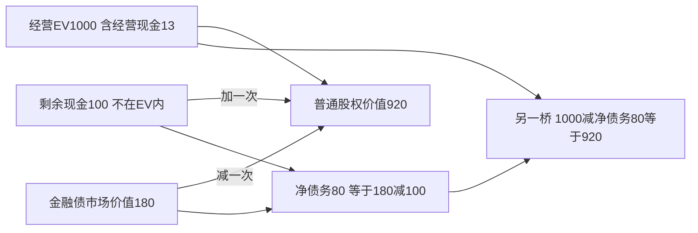

# WACC、资本结构、分派与治理

澄河制造的新生产线需要155万元资源投入，而历史年末现金113。贷款利率低于股东要求回报，是否借越多越好？先确认资金对象、风险和税盾，再看债务怎样改变股东风险、支付约束和各方激励。资本结构、分派与治理共同决定资金能否按既定计划使用，但都不能替代项目本身的经营现金。

本课承接[[社会科学/50-CFA课程/10-三张财务报表权责发生与现金勾稽|2026历史主账本]]及[[社会科学/50-CFA课程/20-资本预算增量现金流与项目选择|未来三年新增项目]]。金额万元，资本成本年有效名义率；实际借款与分派除历史已给交易外，均为另行教学情景。所有税、契约与市场估值是显式输入，不是对真实公司的投资建议。

## 1. 先让现金流与索取权配对

融资前经营自由现金流FCFF属于债和股共同资金提供者，用匹配的综合资本成本贴现，得到相应经营资产价值；股东自由现金流FCFE已扣债的利息与还本、加净借款，用股权成本贴现。债本身应按债合同现金与风险估值。不能把FCFE用WACC贴现，或把扣过利息的经营现金再减一遍债。

本例10课经营现金分类包括利息，12课已把它接到规范化FCFF10与实际现金FCFF14.25。估值需要未来多期经营预测，本课直接**给定经营EV1000**来检查桥接，绝不从一年FCFF10直接宣称公司值1000。

历史现金113划分为：经营必需现金13，已包含在经营EV1000；可分離剩余现金100，未进入经营现金预测和EV。两者互斥、合为113。金融债账面180在本题恰等于市场180，无优先股、少数股权、养老金索取权或租赁叠加情景。两种合法桥：

$$E=EV_{op}+C_{surplus}-D=1000+100-180=920,$$

$$E=EV_{op}-(D-C_{surplus})=1000-(180-100)=920.$$

若现金已经在净债务扣除了，又在EV旁加100，便会得1020，重复100。若把经营现金13再加一遍，便会得933。真实现金若受限、不可跨境取用或有分配税，应按可归属于股东的净价值处理；不能先减全部现金、又额外加“非经营现金”。关于通用估值主解释，去[[社会科学/30-金融市场与风险/03-股票所有权现金流与估值|股票所有权与估值]]阅读每股索取权及终值约束；本课仅提供明示现金集合的公司财务应用。

## 2. WACC的每一项都需要条件

只含债和普通股时：

$$WACC=w_Er_E+w_Dr_D(1-T),\quad w_E=\frac{E}{E+D},\quad w_D=\frac{D}{E+D}.$$

权重无量纲、和为1；$r_E,r_D,T$都以小数代入。$E,D$应是适用的市场价值/目标市场权重，$r_D$为当前新增或机会融资成本，$r_E$为同风险股权要求回报，不是历史ROE或股息率。账面E228.75与债180不能未经理由拿来替920与180。[CFA Institute 2026 Capital Structure](https://www.cfainstitute.org/insights/professional-learning/refresher-readings/2026/capital-structure)支持WACC、MM命题和目标资本结构的课程定位。

沿当前市场桥，股权920、债180，若股权成本12%、债成本6%、税率25%且利息扣除能当期充分利用，

$$WACC_{current}=(920\times0.12+180\times0.06\times0.75)/1100=10.7727\%.$$

若未来同风险项目计划维持**目标市场权重**E60%、D40%，在此目标杠杆下另估得股权成本12%、债成本6%，则 $WACC_{target}=0.6\times12\%+0.4\times6\%\times0.75=9\%$。两个例子的12%是分别给定的风险估计，不能据此认为变杠杆时股权成本天然不变。20课项目10%是单独题设；若论证同币种、税、经营风险及稳定目标权重适配9%，应重新用9%算项目NPV，不悄悄把旧10%标成9%。

现金流税后且税盾已含于WACC时，不能再把同一利息税盾现金流加进FCFF。若公司亏损、利息扣除上限、税率不同、债率浮动或税盾延迟，应按实际可用时点估值；$1-T$不是无条件折扣。若税盾完全不能用，上述60/40目标WACC变9.6%。有优先股时需加对应权重与成本，分母扩大；其分派不能照抄债的税盾因子。

公司整体WACC用于同风险、相似资本政策的平均项目。澄河若投高风险海外试验技术，经营风险、币种与融资结构变了，要重新评项目要求回报；低风险贷款利率并不能替高风险股权项目贴现率。

## 3. MM命题为什么不等于“债越多越好”

无公司税、无交易/破产成本、信息和融资条件满足理想市场设定时，MM I说同经营资产风险的公司总价值与融资划分无关。股东风险随杠杆增：简化MM II为

$$r_E=r_U+\frac{D}{E}(r_U-r_D).$$

取无杠杆经营要求回报 $r_U=10\%$、债成本6%、$D/E=2/3$，则股权成本12.6667%，股权权重60%、债40%，$WACC=0.6\times12.6667\%+0.4\times6\%=10\%$。便宜的债占比上升伴随剩余股权风险升高，平均成本未下降。若错误固定股权成本10%，会得到8.4%，违背本模型前提。

在只引入公司税、其他理想条件保持、永久固定债务100、税率25%、利息税盾每期充分可用且税盾风险适用该简化折现下，$PV(TaxShield)=TD=25$，$V_L=V_U+25$。这不是所有债务政策下的通式；若债随价值重平衡或税盾风险不同，需重新按期估值。加入困境成本、代理成本、发行摩擦和信息不对称，税盾收益可能被抵消。

给定无杠杆价值1000，以下是**原创假设**的税盾/预期困境价值对比，不是经验拟合：

| 固定债务方案 | 税盾现值（充分利用） | 预期困境等成本现值 | 总价值 |
|---|---:|---:|---:|
| D0 | 0 | 0 | 1000 |
| D100 | 25 | 5 | 1020 |
| D300 | 75 | 100 | 975 |

方案D100在给定三方案中价值最高；不能据三个数宣称所有公司最优债100。还要看行业现金稳定性、抵押资产、债期限、再融资窗口和弹性。模型只纳入公司税，不同时宣称个人税、员工和客户成本已全部算完。

## 4. 分派怎样改变账本，回购怎样改变每股量

历史NI48.75、已付股利20，留存增加28.75。历史实际FCFE33，股利20后的剩余13恰是现金净增加；这只是本组完整交易下的勾稽，不等于净利润全可分，也不等于融资借款30都是永久股东收益。项目未来初始支出155与经营必需现金13提醒董事会，还要做融资计划、到期预算与契约审查。

**追加股利的独立会计情景：** 在主账本期末再宣告且立刻付20，现金93、RE48.75、权益208.75，总资产453、总负债244.25不变。公司资源与权益各减20；EPS分母不变。市场股权价值若其他条件相同且无税/信息/交易摩擦，分派后由920变900，股东收到现金20，总财富仍920。实际价格反应需另外分析。

**回购的独立市场情景：** 假设股份100万股、每股9.2元，与市场E920万元一致；剩余现金按公允价回购20万元，回购约2.173913万股，剩余97.826087万股，股权价值900万元，每股仍9.2元。在下一年NI假定仍48.75且回购年初完成时，EPS由0.4875元升至约0.4983元。现金20不再赚利息、融资风险或NI可能变，因此“回购必然提高经济价值”不成立；本例冻结NI只隔离分母效应，不能给真实预测。

股利、回购和偿债在税、控制权、流动性、信息与债契约上有差异；法律可分派利润与偿债测试依所在地规则，未指定法域就不下统一合法性结论。管理层掌握估值信息可能影响回购公平性，预算委员会应核对项目机会成本而非只追EPS。

## 5. 治理冲突用现金分配看清

委托人授权代理人管理资源，代理人目标可能不同；控股股东、少数股东、债权人、员工、供应商亦有不同索取权与信息。[CFA Institute 2026 Corporate Governance: Conflicts, Mechanisms, Risks, and Benefits](https://www.cfainstitute.org/insights/professional-learning/refresher-readings/2026/corporate-governance-conflicts-mechanisms-risks-and-benefits)公开介绍提供这些冲突与治理机制的课程定位。下列判断是合成经济案例，职业标准适用另读本目录伦理课程。

**管理层扩张：** 一个项目NPV－5，但让经理个人职位福利现值＋8。公司/股东承担－5，经理有动力通过夸大收入争取扩建。用独立预算审查、真实收入审计与长期风险调整激励减轻冲突；奖金只挂营业收入可能强化问题。独立董事也需足够信息、能力和执行权，存在并不自动消除冲突。

**股东向债权人转移风险：** 一年后到期债面值80。安全资产确定值100，债得80、股得20，总值100。改成风险项目，50%资产160、50%资产20；期望资产90下降10，债期望 $0.5\times80+0.5\times20=50$，股期望 $0.5\times80+0=40$。股东期望收益加20，债权人减30，总价值减10。这里未贴现且概率给定，不能据期望数完成风险价格估值；但逐状态支付明确展示转移机制。债契约限制资产替换/分派、监控和担保可缓解，也可能妨碍好项目。

**控股股东关联交易：** 澄河控股股东持60%，强推公司向自己全资供应商支付超公允价10。上市公司失10，其中控股方承担6、少数股东承担4；供应商收到10归控股方，控股方净赚4、少数净失4，假设无其他税费。公司价值被移出、控制人财富增加。要求披露关联关系、无利益关系董事审议、独立定价/回避表决并保护少数股东；这些是治理机制建议，具体法律程序须另查法域。

经济NPV正也不能据此许可违反安全、环境、劳动或披露义务。把已识别的真实义务成本放入现金与约束，再检验方案；不能以“其他利益相关方不好量化”为由默认0。

## 6. 练习与答案

**题1：** EV1000含经营现金13，总现金113、债180，合法股权桥是什么？**解：** 明确剩余现金100，$1000+100-180=920$；或 $1000-(180-100)=920$。加113会重复13；用净债80又加100会重复100。

**题2：** 目标E60%/D40%、rE12%、rD6%，税盾不可利用，该怎么改？**解：** 税后债成本因子不能机械取0.75，当前设定WACC9.6%；税盾延后而非永不可用时，要按实际时点另估，不能套同一个9.6%作精确答案。

**题3：** EPS升高能否证明回购创造价值？**解：** 公允价20回购的冻结NI例，股份减少令EPS升，但分派后的价值900除剩余股份仍9.2元。判断要看买价、替代投资、现金收益与风险，非只看分母。

**题4：** 风险替换使股东期望剩余从20变40，总资产期望从100变90，谁承担损失？**解：** 债从80变50损30，股增20，合计净损10。限于给定概率与未贴现支付；不以未贴现期望冒充市场定价。

数例源代码及非法输入测试见[[社会科学/50-CFA课程/80-三表与资本预算复算|复算实验]]。年度导航：[2026一级纲要](https://www.cfainstitute.org/sites/default/files/docs/programs/cfa-program/2026-l1-topics-combined.pdf)与[2027一级纲要](https://www.cfainstitute.org/sites/default/files/2027levelitopicoutline_online.pdf)显示页9–10的Governance、Capital Investments、Capital Structure。分派/回购例是通向后续公司与股权分析的教学延伸，不因此声称一级公司主题、二级分派政策、MM全部条件证明或全LOS已验收。
