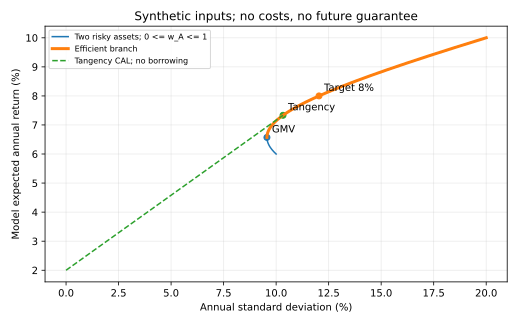

# 有效前沿：配置约束与行为偏差

低风险组合不一定满足回报目标，高预期回报组合也不一定允许买。本课从已知的组合方差走到一个完整但有限的决策模型：先写可行集合，再比较均值和方差，最后解释为何人的目标与行为会改变执行。全部数是合成年度参数，不是现实资产或投资建议。

## 1. 同一参数与一个决策变量

沿用[[社会科学/30-金融市场与风险/04-组合分散风险因子与CAPM边界#2. 一个可复算的两资产例子|两资产协方差算例]]的波动与相关，新增年度模型均值$\mu_A=10\%,\mu_B=6\%$。$\sigma_A=20\%,\sigma_B=10\%,\rho=0.2$给协方差0.004。回报用小数，方差单位为年度回报平方，矩阵为
$$\mu=\begin{pmatrix}0.10\\0.06\end{pmatrix},\quad\Sigma=\begin{pmatrix}0.04&0.004\\0.004&0.01\end{pmatrix}.$$
矩阵对称且行列式0.000384>0，正定。先只投资两风险资产、不借款、不卖空，$w=w_A\in[0,1],w_B=1-w$。则
$$\mu_p(w)=0.06+0.04w,\qquad v(w)=0.042w^2-0.012w+0.01.$$
这由先修页的$w^T\Sigma w$展开，不把协方差证明复制一遍。均值严格随$w$增加；方差是一条凸二次曲线。

## 2. 最低方差不是所有人都最合适

导数$v'(w)=0.084w-0.012$，零点$w_{GMV}=1/7$，二阶导数0.084>0，因此全局最低方差组合为A约14.2857%、B约85.7143%。其均值6.571429%、标准差9.561829%。完成平方可直接核对：
$$v(w)=0.042(w-1/7)^2+0.009142857\ldots.$$

| A权重 | 模型期望回报 | 模型标准差 | 比较 |
| ---: | ---: | ---: | --- |
| 0% | 6.0000% | 10.0000% | 被GMV支配 |
| 14.2857% | 6.5714% | 9.5618% | GMV |
| 33.3333% | 7.3333% | 10.3280% | 该参数下切点 |
| 50% | 8.0000% | 12.0416% | 8%目标约束解 |
| 60% | 8.4000% | 13.3866% | A上限端点 |
| 100% | 10.0000% | 20.0000% | 高回报高波动 |

$w<1/7$时提高A权重直到GMV能同时提高均值、降低方差，所以这一段不有效。$w\ge1/7$时均值和方差一起增加，任何一个权重都不能同时被另一个权重改善；这段是本可行集合的**有效前沿**。这里仅两资产且均值有序，不能把“GMV右边都有效”的图形方向直接套到任意资产集。

图显示合成参数与无费用条件。整条蓝线是两风险资产机会集合，加粗部分是有效分支；从无风险资产出发的虚线需要下一节的额外条件。图的数值来自同一源码，不能由曲线漂亮推断未来参数稳定。

## 3. CAL需要真正匹配期间的无风险资产

再假设可以按年度无风险有效利率$r_f=2\%$贷出，且同一币种、同一期间、确定名义支付；不讨论信用、通胀或期限错配。风险组合$P$的权重为$y$，无风险权重$1-y$，无借款时$y\in[0,1]$。因为无风险项方差与协方差为0，
$$E[R_c]=r_f+y(\mu_P-r_f),\quad\sigma_c=y\sigma_P.$$
消去$y$得到资本配置线CAL，斜率为$(\mu_P-r_f)/\sigma_P$，即该参数下Sharpe比率。CAL是选定风险组合的线；只有在均衡市场组合等额外条件下的特定CAL才称CML，不能把任意两资产切点叫整个市场。

在无卖空的本例，最大Sharpe的切点方向为$\Sigma^{-1}(\mu-r_f\mathbf1)$，归一化得$(1/3,2/3)$。可直接核对：该方向未归一化的比例为$(0.00064,0.00128)$。切点均值7.333333%、方差0.010666667、标准差10.327956%、Sharpe约0.516398。令$e=\mu-r_f\mathbf1$，由Cauchy–Schwarz，$(w^Te)^2\le(w^T\Sigma w)(e^T\Sigma^{-1}e)$；这是把$\Sigma^{1/2}w$与$\Sigma^{-1/2}e$作内积得到的。正超额回报方向的Sharpe上界因此在$w\propto\Sigma^{-1}e$达到。本例归一化权重均为正，所以确实在无卖空集合内可达。方向式需矩阵可逆、最大值可达，且最终权重满足约束；有融资或资产上限时不能直接照搬。

若模型效用为$U=E[R_c]-\gamma\operatorname{Var}(R_c)/2$，$\gamma>0$表示风险厌恶参数，在此财富/年度小数回报约定中是固定模型系数。对固定$P$，最优$y^*=(\mu_P-r_f)/(\gamma\sigma_P^2)$再截断到[0,1]。取$\gamma=10$得$y^*=0.5$，最终A1/6、B1/3、无风险1/2，均值4.666667%、标准差5.163978%。这只是给定二次效用的解，不能据问卷标签估出真实$\gamma$。

反例：想在该切点CAL上达到8%，需$y=(0.08-0.02)/(0.073333-0.02)=1.125$，违反无借款。两风险资产50/50却能达到8%，所以“选择切点后沿线配置”不能在借款受限、硬回报目标下替代重新优化全部可行组合。若借贷利率不同，CAL在借入段斜率改变，也不再是一条同利率直线。

## 4. 把目标与约束写成可检查条件

构造客户政策：全部资金用于这两资产、禁止卖空、A上限60%、模型期望回报至少8%，目标在可行集合内最小化方差。于是$w\in[0,0.6]$且$0.06+0.04w\ge0.08$，得到$w\in[0.5,0.6]$。该区间超过GMV点，方差递增，最优$w=0.5$，标准差12.041595%。把目标升至8.5%要求$w\ge0.625$，可行集合为空，应报告**不可行**，不能暗中放宽A上限或卖空来输出“最优”。

写IPS有助于把目标与约束稳定下来；风险承担意愿和财务承受能力需要分别了解。近期必须支付的资金、负债期限、税、法律监管与特殊要求会改变资产及权重集合。[CFA Institute 2026 Basics of Portfolio Planning and Construction，LOS与Introduction](https://www.cfainstitute.org/insights/professional-learning/refresher-readings/2026/basics-of-portfolio-planning-and-construction)。例如半年内需支付20万元而只有这两项波动资产，年度均值8%不能证明支付能力；需另设可支配流动资金与期限条件。本例未指定真实税法或客户情况，不将模拟政策当真实IPS。

参数也不是政策事实。若危机相关升至1，50/50标准差变为15%，原“标准差最多13%”的风险约束便失效；若均值估计误差大，优化会放大输入误差。应分别做估计区间与压力情景，不能将点估计的最优权重宣称稳定最优。

## 5. 行为偏差要靠条件识别

认知错误主要涉及推理或信息处理，情绪偏差主要由感受和冲动推动；实际行为可能两者混合，单次选择不能诊断心理。[CFA Institute 2026一级纲要p.28与2027 p.28，The Behavioral Biases of Individuals的认知/情绪区分LOS](https://www.cfainstitute.org/sites/default/files/2027levelitopicoutline_online.pdf)。下面是原创条件例，政策A上限仍为60%。

| 可观察行为与条件 | 可能机制 | 可检查的修正 |
| --- | --- | --- |
| 因最初看到A均值10%，新证据改为7%后仍坚持旧10%，且无法解释新证据 | 锚定/保守性等认知机制线索 | 重新列均值来源、版本与敏感性；先独立计算再比较 |
| 只搜支持A上涨的材料，把明确反例一概删去 | 确认偏差线索 | 预先记录反例与失败条件，对等核查原始资料 |
| 在无现金需求、风险政策未变时，仅因不愿实现账面亏损，拒绝所有再平衡讨论 | 损失厌恶线索 | 用未来现金流和总组合风险讨论选择，预设再平衡规则 |
| 面对同一信息与成本，把熟悉的持仓一律保留，连比较都拒绝 | 现状偏差线索 | 以“今天空仓会怎么配置”作比较并保留决定理由 |

这些是条件化解释，不是对用户或任何投资者的诊断。反例：亏损时不卖可能由税、交易成本、不可交易限制或更新后的合理预期决定；保留原组合也可能因为新参数误差太大。把合法约束叫“偏差”会破坏政策。纠正认知错误可补信息和复算，情绪约束可能还需要沟通与能执行的政策；两者都不能成为突破资金承受能力或硬性上限的理由。

## 6. 练习与答案

1. 本两资产模型目标7%、A上限60%，最低方差是多少权重？答：$w\ge(0.07-0.06)/0.04=0.25$，超过GMV，因此A25%、B75%；方差0.009625，标准差9.810708%。
2. 为什么全B被支配，不能叫有效组合？答：GMV同时把均值从6%升到6.5714%、波动从10%降到9.5618%。
3. 8.5%目标不可行时，增加模型迭代次数能解决吗？答：不能，约束集合为空是数学事实，需要重新协商目标或约束；数值求解器不能制造可行性。
4. 客户拒绝出售亏损资产是否必然损失厌恶？答：不是，先检查税、成本、流动性、信息和政策变化。

用[[社会科学/50-CFA课程/82-收益统计与组合复算|82实验]]的四个等概率状态独立检查方差，再以有限权重枚举检查约束解；回[[社会科学/30-金融市场与风险/08-杠杆保证金传染与系统性风险|杠杆与融资约束]]了解借款并非只改变一条图线。

## 年度定位与未覆盖

实际打开[2026一级纲要pp.27–28](https://www.cfainstitute.org/sites/default/files/docs/programs/cfa-program/2026-l1-topics-combined.pdf)：Portfolio Risk and Return: Part I的GMV/有效前沿与效用，Part II的无风险组合/CAL；[2027一级纲要p.2，The Return and Risk of a Financial Portfolio，以及pp.27–28同名组合与政策模块](https://www.cfainstitute.org/sites/default/files/2027levelitopicoutline_online.pdf)为本课年度定位。本课只完成两资产、简单CAL、硬目标/上限和条件化行为例；多资产数值优化、全部绩效比率、机构/私人客户完整IPS、负债/税/流动性模型、市场行为的实证识别和Level III配置路径未覆盖。
