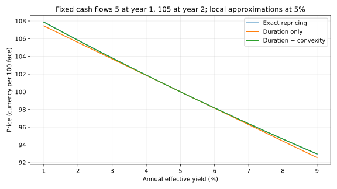

# 久期何时不够：凸性、关键利率与精确重估

久期把价格曲线在当前位置换成一条切线。读完[[社会科学/30-金融市场与风险/02-债券价格利率期限结构与信用利差#2. 久期是局部敏感度，不是到期年数的同义词|久期的一阶解释]]后，应继续问两件事：沿切线走得远，曲率误差有多大；若短端升而长端降，究竟在沿哪一个方向走？前一个问题需要凸性，后一个问题需要把曲线拆成节点。

本课以原创固定现金流例子回答这两个问题。CFA Institute **2026一级**的 *Yield-Based Bond Convexity and Portfolio Properties* 对应计算凸性、二阶价格变化和组合指标局限；*Curve-Based and Empirical Fixed-Income Risk Measures* 对应嵌入期权、关键利率及经验风险度量。**2027一级官方纲要印刷页21（PDF第21页）**仍列这两个模块及相应LOS。这里深入一组可复算的无期权模型，未覆盖全部固定收益LOS。[2026凸性模块](https://www.cfainstitute.org/insights/professional-learning/refresher-readings/2026/yield-based-bond-convexity-and-portfolio-properties)、[2026曲线模块](https://www.cfainstitute.org/insights/professional-learning/refresher-readings/2026/curve-based-and-empirical-fixed-income-risk-measures)、[2027官方纲要](https://www.cfainstitute.org/sites/default/files/2027levelitopicoutline_online.pdf)。

## 从二阶导数得到凸性修正

先限定计量：估值日恰在付息后，未来现金流 $CF_i\ge0$ 不随利率改变，时点 $t_i>0$ 以年计，$y>-1$ 是**年有效收益率**，所有现金流用同一个 $y$ 贴现。价格为

$$P(y)=\sum_i CF_i(1+y)^{-t_i}.$$

对 $y$ 求一次和两次导数，每一项分别乘上 $-t_i/(1+y)$ 与 $t_i(t_i+1)/(1+y)^2$，所以

$$D=-\frac{P'(y)}{P(y)}=\frac{\sum_i t_iCF_i(1+y)^{-t_i-1}}{P(y)},\qquad
C=\frac{P''(y)}{P(y)}=\frac{\sum_i t_i(t_i+1)CF_i(1+y)^{-t_i-2}}{P(y)}.$$

这里 $D$ 是修正久期，$C$ 是本复利约定下的凸性。以年率/年为尺度，常将其分别报告为年与年平方；严格计算时它们是对所选率报价的导数系数。换成半年复利年化YTM或连续复利，必须连同导数的换算因子一起改，不能只换标签。

Taylor展开在**同一估值日、同一现金流**下给出

$$\frac{P(y+\Delta y)-P(y)}{P(y)}
=-D\Delta y+\frac12C(\Delta y)^2+O((\Delta y)^3).$$

100bp就是 $\Delta y=0.01$，不是100或1。这个定义的 $C$ 尚未含 $1/2$，不能再混用已把半数并入定义的教材/软件口径。正现金流且无期权时 $P''>0$；切线位于凸曲线下方，因此久期对涨价估得太少、对跌价估得太多。**二阶估计仍有三阶余项**，无需把它称为有限冲击的精确答案。[凸性机制与正凸性条件](https://www.cfainstitute.org/insights/professional-learning/refresher-readings/2026/yield-based-bond-convexity-and-portfolio-properties)。

## 同一债券：由近似走回现金流

面值100，一年末息票5，两年末息票和本金合计105，$y=5\%$。精确 $P=100$，$D=1.859410431$，$C=5.269409351$。所有价格都是每100面值的货币金额；表中没有时间经过、息票再投资或信用变化。

| 年有效收益率变化 | 精确现金流重估 | 仅久期 | 久期加凸性 | 二阶误差（估计−精确） |
|---|---:|---:|---:|---:|
| −200bp：5%到3% | 103.826939 | 103.718821 | 103.824209 | −0.002730 |
| −100bp：5%到4% | 101.886095 | 101.859410 | 101.885757 | −0.000337 |
| +100bp：5%到6% | 98.166607 | 98.140590 | 98.166937 | +0.000329 |
| +200bp：5%到7% | 96.383964 | 96.281179 | 96.386567 | +0.002604 |

例如+200bp的一阶变化为 $-1.859410431(0.02)=-3.718821\%$；二阶加回 $\tfrac12(5.269409351)(0.02)^2=0.105388\%$；故二阶价格96.386567。精确值来自 $5/1.07+105/1.07^2$。误差方向在两侧不同，说明“加凸性以后永远高估”并不成立。

图轴是年有效收益率与价格，三条线在5%附近相合；图仅显示此固定现金流例，不代表可赎回债。在[[社会科学/50-CFA课程/83-资产估值与费用复算|复算实验]]可改冲击幅度并重新生成此图。

## 一条久期为什么看不见曲线扭转

一个YTM把多期限贴现压成一个数。改用连续复利零息曲线 $z(t)$：

$$P(\mathbf z)=\sum_i CF_i e^{-z(t_i)t_i}.$$

这不是把前例5%年有效率原样换成5%连续率：两者折现因子不同。若想保持同价，连续率须取 $\ln(1.05)$。下面明确另用连续率5%，价格因此变为99.764076。

设关键节点 $\tau=(1,1.5,2)$ 年，节点率向量 $\mathbf z=(z_1,z_{1.5},z_2)$。**教学插值约定**：现金流在相邻节点 $\tau_j\le t\le\tau_{j+1}$ 之间时，

$$z(t)=w_j(t)z_j+w_{j+1}(t)z_{j+1},\quad
w_j=\frac{\tau_{j+1}-t}{\tau_{j+1}-\tau_j},\quad
w_{j+1}=1-w_j.$$

其他权重为0，节点之外拒绝外推。于是1.25年现金流把两个邻节点各分50%；“只冲击一个节点”也会通过插值改变邻区的折现。市场曲线可能插值贴现因子、远期率或使用样条；不同基底会产生不同的关键利率分配，此处的数值不是通用行业标准。

定义节点敏感度

$$KRD_j=-\frac1P\frac{\partial P}{\partial z_j}
=\frac{\sum_i t_iPV_iw_j(t_i)}P,\qquad PV_i=CF_i e^{-z(t_i)t_i}.$$

单位按年连续率为年。一阶估计为 $\Delta P/P\approx-\sum_jKRD_j\Delta z_j$。也可在相同插值规则下独立重估：

$$KRD_j\approx\frac{P(\mathbf z-h\mathbf e_j)-P(\mathbf z+h\mathbf e_j)}{2hP(\mathbf z)}.$$

$h=1$bp可作数值检查，但太小会造成相减舍入，太大包含高阶误差；实验比较解析导数与有限差分，而不是用两个同源实现互相背书。

同一现金流5/105恰在1和2年节点，得到 $(KRD_1,KRD_{1.5},KRD_2)=(0.047673945,0,1.904652109)$。中节点为0是**这只债的现金流加本插值规则**造成的，不说明1.5年市场利率不重要。若加入1.25年的现金流4，中节点就承担那笔现金流的一半敏感度；测试包含这个反例。

短端+100bp、长端−100bp、中间不变，向量 $(0.01,0,-0.01)$ 的算术平均为0。拿“平均变化为0”喂给单一久期会预报不变，关键利率则保留了现金流的期限权重，用未四舍五入的节点值：

$$\Delta P/P\approx-(0.047673945)(0.01)+(1.904652109)(0.01)=1.856978164\%.$$

据此价格101.616673；直接用6%的一年连续率和4%的两年连续率重估，得到

$$5e^{-0.06}+105e^{-0.04(2)}=101.636039.$$

收益率“平均”没有按现金流风险权重加权，因而丢掉了主风险方向。一个中间节点不变的扭转也不等于没有风险。

## 指标能组合，前提不能省

本插值权重满足 $\sum_jw_j(t)=1$，所以 $\sum_jKRD_j=\sum_i t_iPV_i/P$，等于对**全部连续零息节点同升**的平行敏感度。这个和是1.952326055，与上面年有效YTM的1.859410431不是同一导数。比较或汇总前必须固定曲线对象、报价单位、插值、冲击尺度与现金流模型。

按市值权重 $a_b$，在同一冲击和同一计价口径下，组合 $D_p=\sum_ba_bD_b$，$C_p=\sum_ba_bC_b$，节点也可如此加权。负债或空头要保留金额符号；若净组合价值为0，除以净值的百分比久期无定义，应报告金额敏感度 $-\partial P/\partial z_j$ 或节点DV01。DV01每1bp的金额规模近似为 $P KRD_j10^{-4}$，利率上升造成的损益是其负值。

有限非平移冲击还可出现跨节点二阶项：$H_{jk}=P^{-1}\sum_i t_i^2PV_iw_jw_k$，二阶变化为 $-\mathbf KRD^\top\Delta\mathbf z+\tfrac12\Delta\mathbf z^\top H\Delta\mathbf z$。有插值中间现金流时，两个节点会共同影响同一贴现因子，不能只加各自“凸性”。面对大幅冲击直接重估通常更清楚。

若发行人会提前赎回，未来 $CF_i$ 随利率和行权行为改变，固定现金流求导失效。有效久期/凸性要在指定基准曲线冲击下**重新估计现金流与期权价值**；下降利率可能让上行价格被赎回价压住并产生负凸性。本实验没有期权树。基准曲线风险也不等于信用利差、违约和流动性风险；经验久期还反映历史样本中这些变量的联动，不能保证下一次危机相同。[曲线与经验度量的适用对象](https://www.cfainstitute.org/insights/professional-learning/refresher-readings/2026/curve-based-and-empirical-fixed-income-risk-measures)。

## 跟算与回答

1. **5%到6%，凸性加回多少？**答：$0.5C(0.01)^2P=0.026347$，所以价格从一阶98.140590升到二阶98.166937；仍需与98.166607精确值比较。
2. **只把1.5年节点升100bp，当前5/105例变多少？**答：精确不变，因为现金流都在端节点，线性插值没有改变其贴现率。加入1.25年支付4则不再成立。
3. **为什么同久期不能保证相同压力损失？**答：凸性、节点分布、期权行为、信用及流动性可不同；久期只匹配一个局部方向的一阶系数。

想把风险方向与组合因子联系起来，去读[[社会科学/30-金融市场与风险/04-组合分散风险因子与CAPM边界|组合风险的共同因子与边界]]；想看到保证金为何让估值正确仍可能被迫卖出，读[[社会科学/30-金融市场与风险/08-杠杆保证金传染与系统性风险|杠杆与保证金]]。
