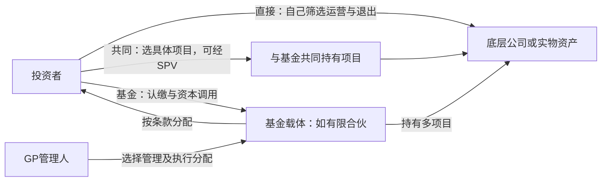

# 另类投资：资产怎样赚钱，投资者最后拿到多少

“底层资产赚50%，基金收2和20，投资者还剩多少？”这个问题缺少计费基数、现金流时点和利润分配顺序。管理费的2%可能按认缴、已投成本或净值收；20%的carry可能只分享超过门槛的利润，也可能在补足门槛后追赶分成。即使底层资产完全相同，条款不同也会改变净回报。

CFA Institute **2026一级** *Alternative Investment Features, Methods, and Structures* 对应方法/载体/报酬，*Alternative Investment Performance and Returns* 对应费前费后回报。**2027一级纲要印刷页25–26（PDF第25–26页）**仍列二者，并列私募资本、地产/基础设施、自然资源、对冲基金和数字资产模块。下文给比较路线和一个完整合成收费账本，未声称覆盖各资产全部LOS、尽调流程或任何实际基金。[2026结构LOS](https://www.cfainstitute.org/insights/professional-learning/refresher-readings/2026/alternative-investment-features-methods-and-structures)、[2026回报LOS](https://www.cfainstitute.org/insights/professional-learning/refresher-readings/2026/alternative-investment-performance-and-returns)、[2027纲要](https://www.cfainstitute.org/sites/default/files/2027levelitopicoutline_online.pdf)。

## 先选获取暴露的方法，再看法律载体

**Direct investment（直接投资）**由投资者自行选择并持有资产，控制最多，但自行承担筛选、交易、运营与退出能力成本；没有外部基金carry不等于没有成本。**Co-investment（共同投资）**是与基金等共同进入具体项目，可能减少基金层费用、让投资者选择项目，同时增加集中、项目尽调与分配冲突。**Fund investment（基金投资）**把项目选择与管理交给经理，获得专业能力和较多项目的组合，但承担基金费用、盲池选择和条款约束。基金中的基金还可能叠加底层和上层费用；已经扣在底层NAV里的费用不能再次盲扣。[三种方法的官方比较](https://www.cfainstitute.org/insights/professional-learning/refresher-readings/2026/alternative-investment-features-methods-and-structures)。

方法与载体是两条轴：共同投资也可放入SPV，基金也可采用有限合伙、公司或信托。常见有限合伙的GP负责管理、LP提供资本并按文件享有限责及约定权利；具体法律责任需以法域和合同为准。**认缴120**是将来按资本调用提供资金的承诺，**实际缴入100**才是本例已支付的投资资金；未调用20不是一笔已支付的现金。资本调用、分配与净值估计往往跨多年，因而仅比较一年账面收益会丢掉资金时间。[基金所有权及报酬结构](https://www.cfainstitute.org/insights/professional-learning/refresher-readings/2026/alternative-investment-features-methods-and-structures)。

图中三条路径是获取资产暴露的方法；载体与费用在各自合同中确定，不由箭头自动赋予流动性或保证回报。

## 各类收益要回到资产与策略机制

下面是对已读具名模块的分析框架；它把收益拆成现金、价值变化及融资效应，便于提出可检验问题，并不把任何一类承诺为高收益或低相关。

| 暴露对象 | 收益从何而来 | 估值与流动性边界 | 原始模块 |
|---|---|---|---|
| Private equity，创投/成长/收购 | 分红、企业现金流与退出价；运营改善/增长影响企业价值，去杠杆及估值倍数变化影响股权所得 | 未上市交易稀少，DCF/可比倍数对假设敏感；退出市场、优先股顺位与债务改变LP所得，杠杆也放大损失 | [Private Capital: Equity & Debt](https://www.cfainstitute.org/insights/professional-learning/refresher-readings/2026/investments-in-private-capital-equity-debt) |
| Private debt，直接贷款/夹层/困境 | 利息、本金、约定费项或股权参与；买入折价的债务可能有重组回收收益 | 约定息票不是实现收益，违约/回收、担保和契约决定损失；稀少成交下模型净值不等于立即卖出价 | [Private Capital: Equity & Debt](https://www.cfainstitute.org/insights/professional-learning/refresher-readings/2026/investments-in-private-capital-equity-debt) |
| Real estate | 租金扣空置、运营和资本开支后的现金流，加出售价值变化 | 独特地点与建筑不易互换；资本化率/DCF、融资与交易成本敏感，估价滞后会平滑波动 | [Real Estate & Infrastructure](https://www.cfainstitute.org/insights/professional-learning/refresher-readings/2026/real-estate-and-infrastructure) |
| Infrastructure | 经营服务费、使用费或合同现金流，加终值；股权/债权承接不同顺位 | 工程建设、运营、监管、需求及合同履约风险；长期资产/合同难退出，长期收入仍需适当折现 | [Real Estate & Infrastructure](https://www.cfainstitute.org/insights/professional-learning/refresher-readings/2026/real-estate-and-infrastructure) |
| Commodity / natural resources | 实物商品主要由价格变化减储运；完全抵押期货策略还有抵押利息和持有/展期路径；农林还可有作物或木材现金收入 | 现货、期货和生产商股票不是同一暴露；便利收益不能当到账现金，库存、天气、期限曲线影响价格；农林估价频率低 | [Natural Resources](https://www.cfainstitute.org/insights/professional-learning/refresher-readings/2026/natural-resources) |
| Hedge fund | 收益取决于策略：多空选择、相对价值价差收敛、事件交易、宏观方向及承担的风险 | “hedge”名字不保证已对冲；衍生品、空头和杠杆带来尾部/融资/基差风险；底层流动但基金有锁定/赎回限制时LP仍难退出 | [Hedge Funds](https://www.cfainstitute.org/insights/professional-learning/refresher-readings/2026/hedge-funds-l1) |
| Digital assets | 须先问权利：原生币可能只有转售价，代币化股债按底层权利有现金流；部分网络奖励/借贷收益取决于协议安排 | 链上记录不自动等于对公司资产的法律请求权；托管、私钥、智能合约、交易深度与权利可执行性须分别核验 | [Introduction to Digital Assets](https://www.cfainstitute.org/insights/professional-learning/refresher-readings/2026/introduction-to-digital-assets) |

股权价值怎样从企业价值扣债务、怎样选DCF与倍数，主解释在[[社会科学/30-金融市场与风险/03-股票所有权现金流与估值|股票估值]]；债务的承诺支付与信用利差边界在[[社会科学/30-金融市场与风险/02-债券价格利率期限结构与信用利差|债券与利差]]。本表为这些机制在另类载体中的应用，没有平行复制完整估值证明。

两处常见误解可以用合成反例拆开。企业退出时EV从200降至180，债务从100降至60，假设还债资金来自期间运营现金流且没有LP追加资本或中间分红，股权剩余从100变成120：企业价值下跌与股权增值可以同时发生，因为还债的钱及融资结构必须一并解释，不能据20%股权上涨宣称经理提升了EV。另一例，期货在不变的现货价格100下从105向100收敛，持有该合约多头亏5；换入下一张较贵远月合约并不在换仓瞬间自动亏掉价差，但若相同上倾曲线持续、后续合约继续下收敛，会形成负展期效应。因此只看现货变化0不能推出期货策略回报0。

## 把“2和20”写成一份可结清的账本

以下金额单位为**万元**，时间单位为年，均为原创合成条款；实际合同若不同须重算。LP认缴120，t=0调用100并全部投到底层，未调用20无现金流。本例120仅指投资承诺，费用另付且不减少未调用投资承诺20；真实基金若将费用也计入同一认缴上限，应重写调用余额。底层投资在t=2以150全部出售，已扣底层运营与交易成本、尚未扣基金管理费和carry，无中间资产分配、无债务、无残余NAV、无税。

**管理费**：第一年按认缴120的2%=2.4，于t=1由LP另付；第二年按未退出的已投成本100的2%=2，于t=2另付。费用不占上述投资调用100、不参与可退还资本或优先回报。这个特别明确的条件是本例的一部分，不能套给把费用资本化/纳入返本的合同。

**分配waterfall**：底层150在t=2按whole-of-fund顺序分：先返还投资本金100；再给LP按100年复利8%累计两年的优先回报；超过这两项的利润由LP/GP按80/20分。采用**hard hurdle且无GP catch-up**。8%不是保本收益，现金不足时优先回报也可能收不全；它是分配优先级。[ILPA Principles 3.0，GP and Fund Economics及定义页41–42：费基数、分配顺序与hard hurdle](https://ilpa.org/wp-content/uploads/2019/06/ILPA-Principles-3.0_2019.pdf)。

| 150出售款的分配步骤 | LP获得 | GP获得 | 未分配余额 |
|---|---:|---:|---:|
| 起始出售款 | 0 | 0 | 150 |
| 返还投资本金 | 100 | 0 | 50 |
| 优先回报 $100(1.08^2-1)$ | 16.64 | 0 | 33.36 |
| 剩余33.36按80/20 | 26.688 | 6.672 | 0 |
| 合计 | **143.328** | **6.672** | **0** |

核对守恒：$143.328+6.672=150$。管理费由LP另外支付，两笔合计4.4；经理总收到4.4管理费＋6.672 carry＝11.072，未把管理费凭空从底层150再扣一次。

| 时点 | LP现金流 | 经理管理费现金流 | 经理carry现金流 | 底层投资/出售现金流 |
|---|---:|---:|---:|---:|
| t=0 | −100 | 0 | 0 | 收入100、投入资产100 |
| t=1 | −2.4 | +2.4 | 0 | 0 |
| t=2 | +143.328−2＝**+141.328** | +2 | +6.672 | 出售收到150并分出150 |

底层总利润50，扣掉经理两种报酬11.072后，LP未贴现净利润38.928。把“50%毛收益−2%−20%＝28%”作为答案同时误用了两种费用的基数和跨期时点。

## 回报倍数与IRR承担不同问题

底层投资MOIC $150/100=1.5$，若只有t=0、t=2两笔现金流，毛年化IRR $\sqrt{1.5}-1=22.474487\%$。LP实缴投资＋费用共104.4，分配143.328，因此本例**含费用分母的LP净倍数**

$$143.328/104.4=1.372873563.$$

不同报告的MOIC口径可能不把费用纳入分母，必须先写定义；这不是把所有行业口径强行统一。已完全清算NAV=0，按同一含费用paid-in口径DPI=TVPI=1.372873563，RVPI=0；若还有未实现资产，TVPI包含残余估值，不能冒称全部已收现金。[ILPA指标定义](https://ilpa.org/wp-content/uploads/2019/06/ILPA-Principles-3.0_2019.pdf)。

LP净IRR使用**实际日期对应的现金流** $(-100,-2.4,+141.328)$，解

$$-100-\frac{2.4}{1+r}+\frac{141.328}{(1+r)^2}=0.$$

令 $x=1+r>0$，得到 $100x^2+2.4x-141.328=0$；唯一正根给出 $r=17.687509857\%$。不能把104.4全放t=0再开平方，因为2.4在t=1、2在t=2支付。本例将现金流限定成一个初始投入、一个非负中期支出及一个正终期收入，所以根唯一；一般不规则资本调用/分配须按实际天数并检查多根或无根。[另类回报的时点、IRR与倍数边界](https://www.cfainstitute.org/insights/professional-learning/refresher-readings/2026/alternative-investment-performance-and-returns)。

IRR是这组现金流的折现率，不证明同规模资金可无限按该率再投资。认缴120中的未调用20可能另有机会成本；这既不在已缴现金流IRR里，也不能伪装成−20已调用。与其他基金比较还需同币种、规模、vintage、现金流和估值标准，不能用较平滑的私募NAV认定风险较小。

## 换一条catch-up，20%为何就不同

保持资本、出售款和两笔管理费不变，只把分配改成：返本100、优先回报16.64之后，**100% GP catch-up**，直到GP占“截至此时已分利润”的20%，然后剩余80/20分。解 $g/(16.64+g)=0.2$ 得 $g=4.16$。因此

| 步骤 | LP | GP |
|---|---:|---:|
| 返本与优先回报 | 116.64 | 0 |
| GP追赶 | 0 | 4.16 |
| 剩余 $150-116.64-4.16=29.2$ | 23.36 | 5.84 |
| 合计 | **140** | **10** |

这时GP总carry10，恰为全部50利润的20%；原hard-hurdle例仅对超门槛33.36收20%，carry6.672。不能把hard hurdle、含catch-up与“低于门槛不收、超过就对全部利润收”的其他soft-hurdle安排混为同一合同。现金刚好够优先回报时，GP追赶可能尚未完全完成。

本实验把catch-up写成独立分配区段，以0至200的所有整数出售款检查亏本金、不足门槛、部分追赶和充分追赶各区间。**出售款110**时返本100、LP优先回报仅收10、GP0：8%门槛没有制造额外6.64现金。**出售款80**时LP只收80、GP0，净损失还包括4.4管理费；费率通常不因亏损自动归零，具体减免需合同依据。

Whole-of-fund与deal-by-deal也不等价。若A项目先赚40就让GP先取carry8，B项目后来亏40，全基金最终利润0；需要约定clawback等机制处理早期多分的8，不能假设“每笔当时算对”就保证最终全基金分对。这里的终期单笔清算模型没有多项目日期、托管、税后clawback及再循环，不承担真实法律文本执行。[ILPA对分配与clawback的机制说明](https://ilpa.org/wp-content/uploads/2019/06/ILPA-Principles-3.0_2019.pdf)。

开放式对冲基金还常看high-water mark：假设已扣管理费、未扣业绩费的NAV先100→90→99，没有追加/赎回且HWM100，第三个数虽比90涨10%，仍未越过100，不能按整个9利润立即收20%而忽略HWM。若之后升到110，采用只对超过100的部分20%计费，则费2、费后NAV108，并按合同更新HWM。这个合成机制与封闭式PE的返本/门槛/catch-up不同；真实基金还须确定计提/结晶、系列会计、equalization与资金进出规则。[原始模块明确列HWM与clawback](https://www.cfainstitute.org/insights/professional-learning/refresher-readings/2026/alternative-investment-performance-and-returns)。

## 练习与继续路线

1. **把第一年计费基数改成已投100，净利润增多少？**答：管理费从2.4减至2，LP未贴现净利润增0.4，IRR要把t=1现金流改成−2重新解；不能只把原IRR加0.4个百分点。
2. **仍卖150，但catch-up开启，LP终期净到账多少？**答：140−2=138，t=1仍付2.4；净倍数140/104.4，净IRR由 $(-100,-2.4,+138)$ 重算。
3. **期末NAV上涨但没有退出，是否可以把增长当成已收分配？**答：不能。必须区分DPI现金、RVPI残值和总TVPI，并披露估值假设及退出流动性。

[[社会科学/50-CFA课程/83-资产估值与费用复算|复算实验]]提供本账本的精确有理数与现金流测试；[[社会科学/50-CFA课程/03-GIPS业绩呈现范围与误导识别#收费与展示：gross不是没有任何成本|GIPS收费呈现]]解释报告范围、gross/net与避免重复扣费，承担的是**呈现义务**，不替代这里的基金合同分配。想判断经理收益是否来自共同风险因子，读[[社会科学/30-金融市场与风险/04-组合分散风险因子与CAPM边界|因子与分散边界]]。
