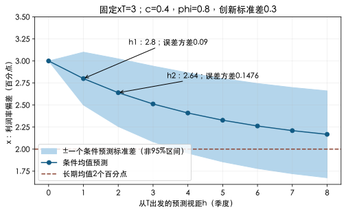

# 时间序列：平稳性决定预测公式能承担什么

为什么价格回归显著，却不能可靠预测下一期？[[社会科学/50-CFA课程/31-金融样本回归解释与诊断|金融回归]]已经解释了OLS、误差协方差和信息可得时点。本课增加时间序列的关键前提：不同时期的观察能否共享同一个均值、方差和依赖结构。全部数据为原创合成教学数据；这里的预测是理论演练，不是投资建议。

## 1. 同一个模型，先区分初始状态与长期分布

设季度经营利润率的偏差指标为$x_t$，单位是百分点，时点$t$为季度末。题设过程

$$x_t=0.4+0.8x_{t-1}+\varepsilon_t,\qquad E[\varepsilon_t\mid\mathcal F_{t-1}]=0,\quad Var(\varepsilon_t\mid\mathcal F_{t-1})=0.09.$$

本例明确假定每一期创新的**条件方差恒为0.09**平方百分点，条件均值为0；因此创新互不相关、与过去正交，且无条件方差也为0.09。只有恒定无条件方差而没有这个条件同方差前提，不足以推出下文的条件预测误差方差；参数由训练期事先给定，不从下表测试期重估。协方差平稳要求无条件均值恒定有限、无条件方差恒定有限、$Cov(x_t,x_{t-k})$仅依赖滞后$k$。对于此AR(1)，$|\phi|<1$允许平稳解；还要从平稳分布初始化，或把任意初始状态产生的过渡期单独处理。固定$x_0=3$而直接生成短序列，其无条件初始分布不是平稳分布，不能只凭0.8便把所有模拟点叫平稳样本。[官方Time-Series Analysis，Summary的stationarity和AR段](https://www.cfainstitute.org/insights/professional-learning/refresher-readings/2026/time-series-analysis)给出本课所用对象。

平稳解的长期均值满足$\mu=c+\phi\mu$，所以$\mu=c/(1-\phi)=2$个百分点。去均值后$z_t=\phi z_{t-1}+\varepsilon_t$，长期方差$v=\phi^2v+\sigma^2$，得到$v=0.09/(1-0.64)=0.25$平方百分点；滞后协方差为$v\phi^{|k|}$。这些结论是在创新假设下推导的，不由短样本均值是否接近2来认证。

已知本季$x_T=3$，条件均值预测是

$$\hat x_{T+h\mid T}=\mu+\phi^h(x_T-\mu),$$

因此一期2.8、二期2.64。预测误差为$\sum_{j=0}^{h-1}\phi^j\varepsilon_{T+h-j}$，在上述条件同方差及条件零均值前提下，给定$\mathcal F_T$的预测误差方差为$\sigma^2\sum_{j=0}^{h-1}\phi^{2j}$：一期0.09、二期0.1476平方百分点。它们小于长期方差0.25，随视距增长靠近0.25。图里区分了预测均值与误差标准差；均值回归不表示每条实际路径都向2移动。

可跟算的边界：若改用ARCH创新$\varepsilon_t=\sqrt{0.045+0.5\varepsilon_{t-1}^2}\,\eta_t$，其中$\eta_t$为独立于过去的独立同分布标准正态变量（无量纲），取其平稳解，则创新仍是条件均值0、互不相关的鞅差，无条件方差满足$v=0.045+0.5v$，即$v=0.09$。但若已知$\varepsilon_T=0.6$，一期创新条件方差为$0.045+0.5(0.6^2)=0.225$；二期创新条件方差用迭代期望算为$0.045+0.5(0.225)=0.1575$。AR的二期预测误差为$0.8\varepsilon_{T+1}+\varepsilon_{T+2}$，两个创新给定$\mathcal F_T$仍正交，故二期条件误差方差为$0.8^2(0.225)+0.1575=0.3015$，不是0.1476。条件均值预测仍为2.8和2.64，但误差带需跟当前波动状态改变；不能仅拿长期创新方差0.09代入同方差公式。这里演示理论边界，没有拟合ARCH参数。

如果额外假定创新独立于过去、独立同分布为正态且参数完全已知，可用条件均值±1.96倍预测标准差构造约95%区间；真实估计还存在参数不确定性、结构变化和非正态尾部。本图带宽仅为±一个模型标准差，**不是95%区间**。

## 2. 单位根与确定性趋势需要不同处理

随机游走$x_t=x_{t-1}+\varepsilon_t$的$\phi=1$。固定起点时$E[x_t]=x_0$，但$Var(x_t)=t\sigma^2$，没有恒定无条件方差；带漂移时均值也随$t$变化。一次冲击永久进入未来水平，不能用$c/(1-\phi)$计算长期均值。若创新本身为平稳白噪声，差分$\Delta x_t=\varepsilon_t$为平稳序列；若创新方差随时间变，差分仍可能不平稳。

对照确定性趋势$x_t=a+bt+u_t$，若$u_t$平稳，去掉正确的确定性趋势可得到平稳余项；把这类序列差分也能消除趋势，却引入$u_t-u_{t-1}$的依赖，可能损失模型效率。对数线性趋势拟合$\ln x_t=a+bt+u_t$须$x_t>0$，描述固定百分比增长；$\exp(a+bt)$在对数正态误差下是条件中位数，均值另有方差校正，不能机械反变换当无偏均值。趋势选错、遗漏断点和季节性都可能让余项仍相关。

将AR(1)改写为

$$\Delta x_t=c+\gamma x_{t-1}+u_t,\qquad\gamma=\phi-1,$$

单位根原假设是$H_0:\gamma=0$；单侧备择通常为$\gamma<0$。有截距、是否含时间趋势、是否加入滞后差分以吸收余项自相关，都必须在看结论前指定。一般ADF式为$\Delta x_t=a+bt+\gamma x_{t-1}+\sum_{j=1}^p\delta_j\Delta x_{t-j}+u_t$。$\hat\gamma/SE(\hat\gamma)$形似$t$，在单位根原假设下使用相应DF/ADF分布和临界值，不能查普通Student-$t$表。[statsmodels官方adfuller文档，regression、autolag与Notes](https://www.statsmodels.org/stable/generated/statsmodels.tsa.stattools.adfuller.html)明确其原假设、确定性项和MacKinnon近似；这里未调用该包。

最小手算账本$x=(10,11,10,12,13,12,14,15,14)$给8行滞后与差分：$\sum x_{t-1}=97$，$\sum\Delta x_t=4$，$\sum x_{t-1}^2=1199$，$\sum x_{t-1}\Delta x_t=41$，$\sum(\Delta x_t)^2=14$。带截距、零滞后差分的回归给$\hat\gamma=-0.32786885$、截距4.47540984、标准误0.26365766、统计量−1.24354001。这个九点例只演示DF回归算术，**没有输出p值、临界值或检验通过**；还未检验余项白噪声。负斜率本身不能排除单位根。

有限样本中接近单位根的平稳过程与单位根过程难区分。短样本的未拒绝不证明存在单位根，拒绝也不证明未来参数稳定；滞后太少遗留自相关，太多降低功效，断点可能扭曲检验。检验结论应连同样本窗口、确定性项、滞后选择、来源版本和诊断报告。

## 3. 非平稳伪回归与协整的边界

实验代码固定seed2718，生成两条各80点的随机游走，起点分别10、20，均有漂移0.4，创新来自互相独立的标准正态抽取。两条水平序列都有单位根；$y$对$x$的普通含截距回归却给$R^2=0.816653$，斜率0.627454，普通斜率统计量18.639301。漂亮回归来自共同上行与累积冲击，不能据普通$t$分布解释显著性，更不证明$x$驱动$y$。这是一条固定示例路径，未估计“出现伪回归的频率”。

有些非平稳变量之间存在经济长期关系。例如$y_t=2x_t+u_t$，$x$为单位根过程而$u$平稳，则$y-2x=u$平稳，称两者协整。独立随机游走一般没有这样的固定平稳线性组合。协整不能只凭水平回归高$R^2$或残差图看似平稳认定；残差检验的临界值与单变量ADF不同。差分回归描述短期变动；已验证协整时可用误差修正模型同时表示长期偏离及短期变化。本课没有实现协整检验或误差修正估计；不能把“差分后拟合”当全部长期关系分析。[官方Time-Series公开LOS与Summary的单位根/协整段](https://www.cfainstitute.org/insights/professional-learning/refresher-readings/2026/time-series-analysis)是这一区分的年度入口。

## 4. 冻结参数后，才比较预测

下表为连续四季度的一步预测。每季预测时只知道前季实际值；AR系数固定0.4、0.8，不滚动重估；“上一期水平”是随机游走基线。它与从同一个$T$连预测两步2.8、2.64的视距不同。

| 季序 | 前季实际 | 当前实际 | AR预测 | 基线预测 | AR误差（实际减预测） |
|---:|---:|---:|---:|---:|---:|
| 1 | 3.0 | 2.9 | 2.8 | 3.0 | 0.10 |
| 2 | 2.9 | 2.3 | 2.72 | 2.9 | −0.42 |
| 3 | 2.3 | 2.5 | 2.24 | 2.3 | 0.26 |
| 4 | 2.5 | 2.1 | 2.40 | 2.5 | −0.30 |

$RMSE=\sqrt{n^{-1}\sum e_t^2}$：AR为$\sqrt{0.344/4}=0.293258$个百分点，基线为$\sqrt{0.57/4}=0.377492$。AR在这四点较好，但四点不能证明显著预测优势。它们没有参加参数拟合，故相对于题设冻结参数为样本外演练；不是一份真实金融样本外实证。

下一步先看有时间顺序的余项及自相关，检验均值模型有没有留下可预测结构；季度季节性重点看lag4。余项不相关也不保证平方余项不相关，ARCH关注条件方差；小样本不能把约$\pm1.96/\sqrt n$的自相关带当精确同时检验。最后按[[社会科学/50-CFA课程/31-金融样本回归解释与诊断#4. 从解释回归走到可评测预测|金融信息可得时点]]安排真实训练/验证/评测和成本。本课未实现季节AR、ARCH拟合或这些诊断检验。

## 5. 迁移题与答案

1. 保持$c=0.4$，把$\phi$改为1，还能说均值是2吗？答：不能；有漂移的随机游走没有上述有限平稳均值，期望累计增加0.4。
2. 一期预测后实际出现4，下一期一步预测是多少？答：0.4＋0.8×4＝3.6；不能继续用原来二步条件预测2.64，因为信息集已改变。
3. 原始销售量有确定性季节周期，差分后的价格收益平稳，是否可以忽略季节性回归销售？答：不能，变量、单位与DGP不同；先处理销售自身季节项和残差结构。
4. 单位根检验未拒绝、普通回归$t=18.64，哪项足以支持可交易关系？答：都不足。检查协整与短期模型、发布时间及冻结样本外；统计关系仍不等于因果或净收益。

去[[社会科学/50-CFA课程/86-二级分析案例复算|86案例实验]]核对闭式预测、DF手算汇总与固定随机路径。

## 年度与LOS定位

已打开[2026官方Level II纲要](https://www.cfainstitute.org/sites/default/files/docs/programs/cfa-program/2026-l2-topics-combined.pdf)和[2027官方Level II纲要](https://www.cfainstitute.org/sites/default/files/docs/programs/cfa-program/2027-cfa_l2_topic_outline.pdf)，两年均在印刷p.2的Time-Series Analysis。下列序号仅按公开条目顺序定位，不冒充官方编号：3协方差平稳、4 AR预测、6均值回归、7样本外/RMSE、9随机游走、10–11单位根步骤、14非平稳/协整、15模型选择对应本课主案例；1–2趋势为概念比较，5余项自相关与8参数不稳定为诊断边界；12季节性、13 ARCH仅指出用途，未交完整算例。这个模块内仍有缺项，多元回归、金融ML和Big Data Projects也不由本页完成。
