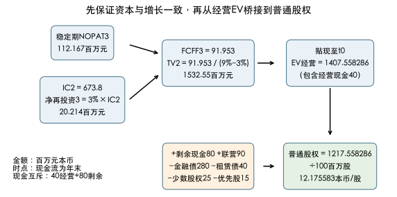

# 公司估值：多条消息如何进入同一条价值链

报表利润上升、资本开支下降、公司提高股息，三条消息会让估值同向变化吗？本例要求先把利润调整成可持续经营输入，再看增长如何消耗资本，最后选择现金流模型。[[社会科学/50-CFA课程/11-收入存货长期资产与报表调整|报表调整]]承担确认和计量机制，[[社会科学/50-CFA课程/21-WACC资本结构分派与治理|资本成本]]承担一般WACC和现金集合；本课不另造一套主定义。

## 1. 澄川工业的分析底稿

本例是全新的合成公司，不是前课澄河制造的账本。信息截至估值时点$t=0$（假想2026年末），所有未来流量在年末支付，金额为**百万元本币**，股数为百万股，利率为同币种名义年有效率。不是实际会计或投资建议。

| 消息／口径 | 已知信息 | 为什么影响模型 |
|---|---|---|
| 本期利润 | 报告EBIT120，其中出售闲置厂房收益20、一次性重组费用10；折旧20 | 本题明确两项不再发生，先正常化，不能只剔除坏消息 |
| 税与再投资 | 规范化经营税率25%；资本开支35；经营NWC增加15 | 税按长期经营应计与付现一致，不沿用历史税款拖欠；NWC不含现金和有息债 |
| 起点资本 | 经营投入资本$IC_0=600$，含经营必需现金40、全部并表经营资产净值及ROU | 增长要与资本占用衔接 |
| 现金／关联投资 | 现金合计120，其中剩余现金80；联营投资市场价值90，其利润、股息和价值均未计入经营预测 | 经营现金40已在经营资本和EV内；80与90各加一次 |
| 融资与优先权 | 金融债市场280、租赁债市场40、并表少数股权市场25、优先股市场15；普通股100百万股 | 经营FCFF含子公司全部经营现金，因此要减少数股权；不使用账面权利价值替代给定市场值 |
| 分派政策 | 管理层只给$D_1=20,D_2=25$，未承诺长期释放留存资金 | 有支付能力不等于现行股息代表全部权益现金流 |

租赁在本例**统一视为融资**：EBIT已扣ROU折旧且未扣租赁利息；折旧包含ROU，资本开支包含新增ROU按融资前经济购置额处理，租赁本金不扣在FCFF中，未来租赁融资属于债务政策。桥接时扣租赁债40。这是分析性融资前账本，不等同现金流量表的“投资付现”项目；若选择租赁经营费用口径，要重建EBIT、再投资与桥接，不能只删除40债。题设未来净再投资已包含全部这些项目，没有额外隐藏租赁取得。

规范化$EBIT=120-20+10=110$，$NOPAT=110(1-25\%)=82.5$，$FCFF_0=82.5+20-35-15=52.5$。本期报告EBIT对应的90税后数不是正常化NOPAT，82.5更不是可全部分派现金。[官方Integration，公开LOS及分析框架](https://www.cfainstitute.org/insights/professional-learning/refresher-readings/2026/integration-financial-statement-analysis-techniques)用于定位调整目的；具体“不再发生”是本题假设，不是一般会计规则。

如果重组费用每年都有，不能全额加回；如果处置闲置厂房改变未来产能，剔除20收益后仍须重做经营预测。本例出售资产已退出$IC_0$，联营价值90不含该厂房，未来不再重复添加其售价。

## 2. 先预测经营，再选折现率

销售与成本分析产生下表，而不是由历史52.5机械外推。$IC_t=IC_{t-1}+Capex_t-Dep_t+\Delta NWC_t$；本例排除重估、减值、收购和汇兑造成的其他资本变动。

| 年末／流量所属年 | 1 | 2 |
|---|---:|---:|
| EBIT | 132 | 145.2 |
| NOPAT（税率25%） | 99 | 108.9 |
| 折旧 | 24 | 26.4 |
| 资本开支 | 42 | 44.4 |
| 经营NWC增加 | 18 | 19.8 |
| 净再投资 | 36 | 37.8 |
| FCFF | 63 | 71.1 |
| 年末投入资本IC | 636 | 673.8 |

债/普通股目标市场权重40%/60%已针对本经营资产风险估计，$r_D=6\%,r_E=12\%$，利息税盾可充分及时利用，故$WACC=0.4(6\%)(1-25\%)+0.6(12\%)=9\%$。这是一套**目标融资假设**，不是用结果股权和起点固定债重算的当前权重。FCFF不另含利息税盾；优先股、少数股权在此为既有单独索取权，题设新增经营资本由债和普通股目标组合提供，没有新增优先融资或少数权益。若这些索取权参与新增资本，WACC需重新构造。详见[[社会科学/50-CFA课程/21-WACC资本结构分派与治理#2. WACC的每一项都需要条件|WACC适配条件]]。

## 3. 稳定期必须让经营利润和资本一起稳定

从第3年开始，NOPAT与资本都以3%增长，$IC_2=673.8$是起点。于是$NOPAT_3=108.9(1.03)=112.167$，为维持$IC_3=673.8(1.03)=694.014$，净再投资必须为20.214，而$FCFF_3=112.167-20.214=91.953$。稳定期资本回报按**期初资本**定义：

$$ROIC_{stable}=NOPAT_3/IC_2=16.646928\%,\qquad ReinvestmentRate=g/ROIC=18.021343\%.$$

后一个比率用未四舍五入值计算；它满足$NOPAT_3\times g/ROIC=20.214$。第2至第3年FCFF跳升并非利润跳升，而是题设过渡结束后净再投资由37.8降为20.214；若无业务依据支持该下降，应扩大显式期，而不能为了高终值强行设定。上一年FCFF71.1直接乘1.03得到73.233，会带入另一套资本政策，不能冒充这套稳定经营模型。[官方Free Cash Flow，Summary两阶段公式及预测段](https://www.cfainstitute.org/insights/professional-learning/refresher-readings/2026/free-cash-flow-valuation)给公式配对；资本政策和数字由本例明示。

稳定期终值是**第2年末、支付FCFF2之后**的剩余经营价值：

$$TV_2=\frac{FCFF_3}{WACC-g}=\frac{91.953}{0.09-0.03}=1532.55,$$

$$EV_{op,0}=\frac{63}{1.09}+\frac{71.1+1532.55}{1.09^2}=1407.558286.$$

同一框架可做**条件敏感性**：固定显式期和$IC_2$，每列改变稳定$g$时同步用$NOPAT_3=108.9(1+g)$与净再投资$gIC_2$，不能只改分母。下表是经营EV（百万元），不是股价；行里WACC改变表示资本成本估计不确定性，未改变显式经营预测。

| 稳定增长g／相应FCFF3 | WACC8% | WACC9% | WACC10% |
|---|---:|---:|---:|
| 2%／97.602 | 1513.923182 | 1291.208051 | 1124.318182 |
| 3%／91.953 | 1695.987654 | 1407.558286 | 1201.664699 |
| 4%／86.304 | 1969.084362 | 1570.448615 | 1304.793388 |

较高增长需要更多资本而降低FCFF3，表中EV仍上升是其他输入固定下长期流增长/贴现差的共同结果；不能说提高增长永远创造价值。此变化还改变$NOPAT_3/IC_2$，不是“同一固定ROIC下只调增长”。

不能把终值提前到$t=1$，也不能把第2年71.1计入永续首笔同时再次显式相加。要求$WACC>g$、稳定风险和币种/名义口径相容；$g\ge WACC$并不是无限便宜融资机会，而是该永续近似失效。

## 4. 经营EV转普通股，要减完整且互斥的索取权

$$E_0=EV_{op,0}+80+90-280-40-25-15=1217.558286,$$

所以每普通股理论价值$1217.558286/100=12.175583$本币/股。等价写法是$EV_{op,0}-(280+40-80)+90-25-15$。现金总计120不能全加，经营现金40已经进入经营资本/预测；用净债务240后又加80，会重复剩余现金。[官方Free Cash Flow，Summary末段非经营资产分离](https://www.cfainstitute.org/insights/professional-learning/refresher-readings/2026/free-cash-flow-valuation)支持分开估值的原则。

公司保留更多现金而经营预测完全不变时，新增可归属剩余现金可加一次；若现金为抵押、不能分配、有税或已承担经营需要，则要重新判断净价值，不能把账面存款自动当100%自由资金。少数股权25也只能在相应子公司全额经营价值纳入时扣减，权益法联营90已是本公司的权益索取权，不能再扣联营公司的全部债。

## 5. 为什么优先FCFF，DDM与剩余收益还缺什么

FCFF适合本题：融资前经营预测完整、再投资可观察、分派政策偏低，杠杆政策由目标权重处理。FCFE若要完整复算，仍需未来利息、净借款及租赁融资路径；不能把“FCFF减历史利息”固定永续。DDM在分派与盈利/权益现金能力关系稳定、非控制视角下有用；若强加$D_3=25(1.03)=25.75$且股息永远3%增长，用$r_E=12\%$得

$$V^{dividend\ scenario}_0=20/1.12+(25+25.75/(0.12-0.03))/1.12^2=265.873016.$$

这是假设现行低分派永续的**单独政策情景**。它不是对上述经营资产和最终留存资金使用作相同假设的第二份正确估值，不能与1217.56取平均，也不能因较低就断言DDM数学有误。必须补清留存资金未来投资、回报及释放路径，统一最终股东现金权利后比较。[官方Discounted Dividend，Summary模型选择段](https://www.cfainstitute.org/insights/professional-learning/refresher-readings/2026/discounted-dividend-valuation)。

剩余收益以普通股净利润减股权机会成本：$RI_t=NI^{common}_t-r_E B_{t-1}$，然后$E_0=B_0+\sum RI_t/(1+r_E)^t$，需一致的普通股账面权益、会计调整和终期条件。干净盈余关系为$B_t=B_{t-1}+NI^{common}_t-D_t$（本式排除增发回购等所有者交易）；OCI、股权激励、商誉或跨报表调整不能静默遗漏。利润不扣股权资本成本，故正NI也可能负RI。[官方Residual Income，Summary定义与期初账面值公式](https://www.cfainstitute.org/insights/professional-learning/refresher-readings/2026/residual-income-valuation)。本题缺普通股完整账面滚动和未来利润/OCI信息，故**比较用途但不假装已完成剩余收益估值**。

## 6. 四个相互依赖的问题与解答

1. 只剔除重组10而不剔处置收益20，规范化EBIT会被高估多少？答：给130而不是110，高估20；不能按“非经常损失总该加回”单向选择消息。
2. WACC改10%而经营预测不变，价值一定下落吗？答：本例非负FCFF和正终流下会下降；用相同91.953、g3%重估，不能改变现金流以掩盖敏感性。真实资本成本变化也可能伴随风险/预测变动。
3. 稳定ROIC压低而NOPAT3不变，能只调$g/ROIC$而不改$IC_2$吗？答：不能在本例同时保持$ROIC=NOPAT3/IC2$；应说明是提高资本需求、降低利润还是改变增长政策，再重做资本桥。
4. 把同一现金80计入净债务又直接相加，股价高估多少？答：80/100＝0.8本币/股；总现金120全加则高估经营现金40/100＝0.4。

到[[社会科学/50-CFA课程/86-二级分析案例复算|86]]用精确分数oracle核对FCFF、终资本、贴现时点和现金反例；到[[社会科学/50-CFA课程/62-信用风险含权债与情景估值|信用和含权债]]看相同“先状态现金、后匹配折现”的思想如何用于债合同。

## 年度定位与未覆盖

已打开[2026 Level II官方纲要](https://www.cfainstitute.org/sites/default/files/docs/programs/cfa-program/2026-l2-topics-combined.pdf)与[2027对应纲要](https://www.cfainstitute.org/sites/default/files/docs/programs/cfa-program/2027-cfa_l2_topic_outline.pdf)：印刷p.9 Integration of Financial Statement Analysis Techniques的5条LOS由正常化/资本与现金口径局部迁移；p.13–14 Discounted Dividend Valuation的“比较股息/现金流/剩余收益及适用情形”、p.14 Free Cash Flow Valuation的“EBIT调整到FCFF、预测、模型选择、终值、敏感性”由本例局部实践；p.15–16 Residual Income Valuation只核对定义和选择约束。未覆盖全部FCFE、多阶段DDM/H-model、残余收益完整估值、跨公司倍数和私营公司估值；复杂报表的联营/合并会计、股权激励、养老金、外币折算与金融机构分析也不能由本题几个给定输入算作完成。
