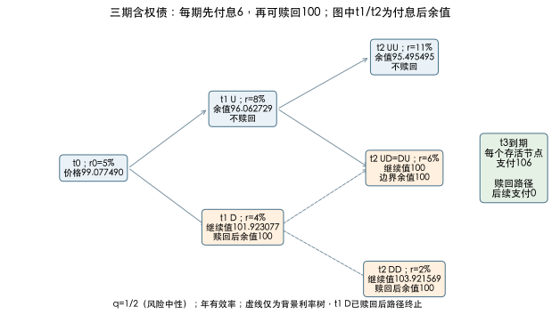

# 信用、含权债与情景估值：先看每个状态实际付什么

相同息票和到期日，为什么可赎回债比普通债值少？同样承诺100，为什么违约债不能只把“违约概率乘损失”从100扣掉？本课用两个独立的完整状态模型，分别处理利率/行权和违约/回收；然后辨认YTM利差、固定流利差与OAS。数字为原创教学假设，理论演练不是投资建议。

## 1. 三期利率树：利率决定从节点到下一期的贴现

第一笔债每100面值在$t=1,2$各付6，$t=3$付106；起点恰为付息日后，没有应计利息，因而本例全价与净价相同。无违约、税费和交易摩擦。年有效一期短率树如下：

| 时间、状态 | r：本节点到下一年 | 下一状态及风险中性权重 |
|---|---:|---|
| t0 | 5% | U／D，各1/2 |
| t1 U | 8% | UU／UD，各1/2 |
| t1 D | 4% | DU／DD，各1/2 |
| t2 UU | 11% | t3后继，两者到期106 |
| t2 UD＝DU | 6% | t3后继，两者到期106 |
| t2 DD | 2% | t3后继，两者到期106 |

树含3次贴现，终期有UUU、UUD/UDU/DUU、UDD/DUD/DDU、DDD四类节点，直债所有终节点现金相同106。$q=1/2$是定价模型权重，不是预测高利率出现频率。输入树隐含一套期限结构；这里没有外部市场报价，也没有做曲线/波动率校准，不能叫“已校准真实无套利市场模型”。在其假定可交易债券体系内，状态贴现和正权重可以构造一致价格。

定义$V_{t,j}$为**本年息票已付之后**剩余合约价值，$j$为下行次数。直债$t=2$余值分别$106/1.11=95.495495$、$106/1.06=100$、$106/1.02=103.921569$。在$t=1$，用

$$V_{1,U}=\frac{6+0.5V_{2,UU}+0.5V_{2,UD}}{1.08}=96.062729,$$

$$V_{1,D}=\frac{6+0.5V_{2,DU}+0.5V_{2,DD}}{1.04}=103.808446.$$

起点$V_0=(6+0.5V_{1,U}+0.5V_{1,D})/1.05=100.891036$。这里的分子6是下一期到达时支付的息票，不是当期已付息票；混用付息前/后价值会少算或重复一笔6。

另一条可检查的路线是枚举8条终路径，每条权重1/8，逐期付6、6、106并按经过节点的一期率连乘贴现。现金流固定时，也能先用相同树求三个零息贴现因子$D_1,D_2,D_3$，再以$6D_1+6D_2+106D_3$估值。程序测试选择逐路径支付，避免用同一递推再次证明递推。

## 2. 赎回权改变余值，不改变已付息票

现在允许发行人在$t=1,2$**先付当期6，再以100赎回**；没有锁定期之外的日期、赎回罚金或通知延迟。发行人以降低债务剩余价值为目标，所以每个允许行权节点

$$V^{call}_{t,j}=\min\{100,\;Continuation_{t,j}\}.$$

$t=2$变成95.495495、100、100；原低率节点的103.921569被100截断，中节点是无差异边界，可赎回或继续。本课以边界赎回为一条现金流表示，价值不变。$t=1$高率节点余值仍96.062729；低率节点继续值为$(6+0.5\times100+0.5\times100)/1.04=101.923077$，所以赎回，余值100。今天

$$V^{call}_0=\frac{6+0.5(96.062729)+0.5(100)}{1.05}=99.077490.$$

直债与可赎回债差$100.891036-99.077490=1.813546$，是这套模型下发行人赎回权价值。若把发行人的min误写成max，就把权利送给了持有人；有回售权的持有人选择max。行权价越低，债的模型价值越低；把行权价提高到1000在本例不再行权，应回到直债价格。[官方Embedded Options，Summary的行权比较与树估值步骤](https://www.cfainstitute.org/insights/professional-learning/refresher-readings/2026/valuation-analysis-bonds-embedded-options)。

逐路径核验的实际政策：首年D路径收6＋100后结束；首年U、次年D路径先收6，再收6＋100；UU路径先收6、6，最后106。不能在已经赎回的路径继续支付第三年本金或息票。树的重组节点不表示所有历史支付相同，已终止路径在后续求和必须剔除。

## 3. OAS是使整个含权模型匹配价格的利差

若相同合约的假想市场价为99，固定这棵树和$q$，在每个一年有效率上加同一小数$s$，每次用$1+r_{t,j}+s$贴现，并**重新判断行权**，找到$V^{call}_0(s)=99$，得到$s=0.0004393955$，即约**4.393955bp**。1bp＝0.0001，不能把0.000439叫43.94bp。代码用[0,0.2]括区间和80次二分，目标须在端点价格之间。[官方Embedded Options，Summary OAS定义](https://www.cfainstitute.org/insights/professional-learning/refresher-readings/2026/valuation-analysis-bonds-embedded-options)。

尤其$t=2$的6%中节点，在$s=0$时继续值恰100；$s>0$后106/(1.06＋s)低于100，变成不赎回。若把原行权现金流冻结，再贴现寻找$s$，就没解同一个含权模型。4.39bp是**年有效一期树相加报价**；若换成连续率、不同日计数或校准方法，数值须重解。现实OAS还依赖基准曲线、利率波动率和行为假设，不是“纯粹客观违约概率”。

直债固定承诺流可以解YTM或零息曲线上常数Z-spread；含权债YTM仍能作为按承诺到期流的报价，但不会正确表示赎回路径回报。Z-spread使用固定流，OAS嵌入行权重估，两者不能直接互换。$V_- ,V_+$重估可构造有效久期$D_{eff}=(V_- -V_+)/(2V_0\Delta y)$，但需要匹配的基准曲线冲击、校准和行权模型；随便把所有短率加减10bp得到的是**本给定树的平移敏感度**，本页不将其冒充完整市场有效久期。对照[[社会科学/50-CFA课程/40-债券凸性关键利率与曲线风险#指标能组合，前提不能省|固定现金流导数的失效条件]]。

## 4. 另一笔信用零息债：违约状态互斥且吸收

第二笔债独立于上面的含权债：两年后承诺100，无息票、无赎回，平坦无风险年有效率5%。条件于期初存活，风险中性违约概率第1年2%、第2年3%；违约在当年末结算，立即付**绝对金额40**并终止，之后没有本金或回收。回收不是当时无风险债价值的40%，也没有结算延迟。完整状态树为：

| 互斥终态 | 风险中性概率 | t1现金 | t2现金 |
|---|---:|---:|---:|
| D1首年违约（吸收） | .02 | 40 | 0 |
| S1D2次年违约 | .98×.03＝.0294 | 0 | 40 |
| S2一直存活 | .98×.97＝.9506 | 0 | 100 |
| 合计 | 1 | — | — |

不能把2%＋3%＝5%当两年无条件违约概率，本例累计是4.94%。以无风险率贴现**风险中性期望支付**：

$$P^{credit}_0=\frac{.02(40)}{1.05}+\frac{.0294(40)+.9506(100)}{1.05^2}=88.050794.$$

如果既使用风险中性违约现金，又任意再加信用利差贴现，就可能再次计入同一风险。本题另解使承诺100对应该价的年有效YTM：$y=(100/P)^{1/2}-1=6.569607\%$，相对5%零息基准的**两年到期收益率利差**为156.960660bp。这不是含权债OAS，也不是立即预期亏损4.94%。[官方Credit Analysis Models，Summary风险中性概率/无风险贴现及风险参数](https://www.cfainstitute.org/insights/professional-learning/refresher-readings/2026/credit-analysis-models)。

假想无违约债价格$P^{rf}=100/1.05^2=90.702948$。价值扣减$CVA=P^{rf}-P^{credit}=2.652154$。可以分期重算：首年末若不违约，本来持有余值$100/1.05=95.238095$，首年违约损失为95.238095−40；次年末余值100，损失60。所以

$$CVA=\frac{.02(95.238095-40)}{1.05}+\frac{.0294(100-40)}{1.05^2}=2.652154.$$

第一期暴露不是未贴现的到期100，不能把两个年份都用60损失。一般$EE\times LGD\times PD$还要说明时点、是否条件存活和回收规则。代码允许早期全额回收面值100，此时提前支付可能使债比原零息无风险债更值钱，CVA定义的差额可为负；这是回收约定与现金时点的数学边界，不是违约带来普遍收益的现实命题。

## 5. 信用数据怎样与估值输入连接

若评级研究给的是**物理概率**，它用于预测真实违约、持有期损失或收益；风险中性概率用于定价。两者之间的风险溢价不能从这个合成案例推断。实际利差也可能含流动性、税、融资与模型因素，不能直接以spread/(1−recovery)认定真实违约频率。

结构模型从企业资产价值与债务边界触发违约，需资产波动率和资本结构等假设；简化强度/约化模型直接设定违约到达规律，便于连接市场利差，但经济触发机制较弱。上述离散条件违约表只是约化思想的教学状态模型，既不是完整Merton模型，也不是连续强度模型校准。评级迁移（升级、降级后卖价）、CDS保护/保费、证券化瀑布与相关违约尚未实现。[官方Credit Analysis Models公开LOS](https://www.cfainstitute.org/insights/professional-learning/refresher-readings/2026/credit-analysis-models)。

本页两个模型刻意独立：不能将信用价88.05直接乘可赎回债价99.08或从后者减2.65。联合信用含权债必须给利率与违约的联合状态、存活条件下的行权/付款顺序、违约回收及相关性，重做所有节点。

## 6. 多信息题与答案

1. t1低率节点不行权继续值101.923077，发行人付当期息票后要支付多少？答：赎回本金100；含刚付息票，总当日106，不能从100中再扣6。
2. 市场价99.2，继续在OAS区间[0,20%]寻找可行解吗？答：不行，本模型s0最高端价99.07749低于99.2，需允许负spread或重查输入；程序应拒绝原括区间。
3. 第二年“3%”被误当成无条件违约概率，价会如何变？答：第二年违约概率被高估0.0006，但还必须相应减少存活概率，不能让总概率大于1；一致误算会把t2期望现金降低0.0006×60＝0.036，现价降低约0.032653。
4. 把首年回收延迟到t2，其余不变，价格如何变？答：减少$.02\times40(1/1.05-1/1.05^2)=0.036281$；回收率相同但时点不同也改变价值。

到[[社会科学/50-CFA课程/86-二级分析案例复算|86]]核对逐路径现金、行权政策方程、信用概率合计与CVA暴露时点；读[[社会科学/50-CFA课程/61-公司估值多信息案例与模型选择|公司价值链]]比较非经营资产、债与普通股的不同索取权。

## 年度定位与缺项

实际打开[2026官方Level II纲要](https://www.cfainstitute.org/sites/default/files/docs/programs/cfa-program/2026-l2-topics-combined.pdf)与[2027对应纲要](https://www.cfainstitute.org/sites/default/files/docs/programs/cfa-program/2027-cfa_l2_topic_outline.pdf)，两年印刷p.18–19：The Arbitrage-Free Valuation Framework的“给节点现金倒推、逐路径及曲线比较”；Embedded Options的“call/put关系、树上定价、OAS”；Credit Analysis Models的“PD/LGD/EE/CVA、债价与利差、信用模型比较”对应本页局部练习。未覆盖完整树校准/期限结构模型/Monte Carlo、所有有效/单侧/关键利率久期与凸性、浮息cap/floor、可转债、评级迁移、信用曲线、证券化与CDS。三期树能回答本题，不等于已完成二级固定收益全模块。
