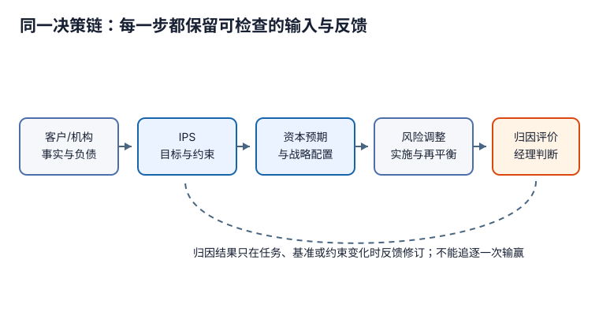

# CFA 三级共同核心：从委托问题到可追责的经理判断

客户说“多赚一点、少跌一点”，为什么不能直接优化一个组合？因为资产管理不是从收益率表开始，而是从**谁的钱、要兑现什么、何时兑现、不能做什么、谁有决定权**开始。资本市场预期只是可错的输入；资产配置把输入翻译成承担风险的方式；衍生品和货币覆盖改变已有风险；归因和评价检查实际发生了什么；基准与经理选择再把结果放回委托关系。链上任一步口径错位，最后的高 Sharpe、正 alpha 或漂亮归因都可能回答错问题。

## 连续学习路线

本组是投资委托与专业组合管理的可选深入路线。若当前只是理解家庭、企业、公共预算或跨境资金，请先用 [[社会科学/50-CFA课程/00-CFA课程-MOC#不以考试为前提的选读|社会认知中的会计与金融问题]] 返回收入/收现、税收归宿、汇率和外部账户；无需学完本组或先选考试年度。上方先修字段适用于本组专业课程，不是社会认知路线的统一门槛。

1. [[社会科学/50-CFA课程/70-三级共同核心/71-客户与机构IPS及资产负债目标|客户与机构 IPS]]：把私人客户与机构的目标、负债、流动性、期限、税务和治理写成可检验约束。
2. [[社会科学/50-CFA课程/70-三级共同核心/72-资本市场预期与稳健资产配置|资本预期与稳健配置]]：区分预测、结构假设和决策，比较 asset-only、liability-relative 与 goals-based 三种问题。
3. [[社会科学/50-CFA课程/70-三级共同核心/73-衍生品与货币风险调整|衍生品与货币调整]]：用合约改变 beta、久期与币种暴露，并把基差、滚动、流动性和交易对手风险留在答案中。
4. [[社会科学/50-CFA课程/70-三级共同核心/74-绩效计量归因与风险调整评价|计量、归因与评价]]：从总回报到账本式归因，再到 Sortino、appraisal、capture 与 drawdown；解释它们能说和不能说什么。
5. [[社会科学/50-CFA课程/70-三级共同核心/75-基准质量与投资经理选择|基准与经理判断]]：先检验 benchmark，再将定量结果、过程、团队、容量、费用与运营尽调合起来，显式处理误聘与错杀。
6. [[社会科学/50-CFA课程/70-三级共同核心/89-三级共同核心复算|同源复算]]：逐个复算配置风险、负债久期、期货/货币覆盖、Brinson 归因和风险调整指标，并运行反例测试。

沿途复用现有主解释：收益口径先看[[社会科学/50-CFA课程/30-收益率时间加权与资金加权|时间加权与资金加权]]；协方差的类型与单位看[[数学/30-概率与统计/02-期望方差协方差与抽样|期望、方差与协方差]]；债券久期和非平行曲线边界看[[社会科学/50-CFA课程/40-债券凸性关键利率与曲线风险|久期、凸性与关键利率]]；职业责任看[[社会科学/50-CFA课程/01-职业伦理准则标准与判断程序|职业伦理判断程序]]。这些链接各自承担基础定义，本组只把它们用于委托决策，不平行复制证明。

## 2026/2027 官方共同核心定位

CFA Institute 当前三级页面把共同核心分为 Asset Allocation、Portfolio Construction、Performance Measurement、Derivatives and Risk Management、Ethical and Professional Standards；候选人另选 Portfolio Management、Private Markets 或 Private Wealth 一条路径。页面给出的共同核心权重合计为 65%–70%，路径为 30%–35%。2026 与 2027 三条路径公开 outline 的共同核心部分一致列出以下模块；本组定位到模块层级，不声称逐条覆盖 LOS。

| 官方共同核心模块（2026/2027） | 本组承担 | 明确未完整覆盖 |
|---|---|---|
| Capital Market Expectations I/II；Overview/Principles of Asset Allocation；Asset Allocation with Real-World Constraints | 71–72 给框架、两类 IPS、经济资产负债表、两资产与负债相对数例、稳健/情景思路 | 各资产类别完整预测方法、宏观联动、全球市场组合作基线、Monte Carlo、税务再平衡和全部行为偏差 |
| Equity/Fixed Income overview；Alternatives allocation；Private Wealth overview；Institutional Investors；Trading Costs；Institutional case | 71 比较私人/机构；72 含负债目标；73 说明实施；75 连接委托与经理 | 另类项目监控、完整股票/债券组合构建、银行/保险资产负债表、SWF 环境社会风险、spread/VWAP/implementation shortfall 与电子市场 |
| Portfolio Performance Evaluation；Investment Manager Selection；Overview of GIPS | 74–75 覆盖 measurement/attribution/appraisal、Brinson、固定收益归因边界、指标、benchmark 质量与经理流程 | 完整固定收益归因模型、风险归因、另类 benchmark、全部合同/绩效费表与 GIPS 逐条要求；GIPS基础转读现有03 |
| Options Strategies；Swaps, Forwards, and Futures Strategies；Currency Management | 73 完整演示股指期货 beta 与 75% 货币覆盖，说明利率/汇率/权益用途 | 全部期权策略损益、波动率/方差互换、互换结构、carry/技术/波动策略、cross-/macro-/minimum-variance hedge 的完整计算 |
| Code/Standards；Guidance I–VII；Level III application；Asset Manager Code | 入口与各课将责任、适当性、合理依据、准确呈现嵌入决策 | 不重写 I–VII 案例；Asset Manager Code 仍未形成独立完整课 |

三条路径和 PSM 留给后续；本目录不复制占位，也不把阅读 Python 页写成完成官方 PSM。年度事实以[官方三级页面](https://www.cfainstitute.org/programs/cfa-program/candidate-resources/level-iii-exam)、[2026 Portfolio Management pathway outline](https://www.cfainstitute.org/sites/default/files/docs/programs/cfa-program/2026leveliii-portfolio-management-pathwaytopicoutline_online.pdf)和[2027 outline](https://www.cfainstitute.org/sites/default/files/2027leveliii-portfolio-management-pathwaytopicoutline_online.pdf)为定位依据；其他两条路径 PDF 的共同核心相同，但本组没有据此审阅其路径内容。

## 一条贯穿案例

私人客户林女士有可投资资产 2,000 万元、未来三年持续支出和十年后的教育/住房目标；机构“青岚养老金”资产 105、负债现值 100，资产修正久期 5、负债修正久期 8。投资委员会先写 IPS，再为现金/债券/权益给出年化期望收益 3%/3%/6.5% 与协方差假设；实施时用期货把 5,000 万元权益敞口 beta 从 0.60 调至 0.45，并覆盖 75% 的外币资产；期末用指定 benchmark 做归因与经理判断。

数值是教学数据，不是 CFA Institute 题目、真实机构资料或投资建议。每页末的“迁移题”改变一个条件；原创短答先给结论和最小理由，目的是练习 constructed response 的清晰性，不冒充官方评分。自评时每题只检查两点：是否给出题目要求的**明确结论**，是否用案例里的**一个决定性事实或公式**支持；措辞可不同，满足这两个点的等价答案可接受，不能把本库示范句当官方评分键。
