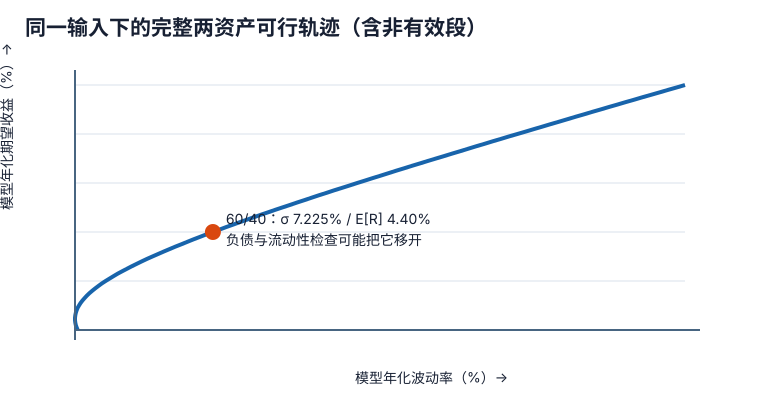

# 资本市场预期与稳健资产配置：别让精确小数伪装成知识

IPS 给出问题，资本市场预期（CME）给出可错的输入。资产配置的核心不是找一组看起来最科学的权重，而是检查：输入如何形成、对误差有多敏感、是否匹配客户真正承受的风险。

## 预测先分层

一个可审查的预期过程至少分三层：

1. **条件信息**：增长、通胀、政策、估值、收益率曲线、风险溢价和汇率状态。事实时点必须固定；“通胀很高”若没有时点与比较基准不可复核。
2. **结构模型**：债券回报可拆起始收益、滚降、曲线变化、信用与违约；权益长期回报可拆收益率、盈利增长与估值变化。模型是观点的载体，不是事实。
3. **决策输入**：期望收益向量、协方差矩阵、流动性与尾部场景。历史样本、均衡先验和主观观点如何合成应留记录。

常见错误是混用名义/实际、税前/税后、算术/几何、当地币/基础币或不同期限。若收益按年化算术均值、风险却来自月度未年化协方差，优化器会忠实放大单位错误。协方差的定义、单位与样本边界复用[[数学/30-概率与统计/02-期望方差协方差与抽样|期望方差协方差主解释]]。

## 一个可手算的政策点

先只用债券 B 和权益 E：

$$
\mu=(3.0\%,6.5\%),\quad
\Sigma=\begin{bmatrix}0.0025&0.0015\\0.0015&0.0225\end{bmatrix},\quad
w=(0.6,0.4).
$$

组合期望收益为

$$
E[R_p]=0.6(0.03)+0.4(0.065)=4.40\%.
$$

方差逐项展开：

$$
\sigma_p^2=0.6^2(0.0025)+0.4^2(0.0225)+2(0.6)(0.4)(0.0015)=0.00522,
$$

所以模型波动率为 $7.225\%$。这不是“真实风险 7.225%”：估计误差、非正态尾部、流动性、负债和路径依赖都未包含。[[社会科学/50-CFA课程/32-有效前沿配置约束与行为偏差|有效前沿主课]]给出两资产曲线与约束基础；本页把它接回 IPS。

## 三种配置问题不能互换

**Asset-only** 最小化资产组合风险或在风险预算下提高预期收益，适合负债不构成主要状态变量的情形。青岚若只看资产波动，可能偏好短久期债券。

**Liability-relative** 关心盈余 $S=A-L$ 或 funded ratio。这里的随机变量 $A$、$L$ 是同一未来时点、同一计价单位的资产与负债价值（也可一致地写成价值变动）。近似方差不仅有资产方差，还包含负债方差与资产负债协方差：

$$
\operatorname{Var}(A-L)=\operatorname{Var}(A)+\operatorname{Var}(L)-2\operatorname{Cov}(A,L).
$$

与负债同跌同涨的长久期债券可能提高资产波动，却降低盈余风险。若改用资产/负债收益率，必须乘各自价值规模后再相减，否则量纲不一致。71 的久期例就是方向性检查。

**Goals-based** 把目标分层，每层有金额、期限、优先级和成功标准。林女士的三年基本支出与十年可调整目标不能只合成一个平均风险厌恶系数。分层有助沟通，但同一资产和税务跨目标共享，不能把每个心理账户当作经济上完全隔离。

## 稳健性比最优小数更重要

均值方差最优权重对期望收益很敏感。实务上可用：

- 对输入作合理收缩或使用均衡组合作锚，而不是逐个资产给过度精确 alpha；
- 以多个宏观场景和压力情景检查目标成功、流动性和盈余，而非只报告正态波动；
- 加入可解释的上下限、交易成本、税和流动性约束；
- 比较邻近权重：若 40% 权益与 42% 权益在合理输入范围内无实质差异，写 41.37% 是虚假精确；
- 明确战略配置、允许区间与短期战术偏移的责任和回归条件。

再平衡不是“跌了机械买”。偏离带应同时考虑波动、相关性、交易成本、税、现金流和治理频率。若未来一月有大额给付，先用现金流恢复权重可能优于立即交易；若偏离源于 IPS 已变，则回到目标重审，不能把旧战略权重当圣旨。

## 反例：最高期望收益不是最好答案

若权益预期从 6.5% 上调到 8%，优化器会提高权益权重。但若上调来自估值继续扩张、且估值反转场景与发起人盈利下滑同现，青岚的总体脆弱性可能上升。点预测改善与政策适合性是两件事；推荐必须说明替代方案、敏感性与失败条件。

## 迁移题与原创短答

**题目。** 两个顾问使用同一收益向量和协方差矩阵。甲为青岚做 asset-only 最小方差，乙最小化盈余波动。为何权重可能不同？

**短答。** 乙把负债风险及资产与负债的协方差纳入目标；与负债高度相关的长久期资产即使自身波动较大，也可减少盈余波动。甲忽略负债，只能回答资产账本的风险问题，因此两者不是同一优化。

**再问。** 若相关系数在压力期从 0.2 升至 0.8，原分散结论还能照搬吗？不能。应以压力相关性重算并检查目标/流动性结果；历史平均相关性不保证危机状态。

配置通过稳健性检查后，下一步不是立刻卖出现货；去[[社会科学/50-CFA课程/70-三级共同核心/73-衍生品与货币风险调整|衍生品与货币风险调整]]看如何在保留持仓时改变敞口。
