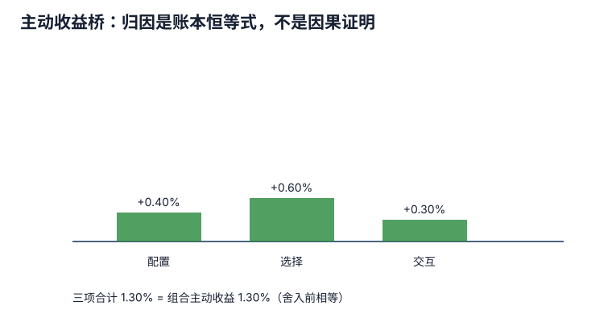

# 绩效计量、归因与风险调整评价：三个问题，三种证据

**Measurement** 问“赚了多少”；**attribution** 问“按指定模型，差异记在哪些决策账户”；**appraisal** 问“承担风险、费用和限制后，这个结果是否值得”。三者不能互相替代。正收益不等于有技能，归因项为正不等于造成收益的真实因果，单个风险调整比率更不能完成经理尽调。

## 先固定收益口径和决策责任

若客户在期中有外部现金流，资产所有者体验到的 money-weighted return 与经理可控的 time-weighted return 可能不同。定义、现金流切分和反例见[[社会科学/50-CFA课程/30-收益率时间加权与资金加权|时间加权与资金加权]]。归因前还要固定：总额/净额、税前/税后、基础币、估值时点、费用归属、衍生品和现金处理。

资产所有者决定战略配置、overlay 和经理组合；单个经理只控制授权范围内的选择。若青岚委员会把权益政策权重从 40% 提到 50%，不能把随之增加的市场收益全部算作股票经理技能。

## Brinson：把主动收益做成可对账恒等式

设三类资产为权益、债券、现金。本表采用同一期间、基础币和费用口径，类别互斥并覆盖全部组合与基准；没有期内外部现金流和改变持仓的交易，因而可直接用期初权重乘类别期间收益。$w_{Pi}$ 是该类期初组合市值除以组合期初总市值，$w_{Bi}$ 是该类期初基准市值除以基准期初总市值，两组权重分别加总为1；类别收益 $R_{Pi},R_{Bi}$ 各以该类自己的期初市值为分母。表内 $R_P,R_B$ 列指类别收益，带下标 $i$ 后与整体组合/基准收益区分：

| 资产 | $w_P$ | $w_B$ | $R_P$ | $R_B$ |
|---|---:|---:|---:|---:|
| 权益 | 50% | 40% | 10% | 8% |
| 债券 | 30% | 40% | 3% | 4% |
| 现金 | 20% | 20% | 5% | 4% |

先由同一表算整体收益：

$$
R_P=\sum_iw_{Pi}R_{Pi}=0.50(0.10)+0.30(0.03)+0.20(0.05)=6.9\%,
$$
$$
R_B=\sum_iw_{Bi}R_{Bi}=0.40(0.08)+0.40(0.04)+0.20(0.04)=5.6\%.
$$

主动回报 $R_P-R_B=1.3$ 个百分点；不是相对基准的百分比增幅 $R_P/R_B-1$，也不是相对财富比 $(1+R_P)/(1+R_B)-1$。

为了把差额分到账户，先在原差额中加减**同一项** $\sum_iw_{Pi}R_{Bi}$。它是“保持组合类别权重，各类改用基准收益”的对照组合：

$$
\begin{aligned}
R_P-R_B
&=\sum_i(w_{Pi}-w_{Bi})R_{Bi}
 +\sum_iw_{Pi}(R_{Pi}-R_{Bi})\\
&=\sum_i(w_{Pi}-w_{Bi})R_{Bi}
 +\sum_iw_{Bi}(R_{Pi}-R_{Bi})
 +\sum_i(w_{Pi}-w_{Bi})(R_{Pi}-R_{Bi}).
\end{aligned}
$$

第一项只改变类别权重；第二项用基准权重衡量类内收益差；第三项是权重差与类内收益差同时存在的交叉项。还差一步才是本页的 Brinson–Fachler 配置式：因为 $\sum_i(w_{Pi}-w_{Bi})=0$，减去共同参照 $R_B$ 不改变配置总和，

$$
\sum_i(w_{Pi}-w_{Bi})R_{Bi}
=\sum_i(w_{Pi}-w_{Bi})(R_{Bi}-R_B).
$$

于是采用原来的配置、选择、交互三式：

$$
A_i=(w_{Pi}-w_{Bi})(R_{Bi}-R_B),
$$
$$
S_i=w_{Bi}(R_{Pi}-R_{Bi}),\qquad
I_i=(w_{Pi}-w_{Bi})(R_{Pi}-R_{Bi}).
$$

三项分别归入配置、类内选择与交互账户；它们的归属依赖选定公式，不是对真实因果的识别。[Carl Bacon，CFA Institute Research Foundation 2019《Performance Attribution》印刷第12–14页](https://www.cfainstitute.org/sites/default/files/-/media/documents/book/rf-lit-review/2019/rflr-performance-attribution.pdf#page=17)列出这组公式及配置参照的区别。

将原表的小数代入，逐类对账如下，全部为**对整体主动回报贡献的百分点**：

| 类别 | 配置 $A_i$ | 选择 $S_i$ | 交互 $I_i$ | 本类三项和 |
| --- | ---: | ---: | ---: | ---: |
| 权益 | +0.24 | +0.80 | +0.20 | +1.24 |
| 债券 | +0.16 | −0.40 | +0.10 | −0.14 |
| 现金 | 0.00 | +0.20 | 0.00 | +0.20 |
| 合计 | +0.40 | +0.60 | +0.30 | +1.30 |

例如权益配置是 $(0.50-0.40)(0.08-0.056)=0.0024$，即0.24个百分点；权重用比例数，收益用小数数值，不能把50与8直接相乘。这里的1.30是收益率之差的百分点贡献，没有再除以基准收益或某个类别权重，也不是以各类自身市值为分母的类内收益。

Brinson–Fachler把整体基准收益作为共同参照，故某类三项和不必等于该类未经调整的收益贡献差：$A_i+S_i+I_i=w_{Pi}R_{Pi}-w_{Bi}R_{Bi}-(w_{Pi}-w_{Bi})R_B$。例如权益原贡献差为 $5.0-3.2=1.8$ 个百分点，减去 $0.10(5.6)=0.56$ 个百分点后为1.24；债券相应调整抵消这0.56，全部类别相加仍是1.30。

逐类相加得到配置 $+0.40\%$、选择 $+0.60\%$、交互 $+0.30\%$，合计 $+1.30\%$，与主动回报对上；这些百分数表示同表中0.40/0.60/0.30/1.30个百分点的贡献。对账是必要条件；若结果不相等，要检查权重时点、现金流、复利链接和费用，而不是把残差命名为“其他”。多期、期内交易或未归类的overlay/费用不满足上述简单加权设置时，先调整输入与收益链接方法，不把各期归因直接相加当累计主动收益。

不同归因体系会把交互项合并进配置或选择，因此比较报告前必须先比较公式。holdings-based 易实现但可能错过期内交易；transactions-based 更贴近实际持仓路径但数据要求高；returns-based 可在持仓不可得时估计风格暴露，但可能把动态决策压成稳定因子系数。

## 固定收益归因为什么更难

固定收益回报可拆 carry/roll、无风险曲线水平/斜率/曲率变化、利差、选择和交易等，但分解取决于定价模型和顺序。用平行久期解释曲线扭转会把模型残差误写成选券；信用迁移、期权和多币种还会产生交叉效应。本组只要求能读出“哪个指定账户贡献多少、残差多少、模型假设是什么”，不声称覆盖官方 outline 中全部固定收益与风险归因方法。

## 风险调整指标：每个分母都隐含一个问题

对六期经理回报 $(3,-2,4,-1,2,1)\%$ 与基准 $(2,-3,3,-0.5,1.5,1.2)\%$，复算页得到：

- **Sortino ratio**：平均超出最低可接受收益的回报，除以下行偏差；只惩罚低于门槛的结果，但对门槛和频率敏感。
- **Appraisal ratio**：先以含截距的单因子回归 $R_P=\alpha+\beta R_B+\epsilon$ 估计 alpha，再以 $\alpha/s_\epsilon$ 评价每单位残差风险的 alpha。这里 $s_\epsilon=\sqrt{\sum\epsilon_t^2/(n-2)}$；结果依赖 benchmark、频率、线性模型和样本稳定性。平均主动回报除以 tracking error 是 information ratio，不在本页混称 appraisal ratio。
- **Upside/downside capture**：分别在基准严格上涨/下跌子期计算经理与基准的几何平均回报之比；样本期少、极端值和零分母都会使结果脆弱。
- **Maximum drawdown/duration**：路径上的峰谷损失和恢复时间；只描述已观察到的一条路径，不能当未来最坏情形。

本例最大回撤是第二期的 $-2\%$，持续一期。若基准没有至少一个严格上涨期和一个严格下跌期，capture 不定义；若残差风险或下行偏差为零，相应比率也不应返回无穷大。这个数小不代表策略安全：六期样本太短，且没有经历所有状态。用波动率把非流动资产的平滑估值当低风险，也会产生虚假高比率。

## 归因不是因果证明

对 Brinson--Fachler 公式，权益超配且权益类别**基准回报高于整体基准回报**时，该类别配置项才为正：乘数是 $R_{Bi}-R_B$，不是单独的类别基准回报。例：基准权重权益/债券各 50%，组合为 60%/40%，类别回报为 2%/10%，则 $R_B=6\%$；权益上涨且超配，配置项仍为 $(.6-.5)(.02-.06)=-0.4$ 个百分点，债券也为 $-0.4$，总配置 $-0.8$。把类别回报改为 $-2\%/-10\%$ 时，权益虽下跌却跑赢整体基准 $-6\%$，权益项为 $+0.4$ 个百分点。它只证明在所选 benchmark 和公式下的账本分解；不能证明经理正确预测了上涨。经理可能因旧持仓未成交而“被动超配”。要谈技能，还需投资记录、重复性、决策前信息、容量、成本和多个市场状态。

风险归因同样是模型账本。因子协方差改变、非线性期权或压力相关性都可能让边际贡献不稳定。应用结果时应把模型、时点、估计窗口和未解释残差一起报告。

## 反例：benchmark 错了，alpha 就会被制造

小盘价值经理若用大盘成长指数作 benchmark，风格反弹时会出现漂亮主动收益和 appraisal ratio，即使经理只是保持授权风格。反过来，错基准也可能惩罚正确执行。评价经理前必须先审基准，下一课会给出质量检验。

## 迁移题与原创短答

**题目。** 青岚 overlay 团队卖期货把 beta 从 0.60 降至 0.45，随后市场上涨。现货股票经理落后政策 benchmark。谁应承担哪部分结果？

**短答。** 先将现货经理相对其授权 benchmark 的选择结果与资产所有者/overlay 的 beta 决策分账。因降低 beta 错过的市场上涨属于 overlay 或资产所有者决策，不能全部记为现货经理选股不足；经理自身相对授权指数的持仓差异才进入其选择评价。

**再问。** Brinson 三项严格对账是否证明数据和结论正确？不证明。恒等式可在错误 benchmark、错误估值或错误责任映射上成立；还需独立核数据、口径和委托关系。

下一课转向[[社会科学/50-CFA课程/70-三级共同核心/75-基准质量与投资经理选择|基准质量与经理选择]]。
