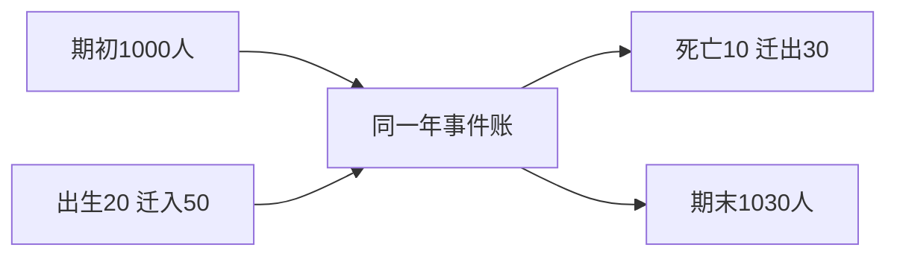

# 人口平衡、暴露与年龄结构：死亡更多，是否意味着更危险

一个地区一年死了82人，另一个只死了28人；如果两地老人比例不同，“医疗水平排名”就先别急着领奖。真正的问题有两个：实际要承担多少死亡与照护，以及相同年龄构成下的死亡率怎样比较。后者不能替掉前者。

本篇所有账本和率都是合成教学数据。首先固定地区边界、常住人口定义、起止时刻和一年观察窗；死亡按观察窗内属于该地区风险人口的事件计数，迁移按同一定义的入出地区事件记账。现实可能有漏报、登记延迟、边界变动和分类修订，不能拿恒等式当作登记系统天然无误的证书。

## 两次存量之间需要完整事件账

令 $P_t$、$P_{t+1}$ 为期初、期末人数（单位：人）；$B,D,I,O$ 分别为这一年出生、死亡、迁入、迁出事件数。没有边界重分类等其他调整时，

$$P_{t+1}=P_t+B-D+I-O.$$

期初1000人，出生20，死亡10，迁入50，迁出30，得期末1030。一个人在本年迁入后死亡，应进入一次迁入和一次死亡，两项并不重复：前者增加存量，后者减少存量。往返迁移也可能被分别计入毛流量，因此迁移事件次数不必等于迁移过的独特人数。只有净迁移 $I-O=20$ 时，不能反推出毛迁入50和毛迁出30。

若人口普查的期末计数为1020，守恒式的差10提示至少一项口径、记录或调整尚未对齐；它不能单独指出哪项错，更不能自动宣布“少报了10名出生”。这同[[社会科学/10-共同工具/02-指标分布与存量流量核算#存量、流量与账户桥|财富存量与流量桥]]的逻辑相同：桥把变化分解，具体机制和漏项需另查。

箭头表示加减账，不能读成“迁入导致死亡”之类的因果路径。年龄转组会改变组人数，但不改变地区总人数；投影时必须在组账中单列，在总账中抵消。

## 人数、人年、事件率和概率不是同一列

人数告诉某时点有多少人；死亡发生在一段时间里。同一个年度人口中，有人观察整年，有人中途出生、迁入、迁出或死亡。每个人只贡献其在该地区、该年龄组、仍活着且被观察时的时间。

记观察窗为 $[0,1)$ 年，个人 $i$ 的风险指示为 $Y_i(t)\in\{0,1\}$，则人年暴露量为

$$E=\sum_i\int_0^1Y_i(t)\,dt.$$

例如以下四条**单独用于解释暴露**的小记录，不是1000人账本的抽样估计：

| 人 | 进入观察时刻（年） | 离开观察时刻（年） | 离开原因 | 贡献（人年） |
| --- | ---: | ---: | --- | ---: |
| A | 0 | 1 | 观察窗结束 | 1 |
| B | 0 | 1/4 | 死亡 | 1/4 |
| C | 1/2 | 1 | 迁入后留至窗末 | 1/2 |
| D | 0 | 1/2 | 迁出，之后状态未知 | 1/2 |

共 $E=9/4=2.25$ 人年，观察到一次死亡，所以中心死亡率 $m=D/E=4/9$ 次死亡/人年。年龄别死亡率同理：同一年龄区间与时期中的死亡数，除以人在该区间中贡献的人年。一个人在一年中生日跨组，其人年应按生日分开；不能把全年时间都塞入年末年龄组。

概率 $q$ 的分母则是“在明确起点活着的一组人”，事件是这组人在规定时长内是否死亡。迁出D在后半年的结局未知，不能当作存活到年末；C又不属于期初队列。直接用 $1/4$ 或 $1/3$ 当作期初队列一年死亡概率，都没有处理队列定义、进入与删失。若要估计离开后的生存，需要追访或相应的生存分析假设；本例没有识别这项概率。

率有 $1/年$ 量纲，概率无量纲且在 $[0,1]$ 内。某事件率若超过1/人年，首先应检查时间长度、暴露与记录，并非代数上自动非法：人年很短时，死亡数/人年也可能超过1。把率直接塞进概率栏，再用“概率大于1就截成1”善后，像先把米抄成平方米，再夸计算器懂得节制。

年中人口乘一年常用来近似人年，要求该期人口变化和构成足够平稳；期中集中迁入、疫情波峰或年龄堆积会破坏近似。[SSA方法说明第三节](https://www.ssa.gov/oact/NOTES/as120/LifeTables_Body.html)讨论了死亡分子、人口分母来自不同来源的不一致；实际登记与普查的覆盖必须核对。

## 同样年龄别率，为什么粗率相差近三倍

年龄分为0–59、60+；粗率用**总死亡/总人年**。本例不把年度粗率叫一年个体死亡概率。

| 地区/情景 | 0–59暴露（人年） | 0–59死亡 | 60+暴露（人年） | 60+死亡 | 粗死亡率（每千人年） |
| --- | ---: | ---: | ---: | ---: | ---: |
| A年轻构成 | 800 | 8 | 200 | 20 | 28 |
| B年长构成 | 200 | 2 | 800 | 80 | 82 |
| B年龄别率改善 | 200 | 1.6 | 800 | 64 | 65.6 |

前两行每年龄组死亡率完全一样：$m_y=0.01,m_o=0.10$ /年。A的暴露权重为 $(0.8,0.2)$，B为 $(0.2,0.8)$，所以粗率为

$$m_A=0.8(0.01)+0.2(0.10)=0.028,\quad m_B=0.2(0.01)+0.8(0.10)=0.082.$$

B的第三行是把两年龄别率都乘0.8后的**模型期望死亡数**：1.6是期望，不是记录了一具零点六的遗体。这里的0–59组故意极粗；实际比较需要更细年龄或检查组内构成，否则“控制了年龄”仍可能残留组内差异。

指定同一个标准暴露构成 $w=(1/2,1/2)$，直接标准化率为

$$m_j^*=\sum_k w_km_{jk}.$$

A与B均为0.055/年，B改善情景为0.044/年。于是B改善后年龄别率和标准化率都低于A，粗率仍为65.6高于28。改变的是目标构成，不是宣布真实82人或期望65.6人的服务负担不存在。标准化率也依然是率，不是现实观察到的死亡人数或某个人的风险。

共同权保持组内优势的证明由[[社会科学/10-共同工具/04-比较研究偏差与证据审计#共同人群权重能保持什么|共同工具页]]维护。去那里带上两年龄组、两年龄别率和同一个权重；回来要指出人口例的权重是人年份额，不能无条件替成某时点人数。再去[[AI/15-卷积神经网络/06-检测分割匹配损失与评估协议#同两张图，为什么平均顺序会翻转|两张图的Dice聚合]]时，检查模型是否连分母也改变了；不能只复制“平均会骗人”五个字。

年龄标准化未控制所有健康、收入、登记和迁移选择，更未给政策干预的反事实。B如果引入健康青年，粗率降低既可能来自构成，也可能伴随组内风险和观测覆盖改变。完整因果问题回[[社会科学/10-共同工具/03-因果图反事实与识别|因果识别主解释]]，本篇只做账与描述比较。

## 改一个条件，再接生命表

遮住上面结果，保留年龄别率 $(0.01,0.10)$，令地区C暴露为 $(500,500)$。问总死亡期望、粗率及标准化率各是什么；再把标准权改为 $(3/4,1/4)$，A与B的标准化比较怎样改变？

答案与结论边界

C期望死亡 $5+50=55$，粗率0.055/年；共同各半权下标准化率也0.055/年，恰好因为C与标准构成相同。标准权改为 $(3/4,1/4)$ 后，A和B都为0.0325/年，原始粗率28与82/千人年不变。只用本表不能判断医疗政策原因、个体风险、未来人口或家庭照护能力。

下一篇[[社会科学/61-人口学/02-死亡率生命表与时期队列|从死亡率构造生命表]]新增的不是再换一次平均数，而是补上“活到年龄x的人接下来会怎样”的条件起点、年龄区间内死亡时点及开放末组；没有这些条件，年龄别率不能自行变成预期寿命。
