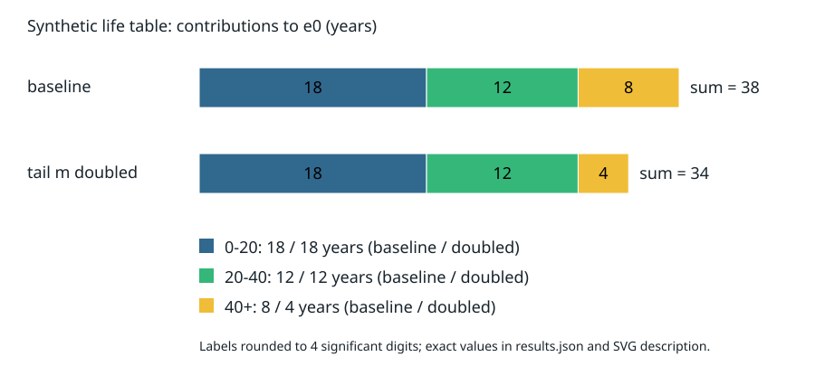

# 死亡率、生命表与时期/队列：38年到底是谁的38年

同一年里，20岁与80岁的人属于不同出生队列。把他们的年龄别死亡率拼成“从出生走到死亡的一生”，是一项明示的构造；它不是已经追踪了一群新生儿的未来。生命表的价值恰在于把拼接规则写清，使不同地区和时期的死亡条件可以按相同方法比较。

## 先得到区间概率，而不是把率改个列名

年龄区间 $[x,x+n)$，宽度 $n>0$ 年。下标中的$n$是年龄宽度，不是样本数。记：

| 符号 | 对象 | 单位 |
| --- | --- | --- |
| ${}_nm_x$ | 该区间死亡数/活人年暴露 | 1/年 |
| ${}_nq_x$ | 活到恰好x岁者在接下来n年内死亡的条件概率 | 无量纲 |
| $l_x$ | 生命表假想初始队列中活到恰好x岁者数量 | 人 |
| ${}_nd_x=l_x{}_nq_x$ | 这组人在区间内的死亡数量 | 人 |
| ${}_na_x$ | **区间内死亡者**从x起平均再活的年数 | 年 |
| ${}_nL_x$ | 这一生命表队列在区间内共活的人年 | 人年 |

区别在分母：$q$以期初活着的人为条件，$m$以每个人实际活着的时间为分母。幸存到下一边界者各活n年，区间内死亡者平均活a年，因此

$$
{}_nL_x=n l_{x+n}+{}_na_x{}_nd_x
=n l_x-(n-{}_na_x){}_nd_x.
$$

让生命表区间中心率等于输入率，即 ${}_nm_x={}_nd_x/{}_nL_x$，代入 $d=lq$、约掉正的$l_x$得

$$
m=\frac{q}{n-(n-a)q},\qquad
\boxed{q=\frac{nm}{1+(n-a)m}}.
$$

本式需要 $m\ge0$、$0\le a\le n$，且输入组合应给出 $q\le1$；等价于 $am\le1$。不满足时，说明率与死亡时点假设不相容，程序应拒绝，不能机械截断。无幸存者时后续$e_x$也不能除以零。

常用 $a=n/2$ 是死亡在区间中均匀分布时的平均死亡时点；婴儿死亡集中在生命早期时未必适合。若另外假设区间内恒定瞬时死亡风险 $\mu$，应有 $q=1-e^{-\mu n}$；该模型下中心率为 $m=\mu$，a应由同一指数分布导出，不能又任意取n/2。比如 $m=0.1,n=20$，指数模型给约0.8647，均匀死亡时点a=10则给1；这是两种模型，不是四舍五入误差。

## 用一张极简表走完l、d、L、T、e

上一课只有0–59与60+两组，不能凭它恢复0–20、20–40的死亡率；这里明确另给一套更适合演示生命表的合成年龄率输入，不把旧组拆细冒充取得了新数据。下表年龄故意只分0–20、20–40、40+，死亡率也故意很高，便于手算；不是人类真实死亡模式估计。设同一时期的完整年龄率表为前两组 $m=(1/90,1/30)$ /年，取a=10年。第三组用末组中心率0.05/年并**另立恒定风险尾部假设**。初始尺度 $l_0=1000$ 人只是计算基数，改为十万人会同比放大l/d/L/T而不改变q/e。

第一行：

$$q_0=\frac{20/90}{1+10/90}=1/5,\quad d_0=200,\quad l_{20}=800,$$
$$L_0=20(1000)-10(200)=18000\text{ 人年}.$$

第二行：$q_{20}=(20/30)/(1+10/30)=1/2$，所以$d_{20}=400,l_{40}=400,L_{20}=12000$人年。

末组没有有限的n，不能把“40+”当20年再照搬上一行。我们假定从40岁起风险恒为 $\mu=0.05$/年，生存尾部为 $l_{40+t}=400e^{-0.05t}$。于是

$$L_{40+}=\int_0^\infty400e^{-0.05t}dt=400/0.05=8000\text{ 人年}.$$

最终人人会死亡，所以末组$q=1,d=l_{40}$；但死光花多少时间仍需尾部模型。**q=1本身不能决定L，更不能决定余寿。** 恒定风险是本教学尾部的明确假设，真实老年死亡率常需更细建模；[IUSSP模型生命表说明](https://demographicestimation.iussp.org/content/introduction-model-life-tables)解释了缺年龄段时如何依赖额外模式假设。

定义 $T_x$ 为从x起各后续区间L之和（人年），$e_x=T_x/l_x$ 为活到x岁者平均剩余年数。把T从末行向前累加：

| 年龄区间 | m（1/年） | q | l（人） | d（人） | L（人年） | T（人年） | e（年） |
| --- | ---: | ---: | ---: | ---: | ---: | ---: | ---: |
| 0–20 | 1/90 | 1/5 | 1000 | 200 | 18000 | 38000 | 38 |
| 20–40 | 1/30 | 1/2 | 800 | 400 | 12000 | 20000 | 25 |
| 40+ | 1/20 | 1 | 400 | 400 | 8000 | 8000 | 20 |

检查三项：死亡数合计1000；l不增；每个有限区间 $n l_{x+n}\le L_x\le n l_x$。出生时预期寿命38年不是死亡年龄的众数，也不是每个人的死亡日期；活到20岁者的期望死亡年龄在本表是 $20+25=45$，不是“还剩18年”。条件分母从1000人变成800人，不能把已活年数从e0机械扣掉。

条长是 $L_x/l_0$，单位年；18+12+8=38。图源与完整数值在[[社会科学/61-人口学/80-实践/01-人口分母生命表与投影/README|可复建实践]]。图对比的第二条只把末组风险加倍，所以尾部贡献8变4，e0变34；它不声称现实政策只改变这一项。

## 改条件时，哪里应该重算

保持两有限组m和a不变，将末组m从0.05改为0.1，则l40仍400，末组L从8000变4000，e40从20变10，e20从25变20，e0从38变34。只改变尾部却把早期存活数也改了，是把依赖方向抄反了。

另一种改变是保持0–20组m=1/90，令死亡者平均只活a=5年。则$q_0=4/21$、$l_{20}=17000/21$，e0为 $785/21\approx37.381$年。这里m未变但q变小：死亡更早，每次死亡贡献的暴露更少，为保持同一D/L只能减少死亡比例。后续条件率未变，所以e20仍25年。只说“早死使q更高”遗漏了我们**固定的是中心率**，不是固定死亡人数。

原始年龄别率若来自漏报或错误人年，上面所有精确分数也只是在精确传播错误。[NCHS 2021州生命表报告](https://www.cdc.gov/nchs/data/nvsr/nvsr73/nvsr73-07.pdf)第1–2页分别说明时期/队列、l/d/L/T/e；报告第2页还区分随机变异与未包含的年龄误报等测量误差。此处没有复算其真实州表，也没有把合成e0=38归给任何国家。

## 时期表在同一列，队列沿日历往前走

时期生命表使用某一短时期内不同年龄的人所经历的死亡条件，假想一组新生儿终身承受这套年龄率。队列生命表追同一出生队列，在不同日历年到达不同年龄；尚未走完的一生需要未来率假设。[SSA基本概念第二节](https://www.ssa.gov/oact/NOTES/as120/LifeTables_Body.html)明确区分两种表。

例如2020年出生者20岁时是2040年；2020年观察到的20岁者出生于2000年。若2040年20岁风险不同，2020时期表就不等于2020出生队列的真实一生。在人口迁移存在时，“地区2020出生者”和“以后仍居住本地的人”也未必是同一队列；追访和选择会进一步改变分母。

### 年龄—时期—队列不是三个自由旋钮

以连续时间和精确年龄表示，日历时期p、年龄a、出生时间c满足 $p=a+c$；只用整数年份/周岁分组时要处理生日和区间边界，不能逐条假定整数等式精确成立。

假设线性预测包含 $\alpha a+\beta p+\gamma c$。对任意实数t，令

$$(\alpha',\beta',\gamma')=(\alpha+t,\beta-t,\gamma+t),$$

则预测改变量为 $t(a-p+c)=0$。所以增加同样关系下的样本，仍无法把三个线性趋势分别识别。取年龄/时期/队列三行 `(20,2020,2000),(40,2020,1980),(20,2040,2020)`，用原系数 `(1,2,3)` 与新系数 `(2,1,4)` 都得到10060、10020、10160。算出唯一一组回归系数，可能只是软件替你偷偷选了约束，不能当作三个历史机制已经分家。

到[[数学/20-线性代数与几何/07-线性方程组消元LU与解的结构#一次完整消元|线性方程组主解释]]，把$(a,-p,c)$的线性关系对应到设计矩阵的核；回来须说清额外约束如“队列线性趋势为0”排除了哪类解释。这里展示的是线性漂移不可识别；更复杂APC分类模型、非线性项和约束敏感性需单独研究，不能把这个算例当通用估计器。

接着读[[社会科学/61-人口学/03-队列要素投影与条件情景|队列要素投影]]：生命表提供的是条件生存信息；把它交给年龄组人数动态时，还要核对恰好年龄与整组年龄、出生时点和迁移进入时点。拿到一个q就往所有人头上一乘，仍会跨错分母。
