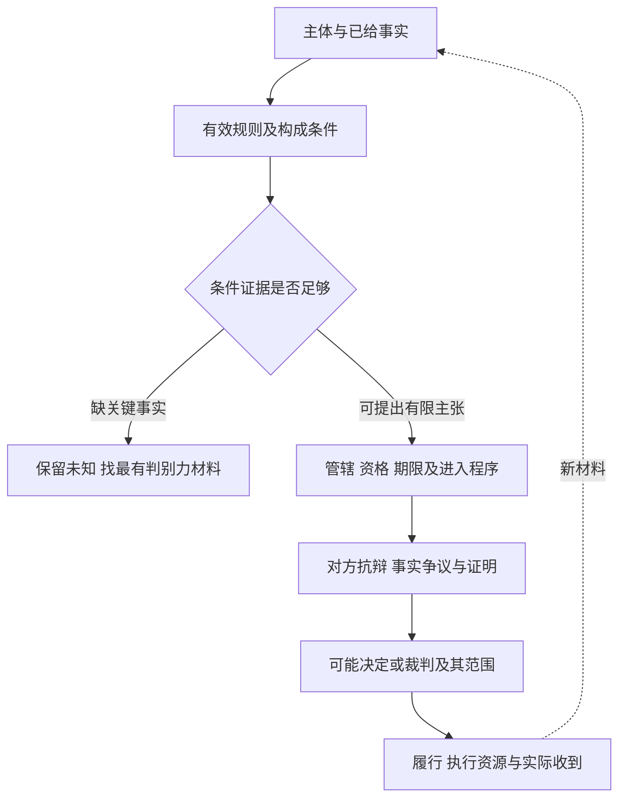

# 主体、事实、解释与证据：把“应该赔”展开成可以检查的论证

书架倾倒，照片显示地上有散落的书。照片可能支持“出现倾倒后的现场”，却不自行证明谁安装、谁控制、有没有超载、哪条义务适用，以及哪个被告应赔多少。法律分析需要让每个结论显露其规则和事实前提。

本页是一套教学分析方法；具体权利、证明标准和程序只能由各法域实际规则支持，不把下面的检查树作为全世界统一法律。

## 谁在请求什么，向谁请求

采购付款者、签约者、书架所有者、场所运营者、安装者和受伤使用者可能分别不同。“负责人”是组织称呼，不自动说明他个人是合同当事人、有权代表公司、具有公共权限或承担个人责任。先画关系：谁与谁订约，谁控制场所，谁作决定，谁受到什么损害。

权利、义务、权限与责任也不是同一对象。请求退款不同于要求停止使用危险物；有资格签采购合同不同于有权限制居民进入公共设施。某人有角色上的任务，不足以推出所有法律责任；某组织有法律人格，也不自动排除个人另有责任。

写结论时采用一个有限句型：“在已给事实F及明确规则R下，甲针对乙的请求P可能成立；仍需核C，抗辩D可能改变结论。”这使未知能够留在论证中，不迫使作者在资料不足时给胜诉保证。

## 权利、自由、权限和责任：一句“我有权”还缺什么

本课用四个不同的问题帮助阅读具体规范：甲能否要求乙做某事（乙有相应义务）；甲能否作某行为而不违反某项义务；甲能否通过签约、取消或决定改变法律关系；乙能否单方面改变甲的地位。它们是教学分析区分，具体名称和承认方式须回到法域原文。

F1中B有资格以自己名义签采购合同，关注的是法律主体与代表权限；B能否要求S退款，关注具体请求和对应义务；B能否有效解除，关注改变合同关系的行为及条件。F3中Lin符合一般使用条件，不表示任何管理员都拥有三十天排除权，也不表示Lin在开放时间外可无条件进入。将这些问句拆开，能防止把“我持有借书证”变成“任何停用都不可能”，或把“馆方控制门”变成“馆方有权作任何决定”。

财产权也须拆解：B买到物、付清价款、取得所有权、物由谁占有、合同是否有效终止，是不同状态；本文没有在三域预写所有权转移规则。拿到实物不自动证明已拥有所有处分权限，退款分析也应说明货物返还与价款返还怎样对应。所有权、合同债权及受伤第三人的侵权请求各有法源，这就是财产法、合同法与侵权法应互相接续又不混成一条请求的原因。

## 规则如何变成条件

从实际条文与相关解释提取条件，不先套一个万能模板。退款可能涉及约定是否进入合同、履行是否不符、是否允许补救、解除或拒收条件、通知、使用/接受状态、例外和时限。损害责任可能涉及义务、违反、因果、损害、归责与抗辩；这些具体条件因请求依据而变，不能只因看到损害就略过其余。

一项法律推理可写成：规则在该法域、主体、时点适用；构成条件A/B/C有证据；例外E未成立或尚未知；因此得到限定结论。要同时写最强反方，例如“承重报告的测试条件不同”“已完成接受后救济不同”“运营者并不控制该区域”。反方若足以击中必要条件，必须修改结论，而不是只在最后加一句仍有争议。

解释有时需要结合文本、体系、目的、历史材料与裁判论证；不同法域允许何种权重须核实际依据。类比要写相同点与决定性差异，不因两个故事都发生在图书馆就认为相同规则适用。不得从“符合道德”推出规则有效，也不从法律有效推出道德正当。

## 解释不是查字典：怎样重建双方理由

文字只给起点。解释者必须交代对象、语境和争议：例如“承重80kg”是均匀静载还是某一点的冲击力，合同是否纳入安装附件，卖方宣传与签署附件是否冲突，条款和实际使用目的如何相互支持。先检索法域承认的解释依据，再分析本例；不能为达到退款结论而只挑一句有利文字。

以虚构规则“发生反复妨碍服务，可暂时排除”作演示。支持排除的一方可以说防止持续损害、维护其他使用者权益符合规则目的；反方可指出F3只有一次普通音量批评，没有“反复”和“妨碍”，若把所有批评纳入，便使两个限定词失去约束。决定性差异在行为是否满足条件及权力范围，不能只因同为图书馆管理而类比到重复损坏案。若原文允许紧急危险例外，另查是否紧急、必要及例外的程序；目的解释不能凭空创造例外。这个例子只是理由重建，实际法律解释的允许形式与权重由区域页证明。

每份简报至少写一个足以推翻结论的观察。F1是原始测试不符合约定或缺陷由交付后错误安装造成；F2是独立事故记录显示其他决定性原因；F3是所给原决定之外有依法可援引的关键事实及合法依据。新观察可能改变某一请求，也可能只改变赔偿范围，不能把局部反证当整案倒转。

## 事实、指控和法律评价分栏

| 材料中的句子 | 当前是什么 | 下一项检查 |
| --- | --- | --- |
| “合同写了承重80kg” | 文书内容主张 | 原文、版本、签约主体、条款是否生效 |
| “书架只能承重40kg” | 技术/事实主张 | 测试方法、对象是否同批、单位和记录 |
| “管理员明知危险” | 关于知识状态的指控 | 警告何时到达、谁收到、是否理解、后续动作 |
| “运营者违法” | 法律评价 | 哪个主体、哪条有效规则、哪些条件 |
| “应付医疗5000及手机300” | 请求及数量主张 | 损害项目、证据、请求依据、计算与限制 |

缺某项证据不必把整件事当假；确认现场也不让其他条件自动为真。可以分别记录已支持、相矛盾、未知，并说明哪个未知最影响结论。

## 认识上的相信不代替法律上的证明

读[[哲学与文化/20-论证知识与规范/05-证言依赖与知识的理由#已知依赖与未知依赖怎样改变理由|证言依赖]]，可知三个转述同一记录没有增加三份独立观察。法律程序还另问：谁承担哪项证明负担，材料能否被使用，达到什么标准，失败产生什么程序后果。不能把一个Bayes后验直接当成法定证明标准。

虚构练习：A拍下事故后照片，B抄A说明，C转发B。三份文件只给同一照片/说明的传播链。另一位D独立保存事故前安装记录，才可能提供新的信息；D也可能与A共享来源，须检查形成过程。改变虚构规则的证明负担，可能改变谁在证据不足时承担后果，但不会把同源转述变成独立事实。

未证明指控、证明指控为假、程序暂不准入、软件默认拒绝、法律无权是五个不同结论。法域页给具体条件；共同方法只阻止这五者相互冒充。

## 程序与救济不能只列名称

图是研究检查的依赖顺序，不是三域统一诉讼流程。符合受理条件不等于实体胜诉；有利裁判不等于已经收到钱；启动监督不等于法院受理。每域案例必须回答它实际采用的程序与有限救济范围，未查期限就不填一个想象数字。

读[[社会科学/40-公共政策与社会学/12-代表产生司法监督与执行#一次投诉的五步回访|一次投诉回访]]，返回将提交、受理、决定、拨付、收到分别配到证据。组织预算批准只能证明批准，付款或执行记录才观察兑现。

## 完整迁移题

三份转载称“管理员承认过错”；原始记录只有“我们正在检查，先暂停该书架”。规则教学设定要求申请人提供违反检查义务的证据，允许暂停是临时预防动作，不视为责任承认。另一个版本把某项检查记录的提出责任分配给运营者。请写两个版本下当前能支持什么。

> [!answer]- 完整答案
> 转载同源，不能作为三份独立认责材料；原记录支持开始检查和临时暂停，不支持明确责任承认。v1下仍须找检查义务、记录和违反事实，不能从缺证推出管理员无过错。v2下运营者可能需要提供指定记录；不提供产生何种后果须按虚构版本具体规定判断，不能任意填“当然败诉”。两个版本改变证明分配，不改变原记录说了什么。需要原始安装/检查/警告记录及其日期，分别核事故前义务、行为和风险；暂停动作可有合理预防理由，不能反向证明全部构成条件。

共同对象、金额和材料状态见[[社会科学/63-法学/04-共同案情与证据接口|共同案情与证据]]，材料E7中的医疗支出与未证手机金额必须分开。

本页的分析树、情境、题解是原创方法练习，不是一份现实争议意见。改变法律行为的重要结论须在各法域页由一手规范与独立核查支持。
