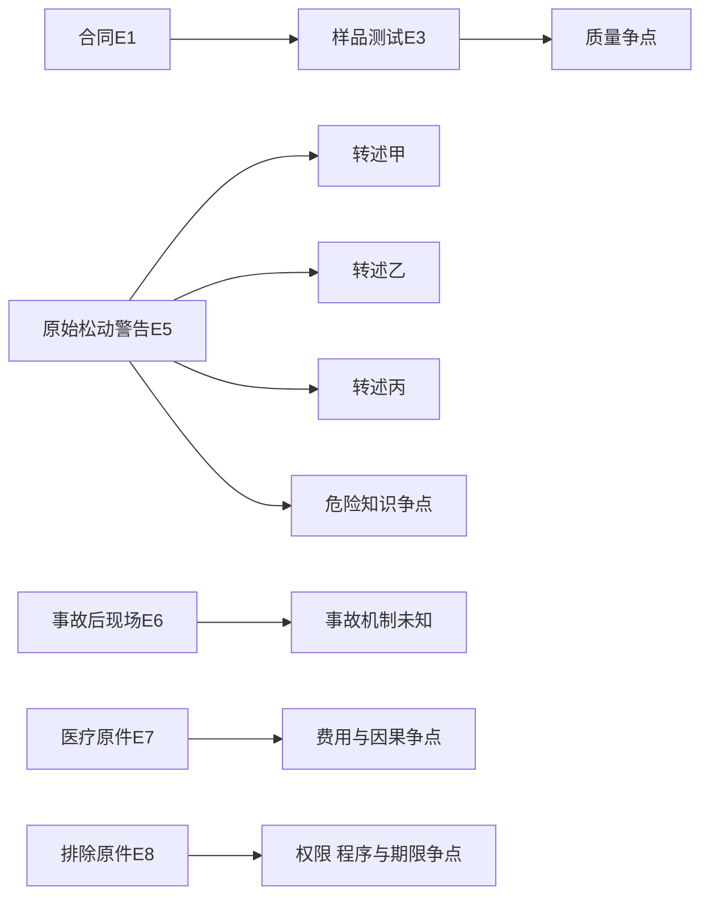

# 共同案情与证据：让三域回答同一问题

下列是教学合成案情，不是现实发生的案件或裁判。书架采购、场所损害和公共服务停用的主情境从恢复原稿复用；本轮补明价款、付款、送达、物件区分、损害项目、身份和变量。“存在原件”表示题设给有该原件，作者没有拿到现实当事人的文书。法源取得日期另由各域版本页记录，教学日期不能认证来源读取。

## 对象、地域与金额

B是私人阅读室运营公司；S是同域营业卖方；X是仅提供技术撮合的第三方平台。B/S以组织名义签约，X无担保、付款承诺或卖方代表身份。Lin是30岁的受邀读者和另一公共馆的本地居民。公司B与公共馆L分别独立，不能把公司采购当政府采购，也不能把公共馆拒入当私人公司行为。各案均在当地发生，不给跨境冲突法事实。

| 法域 | 本地教学映射 | 金额怎么使用 |
| --- | --- | --- |
| 中国大陆 | 浙江省杭州市辖内的国内私营有限责任公司；L为这个范围内教学构造的政府设立县级公共馆 | 价款10000人民币元、医疗5000元、手机主张300元 |
| 德国 | NRW州境内GmbH；L为该州教学构造的市立公共馆 | 价款10000欧元、医疗5000欧元、手机主张300欧元 |
| 英格兰与威尔士 | 基准在英格兰境内的private company limited by shares；L为英格兰教学构造的地方图书馆机关；威尔士差异另核 | 价款10000英镑、医疗5000英镑、手机主张300英镑 |

共同单位“教学货币单位TU”只固定请求的数量关系；本地数值是为程序金额教学任意选定，**不是汇率换算或购买力相等**。费率、法院金额门槛与损害计算须按当地有版本来源分析，不能从相同数字推断实际成本、福利、诉讼速度或制度优越。同一医疗行为在现实三地不会天然同价；实际比较还要固定医疗项目、收入、购买力、保险和时间。

公司合法成立是教学设定，不声称查到真实登记。未给真实县市、登记文书和馆章程，不能补出具体授权、真实被告或某地法院。区域页可以另标实际地方规则示例，但示例事实不能悄悄进入本案。

## F1 公司采购退款

2026-05-15，B通过X与S签约买十个可独立使用的书架，每个价款1000 TU，总价10000 TU；B当天全额付款，题设有付款原件。合同附件纳入双方约定：每架在卖方指定安装条件及均匀载荷下承重80 kg。05-20交付，收货单只确认数量和外观，约定技术验收尚未完成。

06-01，独立编号的一件同批样品依约定安装及均匀加载条件测试，在40 kg时不稳定。题设有原始测试记录，但同批代表性、缺陷在交付时是否已存在仍可争。06-02，B发出且S当日收到书面修复或更换要求，要求免费补救至06-10；通知没有“到期即解除”条款，也没有后来另发的解除或拒收通知。直到06-15，S没有回复或补救；物品可供检查，未使用架安全存放。B此时希望全额退款，并问返还书架怎样安排。

没有给免责、法律选择、法院选择、仲裁、保证或额外补救条款。这里的缺失是未知，不能解释为已确认不存在。还须分析通常检验何时可能发现问题、法律上的接受、补救期合理性、全批缺陷和解除/拒收条件。不能把内部验收未完成当各域统一的“法律上没有接受”，也不能把已收补救通知当已经有效终止合同。

## F2 阅读室场所损害

B控制同一私人阅读室，营业时间允许成人受邀免费进入；题设没有给Lin与B之间的入场合同或费用。05-28，员工原始书面消息报告书架固定连接松动，负责管理的员工M收到消息。事故前没有观察到警告、隔离或修理。

06-01，Lin按通常方式取书，没有攀爬，承载35 kg的书架倾倒。它是同批另一件，不是F1受检样品；F1测试不自行证明F2原因。Lin受到需治疗的身体伤害，实际支付医疗5000 TU，题设有治疗和支付原件；费用与本次事故的因果及合理性仍需分析。手机同时受损是Lin的主张，要求300 TU，但未给原购买、受损或维修记录。06-15，Lin希望就医疗和手机损失向适当责任人提出请求。

安装者I和制造者身份未知，安装、维护、生产缺陷及第三人介入均待查。没有伤情等级、长期损害、误工或专业结论；**没有给死亡或法律意义的重伤**。医疗金额不能替代刑事伤情条件。经理收到通知不能自动让经理个人取代公司承担全部责任；公司、安装者、制造者和自然人的不同义务/归责必须各自证明。请求不同对象也不能重复获得同一损失赔偿。

## F3 公共图书馆准入

L是另一家政府设立并由公共主体运营、提供免费普通借阅和阅览的图书馆。Lin是本地居民、符合普通使用条件，遵守通常规则，使用手动轮椅并需要无台阶通道；他不是L的成员、股东或雇员。

2026-06-01，Lin收到书面决定：从06-01至06-30全天结束，停止其借阅和阅览服务三十天。唯一记载理由是此前一次普通音量的开放时间政策批评。没有威胁、损坏、重复妨碍或违规则事实；没有给事前听取意见、答辩机会或独立复核记录。**排除理由是批评，题设没有按残障歧视的事实**；轮椅使用与可及性仍是程序和现实后果可能相关的条件。

06-15，Lin希望审查决定并立即恢复依法可以取得的服务，没有提出金钱损失请求。尚须查决定者权限、L的法律身份、具体行为分类、地方有效规则、可进入程序、期限、临时保护及可及替代服务。未给听取意见记录不能自行证明任何法域一定要求该程序；三十天可能在终局决定前届满，说明及时保护问题，不能自行证明临时救济条件已经满足。

## 证据对象与来源依赖

| ID | 题设材料及能支持的对象 | 未被它直接证明的对象 |
| --- | --- | --- |
| E1 | B/S原始合同、附件、签署、X页面识别S | 未知附加条款效力、B代表权限的全部现实手续 |
| E2 | 05-15全额付款、05-20数量/外观收货原件 | 合法终止、技术验收、退款已到账 |
| E3 | 06-01原始测试、样品编号、约定安装和加载 | 全批代表性、交付时缺陷、F2事故原因 |
| E4 | 06-02补救要求及已收记录、所写期限 | 合理法定补救期、解除/拒收已经生效 |
| E5 | 05-28原始松动消息，M收到；后续转发同源 | 所有自然人的刑事故意/过失、最终事故原因 |
| E6 | 事故后照片及Lin所见陈述 | 完整事故视频、专业因果或独立制造鉴定 |
| E7 | 治疗/付款原件5000；手机300只是未证主张 | 所有费用合理、误工、重伤、手机价值 |
| E8 | 排除原件、06-01收到、理由和起止日 | 权限、有效地方规则、程序合法、服务已恢复 |
| E9 | 三份转述都复制E8 | 三次独立观察或三份独立认责证言 |
| E10 | Lin轮椅与本地居民身份是合成设定 | 具体地方调整义务、实际馆登记和授权 |

E5转发三次仍只有一个原始警告；E9不是三个独立事件。材料条目存在不让未知事项变真，材料能否使用、由谁提出、达到哪种证明要求，分别由法域程序判断。

箭头表示材料来源或支持对象，不表示事故因果。要检验F2机制，另找原始安装记录、事故前检查和可靠技术评估；不能由Q直接画到A而宣布制造缺陷造成伤害。

## 改变一个前提，再研究

| 变体 | 改变的前提 | 必须重新分析的关口 |
| --- | --- | --- |
| F1-A | 仅一件不合格，九件可靠检验合格且可独立用 | 部分/全单救济、补救与合同目的 |
| F1-B | 买方改为自然人为家庭购买 | 消费者身份与法源选择，不能照搬企业采购 |
| F1-C | B尚未付款 | 没有已付价款可返，其他救济分别查 |
| F2-A | 警告可见易懂，Lin违反警告攀爬 | 警告是否足够、原因和贡献，不能预设零赔偿 |
| F2-B | 独立证据显示安装失败、制造合格 | 义务主体与机制，不能自动定罪 |
| F2-C | 医疗证据确认死亡 | 重新检索具名刑事分支，死亡仍不自动定罪 |
| F3-A | 反复损坏、原件齐全、劝阻无效 | 实体依据增强，权限/程序/期限仍查 |
| F3-B | L改为私人会员协会 | 使用权源、行为分类与程序入口重选 |
| F3-C | 排除理由改为使用轮椅 | 平等、残障和合理调整的当地规范另核 |

先遮住区域答案，任选一项重做主体—法源—条件—反方—程序—救济，指出哪项原事实被替换，以及未改变哪些事实。题目不要求唯一判决：有依据的条件结论、不同规则路径和明确未知都可成立。共同虚构规则任务见[[社会科学/63-法学/01-法源版本与跨法域比较#同版虚构规则：完整输入与缺失输入|版本/授权迁移]]与[[社会科学/63-法学/02-主体事实解释与证据程序#完整迁移题|证言/证明迁移]]；三域案例给各自规范依据和可核答案。
