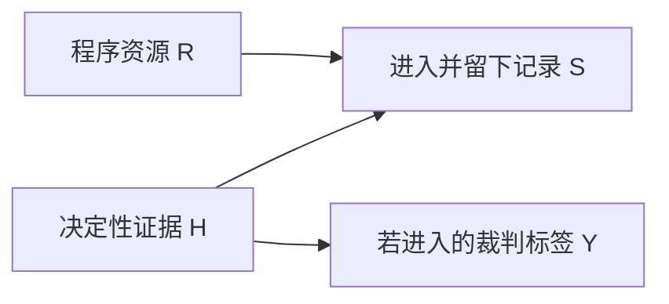

# 同题比较：同样的事实，怎样走到不同的法律关口

“书架不合格就退款”“收到危险报告就是犯罪”“公立馆不许进就提行政诉讼”，都把数个条件压成了一个结论。本页携带[[社会科学/63-法学/04-共同案情与证据接口|唯一共同事实F1—F3、E1—E10]]，将三域完整分析接回共同方法。先遮住下文答案，分别写出谁向谁请求什么、关键条件、最强反方、程序和可以兑现的有限救济。比较应显示究竟哪一步改变；同名“解除”“过失”“公平”不能代替这一步。

本案为合成教学题。订约/付款2026-05-15，交付05-20，测试、事故和准入决定06-01，补救通知06-02已收；三案均在**06-15研究请求**。法规及原判实际读取日为**2026-10-10**，不是新增的事故或立案日。程序数值仅另假设06-15启动对应程序。三域规则的版本、施行与实际阅读范围分别在[[社会科学/63-法学/10-中国大陆/04-规范版本法源读取与复核|中国大陆04]]、[[社会科学/63-法学/20-德国/04-德文法源与版本核对|德国04]]、[[社会科学/63-法学/30-英格兰与威尔士/04-法源版本与核读范围|英格兰与威尔士04]]；各区域具名条文、原判段落和最强反方是本页每项缩写结论的展开入口。

## F1：已付款为什么还不是已成立的全额退款

B的合同请求针对S；股东、读者Lin和仅提供技术中介的X各有不同角色。E2证明10000 TU确已支付，E1证明十件独立书架的80 kg约定，E3支持被测一件在约定安装/荷载下40 kg失稳。E3没有自行证明交付时已有不合约，也没有证明十件全部同样失稳。E4证明S收到修理/更换要求，不证明八天必然合理，更不是后来已经送达的解除声明。这里把争点说清，比给出“通常可以退款”更有用。

| 同一节点 | 中国大陆 | 德国 | 英格兰与威尔士 |
| --- | --- | --- | --- |
| 质量与初始救济 | 民法典615/617接582等；按约质量、补救类型及合理选择分别核 | BGB434(2)、437/439：约定性质、交付/风险时瑕疵、补救及限制 | SGA13/14及明示条款：描述、满意质量、condition/warranty归类；特定用途另需告知/依赖 |
| 从违约到退货的障碍 | 563及610的具体解除条件，补救合理期或目的不能实现；565行使、566返还 | 323/440补救期限或例外，349解除声明，323(5)重大性与部分履行，346—348返还 | 15A轻微到拒收不合理、35法律接受、11/35A的可分性/拒收范围；须有并有效行使拒收权 |
| 一件与十件 | 632可分范围及合同目的；不能凭样本一件全退 | 部分履行和对其余部分是否仍有利益；一件不等于全批 | 独立商业单元与合同可分性分别核；35A不创设原本没有的拒收权 |
| 特别的检验/通知问题 | 620—623检验及外观签收边界，隐蔽问题和约定期限 | HGB377还需双方商人及商事买卖；B为GmbH解决B一侧，S营业不自动证明S为商人 | 合同验收未完成不决定SGA35 acceptance；合理检查机会、时间和行为分别核 |
| 退款不能成立时 | 补救及有证损失等须各自成立 | 补救、441减价或损害等各有条件；载荷比不是价值比 | SGA53的warranty损害赔偿仍需证明价值差/损失；已付不消除独立赔偿可能 |

规则原文及完整应用见[[社会科学/63-法学/10-中国大陆/01-公司采购退款与合同救济|中国大陆F1]]、[[社会科学/63-法学/20-德国/01-采购退款与合同条件|德国F1]]、[[社会科学/63-法学/30-英格兰与威尔士/01-采购退款与合同条件|英格兰与威尔士F1]]。这些不是三种同义的“退货政策”。中国大陆和德国须在所选解除路线核补救与解除行为；英格兰与威尔士普通公司买卖**没有消费者统一的先修后退层级**，重点还在condition、接受与仍存的拒收权。合同补救安排、免责控制和通知仍需阅读，不能据此称买方随时无条件拒收。[民法典615—617、563—566、632](https://gdca.miit.gov.cn/zwgk/zcwj/flfg/art/2020/art_573d6ef5018b46b6a4e1f31ca085a710.html)、[BGB323、349、437—441](https://www.gesetze-im-internet.de/bgb/BJNR001950896.html)、[SGA35](https://www.legislation.gov.uk/ukpga/1979/54/section/35/2026-06-15)。

**完整有限解答。** 截至06-15，B有具体质量异议及调查/补救主张的事实起点；当前不能认定十件全单已经解除或10000应当然返还。先保存合同全文与安装附件、逐架编号和E3原始数据，核交付时状态、其他九件、检查/通知及时性、条款及补救可行性。S最强反方是交付后安装或测试造成失稳、样本不能代表九件、期限/检查不足或接受/条款限制；B须用对应证据回应，沉默不是技术自认。若选解除/拒收，再依本域形成、范围、通知和返还规则采取相应法律行为，不能把本页虚构成已经采取。

程序另写：B提出明确被告、请求、金额、事实及证据，核法院/有效仲裁或论坛约定、管辖和时效。中国大陆通常民事举证及高度可能性、德国ZPO286自由评价、英格兰与威尔士balance of probabilities不能简单换成同一百分数；SGA15A轻微性和UCTA合理性有特别负担，HGB377和中国大陆检验条款则需各自前提。法院受理不补实体验证，判令退款不证明S有资产或钱已到账。

**所有权是另一条链。** 付款、交付、验收、所有权、解除和返还分别定位。中国大陆一般动产交付规则、德国929的物权转移及985/986、英格兰与威尔士SGA16—19的特定化/意图规则不能混成统一“付款即所有”。应核本域转移条件、保留条款和物品身份；本题没有所需全部材料。合同有效期间也不能用“我拥有货物”绕过合同返还条件，或把解除说成所有权已自动全部转回。

补救机会可能减少可修复货物浪费，也让买方多等；拒收限制可能避免轻微问题导致交换被整体推翻，也增加接受、重要性和范围争议。这是对规则作用的理论解释。三域案例没有履约率、买方等待或成本数据，不能据本表认定哪一域实际最保护买方。

### F1-S：抽到坏样品后，批次主张能走多远

原F1的E3没有给随机选样方式，不能把“独立编号”读成“随机抽到”，也不能把下面的新设计写回 [[社会科学/63-法学/04-共同案情与证据接口#证据对象与来源依赖|原始证据表]]。**F1-S是单独的统计教学变体**，与F1-A的九件已经可靠检验合格、F2的另一架倾倒分别命名。全部记录仍是合成材料，不是新取得的真实测试或法院证据。

本变体固定原F1的订约05-15、交付05-20、检测06-01及请求研究06-15。新增假设是：十件书架编号01—10全部在抽样框中；在06-01同一规定测试时点，每件的潜在测试状态固定。测试定义为：按E1的卖方指定安装条件及均匀加载步骤，在40 kg时记录是否出现失稳；出现记为bad，否则记为非bad。假定判读无误、每次检测不改变其余件状态。**非bad只表示本次40 kg测试阴性，并不证明80 kg合同约定已满足**；bad也还不是已经认定的交付时法律瑕疵。$K$是该时点、该测试定义下十件中bad的件数，可取0至10，不是价款比例、损害概率或法律责任比例。

| 携带的对象 | F1-S明确固定了什么 | 还不能换成什么 |
| --- | --- | --- |
| 总体与分母 | 这批十件有编号物品；$K/10$中的10是总体件数 | 全部产品、所有使用时点；已检1件或2件是样本大小 |
| 时间与指标 | 06-01、规定安装与40 kg测试下的bad件数 | 05-20交付时不合约、80 kg合格情况、F2事故原因 |
| 请求对象与范围 | B向S研究合同救济；全单价款是10000 TU | 样本数或$K/10$自动决定可退金额；对X、Lin或制造者的同一请求 |

**先预测，再复算。** 事前选择两个分别实施的设计：设计S1在十件中简单随机抽1件，观察为bad；设计S2简单随机不放回抽2件，汇总观察为“恰好1件bad”，不区分抽取次序。遮住下表，先预测 $K=1,5,10$ 中哪种更容易产生各自观察，尤其想想“全bad”能否生成S2。编号和抽取记录保留供追踪，但下表分析的观察信息限于bad计数；没有暗中另加具体编号状态的模型。

| 同一固定候选 $K$ | S1：1件为bad的似然 $K/10$ | S2：2件恰好1件bad的似然 $K(10-K)/45$ |
| --- | --- | --- |
| 1 | $1/10$ | $1/5$ |
| 5 | $1/2$ | $5/9$ |
| 10 | $1$ | $0$ |

45是十个编号的等概率无序样本对数；分子一bad一非bad有 $K(10-K)$ 对。完整抽样空间、一般超几何推导、有序“先bad后非bad”为一半的原因，以及精确分数枚举，集中在 [[数学/30-概率与统计/06-随机变量变换联合分布与常见分布#不放回计数：批次状态与样本似然|数学主解释]]；它也接回 [[数学/30-概率与统计/03-似然负对数似然与困惑度#主轨：同一个公式，两种提问方向|似然的两种提问方向]]。带回来的答案应是：S1对更大的$K$有相对支持，仍没有确定$K$；S2观察到一件非bad，在理想模型内排除全bad，却没有证明其余八件非bad。似然不是$K$的后验概率，也不是法院采信程度；没有先验与更新办法，不报告“全批bad的概率”。

**从统计对象回到请求。** 样本对整批有信息，不代表十件请求范围已被证明。先保存编号、抽取过程、原始读数、测试定义和时间，再逐件说明证据支持的对象：是06-01测试状态，还是有材料连接到05-20交付状态？该测试与80 kg约定的关系怎样？若请求退某件或全单，分别对应哪些物品与价款？这些信息会改善F1中的批次论证，但仍需回 [[社会科学/63-法学/06-同题比较与共同案例完整解答#F1：已付款为什么还不是已成立的全额退款|F1请求链]] 核初始救济、补救/解除或拒收、行使与范围。即使另有材料确认全部十件在本次测试中bad，也没有凭这张表补齐上述法律前提；抽样模型更没有确定F2另一架的事故机制。

这项范围核查继续使用已展开的三域入口：中国大陆民法典632关于一物/数物的解除范围，德国BGB323(5)的整体解除限制，英格兰与威尔士SGA35A关于已有拒收权下的部分接受/拒收条件。这里只把“要退哪些物品、依据哪些事实”带回原链，**不新增统一的统计退款门槛**。[民法典632](https://gdca.miit.gov.cn/zwgk/zcwj/flfg/art/2020/art_573d6ef5018b46b6a4e1f31ca085a710.html)、[BGB323(5)](https://www.gesetze-im-internet.de/bgb/__323.html)、[SGA35A，06-15历史文本](https://www.legislation.gov.uk/ukpga/1979/54/section/35A/2026-06-15/data.xml)。本次2026-10-11复核限于这些范围条文及测试/请求的时间区分：民法典2020-05-28通过、1260规定2021-01-01施行；SGA35A由1994 c.35插入、1995-01-03生效，本次选择2026-06-15文本及其中2015-10-01消费者分离注释；BGB读取当前323(5)，六月适用版本仍沿用 [[社会科学/63-法学/20-德国/04-德文法源与版本核对|德国已核历史链]]，不把当前434(3)后来新增措辞倒填五月合同。三域的完整版本/施行链沿页首各区域04入口复核，本次没有重写或重新认证全套法源。

**撤去提示的迁移。** 保持同一十件、时点和测试，分别处理：①工作人员挑出外观最松的一件，测为bad，B据此引用S1表；②仍按S2抽两件，记录改成“至少一件bad”，B仍引用S2表。为每题写三句：原式能否使用及原因；若能应改成哪个事件/公式、若不能还缺什么；对06-15全额退款请求还须回查哪两类事实或法律条件。不要把非bad补成80 kg合格，也不要从S1较支持较大$K$推断全额退款成立。

> [!success]- 参考答案
> ① 偏选迹象使编号不再等概率，不能直接用$K/10$；须有迹象与测试状态、实际选择机制的资料，或改成真实可执行的概率设计。已测这件的直接测试信息保留，其他九件仍未被逐件观察。② 应数“至少一bad”，包括两bad：$1-\binom{10-K}{2}/45$；$K=1,5,10$分别为$1/5,7/9,1$，原S2的$K=10$零值不再适用。两题都还要核测试状态与交付时不合约的联系，以及对应法域补救、解除/拒收的条件、行使和范围；不要求唯一判决。

从 [[社会科学/10-共同工具/05-测量抽样与调查设计#从目标总体到真正收到回答的人|抽样设计入口]] 来时，携带的是总体、抽样框、选样机制和观察对象；返回F1时，应能说清“样本对批次有多少模型内信息”与“B向S请求哪些物品的什么救济”之间尚需哪些材料。F2的另一类问题是干预结果如何支持个体事故因果：即使边缘概率更精确，也仍要另查联合与识别条件；F1-S不替它补证。本页后续F2解释仍按独立案例阅读，不把未来识别扩展当作本例的等待条件。

## F2：危险知识可以共用，责任结论不能共用

B控制私人阅读室，Lin为免费合法受邀成人，正常取书而未攀爬。E5是M已收到的固定/连接松动原报告；E6是事故后照片与Lin陈述。它们支持检查危险知识、合理措施和事故机制，却未完成工程因果证明。倒下的是同批另一架，不是F1受检架；合同80 kg与安全缺陷也不是同一法律命题。

| 请求链 | 中国大陆 | 德国 | 英格兰与威尔士 |
| --- | --- | --- | --- |
| Lin对B的场所责任 | 民法典1198安全保障及1165一般过错；B自身管理、员工1191和第三人补充责任区别 | BGB823具体危险管理义务；B自身组织过错与831员工路径/免责条件分开 | OLA1957 s2控制与访客、被允许用途下合理照顾；充分警示、合理委托检查、自愿风险分别核 |
| 厂家/安装者 | 1202—1204产品缺陷/销售者与1165安装过错，身份和原因各证 | ProdHaftG主体、缺陷及抗辩，与安装者823路径分开 | CPA1987产品主体/安全缺陷/因果与negligence安装路径分开 |
| Lin自身行为 | 有证过错及其对损害作用影响减责，未攀爬不能补成有错 | BGB254贡献须有因果，不按成人身份机械减半 | LRA1945 s1按公正衡平减赔；警示存在不自动证明充分或贡献 |
| 5000医疗与300手机 | 医療票据证支出，合理性/因果仍需证明；手机金额及损坏未证 | 249合理恢复、253其他损害另证；286责任/287损失估算不同 | 实际医疗与疼痛等估值不同；手机须证明所有/用途、损坏和合理额 |

完整请求、抗辩、证据和程序见[[社会科学/63-法学/10-中国大陆/02-场所损害民事责任与刑事检查|中国大陆F2]]、[[社会科学/63-法学/20-德国/02-场所损害证据与责任|德国F2]]、[[社会科学/63-法学/30-英格兰与威尔士/02-场所损害证据与责任|英格兰与威尔士F2]]。三个法域都应把控制能力、适当措施与原因接起来；各自义务、推定和抗辩仍是规范问题。中国大陆1253特定物件脱落/坠落推定需先分类，不能移植成一切倒架举证倒置；德国产品责任私人财产500 EUR自负额与英威CPA5超过£275门槛只属于各自产品路径，不能当普通侵权门槛，更不能用数值相近推定相同制度。

**完整有限解答。** Lin可围绕已收到松动警告、继续开放与正常使用提出针对B的具体责任链，并以5000 TU有原件支出为已可具体提出的损失项目；还需证明事故关联和合理性。300 TU手机保持未证；补证不足不等于手机一定没有受损，也不使医疗链自动失败。B最强反方是报告对象未与倒架对应、隐蔽制造/安装原因、合理管理不能发现或避免；厂家最强反方是制造合规、后续安装/改动致险，安装者则可指出后来维护。取得连接件、事故架编号、报告位置、巡检与施工原件及可受质疑的技术意见，才能区分这些解释。B已知危险后是否应隔离的义务，与最初谁造成松动可以并存，不能凭找到了安装者便把B的直接遗漏变成无关。

程序中分别核被告、事故地/住所及法院、证据保全、专家和期限；无真实地点不编法院。临床原件不代替工程专家，私人报告不等于法院已采纳。英威若分入small claims，专家听证许可按CPR27.5，27.2排除通常35.4；本题尚未分轨。法院按责任关系处理一次损害，Lin不能因合同、产品与场所三条链而三次收同一医疗费。实际判决、保险付款和执行没有题设证据。

### 两个群体风险已知，仍要返回 Lin 的事故与证明

从 [[社会科学/10-共同工具/03-因果图反事实与识别#已知群体风险，为什么个体归因仍有界|潜在结果联合与 PN 的完整证明]] 返回时，带的是一个合成技术模型：同一参考总体、明确配置与窗口、一致性、无干扰、正值性，且分配 $A$ 与整对 $(Y(1),Y(0))$ 独立。四格 $(.1,.1,0,.8)$ 和 $(0,.2,.1,.7)$ 有相同两种干预损害风险 $.2/.1$，但对参考总体中实际配置1且已受损这类单位，PN分别为 $.5/1$。它说明群体风险可以约束一种反事实归因，又不能只凭两边缘挑出联合机制。**这两个数字不是 Lin 获赔50%/100%的概率，也不是三域的法定证明百分比。** 技术标签 $A=1$ 不表示违法，$A=0$ 也不自动等于适当措施。

**完整返回答案。** 应把五层问题分别写清：①群体机制层，上述数字只支持声明条件下的风险差和 PN 识别范围；②参考总体及个别证据层，须说明 Lin 的使用、装置、窗口为何属于该总体，事故架编号、报告位置与连接件、安装/维护/载荷资料是否支持具体机制，E5关于另一对象的信息不能直接填进来；③事实归因层，核“如果采取指定修理或隔离，本次损害是否会避免”，仍要说明真实可实施的措施与事故机制，而非把平均风险下降当本次必然避免；④规范归责层，按原三域链核责任主体、控制/权限、适当义务、违反及抗辩，识别技术原因不自动证明法律违法或全部责任；⑤证明层，回 [[社会科学/63-法学/02-主体事实解释与证据程序#认识上的相信不代替法律上的证明|证明负担、材料使用与证明标准]]，核具体民事/刑事阶段的待证命题，不能把模型概率直接当法院已形成确信。

这些问题可以同时有部分支持、部分未知：收到危险警告支持调查具体危险知识，未证明警告对应事故架就保留对象差异；医疗原件支持支出，却不替工程机制补证。已有 F2 的证据保全、可受质疑的技术意见、双方最强反方和三域责任路径继续承担返回后的工作。PN即使在模型内为1，也未证明 Lin 属于相应条件事件和参考总体，更未完成任何实际裁判。

**撤去方法提示。** 只改变统计材料：参考总体的联合构成现给为 $(.05,.15,.05,.75)$，其余合成模型条件不变；再另设该四格只来自已进入裁判记录的单位，记录选择机制未知。分别写一段有限 F2 简报：哪项模型结论能给出，哪项关于 Lin 的结论仍不能给出，下一份最有判别力的材料是什么？不得用技术配置编号代替义务，也不得填一个胜诉率。

> [!success]- 条件答案
> 第一变体中，两边缘仍为 $.2/.1$，平均风险差 $.1$，条件 PN为 $.75$；它只对给定参考总体中的配置1受损单位成立。Lin的总体联系、事故对象、指定措施与工程机制仍未知，三域的规范和证明链不因 $.75$ 自动成立；应优先取得能把原警告、事故架和可避免机制接起来的编号/连接件/安装维护记录与技术意见。第二变体额外缺选择与总体连接，记录中的四格不能自动当所有相关使用单位的联合分布；先查哪些事故进入记录、未进入者为何缺失和标签如何产生，再讨论能否运输风险或归因。两题均无已证胜诉、定罪或付款，不能把概率模型的答案改成真实诉讼结果。

### 刑事对照：医费不能证明重伤，也不能排除所有监管罪

三域在这里产生实质差别。中国大陆刑法235的过失致人重伤须法律意义重伤，134/135或134之一还须生产作业、法定情形/严重后果或现实危险等各自前提；5000医疗和经理收件不够。德国StGB229的过失身体伤害**不要求重伤**，须对具体自然人证明义务、实际能力、可预见/避免、因果及过失；GmbH不是该自然人罪的行为人。英威更贴近已知营业风险的入口是HSWA3/33雇主经营活动对非雇员的风险义务，未死亡仍可能涉及监管罪；s37经理责任须先有法人犯罪，再核同意、纵容或可归责忽略。OAPA致伤罪和死亡后的manslaughter另选构成。完整具名法源在上列三个F2页。

因此当前答案是“分别有待查证的刑事入口”，没有任何已证定罪。调查线索、起诉条件、审判证明和刑罚不是一件事。英威HSWA40合理可行抗辩的法定负担不能改写成全部罪行均由被告证明无罪；三域的刑事证明也不能由民事过错结论替代。改变为有医学死亡证明，只增加死亡事实；中国大陆、德国及英威各自死亡因果、个人/组织构成、前瞻风险和程序仍须重核。

## F3：实体理由强，为什么及时恢复仍要另一条链

L与B不同。共同题给政府设立的公共图书馆、本地普通资格、轮椅通行需要和E8原决定：唯一记录理由为普通音量政策批评，06-01至06-30禁借阅及阅览。没有给真实县市、地方细则、决定者授权、扰乱行为或替代服务。E9三份复制不是三个独立证人。轮椅身份不证明本次决定因残障作出。

| 关口 | 中国大陆 | 德国NRW | 英格兰与威尔士，基准英格兰 |
| --- | --- | --- | --- |
| 公共关系与权限 | 公共图书馆法33/42/44等；政府设立不直接确定个别行为属于行政诉讼对象 | GO NRW8居民公共设施准入、用途及地方章程；准入与日常使用的公/私法关系可不同 | PLMA7服务义务与19 byelaw制定/排除权限；上位制定权不证明本馆有效细则 |
| 批评与秩序 | 普通批评缺少44所需破坏/扰乱及劝阻无效事实；权限、实体及程序分别核 | GG5观点自由及平等约束；不得把巴伐利亚原判的市政厅/州法移入NRW | HRA/Article10、公平和适当目的；Article10不是任意入馆通行证 |
| 残障需要 | 图书馆及无障碍规范条件；具体障碍/责任主体另证 | BGG NRW合理调整；AGG民事关系/受保护特征另外选择 | EA20/21/29及Sch2调整，与15/19/27因果及149 PSED决策义务分开 |
| 通向审查 | 服务投诉/主管纠正无需先证明L为行政机关；复议/行政诉讼另以个别行政性质及各自条件为前提；民事关系另证 | 公法准入及行为形式支持VwGO；NRW通常无前置Widerspruch但例外须核 | 公共职能JR核足够利益、permission及替代；EA/HRA个人请求不是同一程序 |

规则、双方最强论证与程序细节见[[社会科学/63-法学/10-中国大陆/03-公共图书馆准入权限与及时救济|中国大陆F3]]、[[社会科学/63-法学/20-德国/03-公共准入程序与救济|德国F3]]、[[社会科学/63-法学/30-英格兰与威尔士/03-公共准入程序与救济|英格兰与威尔士F3]]。原件只记录普通批评，给Lin挑战权限、目的和限制范围的有力起点；机关若主张反复破坏或威胁，须拿相应原材料，不能让“图书馆需要安静”补造事实。但尚缺地方授权链，当前仍不把一个未指定现实机关判为已违法。给回应机会、公平和正式口头听证也不是统一同义义务。

### 所求命令要写到它实际改变什么

06-15距离月底不远，终局撤销可能来不及恢复当月使用。应具体写“停止执行既有排除”“按已有资格恢复借阅/阅览”或“新建某项无障碍措施”，分别核即时工具及条件，不用“申请了审查”概括。

- **中国大陆**：行政路径成立后，诉讼通常不停止执行，按行政诉讼法56或复议法42核具体停止条件；停止既有决定未必提供所需积极服务。如果确认另有民事请求与管辖，民诉法103诉中行为保全与104诉前保全分别研究：诉前紧急/难弥补及应担保，48小时是接受申请后的裁定期限，不是必准；采取后30日主程序及错误责任/范围还要核。行政分类未明不自动创造民事诉权。[民诉法103—105、108、111](https://fgk.chinatax.gov.cn/zcfgk/c100009/c5220330/content.html)
- **德国**：撤销现有行政行为的停止效力及例外按VwGO80分支，积极/事实准入另核123且123(5)不能取代80。若积极恢复当月服务实质已预支主诉利益，例外须严格成功前景和严重、不可事后消除且不宜要求承受的损害；30日届满本身不证明这些事实。普通分支不能全部套这个严格标准。[BVerwG 6 VR3.13 Rn5、7](https://www.bverwg.de/de/261113B6VR3.13.0)
- **英格兰与威尔士**：JR不自动暂停。临时命令按实际效果分prohibitory/mandatory；标题写stay仍可能要求积极作为。要求公共机关积极恢复服务的mandatory分支需strong prima facie case的独立门槛，还要损害和平衡；不能只给可争辩理由或“快到期”。一般公法临时措施没有因此一律加高。[RRR [2024] EWCA Civ530 §§87、112](https://caselaw.nationalarchives.gov.uk/ewca/civ/2024/530)

**完整有限解答。** Lin应携E8原件、已给居民资格及具体想恢复的服务，要求说明有效权限、细则、事实、范围和复核，并及时选择有条件成立的主程序及窄而有效的临时请求。最强机关反方是实际管理授权、未给的完整记录、第三人/公共利益和可达替代服务；这些尚未知，不能说存在，也不能说已被排除。Lin需补真实主体与授权、目前实际禁用部分、具体服务需要和影响、可能替代服务及所求命令。没有给考试、唯一馆或被拒坡道，不为证明紧急编入。

终局审查、撤销/重新处理、积极命令和赔偿各有自己的权力与条件；本题Lin不求钱，不把公法瑕疵变成全额精神赔偿。获得命令后还要观察实际恢复借阅、阅览与通行，才能说救济兑现。六月原事实已经足以做有条件的完整规范分析；取得未来真实法庭结果不是本合成题答案成立的前提。

### 期限和地域不能跟着程序名一起移植

中国大陆复议一般60日、行政起诉一般6个月及法定前置/特别起算分别核；普通投诉不保证停执行或停时钟。德国在正确救济指示等前提下，一月期限从06-01到07-01，未给指示须另核VwGO58，不能把一月写成30天。英威JR及时且一般最迟三个月；EA一般六个月、HRA一般一年不替代选用JR的更严期限。时限未过不意味着当月服务仍可等到最后一天才处理。

威尔士变体不能只换国名。2012 Welsh Byelaws Act s6与Sch1 Pt1列图书馆PLMA19的特定county/county borough附例免确认程序，仍有咨询、至少六周公告及生效/公开要求；英格兰确认要求不能原样复制，其他未列附例也非一律免确认。主管转移、旧规则过渡和通常在Wales签发/审理分别核区域03/04。真实馆细则仍未给，差别没有证明基准或威尔士任何现实决定已经有效或无效。

## 费用和时间数据怎样参与比较

TU只任意映射为同数CNY/EUR/GBP，目的是练习规则阈值；不代表汇率、同购买力、同经济损失或同救济价值。因此本页保留可复算的**域内条件算例**，不排序司法效率。

| 六月程序教学假设 | 条件计算 | 结论停在哪里 |
| --- | --- | --- |
| 中国大陆F1仅10000元的普通财产请求 | 费用办法13受理费基础档50元 | 具体程序、减半、减免另核；不是总成本或全额退款成立 |
| 德国F1普通一审10000 EUR金钱请求 | 至10000档283×3=849 EUR | 当年一般AG管辖至10000；495a另为不超1000，不能称所有AG案简化 |
| 德国F2另假定请求5300 EUR | 至6000档193×3=579 EUR | 300仍未证；医费损害不是治疗合同争议；不含律师/专家 |
| 英威F1仅£10000金钱、无利息附加 | fee1.1(g) £455；若另改£10001为5%=£500.05 | usually small claims金额范围不等于已经分轨；非金钱/利息重新查档 |
| 英威F2另假定仅定额金钱£5000或£5300 | 分别£205、£455启动费 | 不认证300，也不认证small claims；非道路人伤还看PSLA而医费不是PSLA |
| 英威F3假设JR permission申请 | £174 | 只这一阶段，不是全部JR费用或全部临时救济成本 |

来源、法表附注和实际施行范围在各域01/02/04；德国2025 Nr109费表2025-06-01施行，Nr318一般金额管辖/有关程序门槛2026-01-01施行；英威用06-15历史Fees表，不以10月现行表替换。中国大陆F2的案由和人格/财产分类未全部给定，本表不为了对齐而编一个同类受理费。

研究可提出竞争机制：低启动费可能减少入口障碍；专业成本不能充分回收可能使胜方仍难负担；严格临时门槛可能减少过早替代机关决定，也可能令短期权利难获实际保护。要检验这些推论，需记录各域同类案的请求性质、难度、财务条件、代理、减免、处理时间、败诉风险及执行，而不是只比较表面比例。案件筛选、诉前和解、不同损失金额与购买力都可能解释结果。带这些变量回[[社会科学/10-共同工具/03-因果图反事实与识别|因果识别]]；再回[[哲学与文化/20-论证知识与规范/02-伦理与政治正当性|伦理与政治正当性]]判断谁应承担等待和错判风险。规范合法、经验有效及分配正当分别需要证据。

## 进入裁判样本后，胜诉率还代表谁

费用表给的是程序条件下的域内算例；要比较记录中的胜诉率，还必须追踪**全部争议、进入程序、形成裁判记录**三层分母。下面另设一个虚构制度的100件同类型采购争议，不属于任何真实国家，也不是前文F1、F1-S或F2的新事实。用同一批争议比较两个进入方案，固定一个教学观察窗口：窗口开始前测量资源与证据，窗口内决定进入，窗口结束时所有进入者均已完成同一裁判程序并被记录；不另设未结案、和解或不公开造成的缺失。现实中这几道选择往往各有机制，不能从费用表认定它们已被控制。

令 $R=1$ 表示程序资源充足，$H=1$ 表示一个指定实体要件有充分决定性证据。二者在窗口开始前固定，四个 $(R,H)$ 层各25件；其余裁判条件固定。规定每件**若进入该程序**的潜在裁判标签为 $Y=H$：1表示胜诉，0表示败诉。这个规则只用于合成计算，没有假设现实法院完美分类；未进入者尚无实际判决。初始进入规则为 $S=R\lor H$：资源充足者都进入，资源不足者只有证据充分时进入。$S=1$ 在本题同时表示进入并最终留下裁判记录。

| 资源 $R$ | 证据 $H$ | 全部争议（件） | 原规则进入（件） | 原记录胜诉（件） | 全部进入时胜诉（件） |
| --- | --- | ---: | ---: | ---: | ---: |
| 0 | 0 | 25 | 0 | 0（无记录） | 0 |
| 0 | 1 | 25 | 25 | 25 | 25 |
| 1 | 0 | 25 | 25 | 0 | 0 |
| 1 | 1 | 25 | 25 | 25 | 25 |
| 合计 | — | 100 | 75 | 50 | 50 |

原记录胜诉率是 $50/75=2/3$；低资源组是 $25/25=1$，高资源组是 $25/50=1/2$。**低资源组的100%只描述进入者**：其程序覆盖是25/50，另外25件没有裁判标签，不能报道为“已经败诉”。若人人进入，在题设裁判规则下，全部100件的潜在胜诉率是50/100，两个资源组各为25/50。总体四格等大使 $R$ 与 $H$ 独立，也使 $R$ 与 $Y$ 独立；原记录中却有 $P(H=1\mid R=0,S=1)=1$ 与 $P(H=1\mid R=1,S=1)=1/2$。

这里 $S$ 是碰撞点：只看有裁判记录，相当于条件化 $S=1$。在这个子集中，资源不足会排除证据不足者，于是资源和证据产生负关联，并沿 $R\to S\leftarrow H\to Y$ 表现在胜诉率中；图没有设定 $R\to Y$。一般碰撞点与条件化的解释见 [[社会科学/10-共同工具/03-因果图反事实与识别#因果图把结构主张放到桌面上|因果图主解释]]。带上前面的费用、程序资源、100件争议总体和进入机制，回来回答：**费用表本身能证明 $S=R\lor H$ 吗？** 不能；它没有各层争议数、未进入者、选择过程和实际标签，本图只是待证伪的模型。

**只取消入口门槛会怎样？** 假设程序援助仅使原先未进入者也能进入，即把 $S$ 设为1；资源、证据、裁判规则及观察窗口均不变，也无其他作用。记录增至100件，胜诉仍是50件，胜诉率降至1/2；低资源组的覆盖从25/50升到50/50，胜诉率却从25/25降至25/50。高资源组仍为50/50覆盖、25/50胜诉。这是同一批争议的方案比较，不是两个年份的现实统计。覆盖增加与记录胜诉率下降可以并存；仅据这两个数，不能判定实体侵害更多、法官偏见更强或制度更正当。新增的25次败诉是援助后按规则生成的实际标签，不是原先已有而未报道的判决。

**从可见记录到全部争议，还缺哪一格？** 原模型的 $(R=0,H=0)$ 进入概率为0，没有任何观察支持。若只拿75条裁判记录，不能从中恢复该层标签或选择率；本例能够写出25件和 $Y=H$，来自公开题设。一个同样生成这75条记录的替代模型，可以保留未进入的25件及选择规则，却把它们进入后的标签全部改为1；全入后的胜诉率就会是75/100，而非50/100。因此“全入会降到1/2”依赖固定裁判规则这个前提，不能由旧裁判日志单独识别。零选择概率的倒数无定义，大权重不能生成缺失标签；一般支持集条件回 [[AI/10-机器学习与深度学习基础/21-因果机器学习选择偏差与反事实评估#反事实评估从支持集开始|支持集主解释]]。

若下一步要从群体风险推个体归因，带着**参考总体、哪些干预边缘已被识别、分配与潜在结果联合独立是否成立**，返回 [[社会科学/10-共同工具/03-因果图反事实与识别#已知群体风险，为什么个体归因仍有界|群体风险到个体归因的边界]]。本例在选中裁判记录里的比例，不能直接充当那里假定已识别的干预边缘；两组合成机制与数字分别计算，不拼成一份司法数据。

### 遮住答案，改变选择规则与证据

不看下一段，分别列出进入数、胜诉数、两个资源组的覆盖与胜诉分母，并判断哪条原前提失效：①只让 $S=1$；②保持原进入规则，但把低资源组25件 $H=1$ 全改为 $H=0$；③援助既让 $S=1$，又使原25件 $(0,0)$ 获得充分证据变成 $(0,1)$。若还要预测裁判标签，把本例对应到AI标签观察变量，说明随机拆分旧记录究竟检验谁。

> [!answer]- 完整条件答案与返回
> **①** 全入100、胜50，率1/2；低资源覆盖50/50、胜25/50，高资源覆盖50/50、胜25/50。只改变入口的反例成立，$H,Y$不变。**②** 四格人数变为50、0、25、25，原规则进入50、胜25，也得到1/2；低资源覆盖0/50、胜诉率无定义（无进入者），高资源覆盖50/50、胜25/50。相同的总体记录率下降伴随不同覆盖和证据组成，不能凭下降反推“援助有效”或“裁判规则改变”。**③** 四格人数变为0、50、25、25，全入100、胜75，率3/4；低资源覆盖50/50、胜50/50，高资源覆盖50/50、胜25/50。$Y=H$作为裁判函数仍固定，但同一争议的$H$变了，故其潜在$Y$也变了，“$Y$不变、援助仅作用于$S$”失效。
>
> 要区分这些现实竞争机制，需有同一口径争议抽样框、资源及援助分配、援助前后的证据保存/取得、起诉和和解/撤回、结案与公开时间，以及按层统计的进入数和裁判结果；还需识别援助效果的设计，不能把补字段当作因果证明。费用变动可能只改入口，也可能连同代理、证据形成或案件组成一起变；本题没有证明哪种现实机制发生。
>
> **裁判预测返回：** [[AI/10-机器学习与深度学习基础/21-因果机器学习选择偏差与反事实评估#选择机制决定我们能看到哪些标签|AI的观察标签小节]] 中原 $R$ 表示标签被观察，本例 $R$ 表示资源，必须显式写 $R_{\mathrm{observed}}\leftrightarrow S$。随机拆分75条旧记录只检验选中样本，零支持格仍未验证；法院标签也不是全部社会交易中的违法真值。回本节时同时带回目标总体、进入机制和标签定义，不能把两页的 $R$ 静默混用。

以上完整计数及两项改证据答案可用标准库源码 [[社会科学/80-实践/assets/litigation_selection.py|litigation_selection.py]]，输入 [[社会科学/80-实践/assets/litigation-selection-input.json|固定四格与情景输入]]、输出 [[社会科学/80-实践/assets/litigation-selection-output.json|精确分数计数]] 复算。在库根运行 `python3 -B 社会科学/80-实践/assets/litigation_selection.py`；输入是有限合成争议，输出不是真实司法或学习结果。

## 迁移检验：先改变输入，再改变答案

下面不是额外的新案件记录。遮住答案，在三域各写一段有限简报：指出被改变的那个关口、最强反方、尚缺的事实及应回读的来源。不得把虚构Z的七日、一年规则迁入真实法域。

1. F1-A/F1-C合并：九件有可靠合格记录，仅一件有缺陷且独立可用；B未付款，从未解除/拒收。B要求“退10000并赔5000”。
2. F2-A/F2-B合并：出现可见且可理解的警示，Lin违反警示攀爬；独立资料确认制造合规、安装失败。手机还是无原件。
3. F3-B：L改为私人会员协会，其他排除理由不变；再另设F3-C，书面理由明确改为使用轮椅。
4. 日期变体：仍是05-15公司合同、06-01事故/决定，只另设10月首次起诉或复议。哪项实体、程序、过渡与期限必须重新研究？

> [!answer]- 条件答案：范围和程序如何重选
> **一**：当前一件缺陷仍不证明交付时已有，先保留质量争点。九件可靠独立可用削弱全批目的失败，各域分别查632、323(5)、35A/接受与商业单元；未付款没有已付款可返，没声明不能写成已经解除/拒收。5000没有损失或有效赔偿依据。保留有条件的补救、对价款抗辩或赔偿研究，不把全部救济删掉。中国大陆和德国的补救/行使条件不能直接替代英威接受/拒收规则。另改自然人家用时三域消费者定义、合同类别和取消/瑕疵救济都须重选，公司的答案不能只把主体名称替换。
>
> **二**：制造缺陷前提削弱，转查安装者和B已知后的措施；警示须在各域满足具体义务要求，Lin攀爬的许可/因果/贡献亦须查，非固定零赔或减半。当前证据不证明所有损害由攀爬单独造成，手机仍未证。各域刑事链重做具体过失、个人/组织及监管构成，不能由民事减责推出全部无罪。
>
> **三**：先改关系识别。中国大陆公共馆及行政行为前提、德国GO准入/公法路径、英威PLMA/JR公共职能前提不能原样保留；协会章程、合同和具体平等规范须各域重查。若在原公共馆另改为轮椅直接理由，新增原因让对应残障/平等请求有更具体事实基础，但调整、歧视类型、适用对象及程序各自成立。私人身份不证明所有平等法均不适用；残障理由也不自动满足即时积极命令全部门槛。
>
> **四**：固定行为仍在六月，不由十月起诉变成十月事故。中国大陆7月施行的复议实施条例、9月施行的民刑交叉规定仅在符合新程序日期/范围的独立分支核；实体与既有期限另查。德国六月434旧文由原刊和增量核对；2026 Nr212一般07-23施行与EGBGB229§72援引截至07-30版本存在文字张力，十月五月合同的旧瑕疵规则有较强目的/体系解释支持，却不能伪称已获直接权威确定；B2B新增可维修性另明确2028新合同。2026 Nr152十月执行增量须按具体动作核。英威Fees/CPR和当日PD重新选日期，六月金额不能冒充十月费率。F3禁令已到期，继续审查利益/可得救济与已过期限另评；不能用换读取日让时钟重启。

返回[[社会科学/63-法学/05-完整简报与跨域迁移|完整简报]]，把每项结论写成另一个人能够反驳的条件链，再从区域原文检验。学习证据是读者能在没有答案提示时重新选法、区分缺证和反证、提出最强反方及可执行的有限救济；本页提供解答不证明任何真人已完成。
