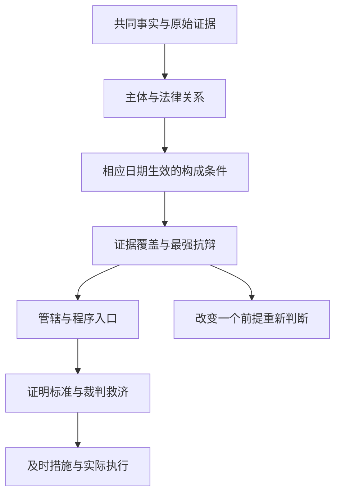

# 中国大陆：同一案情怎样产生不同法律问题

本区域用三件完整合成争议训练法律适用。公司 B 向供应商 S 采购十件独立书架，是合同问题；书架在 B 的私人阅读室倒下伤害 Lin，是场所安全、产品和安装责任问题；另一个政府设立的公共馆 L 禁止 Lin 使用服务，是公共服务、权限和救济问题。B 与 L 是不同主体。不能把采购合同的当事人、损害赔偿的被告和公共管理决定的实施主体合并为一个“责任方”。

固定输入来自 [[社会科学/63-法学/04-共同案情与证据接口|共同案情与证据接口]] v1。阅读时携带 F1–F3、E1–E10，先区分已经给定的事实、尚待证明的事实和规范结论。金额使用教学单位 TU；本区域仅为程序算例把一个 TU 写成一元人民币，既不主张汇率等值，也不比较购买力、律师费用或制度效率。

| 读者的问题 | 主解释及返回任务 |
| --- | --- |
| 付过钱，供应商不答复，可以要回全部价款吗？ | [[社会科学/63-法学/10-中国大陆/01-公司采购退款与合同救济\|公司采购退款与合同救济]]：带合同、检验和催告记录进入；返回时分别写出质量违约、解除权、解除通知、退款范围。 |
| 有伤、有医疗票据，就能告任何相关公司吗？ | [[社会科学/63-法学/10-中国大陆/02-场所损害民事责任与刑事检查\|场所损害民事责任与刑事检查]]：带事故机制和主体职责进入；返回时分开 B 的管理过错、产品缺陷、安装过错及刑事构成。 |
| 公共馆禁入，应该投诉、复议还是诉讼？ | [[社会科学/63-法学/10-中国大陆/03-公共图书馆准入权限与及时救济\|公共图书馆准入权限与及时救济]]：带原决定和馆的登记、授权资料进入；返回时说明可确定的实体缺口及仍有条件的程序路径。 |
| 我查到的法条为什么适用于这一天？ | [[社会科学/63-法学/10-中国大陆/04-规范版本法源读取与复核\|规范版本法源读取与复核]]：带行为日、程序日、发布日期和施行日进入；返回时给出版本选择及未能认证的地方规则。 |

三案均以 **2026 年 6 月 15 日当事人的研究请求** 为判断时点，并在 **2026 年 10 月 10 日** 实际读取法源。后出的程序规则另作复核说明，不能倒填当事人在六月已经采取了某项行动。下列结构的箭头表示“需要继续证明”，不是自动成立。

财产权决定物的归属与排他权，合同请求决定谁应按约履行或退还价款，侵权责任保护受害人的民事权益，行政救济审查特定公共权力行为，刑事程序审查国家是否可以对具体行为人定罪处罚。一个事故可以触及数条链，但每条链的主体、条件、证明责任和结果都要重新核对。本区域的裁判分析是条件论证，没有真实当事人委托、案件立案或裁判结果。
