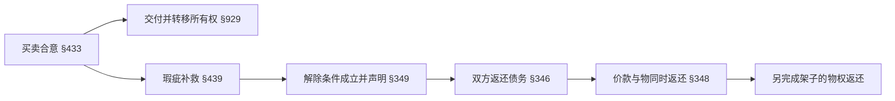

# 采购退款与合同条件

F1中，B在05-15已支付十件独立书架的总价10000 TU；06-01按约定安装测试的一件在40 kg不稳定，而合同约定均匀承重80 kg。S在06-02已收到免费修复或更换要求，06-10是通知所写期限，06-15仍未补救。**这些事实支持瑕疵和补救争议，尚不足以说合同已解除或全部10000已成为返还债务。**通知没有到期解除条款，也没有后来解除声明。共同事实和E1–E4见[[社会科学/63-法学/04-共同案情与证据接口]]。

本页截至2026-06-15分析。实际2026-10-10读取的BGB §434(3)已含后来新增措辞；06-15基准发生在修法前，须从修法增量重建当时条文。对假设十月起诉的五月合同，EGBGB Art229 §72的日期与一般施行日期存在文字张力；独立读取的立法说明支持继续使用旧瑕疵规则的目的与体系解释，须同时保留这项证据及解释边界，不能凭“旧合同”标签免除所有新规定。下面用到的约定承重论证位于§434(2)，不受该次修法改变；重建位置和原刊日期难点见[[社会科学/63-法学/20-德国/04-德文法源与版本核对]]。不能让英文2021译本替代这项核查。

## 先选请求对象，再决定法律身份

买卖主给付是S交付并使B取得所有权、交付无物和权利瑕疵的物；B支付价款并接收物（BGB §433）。E1中的卖方签约身份决定请求首先指向S。X提供撮合，不因显示订单、传消息或保存退款按钮就承担卖方退款债务。若另证明平台担保、自行销售或有代理行为，才另选请求基础；当前事实没有这些前提。[BGB §433](https://www.gesetze-im-internet.de/bgb/__433.html)

B为合法成立GmbH，因此公司作为权利义务主体，与股东或员工个人分开；GmbHG §13(1)规定公司自己有权利义务，§13(2)通常以公司财产对公司债务负责，§35规定经理代表公司。§13(3)将GmbH列为HGB意义的商业公司，结合HGB §6可以确认B一侧的商人身份。这个结论来自组织形式，不能推广成“任何企业都是Kaufmann”。S仅给为营业卖方：还须按HGB §1经营种类规模、登记或具体组织形式判断。平台也是企业并不能补齐S的身份。[GmbHG §§13、35](https://www.gesetze-im-internet.de/gmbhg/BJNR004770892.html)，[HGB §§1、6](https://www.gesetze-im-internet.de/hgb/BJNR002190897.html)

还须核真实合同中的有效限制：BGB §444阻止卖方在欺诈隐瞒瑕疵或承担质量保证的范围援引瑕疵免责。约定80 kg不自动等于另行承担Garantie；未知条款既不能被补成免责，也不能先宣布全部无效。§323(6)还排除买方单独或压倒性地造成解除事由等情形，当前符合指定安装和未使用事实使这项抗辩缺少已给基础，却应保留具体原因核查。[BGB §§323、444](https://www.gesetze-im-internet.de/bgb/BJNR001950896.html)

GmbH不是BGB §13所指主要为非职业经营目的交易的自然人消费者。这是B2B采购，法定远程消费者撤回权不能仅因“线上买”就适用。商业退款保证若另有合同约定应核对该约定，不能从题设未给条款推断它不存在。

## 瑕疵、检查通知与补救是三个问题

**瑕疵判断。** §434要求在风险转移时满足约定、客观及安装要求。80 kg均匀载荷及指定安装条件进入E1合同附件，正确安装下40 kg不稳定直接挑战约定质量（§434(2)）。还要核对测试方法、同一编号、稳定性指标、交付时缺陷是否已存在；付款、签数量外观收货单都不自动证明技术性能合格。反过来，内部技术验收未完成也不自动使HGB检验义务停止。E3只是一件独立样品，同批因果和代表性需要其他证据，不能把“同批”当作十件均有缺陷的法定推定。

**商业检验通知。** 如果买卖对双方都是商事交易，HGB §377要求在通常业务过程中可行的范围尽快检查并及时报告可发现缺陷；隐蔽瑕疵在发现后及时报告，否则可能视为认可。§377(4)以及时发出通知保全权利，题设已收并非适用所必需的更高门槛；§377(5)对卖方欺诈隐瞒另有例外。B已经是商人，但S身份和本交易商事性仍须补齐。即使§377适用，05-20到06-01十二天不自动判迟：要问正常业务检验能否更早发现、检测要求与成本如何、此项是否隐蔽。06-02通知紧接发现，是及时性的强证据，仍应具体判断“unverzüglich”，不能赋予固定全国一天或十四天规则。[HGB §§343–344、377](https://www.gesetze-im-internet.de/hgb/BJNR002190897.html)

**补救权。** 在瑕疵权利未丧失时，§437 Nr1接到§439。买方原则上选择修复或交付无瑕疵替代物，卖方承担所需费用；买方须提供物以便补救（§439(5)），已安全保管且可检查有利于B。卖方可按§439(4)主张特定方式成本不成比例，仍须比较无瑕疵价值、瑕疵意义和另一方式是否无重大不便可用。不能只因一次测试失败就说卖方丧失补救机会。[BGB §§437–440](https://www.gesetze-im-internet.de/bgb/BJNR001950896.html)

补救通知的两项功能必须分开：描述缺陷可以履行§377的报告义务；给卖方适当机会才可能满足后来解除所需补救条件。同一封信能做两件事，但“通知及时”不等于“截止06-10的八天必然合理”。书架风险、修复替换供应时间、检查安排和双方实际合作决定合理期。S持续沉默不等于已明确最终拒绝；免责、无须再等的条件要按§323(2)、§440分别审查，不能凭愤怒略过。

## 从补救失败走到解除，再到返还

通常路线是§437 Nr2 → §323适当补救期届满无结果 → §349向S作出解除声明。§440补充卖方拒绝两种补救、失败或买方无法合理接受等无需再设期限的情形。修复两次失败的通常规则不能被写成任何瑕疵必等两次；没有任何尝试也不能虚构两次失败。

06-15已超过通知所写日期；若适当期已届满、权利未因§377丧失且解除障碍不存在，B可能已经**取得解除权**。但取得与行使不同：本题明确未给解除声明，不能宣告合同06-10自动消灭。以后明确向S表达解除意旨、范围并送达，才进入下一阶段。仅有补救要求或内部“我想退款”，不满足这一步。[BGB §§323、349](https://www.gesetze-im-internet.de/bgb/BJNR001950896.html)

全额解除还必须问十件范围。§323(5)对部分履行要求买方对其余履行无利益才能解除整体，对不合格履行禁止因轻微违约解除。十个架子可独立使用、单价可分，使“只一件证实有问题”下整体失去利益的证明更困难；危及身体的稳定性缺陷可以很重要，但严重的一件也不逻辑推出另外九件都不可靠。F1-A特意确认九件可靠，就应先论证有关一件的解除或减价，整体解除需额外具体理由，不能靠总价或愤怒。基准案九件未知：应检查并保全，不预先接受九件也不预先否定九件。

有效解除后，§346(1)原则上双方返还已受领给付及收益，§346(2)–(3)另处理不能原物返还、贬损、使用等代偿和例外，§348通常同时履行。未使用安全存放使B返还条件较清楚，但不免除实际交还和可能的特别返还成本核对。一个规范化的结果说明是“S返还经有效解除覆盖的价款，B同时返还相应架子”；基准不能直接把该条件结果写成已经应付10000。[BGB §§346–348](https://www.gesetze-im-internet.de/bgb/BJNR001950896.html)

减价（§441）也是形成权路线，能在保留合同情况下按合同成立时无瑕疵与实际价值之比减少价款；不受§323(5)第二句轻微瑕疵排除的同样限制，却仍须满足相应瑕疵及补救前提。计算是

\[
P_{\mathrm{reduced}}=P_{\mathrm{agreed}}\frac{V_{\mathrm{defective}}}{V_{\mathrm{conforming}}}.
\]

承重40/80的比例不等于经济价值一半；本案没有价值鉴定，不能据此算退款5000。损害赔偿则按§437 Nr3、§280及§281等另审查可归责违约、损失、因果和替代履行所需条件；赔偿与返还价款不是可以重复领取的同一损失。[BGB §§280–281、441](https://www.gesetze-im-internet.de/bgb/BJNR001950896.html)

## 合同、所有权、占有和钱为何要分开

买卖合同产生转让义务；动产所有权通常由§929的物权合意与交付实现。二者分别审查，是分离与抽象原则的实际用途。履行付款不自动证明所有权全部转移，仍须查交付物、合意和可能保留所有权条款；有效解除也不自动把已转移的架子所有权倒回S。§346给出返还义务，履行返还时仍须完成相应物权转移。

这个图回答“退款后谁拥有架子”，没有把每条箭头当作已发生。§985所有人请求交还还须证明请求人所有权且占有人没有§986占有权；仅以“我是卖方”不足。若买卖合同本来无效而物权处分独立有效，可能通过§812不当得利请求返还所受利益；若物权合意自身也无效，则另有所有权返还链。抽象原则不表示违法、欺诈等情况下所有处分永远有效，而表示每一行为分别核对效力。当前有有效合同的瑕疵争议应沿§437等处理，不能用§812跳过补救、解除和整体范围限制。[BGB §§812、929、985–986](https://www.gesetze-im-internet.de/bgb/BJNR001950896.html)

## 程序、证据、期限和费用

B以公司名义主张，按真实S身份和住所或机构确定被告；经理代表公司而非个人买方。E1/E2证明交易及支付，E3证明指定测试，不自动证明全批；E4证明内容、收到时间及补救机会。B2B无§477消费者一年推定，应具体证明交付时瑕疵，并回应安装、使用和§377抗辩。ZPO §286要求法院结合全部材料自由形成确信，不能按文档份数投票。

如果后续有效整体解除、确实提出10000 EUR返还诉讼，2026-01-01起GVG §23 Nr1的一般金额管辖为**不超过10000 EUR的Amtsgericht**；恰10000在内。B私人采购不是§71(2) Nr8公共采购争议；若请求、特殊分配或协议改变要重新判断。地域通常从ZPO §§12、17被告一般管辖及§29合同履行地核对，题设没城市和S组织资料，不能指定某个真实法院。Amtsgericht通常可以自行进行诉讼，Landgericht的律师代理要求见§78；代表资格仍须合规。§495a简化程序门槛是不超过1000 EUR，10000不在其中；“AG案件”不等于“小额简化案件”。上诉§511通常要被争议的不利金额**超过1000**或一审准许，初始诉额本身不保证每项上诉可受理。[2025 Nr318，Art1–3、21](https://www.recht.bund.de/bgbl/1/2025/318/regelungstext.pdf?__blob=publicationFile&v=3)，[ZPO](https://www.gesetze-im-internet.de/zpo/BJNR005330950.html)

起诉须写明确请求、事实和请求基础（§253）；审理可以命令检查、听证和鉴定。退款义务含同时返还的条件时请求和判决应体现这一点。胜诉后仍要取得适用执行名义并完成执行所需形式和送达，判决不等于债务人已有可供执行财产（§§704、724、750的一般结构）；2026-10-01起电子执行材料规则的变化属于后续执行分支，不回填六月已发生程序。

普通动产瑕疵请求§438(1) Nr3、(2)通常自交付起两年：忽略中止、另有有效约定、欺诈等特殊因素，05-20交付对应2028-05-20；该日是周六，涉及最后日规则还须结合§193核查，不能把粗略日期当已计算的实际诉讼截止日。解除适用§438(4)接§218的基础请求时效抗辩，不能改套一般三年以延长瑕疵救济。单方面催信不自动中止时效；真实谈判§203或合规司法主张§204才另核条件。

以六月首次普通一审、诉额10000 EUR、没有减费结束方式为教学假设，GKG §34/Anlage2单项费283 EUR，KV1210乘3.0，**法院程序费849 EUR**。这不是完整诉讼成本：鉴定支出、律师、执行与上诉另算；ZPO §§91–92按胜败和必要性分配成本。2025 Nr109的新表自2025-06-01生效，不能继续用旧表；案件和律师委托跨修法时还分别核GKG §71与RVG §60。数字仅检验本地金额门槛和收费台阶。[2025 Nr109，Art5、11、13及费用表](https://www.recht.bund.de/bgbl/1/2025/109/regelungstext.pdf?__blob=publicationFile&v=1)

## 变一个前提，再检查制度理由

F1-B把买方变为个人家用消费者，就重新选BGB §§13、474以下。§477规定在风险转移一年内出现不符状态的通常推定，但有性质不相容例外；§475d在卖方获告知后合理期仍不补救等情形允许无需买方明定补救期，仍须有效解除声明。五月合同不得套用后来新增的修复延长一年规则。若满足§312c远程合同、§312g无例外等条件，§355–356另有十四天撤回权和起算告知要求；06-15已经晚于普通05-20收货后十四天，告知情况未知，不能说必然过期或仍可撤回。瑕疵解除与无理由撤回是不同路径。

F1-C未付款就没有已受领价款可返，还应审查付款与无瑕疵履行的对待给付和抗辩。与F1-A比较，三个变化检验规则究竟依赖“已付钱”“整批失去利益”还是“消费者身份”。

最强支持补救优先的理由是保存可修复价值，允许卖方以较低成本达到约定；最强反对是买方承担危险和等待，卖方可能以廉价承诺拖延。§439的免费补救、§323适当期与§440例外把冲突转为具体条件。抽象分离降低某一法律行为瑕疵不加区分扩散的风险，却增加返还步骤。评价这些结构要观察检查成本、补救延迟、卖方资产和弱方实际获救济的比例，不能由条文数量或本题缺证据推断德国制度优越或失败。
