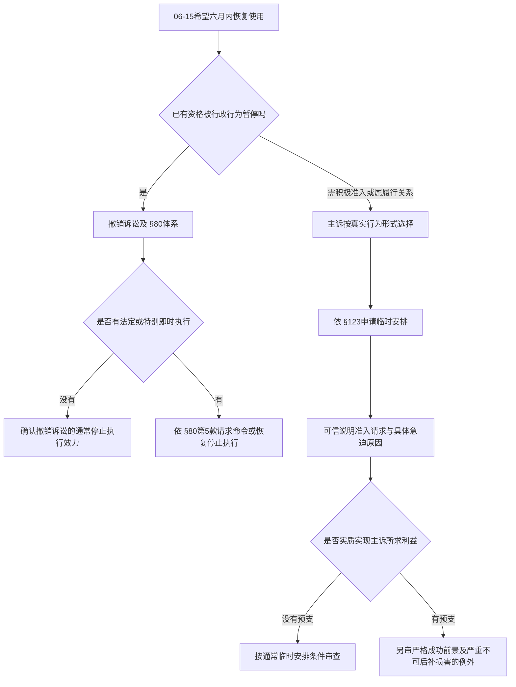

# 公共准入程序与救济

F3的L是NRW教学构造的市立公共馆，与公司B无关。Lin是30岁当地居民、合格读者，使用手动轮椅需无台阶路线；06-01收到借阅阅览停用至06-30的书面决定，唯一理由是普通音量的政策批评，没有威胁、损坏或反复扰乱。**在公法公共设施准入的前提成立时，按观点惩罚普通批评有很强的违法理由；06-15真正需要的结果是及时恢复准入，单等终局判决可能失去整个使用期间。**

题设没有真实城市、地方Satzung、组织形式或具体决策授权；这几项影响管辖、行为形式和具体准入规则，不能用任一城市章程填空。共同事实E8–E10见[[社会科学/63-法学/04-共同案情与证据接口]]。实际查源2026-10-10，基准请求06-15，版本见[[社会科学/63-法学/20-德国/04-德文法源与版本核对]]。

## 先识别机构与“能否使用”的公法关系

GO NRW §8(1)规定市在能力范围内提供公共设施，(2)赋予居民在现行法律范围内使用公共设施的资格。必须进一步核定设施的公共用途设定（Widmung）、资格、容量和合法管理条件。不能把§8读成居民可以无限占用任何市有建筑；也不能仅因馆由市出资，就说借书的每一条日常使用关系一定是公法。准入“能否”（ob）与准入后“怎样”（wie）可以有不同法律组织方式。[GO NRW §8](https://recht.nrw.de/lrgv/gesetz/01012026-gemeindeordnung-fuer-das-land-nordrhein-westfalen-bekanntmachung-der/)

第一步向真实机构确认设立、运营、用途、读者资格与实际支配能力。市立馆若只是市的非独立部门，机构内部负责人不因此成为独立法人；若为另设公法人、公司或受托私主体，要分别核法律地位和市的影响力。GO §7提供市制定章程框架，§41涉及议会与委派决策权限，不能由一封馆员信自动证明有排除资格的授权。未知城市使具体授权判断保持条件性，而不是把缺章程写成“德国公共馆没有规则”。

VwVfG NRW §35定义行政行为：机关在公法领域就个别事项作出有外部法律效果的权力措施。暂停某个读者既有借阅阅览资格通常很接近这个结构，但须先核实公法关系和决定性质；书面形式不是充分条件，私人合同也可以书面终止。若只是事实性拒开门而无资格处分，应分析履行请求及临时安排；若为私人协会F3-B，应重选民事合同、成员权或平等准入基础，不能保留原行政诉讼答案。[VwVfG NRW §§1、35](https://recht.nrw.de/lrgv/gesetz/01012025-verwaltungsverfahrensgesetz-fuer-das-land-nordrhein-westfalen/)

## 权限、程序与实体理由分别核对

**权限和依据。** 核对地方用途及停用条款、制定权限、具体决定机关与委托边界。即使真实章程允许对严重扰乱临时排除，也要看本次事实是否进入该条款、裁量是否符合目的与比例。一般馆舍管理权不提供任意观点处罚许可，基础权利通过GG Art1(3)直接约束公共权力。

**程序。** VwVfG NRW §28(1)原则上在作出干预当事人权利的行政行为前提供对相关事实陈述机会；§28(2)–(3)有具体例外，不应无条件说每一暂停都需正式听证会。§37要求内容明确，§39通常要求书面行政行为给理由；§41规范告知。题设无听取意见记录，支持核查程序而不等于已经证明全部法定步骤遗漏。即使查明遗漏，§45的补正以及§46关于明显未影响实体决定的程序瑕疵规则仍要检查，不能把缺记录等同当然无效或永不能补正。理由形式合格也不使理由本身合法。[VwVfG NRW §§28、37、39、41、45–46](https://recht.nrw.de/lrgv/gesetz/01012025-verwaltungsverfahrensgesetz-fuer-das-land-nordrhein-westfalen/)

**实体与基本权利。** GG Art5(1)保障表达意见，Art5(2)列一般法律、少年保护和个人名誉等边界，Art3(1)要求平等，Art3(3)第二句禁止因残障受不利待遇。普通政策批评没有威胁或扰乱事实，不能把“工作人员不悦”转为合法公共目的。排除理由只针对批评观点，且持续30天覆盖借阅与阅览，既需说明授权，也需说明与秩序目的关联、必要性及负担相称。对真正有裁量的决定，VwGO §114要求查裁量法定边界及是否偏离授权目的，并允许依法补充裁量理由；司法审查并非任意用法官偏好代替管理员，也不能通过补充理由虚构基准没有的扰乱事实。F3基准没有可支撑扰乱管理的实际行为；不存在足以抵消观点惩罚的空白“公共利益”万能标签。[GG Arts1、3、5、19(4)](https://www.gesetze-im-internet.de/gg/BJNR000010949.html)

实际BVerwG判决8 C35.20（2022-01-20）处理巴伐利亚市政大厅依2017-12-13议会决议排除特定议题，准入申请发生于2018年。Rn13–14说明用途与容量条件及私营运营下对市的保障准入请求，Rn17–24指出因讨论主题作排除违反Art5；本题迁移的是公共权力不能以观点规避表达保护的理由。该案不是NRW图书馆、不用其巴伐利亚市法条替代GO NRW、不把其场馆章程和当事人行为回填。它也没有规定任何批评者永远免受中性行为秩序规则约束。[官方全文](https://www.bverwg.de/200122U8C35.20.0)

馆方最强反方是公共馆须保持安静、安全、他人阅读和有限容量，必要时可以对真正妨碍使用的人采取中性措施。F3-A增加反复损坏且警告无效，可能支持一定期限排除，但要查证行为、适用规则和更轻措施、听取意见和真实迫切性。变体证明原结论依赖“普通批评而无扰乱”，不依赖“所有批评都不可限制”。若实际决定说的是观点、后才臆造破坏，后者不能靠想象改变题设。

## 轮椅、合理调整与AGG的适用边界

轮椅需要使准入恢复必须实际可用；一纸准入却提供不可通行路线，仍要另查无障碍和合理调整义务。NRW BGG §1规定对相关公共机构的适用范围，§2禁止无强制理由的残障不利待遇，§3将拒绝必要适当且不造成不成比例负担的合理调整列入歧视，§4解释无障碍，§7连接建筑方面相关法规则。不能把“需无台阶”直接换成所有既有建筑一律立即安装某种坡道，具体条件及可行调整需要机构、建筑与使用事实。[BGG NRW §§1–4、7](https://recht.nrw.de/lrgv/gesetz/01092018-gesetz-des-landes-nordrhein-westfalen-zur-gleichstellung-von-menschen-mit/)

基准决定唯一给定理由是批评，**Lin有残障不等于排除出于残障**。F3-C改成明确因轮椅排除时，Art3(3)、BGG §2–3直接成为核心；BGG §2(4)在残障不利待遇被可信说明后要求公共机构证明不存在歧视。仍需确定调整要求和具体负担，不能由身份自动证明所有请求可实现。

AGG也有适用对象。§19针对形成、履行和结束特定民事关系，特别是通常不顾相对人个性而大量在相似条件下缔结的交易；不是对每一公法决定的统一请求条款。仅政策批评也不是AGG §1列举的受保护特征。若真实运营结构或F3-B转成满足§19的民事交易、存在残障区别待遇，才接§20客观正当理由、§21停止或排除影响及赔偿、通常两个月主张期限和§22相关事实推定后的举证负担；私人协会成员关系也不自动成为大量交易。公共机构的GG/BGG路线与可能民事AGG路线可以分别分析，不能选一个标签覆盖全部。[AGG §§1、19–22](https://www.gesetze-im-internet.de/agg/BJNR189710006.html)

## 六月十五日的救济选择

VwGO §40以公法非宪法性争议为通常行政审判入口，本题求恢复使用而不是先索赔。Lin按§42(2)说明自身资格可能受侵害；这是个人权利保护，不是任何人对任何公共政策起诉。既有资格被行政行为暂停时，通常按§42(1)提出撤销诉讼；若须机关作积极准入行为，核义务诉讼；若只求事实履行而非行政行为，考虑一般履行请求。正确被告按§78及本地规定落实为作出行为机关所属市或实际公法人，不能直接把馆员姓名当被告。地域按§52和真实城市确定；一审VG通常可自行诉讼（§67(1)），不是必然聘律师才允许主张。[VwGO §§40、42、52、67、78](https://www.gesetze-im-internet.de/vwgo/BJNR000170960.html)

NRW JustG §110(1)原则上免除撤销或义务诉讼前的行政异议程序，(2)–(4)有特定例外及再例外，须查具体类别和专门规定。当前一般图书馆暂停事实未显示这些例外。因此不能把“先Widerspruch，等待答复，再起诉”作为本案固定步骤；一般投诉也不能被当成有效法定救济或暂停期限。[JustG NRW §110](https://recht.nrw.de/lrgv/gesetz/24122024-gesetz-ueber-die-justiz-im-land-nordrhein-westfalen-justizgesetz-nordrhein/)

若不需Widerspruch、06-01告知且正确救济说明已给，§74(1)与§57、ZPO §222及BGB §§187–188使通常一月起诉期限至**2026-07-01**（星期三）；不是统一30天。题设没有给救济说明，不能推定合格，也不能推定缺失。若说明遗漏或错误，§58(2)通常一年另有例外；更长受理时间不能挽回六月已经错过的阅读机会，故仍需立即处理临时保护。

§80(1)通常赋予撤销诉讼停止执行效力，§80(2)规定排除情形；若机关特别命令即时执行，§80(3)通常还要求具体书面理由。没有即时执行事实不能替馆方自动补出。§80(5)允许法院依法命令或恢复停止执行，已经执行时可命令撤销执行。单向馆发投诉不能冒充这些效力；如果争的是积极准入或没有行政行为，§123可请求临时状态安排，(3)接ZPO §920等可信说明请求和急迫原因，(5)表明不能拿§123替代§80适用场景。短暂30天排除提供明确时效压力，仍需把Lin的使用目的、资格与当前妨碍具体化，而非只写“人权很重要”。[VwGO §§80、123](https://www.gesetze-im-internet.de/vwgo/BJNR000170960.html)

### 积极准入是否已经预支主诉结果

§123的措施若让Lin在仅剩的六月期间实际取得主诉所求全部服务利益，须进一步判断是否构成实质预支主诉，不能只因申请名称写“临时”就略过。若只是保存权利实现条件、并未实现主诉目标，仍按通常临时安排条件审查；这项预支分支也不能统一加严前面的§80程序。

[BVerwG 2013-11-26，6 VR 3.13，Rn5、7](https://www.bverwg.de/de/261113B6VR3.13.0)指出，预支主诉只在等待将造成严重、不可合理要求承受且事后无法消除的不利时例外允许，并须兼顾所涉基本权和有效司法保护；主诉成功前景还须按严格标准审查，依现有简要事实审查已经可认定会成功。该案为记者索取BND对2002–2011年出口事项的资料，2013-10-09申请临时保护，法院未认定所需急迫条件；实际读取的是裁定正文中Rn1–2、5–7。这里迁移预支的程序标准，不搬记者身份、保密抗辩或该案失败结果到图书馆。

Lin最强论证是观点处罚有强实体违法理由，事后撤销不能恢复已经过去的使用期间，基本权的有效保护要求考察及时准入。但**30天即将届满不自动证明达到严重且无法事后消除的不利门槛**：还须可信说明具体六月使用需要、等待会造成何种后果、有没有可用替代，以及有限准入是否已足够。共同事实未给这些具体需要，不能补造考试、医疗资料或某场活动。馆方最强反方是不能在急迫性和事实尚未充分说明时，仅凭期间短就获得终局利益；有强实体理由仍不替代例外急迫证明。若确属预支，请求及时提出、补齐证据并限制到实现必要保护的范围，会增强例外论证；迟延原因和剩余期间也要审查，当前事实不足以保证该分支必获准。

E8原始决定证明理由、期限与收到时间，E9三次转发仍只有一个源头；E10证明当地居民资格和使用需要，尚无章程与授权证据。VwGO §86要求法院主动调查并让当事人参与，§108要求结合全案形成确信并听取陈述，不会使当事人无须提供关键文书或把复制数量当作独立印证。

主诉若成立，§113(1)撤销违法并侵害Lin权利的行为，必要时按条件处理撤销执行；积极准入可按§113(5)达到作出行为或重新决定。06-30期限届满后如果行为已经失效，要检验§113(1) Satz4继续确认违法所需正当利益；不能自动说一切诉讼消失，也不能无条件保留抽象宣告。执行方面，§167(1)连到ZPO一般执行结构，§172对不履行该条列举判决或临时安排义务的机关，可在法定条件下期限催告、最高10000 EUR强制金并重复执行；该金额不是Lin赔偿，也不是已发生罚款。

本案恢复使用不是金钱请求，GKG §52(1)按对Lin的意义裁量；没有充分估值依据时(2)默认5000 EUR，而不是因为免费借阅就诉额零。**若**法院用默认5000，普通行政一审KV5110乘3.0、单项170.50，则程序费511.50 EUR；临时保护是另一个收费程序，诉额是否减半、是否部分前置本案利益需法院判断，不能直接照搬511.50或保证免费。VwGO §§154–155分配胜败及部分胜敗成本；律师与其他必要支出另算。

## 权利形式与实际可用性一起评估

公共设施用途、行为规则和法院救济为管理员与读者都提供可预测边界；对观点保持中性同时保护其他读者的安静使用，是公共服务多元性的制度理由。最强反方指出管理者需要快速应对危险，过度程序化可能在干预前已造成损害；§28例外、即时执行与临时司法审查试图协调及时管理和权利保护，却不能允许管理员把普通批评重新命名成危险。

形式上允许起诉还不证明实际有用。若短期停用结束后才纠正、临时申请难以组织、无障碍路线始终不可用，读者实际使用可能仍未恢复。相反，成本和案情缺口也不足以证明规则无效：需要观察同类案件及时救济、实际执行、调整成本与失败原因。本题已经能论证观点处罚的违法风险及正确救济条件；没有城市章程意味着个案授权结论仍有明确证据缺口，不应拿它作德国公共机构缺乏授权制度的反证。
