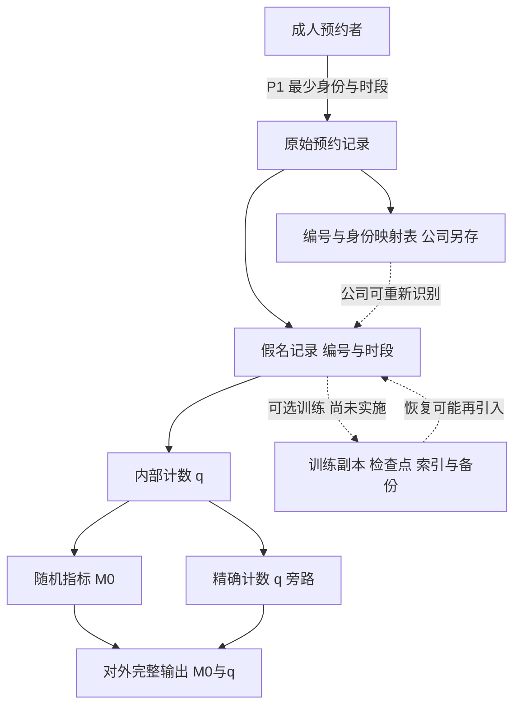

# 个人数据处理目的与技术保证：沿德国预约数据流逐段判断

预约系统去掉姓名后，分析人员只能看到编号；发布程序给统计加了随机性；用户后来要求删除。三项改进各有作用，但仍有三个容易漏掉的出口：公司保存着编号对照表，发布响应另附精确人数，恢复备份能把已删记录带回来。应当沿同一条数据流问：**谁还能识别人、为了什么处理、观察者实际收到什么、删除决定覆盖哪些对象？**

本页维护虚构案例D-GDPR的有限法律应用和一个可复算的发布反例。通用分布定义与遗忘方法继续查[[AI/20-LLM/80-研究拓展/04-隐私记忆成员推断与机器遗忘#差分隐私控制的是相邻数据集的可区分性|差分隐私主解释]]及[[AI/20-LLM/80-研究拓展/04-隐私记忆成员推断与机器遗忘#机器遗忘应以什么作参照|重训练参照]]。这些技术问题不能替我们选择处理目的、法律依据或保存理由。

## D-GDPR的主体、事实与时间

R公司在德国设立并经营私人阅读室，为成人提供预约服务，决定收集、使用和发布数据的目的与手段。2026-06-01以自动系统处理最少身份（姓名、联系方式）和预约时段；预约者是数据主体，R是本例控制者。内部调度员和统计人员在R的权限范围内工作，不是因为使用同一数据库就各自成为另一个控制者。另存的编号—身份映射表仍由R持有，并能正常查回个人。这里只分析同一控制者的处理；没有雇佣、未成年人、健康等特殊类别、公共机关执法或跨境传输事实。它是[[计算机知识/75-软件工程与人机交互/05-职业伦理利益相关者与责任判断#同一个预约服务，谁受影响|原预约情境]]新增的法域化变体，不把原页的未知事实改成现实调查结果，也不改变F1–F3。

| 时点或来源 | 本页实际使用的身份与边界 |
| --- | --- |
| 行为日 | 2026-06-01收集预约及拟发布；2026-06-15评估用途结束后的删除请求，都是教学设定 |
| 公布与施行 | Regulation (EU) 2016/679于2016-04-27制定，刊于OJ L119，2016-05-04，第1页起；Art.99(1)规定公布后第20日生效，Art.99(2)规定2018-05-25起适用，两者不是同一日期 |
| 本次取得日 | 2026-10-12，Asia/Shanghai；本次读取不是issue中旧的2026-10-10读取记录 |
| 可读条文 | [EUR-Lex合并正文](https://eur-lex.europa.eu/legal-content/EN/TXT/HTML/?uri=CELEX:02016R0679-20160504)头标识02016R0679—EN—04.05.2016—000.002；已读Art.2(1)、3(1)、4(1)/(2)/(5)/(7)/(11)、5、6、7、17、25、32及99。本页以下条款编号均指这份正文，除序言另述 |
| 正式版本与取得限制 | 合并页明确自己只是文档工具、无法律效力，列原刊及2018-05-23 OJ L127第2页勘误。正式规范身份仍是原刊与适用勘误。[原刊HTML的带from入口](https://eur-lex.europa.eu/legal-content/EN/TXT/HTML/?uri=CELEX:32016R0679&from=EN)曾取得OJ L119/1开头和部分序言；后续请求及[ELI原刊入口](https://eur-lex.europa.eu/eli/reg/2016/679/oj)、原刊PDF返回验证页，勘误全文未取得，不能称原刊与勘误逐条全核 |
| 序言26的证据 | 本次从EUR-Lex原刊的官方搜索索引取得该段文字，核对额外识别信息、合理可能使用的手段、时间/成本/技术与匿名信息条件；未取得可持续打开的原刊全文。序言帮助解释识别条件，不代替Art.4定义 |

按[[社会科学/63-法学/01-法源版本与跨法域比较#版本合同：四个日期加一个程序时点|版本合同]]，行为日已晚于上述适用日。这支持本例在该文本下的有限分析，不能证明所有德国配套规则、后续裁判、推广渠道规则和特定保存义务均已排除。若实际案件需要那些规则，应追加其正式版本、施行和事实证据。

已知目的P1是分配时段与联系预约人；P2是拟在内部评估这一个时段的需求；P3是拟对外发布需求指标。推广人员另提P4：用预约联系信息发送可选推广，尚未实施。训练分支也仅是设计变体，未训练模型。未知包括具体合同条款、每个字段的必要性证据、统计所需的细粒度、公开受众的背景信息、实际同意界面及撤回路径、合法利益衡量、具体保存义务、法律请求和真实控制措施。这些未知各自影响结论，不能用一个“已脱敏”标签补齐。

## 同一条数据流，四个问题分别追踪

十个合成预约者各有一条本时段记录，编号p01–p10，身份与联系方式用Person01和example.invalid等虚构占位。本例人数单位是“名预约者”；因每人最多一条记录，人数与记录数恰好相同，换成多人多次预约时就不能互换。

| 阶段与对象 | 谁能识别及技术保证 | 用途/依据要问什么 | 保存或删除查什么 |
| --- | --- | --- | --- |
| 原始预约记录 | R直接知道姓名、联系方式；没有DP保证 | P1各字段是否服务必要，依据是什么 | 活跃服务何时结束，后续保存理由是否仍成立 |
| 映射表与假名记录 | 统计员可不见姓名；R握映射表可查回。假名化减少暴露面，不等于本控制者不再处理个人数据 | P2是否需要个人级时段，能否用更粗结果；假名化不提供新依据 | 两份对象及访问权限都要查；删一张表不证明另一张消失 |
| 内部计数q | 一个时段的精确人数；能否关联某人要看粒度、其他信息与访问者 | P2的必要范围、与原目的关系 | 计数与记录可能有不同所需期限，不能静默沿用原记录期限 |
| 对外完整输出(M0,q) | M0单独有下节的保证；q旁路使完整输出无同等保证。公众是否能识别人另依背景信息判断 | P3的公开目的、法律适用、依据及风险，不能凭“统计”豁免全部分析 | 已公开结果是否涉及个人数据，是否触发通知/后续处理问题，须依实际公开对象判断 |
| 可选训练及派生对象 | 尚无模型。若实施，副本、模型影响、索引、缓存及旧检查点是不同对象 | 训练目的与必要性、依据另查，不能由P1推出 | 先确定法律要求覆盖什么，再按血缘查残留与回滚；不能预先判所有模型权重必删或已匿名 |

[Art.2(1)、3(1)、4](https://eur-lex.europa.eu/legal-content/EN/TXT/HTML/?uri=CELEX:02016R0679-20160504)把自动处理、欧盟设立活动和个人数据连接起来：本例R处理与可识别成人有关的信息，发生于其德国机构经营活动，进入所核GDPR适用入口；存储、使用和披露都属于需逐项考虑的处理。Art.4(5)的假名化要求额外信息另存并有相应技术和组织措施。题设“另存编号表”只有一部分事实，实际权限与隔离效果仍待核；即使完整满足假名化条件，R能正常重新识别的事实也不消失。

最强反方说：“统计员没有钥匙，所以这张工作表已经匿名。”这里把受限员工的视野换成了控制者整体的识别能力。R自己持有可用映射表，因此本例不能以去姓名让R的假名记录退出个人数据分析。若改为独立接收者无法取得映射表，必须重查其合理可能使用的识别手段、其他信息和实际成本；本例没有给出这些事实，不对全部接收者作永久相同认定。[序言26的原刊来源](https://eur-lex.europa.eu/legal-content/EN/TXT/HTML/?uri=CELEX:32016R0679&from=EN)所强调的是识别条件，不是文件名里有没有“匿名”。

## 先写处理目的，再核可能依据

用[Art.5与6](https://eur-lex.europa.eu/legal-content/EN/TXT/HTML/?uri=CELEX:02016R0679-20160504)逐段检查。Art.5要求合法、公平、透明，特定明确正当目的、最小化、准确、保存限制及适当安全；R还须能说明其遵守。Art.6(1)给多种可能依据，每次处理须满足至少一项及相应范围，不能认定“私人服务只能用同意”。

P1的有力理由是：预约合同履行或应用户请求的订约前措施可能需要时段和联系信息，进入Art.6(1)(b)候选。但“公司把字段写进合同”没有自动证明必要性。先说明不用该字段是否仍能提供预约、为何保留姓名而非较少身份、联系方式何时停止需要。本题未给完整合同和必要性证据，有限结论是有候选依据及待证事实，不能宣布P1整体合法。

P2与P3都叫统计，却不必有相同范围。只排班可用内部粗计数，公开逐时段小群体数据可能增加推断机会。Art.5(1)(b)/(e)对符合Art.89(1)的特定统计等处理有条件表达；本题没有核实该额外条件，不能因为把目的命名为“统计”就无限复用或长期保留。最强支持公开的理由是公众能核对服务需求和组织承诺；应比较只发布必要指标、延迟或合并时段的收益和信息损失，并继续核依据。

P4将“帮助履行预约”变为“争取后续客户”，须重做目的与依据判断：

- 若拟依同意，核Art.4(11)、7所要求的自由、具体、知情、明确表示，证明记录及撤回条件。若拒绝非必要推广就得不到预约，Art.7(4)要求在自由性评估中高度考虑这种捆绑；一个勾选框无法完成判断。
- 若拟依Art.6(1)(f)，需给出具体合法利益、这次处理的必要性和预约者权益的衡量，不能以“营销有收益”代替三者。本题没有这些材料，不能确定该依据成立，也不宣布所有推广一律只能用同意。
- 在Art.6(4)规定的情形下，另核新旧目的联系、收集关系背景、数据性质、对人的后果及保障措施等兼容因素。它没有赋予“兼容就可随意用”的豁免；同意或法定分支的条件也不能混用。直接营销、发送渠道或其他特别规则若影响真实实施，继续核相应法源，本页未作全域认证。

改变条件会改变答案：若用户在等效可用预约之外，独立选择清楚限定的推广，且拒绝无损服务、易撤回，捆绑自由性疑点减弱；仍须检查其他条件。若公司只取消姓名但保有映射并用联系信息推广，目的与可识别性问题都没有因假名编号消失。

## 精确计数旁路为什么使完整输出失去保证

把技术问题固定到同一组数据。D有十位成人本时段预约，D′仅移除p10的一条记录。允许的相邻关系是增删一位用户，而该用户在这个固定时段至多贡献一条记录；q(D)=10、q(D′)=9，q的敏感度为1名。公开输出只有下一段的指标与可选旁路；映射表留在公司内部，不作为公众取得的输出。证明不假设攻击者偷到映射表。

先构造能独立证明的M0。令b(D)=1[q(D)≥10]，以3/4概率输出b，以1/4概率输出1−b。输出空间是{0,1}，值1表示“报告高需求”，并非精确人数。随机性来自这一次机制的抛币。若相邻数据的b相同，分布相同；若不同，任一个单点输出的两向概率比最多(3/4)/(1/4)=3。因此两单点、空集和全空间都满足原页的不等式，M0对这个数据域有(ln3,0)-DP。该有限构造只是可检查教学机制，噪声会使需求判断错误，没有给出大型统计产品或多次发布的预算方案。

| 输出事件 | D上的概率 | D′上的概率 | 以exp(ε)=3、δ=0核对 |
| --- | --- | --- | --- |
| M0=1 | 3/4 | 1/4 | 3/4≤3×1/4，等号 |
| M0=0 | 1/4 | 3/4 | 1/4≤3×3/4；反向也要核 |
| M0任意值/无值 | 1/0 | 1/0 | 全集与空集各自成立 |

现在开发者为了方便对账，把整条响应改成M(D)=(M0(D),q(D))。联合支持在D为{(0,10),(1,10)}，在D′为{(0,9),(1,9)}。取完整输出事件S={(x,y):y=10}：不论抛币结果如何，

$$
P(M(D)\in S)=1,\qquad P(M(D')\in S)=0.
$$

对**任何有限ε**，原分布条件要求

$$
1\le e^\epsilon\cdot0+\delta=\delta.
$$

所以δ必须至少为1；通常要求δ<1的有意义保证无法成立。把ε调大也不能救回零概率的右侧。这个事件既不查姓名，也不猜训练内容，直接读取公众实际收到的第二坐标。若观察者已知道其余九人的预约，精确总数还能区分目标是否参加；证明本身只需这对相邻输入与可观察事件，并不要求所有公众实际拥有这份背景知识。

删除q旁路、只输出M0，恢复的是上面已证的单次机制及相同用户贡献约束；若另一接口、日志下载或后续多次发布继续泄露，必须扩大完整可观察输出与组合分析。M0的技术保证不提供P3的法律依据，也不证明输出在某个现实识别环境已匿名；反例失败同样不直接认定公开统计违法。合法依据、匿名性、安全和DP分别回答不同问题。

### 用固定输入核对全部有限事件

真源是[标准库脚本](实践/appointment_privacy/exact_event.py)，[固定合成输入](实践/appointment_privacy/input.json)只含这十条假名记录与虚构对照表；[固定结果](实践/appointment_privacy/result.json)保留精确分数。复跑命令是`python3 -B 社会科学/63-法学/20-德国/实践/appointment_privacy/exact_event.py`（从库根执行），结果写回同目录result.json。

脚本不是随机抽样：它枚举M0的4个事件，双向逐项核exp(ε)=3、δ=0；并枚举两输入联合支持上的16个完整输出事件，见证S的概率严格为1和0。它验证本例的概率表与有限事件，没有检查真实业务接口、法律条件、模型训练或全部可能的数据集；M0的一般保证由前面b相同/不同的两类证明给出。

## 删除请求先定规范范围，再追踪副本

2026-06-15，p10请求R删除其个人数据。已经访问完成不自动意味着所有后续目的都结束；“可能将来有用”也不提供无限保存理由。先列哪个对象仍与谁有关、哪个目的是否必要，再用[Art.17](https://eur-lex.europa.eu/legal-content/EN/TXT/HTML/?uri=CELEX:02016R0679-20160504)分别核删除事由和例外。

**条件A：** 题设明确原预约目的及其他处理目的均不再需要p10数据，没有适用的Art.17(3)例外。在这些条件下，Art.17(1)(a)产生对R请求无不当迟延删除有关个人数据的权利和R的对应义务；保存限制也要按Art.5(1)(e)核。本题不给统一“保存若干年”，也不把删除请求自动套成同意撤回。

**条件B：** 增加一项具体法律请求，而且为建立、行使或抗辩该请求确实需要某份记录。Art.17(3)(e)在处理必要的范围内排除17(1)/(2)；要说明请求是什么、哪些字段和期间必要，不能因存在争议保留所有记录、继续推广。另一分支若主张Art.17(3)(b)的保存法定义务，须取得实际适用的欧盟或成员国规则及对象、期限和施行证据；本页未核出一项具体德国保存年限，因此只能给条件分支，不能虚构自动法律hold。例外不自动提供所有后续使用的合法依据，必要性变化后也要重审。

反方最强理由是“删去可能损害双方举证，备份又很难逐条更新”。前半在条件B有具体请求且必要时能进入法律分支；后半是实施困难，不能单独替代例外。删除事由与必要保存可以同时涉及不同对象、字段或用途，因此不能只给数据库全开/全关的选择。

| 按血缘要核的对象 | 可检查的技术动作/观察 | 它不能单独证明什么 |
| --- | --- | --- |
| 原始记录、假名记录、映射表 | 确定p10涉及的行与关联、删除或执行经核的保留范围，再测试查询/关联 | 原表少一行不证明映射和缓存已处理；仅删映射也不保证其他信息无法识别 |
| 日志、索引、缓存、备份 | 枚举实际副本、更新可查询状态；恢复前执行删除决定，核回滚是否重新引入 | 一个活跃查询为空不证明历史副本全空；“备份不便处理”不自动免除法律问题 |
| 可选训练副本与检查点 | 若真的训练，核样本血缘、旧模型/适配器/评测日志；说明遗忘方法的可观察范围及重训练参照 | 模型拒答或有限攻击未检出不证明已经移除训练影响；重训练参照也不规定法律唯一允许的技术 |
| 对外发布物 | 先核其是否仍是有关个人数据及公司已公开/披露的事实，再核适用的后续义务 | Art.17(2)对已公开且应删除者的合理通知措施有条件；不能从本例一个计数推出全球副本已经撤回 |

[Art.25与32](https://eur-lex.europa.eu/legal-content/EN/TXT/HTML/?uri=CELEX:02016R0679-20160504)支持从设计和默认设置控制必要数据量、使用范围、保存和可访问性，并采取与风险相适应的安全措施。假名化、加密、恢复和效果评估是有各自条件的措施。可恢复性与删除要求需在版本流程中共同兑现：恢复系统不能忽略已经作出的删除决定。条文没有把DP命名为全部要求的替代，也没有把安全备份的存在变成无限保存许可。

回到[[AI/20-LLM/80-研究拓展/04-隐私记忆成员推断与机器遗忘#遗忘还涉及模型之外的副本|模型外副本主解释]]时携带“p10—记录—映射—发布—可选派生”的实际对象链。删除存储行、改变模型分布和防止旧状态恢复是不同技术任务。只增事实的合并/闭包不会自行证明撤销已经传播。携带“删去事实或撤去规则”的变式，回[[AI/13-搜索推理与规划/05-知识表示规则归结与查询#撤去提示再检查前提|闭包课的撤回反例]]，按[#166](https://github.com/EunsonZ/WWL/issues/166)的范围区分重新计算与尚待扩展的默认语义；携带“旧副本是否会再引入p10”的问题，回[[计算机知识/55-数据库/10-系统课程/12-WAL日志恢复与副本确认边界#页 LSN 为什么有用，但也不能单独解决撕裂写|日志版本与恢复目标]]和[[计算机知识/75-软件工程与人机交互/82-v2意图恢复与演进实验#唯一业务合同：移动端与流处理共用|持久状态与权威结果的恢复接口]]，消费[#172](https://github.com/EunsonZ/WWL/issues/172)已有的恢复输入。两项尚未交付的默认/增量主课不作为本页等待条件，代数性质及恢复能力也不能决定法律应删范围。

## 返回两个伦理选项：合法候选仍需说明谁承担代价

从[[计算机知识/75-软件工程与人机交互/05-职业伦理利益相关者与责任判断#从准则到具体理由|预约伦理入口]]带来的问题是机会、压力和责任。经过本页，应携带P1–P4、公司保有映射、完整输出反例、必要保存条件，再返回[[计算机知识/75-软件工程与人机交互/05-职业伦理利益相关者与责任判断#比较两个可辩护选项|两个可辩护选项]]。

在D-GDPR的最少数据范围内，A可采用公开且一致的预约规则、最少字段、独立于预约的推广选择，并只发布经过完整机制核对的必要需求指标；代价是随机指标会误报需求，粗粒度不能解答全部运营问题。B可以在不捆绑预约的独立服务渠道处理确有必要的个别支持，由负责者给公开、可质询标准和等效非数字入口；代价是人员、申诉和权限管理负担。B若需要咨询原因或敏感资料，就改变本页最少身份/时段的事实范围，必须另核数据类别和依据，不能借D-GDPR结论直接签发。

法律上有可能成立的处理依据，仍不能回答快网络者是否占有全部时段、推广邀请在稀缺机会下是否造成压力、噪声是否使小群体需求被忽略。伦理上偏好A，也不证明其后台没有精确旁路或恢复残留。教学暂取A，理由是额外采集和二次使用的收益尚未证实，且当前可用较少数据提供预约；若有实际急需者受损和能兑现的安全支持渠道证据，再比较B。真实服务效果、律师意见、平台实现和真人理解均未由这组模拟材料验证。

## 撤去提示后的迁移题

下题先独立回答，题干不告诉你应使用哪条规则或技术名。

2026-06-15，R宣称：“报表只有编号，所以可以永久保存；外部响应有一个随机的高需求标志，还附本时段准确人数；p10的活跃预约行已删，所以删除已经完成。”已知R仍有可正常查回p10的对照表，外部观察者知道其余九人的预约；业务人员想把联系方式用于推广。变体一明确所有处理目的已结束、无适用例外；变体二增加为抗辩一项具体请求确有必要的某份记录。请写一份给负责人的短简报：逐对象判断可推出和不能推出什么，提出下一步证据或修改，分别回答两个变体，并说明选择A或B的理由。若再改为只发布随机标志且移除精确人数，哪些结论会改变？

> [!answer]- 可检查答案
> 1. R握可用对照表，编号表对本控制者仍关联可识别人；统计员看不到姓名不证明匿名，永存还缺具体必要目的。需分开原记录、映射表和各副本，核实际隔离与保存范围。
> 2. 人数是10或9；完整响应中“准确人数为10”在两相邻输入的概率是1和0，任何有限ε都要求δ≥1。随机标志本身可有已证的(ln3,0)保证，完整响应不能继承；知道九人使目标成员区分成为具体攻击路径。这是技术结论，尚不能直接判公开违法或合法。
> 3. 推广是新目的；需核与预约的关系及可能依据。合同必要性不能从推广收益推出；同意分支需查自由选择、限定目的和撤回，合法利益分支需查必要性与权益衡量，适用时还须查目的兼容因素及发送渠道规则。现有事实不足以通过任一完整分支。
> 4. 变体一进入Art.17(1)(a)且题设排除例外，应无不当迟延删除有关个人数据；活跃行删除只证一处。须追映射、日志、索引、备份及恢复路径，若实际有训练还需查副本、检查点与影响，不能以拒答当完成。
> 5. 变体二就具体请求所必要的处理可进入17(3)(e)，只给必要记录和期间的条件结论，其余对象仍查删除事由；不授予全库永久保存或推广许可。若改主张法定保存，须先取得实际规则，不能填任意年数。
> 6. 只发布本例M0可恢复其同一次机制、同一邻接与贡献约束的分布保证；P3依据、识别条件、保存、删除、伦理分配都仍须各自回答。另加接口或反复发布需要重做完整输出分析。
> 7. 可辩护选择可以偏A：较少收集与较低公开推断风险，但承认噪声与无法判断个别急迫性的代价。也可在实际急需证据及独立渠道可兑现时偏B，说明由谁负责、非数字入口、压力与申诉成本；若新增咨询原因，必须标明已超本案事实，另核条件。任何选择都不能伪称已验证现实收益。

返回[[社会科学/63-法学/20-德国/00-德国法同题比较-MOC|德国法同题比较入口]]。本例的完成能力是沿同一数据流改变条件后重新判断；它不覆盖德国数据保护全部特别法、全球法域或真实业务合规认证。
