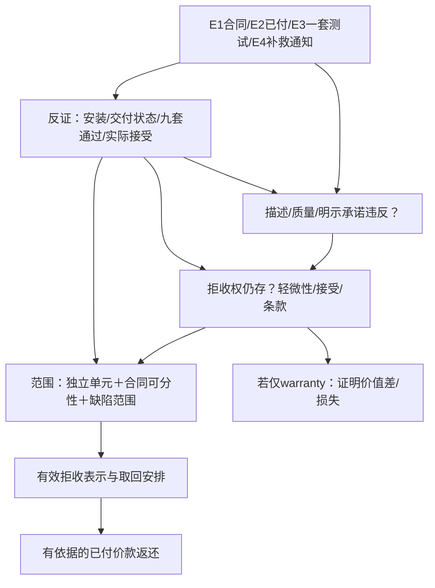

# 英格兰与威尔士：承重少了一半，公司的退款请求怎样成立

## 共同事实与研究时点

F1：公司 B 向营业卖方 S 购买十套**可独立使用**的书架，每套1000 TU、总价10000 TU，5月15日以双方公司名义订约并全部付款。平台 X 仅为技术中介，没有给出销售、担保或代表卖方的承诺。5月20日数量/外观签收；6月1日同批一套在卖方规定安装与分布载荷下40 kg失稳，合同附件要求80 kg。6月2日书面要求修理或更换，S收件已给定；要求6月10日前补救，但通知没有逾期解除条款，也未另发拒收/解除通知。6月15日仍无答复、补救，物品可供检查、未使用物妥善储存。E1—E4是合同、付款/数量签收、测试原件和已送达通知；交付时缺陷、整批代表性、合理检查和补救时间、法律上的接受仍未知。

本域把10000 TU写作£10000仅用于检验程序金额规则，不作汇率或购买力比较。实体规则按行为日选择的官方 revised 文本，程序按2026-06-15；实际核读2026-10-10，[[社会科学/63-法学/30-英格兰与威尔士/04-法源版本与核读范围\|版本说明]]列来源和范围。B是公司，不能适用自然人消费者的14天远程取消或CRA消费者货物救济。

## 谁拥有请求，谁承担债务

注册后公司作为body corporate存在，见[Companies Act 2006 s.16(2)](https://www.legislation.gov.uk/ukpga/2006/46/section/16/2026-05-15)。本题设B、S依法成立；现实则先查准确注册名、合同签署及代理权限。书架用于公司业务，价款由B支付，请求起点是B对S；股东或每位阅读室读者不因关联获得B的全部合同请求。X的付款页面能证明交易路径，却不自动使X成为卖方或退款担保人。Lin另有自身事故损害链，见[[社会科学/63-法学/30-英格兰与威尔士/02-场所损害证据与责任\|场所责任]]。

## 先证明承诺落空，再证明它允许哪种救济

[Sale of Goods Act 1979（SGA）s.13](https://www.legislation.gov.uk/ukpga/1979/54/section/13/2026-05-15)处理按描述销售，[s.14(2)—(2C)](https://www.legislation.gov.uk/ukpga/1979/54/section/14/2026-05-15)处理营业卖方的满意质量：结合描述、价格、有关情境，通常用途、安全和耐用性均有关。80 kg附件是明示承诺；是否也属s.13意义上的销售描述要解释合同，不能把每个宣传数字都自动叫描述。s.14(3)特定用途还要求告知该用途和相应合理依赖，不能因“阅读室”三字代填。

E3在约定条件下40 kg失稳支持受检书架不合约，尤其触及安全/支撑用途。但E3不是“十套均失效”的逻辑证明。要核样本ID、材料/结构/生产与安装批次、负载记录、事故前状况与检测代表性。F2是另一套书架，不能把其事故当本套测试的重复实验。

法定s.13、s.14相关条款在本域为condition；明示条款的condition/warranty归类由[s.11(3)](https://www.legislation.gov.uk/ukpga/1979/54/section/11/2026-05-15)要求按合同解释，名称并不决定一切。condition违反可能支持拒收并把合同视为被毁约，warranty违反通常支持赔偿；二者都还要进入限制、通知和范围分析。

## 四个使退款范围改变的节点

**轻微违约。** [s.15A(1)—(3)](https://www.legislation.gov.uk/ukpga/1979/54/section/15A/2026-05-15)在本可因s.13—15拒收，却轻微到拒收不合理时改按warranty处理，且有合同相反意思的例外；卖方须证明这种轻微性。承重安全问题支持B反驳。但“40/80=50%”只有载荷比，没有自动规定法律上所有单元都退。

**接受。** [s.35](https://www.legislation.gov.uk/ukpga/1979/54/section/35/2026-06-15)要查向S表示接受、与卖方所有权不相容的行为、合理检查机会、合理时间后仍保留而不拒收等。合同技术验收未完成只是一项事实；法律acceptance有独立规则。数量签收不是已证明acceptance，请求修理也不因s.35(6)(a)本身视为接受；但已有使用和时间经过仍须调查。[s.11(4)](https://www.legislation.gov.uk/ukpga/1979/54/section/11/2026-05-15)特别针对不可分合同在全部或部分货物已接受时的限制，不能删去“不可分”前提。

**独立单元和可分性。** 十套独立可用削弱“必须一个整体全退”的预设，但商业单元（s.35(7)：拆分会实质损害价值或单元性质）与合同可分性不是同一个概念。分别读合同的价格、交付及整体用途安排。[s.35A](https://www.legislation.gov.uk/ukpga/1979/54/section/35A/2026-05-15)使本有拒收权的买方可以接受部分而不当然失去拒绝其余的权利，并有相反合同意思的条件。它没有给本来无拒收权的买方新增权利，也不授权用一套缺陷自动拒绝九套合格货物。

**通知和补救。** E4已收件，所以不再把“未证送达”当本题缺口。它内容是修理/更换请求；S沉默和6月10日届满不是一个法律上已成立的解除意思表示。普通B2B SGA没有消费者统一的先修后退层级；但合同补救条款、双方另行协议及合理时间仍可能限制。B应在实际选择拒收时明确告诉S所拒物、依据、价款请求和取回安排，再核该选择是否及时有效。没有这一步，不能叙述成“6月10日合同自动解除”。

## 条款能改哪些义务，哪些控制还在

题设没有提供免责、仲裁、选择法、法院条款；这表示未知，而非已确认不存在。取得E1全文后依次问：是否纳入、怎样解释、作用于明示条款还是法定质量责任、是否受强制控制。[SGA s.55](https://www.legislation.gov.uk/ukpga/1979/54/section/55/2026-05-15)与[UCTA 1977 s.6(1A)](https://www.legislation.gov.uk/ukpga/1977/50/section/6/2026-05-15)连接s.13—15责任排除/限制的合理性；[s.11及Schedule2](https://www.legislation.gov.uk/ukpga/1977/50/section/11/2026-05-15)要求考虑订约时可知情境、谈判力量、替代取得机会、条款知悉、条件是否可行等，并由援用合理性的人证明。有效纳入条款不是一律合理；缺少条款也不能虚构一个对B有利的“无限退款保证”。若依一方书面标准条款订约，还须辨明[UCTA s.3](https://www.legislation.gov.uk/ukpga/1977/50/section/3/2026-05-15)的适用前提。

## 货物、所有权、已付价款分别处理

在有拒收权且有效行使的条件下，研究拒收/终止和已付价款返还。[s.54](https://www.legislation.gov.uk/ukpga/1979/54/section/54/2026-05-15)保留已付钱款在对价失败时的追回规则，不能仅凭“质量不好”跳过拒收是否成立和返还范围。B已付£10000，故确有已付价款可请求；若只一套可退，不能把十套价款全部写成当然应返。

[s.16—19](https://www.legislation.gov.uk/ukpga/1979/54/section/17/2026-05-15)另管所有权：未特定货物、双方意图、默认转移规则、保留处分权均需按实际合同/物品认定。支付、交付、所有权转移、acceptance及终止不是一个时点。不能先武断称S始终有title，再以所有人索回替代B的合同拒收；也不能称合同解除已解决所有title、保管和运费问题。[s.36](https://www.legislation.gov.uk/ukpga/1979/54/section/36/2026-05-15)在有权拒绝且无相反约定时不要求B自行运回，只须向S表明拒绝接受；它不授权毁弃、继续使用或自行决定额外物流损失。

如拒收被接受、轻微性或条款阻却，[s.53](https://www.legislation.gov.uk/ukpga/1979/54/section/53/2026-05-15)仍提供warranty损害赔偿，质量损失初步以交付时合格价值与实际价值差衡量。B价款已付，不应只列“抵扣未付价款”而忘记独立赔偿请求。没有给附带损失，本题不凭空计算营业利润或惩罚赔偿。退款与同一利益的赔偿不能重复取得。

## 民事程序、负担与费用怎样接上

B须证明合同内容、不符合、所求救济的构成事实；一般民事事实标准为balance of probabilities。S的s.15A轻微性及UCTA合理性负担已由条文特别分配；不能说一律所有事实B证明，也不能由S沉默使主张自动成立。技术测试须能供对方质疑；[CPR35.1、35.3](https://www.legislation.gov.uk/uksi/1998/3132/rule/35.3/2026-06-15)要求专家证据限于合理所需问题、专家义务指向法院。许可依据须按分轨选：通常程序按[35.4](https://www.legislation.gov.uk/uksi/1998/3132/rule/35.4/2026-06-15)核使用报告/传唤专家的许可；若分入small claims，[27.2(1)(e)](https://www.legislation.gov.uk/uksi/1998/3132/rule/27.2/2026-06-15)仅保留Part35的35.1、35.3、35.7、35.8，35.4不适用，专家在听证中提供书面或口头证据的许可依据为[27.5](https://www.legislation.gov.uk/uksi/1998/3132/rule/27.5/2026-06-15)。本题尚无分轨命令，不能提前把两种依据合为一条。

定位通常的County Court民事请求与CPR Part7，再核有效论坛/仲裁约定、法院启动和送达条件。诉前交换合同、测试、金额、通知和拟议解决，现行官方[Pre-Action Conduct §§3、6—8、12—16](https://www.justice.gov.uk/courts/procedure-rules/civil/rules/pd_pre-action_conduct)解释澄清争议、比例及不遵守的后果；本轮读的是当前网页，不冒充6月15日所有指引的历史认证。一般简单合同诉讼[Limitation Act1980 s.5](https://www.legislation.gov.uk/ukpga/1980/58/section/5/2026-06-01)为诉因产生起六年；它不延长SGA拒收的合理时间，也不保证六年末才起诉仍能取回全款。

按已读6月15日历史[CPR26.9(4)、26.13](https://www.legislation.gov.uk/uksi/1998/3132/rule/26.9/2026-06-15)，£10000普通金钱请求在通常small claims金额范围内，法院仍考虑救济、复杂性、专家及各方意见；不是本教材已给分轨命令。按同日[Fees Order2008 Schedule1 fee1.1(g)](https://www.legislation.gov.uk/uksi/2008/1053/schedule/1/2026-06-15)，仅请求£10000金钱、无利息附加的启动费示范为£455；£10001进入fee1.1(h)的5%区间，是£500.05。改求非金钱/取回货物，或加利息，须按表附注重新选择。启动费不是总成本。small claims的律师等费用回收受[CPR27.14](https://www.legislation.gov.uk/uksi/1998/3132/rule/27.14/2026-06-15)限制并有法院费、必要支出及不合理行为等例外；降低正式程序负担也可能使胜方仍自担专业研究成本。

最终金钱判决仍需要债务人付款，拒付时按[CPR70.2](https://www.legislation.gov.uk/uksi/1998/3132/rule/70.2/2026-06-15)等选择适合资产和判决的执行方式。胜诉不认证S有财产、X会代付或B已经收到钱。

## 条件改变题：先作答再看答案

甲（F1-A）：九套经可靠独立检测合格，只有一套实质失稳，十套能分别使用。乙（F1-C）：保持缺陷与通知事实，只把已付改为未付。丙（F1-B）：换成自然人家用购买。分别提出请求、最强反方、还需查什么和当前可给的有限结论。

> [!answer]- 可核条件答案
> 甲：先保留一套的质量违约主张，九套结果使整批推断失效；按s.35、35A、商业单元和合同可分性核一套拒收、部分价款或赔偿。仅“一套缺陷”不能自动全退，若能证明整体合同目的被破坏仍需另论证，不能忽略独立可用事实。S可用九套合格反驳范围，仍须证明s.15A的轻微性；安全失稳不因只一套而当然轻微。乙：没有已付价款可返还；符合条件时仍可拒收、终止、对价款主张s.53减免/抗辩或请求有证损失。丙：按CRA2015 s.2的consumer/trader及合同类别重新选择法源；消费者质量拒收与远程取消是不同制度，不能将公司案的SGA15A或S沉默直接当消费者退款答案。

返回[[社会科学/63-法学/03-公法私法刑事与救济的分工\|共同案例]]比较另外两域。比较补救顺序和范围之前，保留本域已付、通知内容和接受这三个已知/未知边界。
