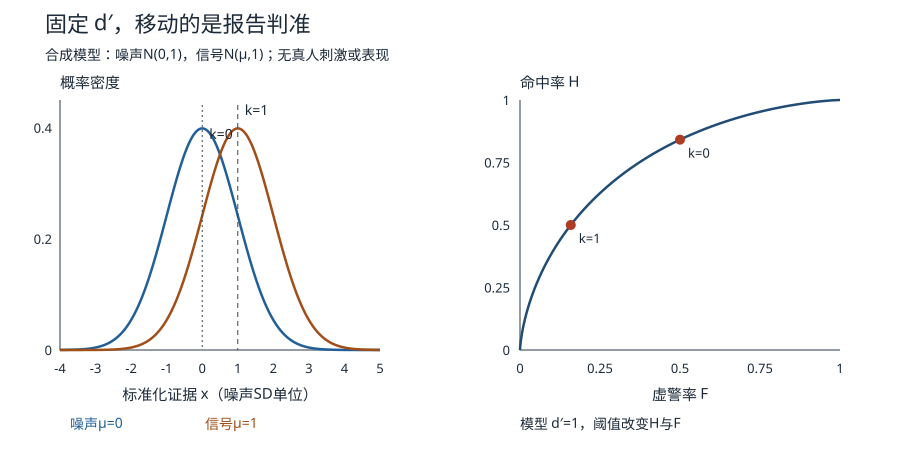

# 报告“看到了”变多，知觉一定更敏锐吗

暗处听一个微弱声音，人既可能没听出，也可能觉得“宁可报错别漏掉”。同一按键同时经过感觉证据和报告规则，命中率上升不独自证明可辨性提高。我们用一个**数学教学构造**把这两件事拆开；没有播放刺激、招募参与者或测出任何人的能力。

## 从构念到四格记录

任务每次实际有信号$S=1$或无信号$S=0$，反应为“有”$R=1$或“无”$R=0$。命中率$H=P(R=1\mid S=1)$，虚警率$F=P(R=1\mid S=0)$；漏报是$1-H$，正确拒绝是$1-F$。分母分别是有信号、无信号试次，不能都除全部试次。实际研究应保存刺激条件、反应、顺序、反应时间、遗漏和设备故障，不把超时任意填成“无”。

这与 [[数学/30-概率与统计/09-假设检验错误概率与功效#1. 先定义零假设与规则|检验的错误概率]] 有同构的条件概率，但心理试次中“报告有信号”不是研究者拒绝“整个人没能力”的零假设。统计推断的样本、研究者规则和参与者报告规则处于不同层次。

## 固定证据分布，只移动阈值

设内部证据$X$在无信号时为$N(0,1)$，有信号时为$N(1,1)$，当$X>k$报告有信号。$X$、均值与$k$都以此构造的噪声标准差为单位，无实际声压或脑活动单位；两个方差固定为1。

记标准正态CDF为$\Phi$，则

$$F(k)=1-\Phi(k),\qquad H(k)=1-\Phi(k-1).$$

$k=1$时$(F,H)\approx(0.158655,0.5)$；$k=0$时$(F,H)\approx(0.5,0.841345)$。阈值降低，命中与虚警一起增加；两种刺激产生的证据分布并未变化。

图由同一方程和输入生成。左图横轴是标准化证据，纵轴是概率密度，不是某个确切证据的概率；曲线右尾面积才是相应报告概率。右图横轴虚警率、纵轴命中率，两点来自**同一条**ROC，不是两类人的测量。降低阈值沿曲线移动，增加均值分离才改变本模型的可辨性。

令$z=\Phi^{-1}$，在本等方差正态模型中

$$d'=z(H)-z(F)=\bigl(1-k\bigr)-(-k)=1.$$

常见标准化判准$C=-[z(H)+z(F)]/2=k-0.5$；原始阈值$k$与$C$不是同一个变量。两个阈值对应$C=0.5,-0.5$，而$d'$均为1。一般$N(\mu_0,\sigma^2)$与$N(\mu_1,\sigma^2)$给$d'=(\mu_1-\mu_0)/\sigma$；方差不等、混合状态或非高斯时，不能不查模型就将这个差当通用能力常数。

实际有限计数若命中／虚警为0或1，$z$发散；这不证明能力无穷。须增加信息、报告不确定性，或预先明确校正／建模方法，不能事后悄悄加一个常数。本实践只对模型的严格内部概率求逆，不假装解决实际小样本边界。

## 准确率还取决于信号多常出现

设信号先验概率$\pi$，总体准确率是

$$A(k;\pi)=\pi H(k)+(1-\pi)[1-F(k)].$$

在$\pi=1/2$时，两点准确率**恰好相同**，均约$0.670672$，不能用这两点讲“准确率变了”。在$\pi=0.1$时，$k=1$约$0.807210$，$k=0$约$0.534134$；同一$d'$下命中上升，准确率却下降。正确率、命中与敏感性各回答不同问题；只说“更准确”而不报基率，分母就替解释完成了魔术。

还可以从代价推规则。以下设$0<\pi<1$。误报损失$L_{FP}>0$，漏报损失$L_{FN}>0$，正确判断损失暂设0。观察$x$后，报告信号当且仅当

$$\frac{f_1(x)}{f_0(x)}>\frac{(1-\pi)L_{FP}}{\pi L_{FN}}.$$

本例$f_1/f_0=\exp(x-1/2)$，最小化给定期望损失的阈值为

$$k^*=\frac12+\log\frac{(1-\pi)L_{FP}}{\pi L_{FN}}.$$

这是已知分布和给定损失下的决策推导，不是人必然最优化的心理定律。基率降低或误报代价增加使阈值提高；漏报代价增加使阈值降低。回 [[AI/10-机器学习与深度学习基础/14-线性回归逻辑回归与概率建模#决策阈值从代价导出，而不是永远设 0.5|AI的阈值与代价]]，带去条件密度、先验和损失；回来检查人是否知道基率、如何理解指令、实际代价是否等于题设。模型输出相似不认证同一内部机制。

## 怎样在人的任务里区分两种解释

若研究“更常说听到”来自标准变化，可保持刺激强度／噪声、设备与任务，改变事先说明的信号基率或误报／漏报后果，观察$H,F$是否沿同一模型ROC移动；若研究证据可辨性，可改变声学信噪比并固定指令和后果，观察两率能否由阈值移动独自解释。两个操纵都可能有额外注意、学习和期待作用，不能因为操作名字叫“判准”便宣布只改判准。

还需重复试次估计不确定性、按参与者保留差异、控制顺序和疲劳、核设备时延与刺激可听性。一个人的两率不能直接给稳定人格或健康标签，群体均值也不能替他作判断。现有 [[计算机知识/75-软件工程与人机交互/04-交互任务反馈可用性与无障碍#一项能暴露问题的研究设计|HCI的3/5独立与4/5含帮助]] 没有已知有信号／无信号的试次真值，因此不能硬算$d'$。

先做 [[社会科学/65-心理学/80-实践/01-检测与配对研究/迁移任务纸#A · 更常报告“看到了”|任务A]]，再到07核答案；本机源码、变条件与真人接口见 [实践README](80-实践/01-检测与配对研究/README.md)。接下来02问：证据之外，注意分配、反应竞争与记忆线索怎样参与表现？
