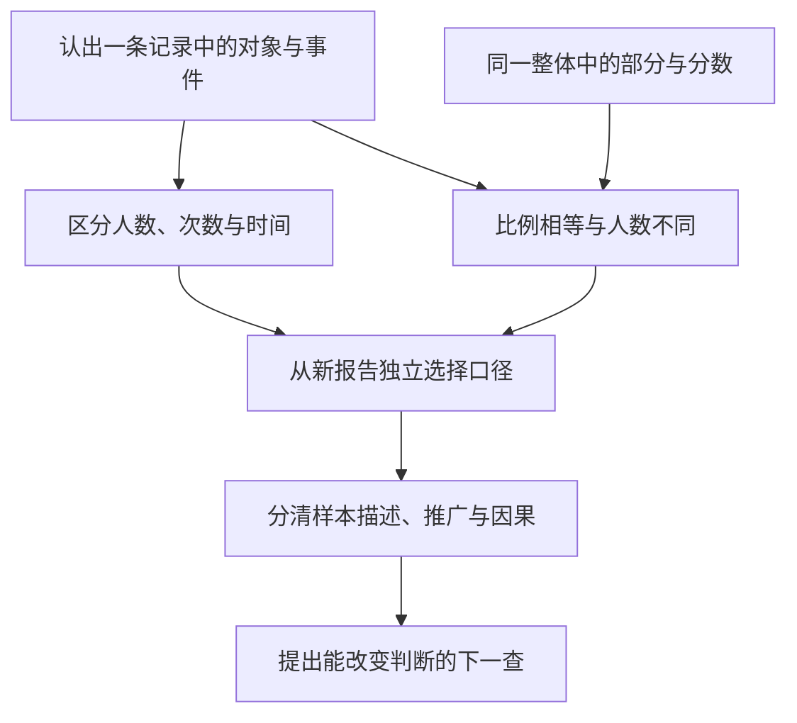

# 为什么教、怎样组织、谁能学：从一个单元到课程与制度

一节“比例报告”课可以教得很顺，学校仍可能只允许会考试的人继续学。教育学因此既研究学习发生的条件，也研究**哪些目的值得追求，知识和机会如何被组织，结果用来对谁作什么决定**。本课沿前一单元扩成四次课，最后让同一提案接受价值、实施与证据三种检查。

## 先区分三种决定

“能够辨认报告口径”是学习目标；“每人都应有机会获得公共判断能力”是规范理由；“按考试排名分配后续支持”是制度安排。第一种可以拟任务观察，第二种必须给受影响者可质疑的理由，第三种要追资源、规则与后果。高分不能独自证明后两种决定合理。

本课用三个可冲突的目的组织讨论，不把它们当完备分类：取得可用知识和技能；能与他人共同理解、讨论与行动；能形成自己的判断并质疑现有做法。比例课若只训练快速算式，第一项的一部分可进步；若不许问“谁没进分母”，就可能削弱后两项。反过来，允许质疑也不自动让计算正确，仍需学习与反馈。

例如只剩一次课，教师想增加无提示变式，学校却要求练公开题库。前者可服务陌生报告判断，后者可服务特定考试熟练；不能偷偷把后者的增益记到前者。应写出目的权重、理由和放弃的机会，再讨论资源限制。返回 [[社会科学/10-共同工具/01-事实模型与价值判断|事实与价值判断]] 检查“观察到什么”和“应优先什么”；返回 [[哲学与文化/20-论证知识与规范/02-伦理与政治正当性|伦理正当性]] 检查羞辱、排除和强制的理由是否充分。

## 课程是被选择和组织的学习机会

这里把课程理解为有目的选择和组织的内容、活动、关系及评价，不只是课本目录。选择比例判断，就意味着暂不深入抽样误差；选择书面长答，可能额外要求教学语言；安排家庭日志任务，就可能使设备与照护条件进入作业机会。每个选择有代价，应随目标明说。

可以分开看三层：**计划课程**写要学什么；**实施课程**看教师、材料与时间真正提供了什么；**经验和获得的课程**看学习者实际参与、理解了什么。它们是分析角度，不是三个已经测出的分数。教案写“小组讨论”，实施可能只有一人说话；学生交了小组报告，也未必每人会独立判断。

还有未明说却反复传递的规则。例如教师口头鼓励质疑，却每次只奖励最快复述答案的人，学习者可能接收到“提不同解释会失去机会”。这是本课的制度假说，需要观察提问后实际回应、访谈与相反案例；不能凭教师一句严厉的话就认证整所学校的“隐性课程”。质性材料怎样生成与核对，复用 [[社会科学/10-共同工具/06-访谈个案与过程追踪|访谈、个案与过程追踪]]。

## 内容的逻辑顺序怎样变成学习的顺序

“分数→抽样→因果→公平”是整理知识的一种逻辑顺序，读者实际卡点却可能是“80%到底是谁的80%”。从卡点进入可以激活问题，随后仍需把分子、分母、选择和比较组织起来；否则只剩四个故事，不能迁移。

Dewey《儿童与课程》（1902）用探索行程与地图讨论经验和系统知识的关系：知识组织能指导新经验，不能代替学习者实际经历；他也批评不给条件、只让儿童从自身想出知识的做法。这是课程论的论证，不能当成已随机验证的教学效果。原典核读范围为印刷pp.18–22及30–31，[原文](https://www.gutenberg.org/files/29259/29259-h/29259-h.htm)。本课据此提出“从报告问题进入，再建立共同工具”的设计推论。

原单元所需先修可以画成**任务依赖图**：

箭头表示本任务的解释依赖，不表示儿童必经、不可逆的发展阶段；可以先诊断再回补。若不会百分比，先用10张人物卡中8张成功、另10张尝试卡中8张成功演示“比例可以相同而单位不同”，再接分数；目标不是把不会心算者挡在讨论之外。若连“同一个人可有多次尝试”也未理解，先回到同ID日志，不能直接塞一个公式。

## 四次课怎样累计而不重复

下面是**可实施设计，不是已运行课表或最佳时长证明**。每次先收原答，再据错误回补；课次可按先修调整，不代填用时。

| 课次与核心问题 | 内容和活动 | 本次可观察出口 | 下一次为何还需它 |
| --- | --- | --- | --- |
| 1：两个80%说同一件事吗 | 沿01完整示例，画对象与事件；保留人数和比例 | 给同口径记录，能同时说比例相等、人数不同 | 先让计算有明确对象 |
| 2：老师不圈分母时怎样开始 | 01渐撤两轮；小组提出一个错报告，互相给反例，再独立做I/II | 原答与提示后补答分开，能自行选对象并限制推断 | 从跟随步骤到自己启动方法 |
| 3：成功更多是否代表机会更好 | 04班级权重、未测者边界；比较“学生等权”和“班级等权”的问题 | 用同一计数复算两个描述，指出分配和缺失尚缺什么 | 把方法接入学校的资源与评价决定 |
| 4：换场合还能判断吗 | 约定延后时点依原教师页先D后N独答，再讨论“排名分支持”提案；分别论证能力证据与机会规则 | 陌生任务判断、规范理由和下一查分列；另约定是否自愿延后测 | 把知识、课程和制度接成可修订方案 |

第四课的D/N只在此前未暴露且实际安排后摘发，保留原题不等值和实际间隔记录；若读者已见题须换另核版本，发放细节见 [[社会科学/68-教育学/80-实践/02-课程与班级证据/README#四次课真正发什么|实践发放顺序]]。

第三课不是要求先掌握整个统计学。式子的含义与必要算例都在04展开；完整推断回统计主解释。第四课的规范讨论也不能用口才代替第二课的对象判断。若目标增加了合作，应观察轮换角色、回应异议与共同修订；最终个人无提示题只回答个人判断，不足以评价合作质量。

正式学校教育常有课程、资格、出勤和评价规则；社区工作坊可有组织、有教师而不授学校资格；家庭阅读或工作中的偶然发现也可能形成学习。这里按具体活动区分组织与目的，不凭场地推断效果。成人工作坊能允许退出延后研究，不代表学校可以退出受教育责任；儿童课堂须另考虑发展、照护与适用程序，见03。不同场景应重新核谁有决定权、谁承担学习成本。

## 学校制度通过哪些环节改变同一教案

设两班教案完全相同，甲班有共同设备和教师备课时间，乙班要求家庭自备网络。即使没有任何能力差，完成练习的机会也可能不同。这是机制假说，预测是设备支持改变后访问失败应减少；若仍主要是概念错，设备解释便不足。不能把所有差异先验归给家庭，也不能把家庭差异从实施记录里删除。

用一条有限链检查制度：**资源／时间规则→实际课程接触→练习与反馈→可观察作答→资格或支持决定**。每个箭头分别留反例：有设备仍未接触，有接触仍未理解，高分仍可能只会熟题。考试若决定资源，教师和学生可能把时间转到计分内容；这也是可检验的激励机制，需比较活动记录与结果，不从考试存在直接推断教学必坏。

教育机会的结构主解释在 [[社会科学/20-经济流动与宏观/04-教育住房地域与累积优势|教育、住房与累积优势]]。从那里带回家庭和地域资源、选择机制与时期；这里新增的是它们如何进入具体课程与反馈。MTO中的居住安排或长期结果不能替代本单元的教学评价，课内改题也不能单独解决入学和住房机会。

一项可辩护的本课规则是：必要访问支持不以排名为前提；概念成绩与内容帮助分记；评分理由可查询和申诉；困难用于决定额外教学，而非立即撤走学习机会。这是本课提出的规范方案，依据是学习机会和可质疑性，不是某项试验证明它无代价。代价包括教师时间、共同设备和复评分工，必须在资源安排中说明，不能把“公平”当免费按钮。

现在去做 [[社会科学/68-教育学/80-实践/02-课程与班级证据/迁移任务纸#E · 目的与制度|任务E]]，再用05答案检查四次课是否真的改变了目标—活动—评价的关系。学习理论怎样选择活动，接03；用作答判断方案，接04。
