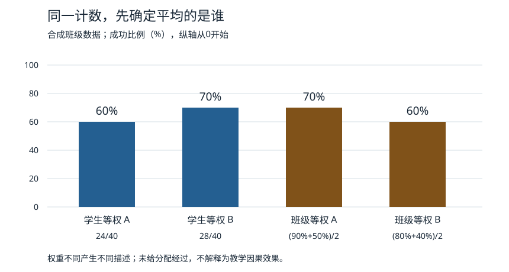

# 评分以后怎样改教学：效度、班级研究与实施证据

本课的计数全部是教学合成数据，不来自学校或被试。目标是从作答建立有限判断，解释研究还缺什么，再把它带回课程修订；代码和图只验证这些给定计数的运算。

## 一道题从作答到决定走了多远

01已把目标拆成对象、关系、边界与下一查，四点各有作答依据。若学生写“两个80%不同”，可能只是记住教师口号；若能指出一个是尝试、一个是人，并在同口径题承认比例相同，证据较具体。**效度属于分数的解释和用途**：用于发现这个错误有依据，不等于可用来决定升学、人格或整门统计能力。

信度关心在相关重复条件下结果的稳定与误差，例如同答卷换评分者；一致性可用逐点一致率并列分歧，但一致未必正确。课堂形成性评分的用途是找下一步教学，期末总结性评分的用途可能是报告某阶段表现；同一题能否兼用，要看暴露、条件和决定后果。形成性不是“分数比较低风险”的同义词，关键是证据实际如何反馈到活动。

一个可检查的修订闭环是：原答“都80%，所以人一样多”→定位把比例当计数→反馈保留原计数→用一大一小两组卡片解释→换同口径新题独立答。若原答其实是没读懂“有效答卷”，就先改词义与访问，不能再加十道除法。原答、教师解释和修订后答分开；改题造成难度改变时，不直接把分差称纯学习增益。

若把自动评分的“出现分母一词”作为标签$Y$，目标判断能力仍是另一个对象；01的合成甲会复述却用错单位，乙不用术语却逐人还原，正好暴露字段与目标错位。带着这两答去 [[AI/65-可信AI与真实数据实践/02-标签选择偏差与社会目标#目标对象和数据字段不是同一个东西|AI目标对象与测量代理]]，核“准确复制旧分数”为什么不认证理解；再返回本课，把评分改为实际对象、理由和健康对照，另核作答过程与支持条件。AI的预测准确和评分者一致都不能替这项教育效度工作。

评分公平也要限定对象：按同一规则评分，有助程序一致；语言、工具、练习机会或题意不同，仍可能使分数用途失当。换口述／图示后概念回答正确，是重新检查语言负担的一条线索，不独自证明所有群体等值。测量的一般主解释回 [[社会科学/10-共同工具/05-测量抽样与调查设计|构念、抽样与测量等值]]；这里负责将它落实到教学决定。

## 同一组班级计数，两个合法描述

设四班同一周完成同一延后新报告任务，“成功”均为无内容提示、四点全部符合，全部有记录。

| 班$j$ | 方案 | 人数$n_j$ | 成功$s_j$ | 本班率$r_j=s_j/n_j$ |
| --- | --- | ---: | ---: | ---: |
| 1 | A | 10 | 9 | 90% |
| 2 | A | 30 | 15 | 50% |
| 3 | B | 30 | 24 | 80% |
| 4 | B | 10 | 4 | 40% |

若问本次A、B两组**学生**的观察成功比例，各学生等权：

$$
\widehat p_A=\frac{9+15}{10+30}=60\%,\qquad
\widehat p_B=\frac{24+4}{30+10}=70\%.
$$

B高10个百分点。若问两组**班级**成功率的等权平均，每班等权：

$$
\bar r_A=\frac{0.9+0.5}{2}=70\%,\qquad
\bar r_B=\frac{0.8+0.4}{2}=60\%.
$$

A高10个百分点。比例的单位无量纲，组差用百分点。两算式都忠实描述原记录，改变的是权重与问题；A的低率大班人数多，B的高率大班人数多。不能只选择有利方向，也不能从反转得出所有加权都错。这里并未把不同班配成可比层，更未证明在每种学生中A都有优势。

图中每根条来自表中计数和上述两式，纵轴为成功比例，旁边保留分子／分母。图与数值由同一输入生成，见 [实践入口](80-实践/02-课程与班级证据/README.md)。图不含学习曲线，因为这批数据没有观察个体前后变化。

## 从描述到因果：班级为何是分配单位

若想比较这四班获分配A或B后会怎样，须先定目标：本例可选“这四班的班级平均成功率在A相对B下的平均改变”。写作

$$
\tau_C=\frac14\sum_{j=1}^{4}\bigl[r_j(A)-r_j(B)\bigr].
$$

$r_j(z)$是在定义好的方案版本$z$下第$j$班的潜在成功率，任务、时点、访问支持及班级成员固定；不同方案只观察到一个。它按班等权，与按学生人数加权的目标不同。现实方案若改变出勤或班级成员，需先固定分母和结果定义，本式不能悄悄换成“只留下能测到者”。

如果确实从四班中等概率选二班分配A，其余B，且没有跨班干扰、实施版本和缺失破坏定义，那么班均差是这项班级目标的随机化无偏估计；不需要把80名学生当独立分配。直觉证明：每班分A、B的概率都是1/2，乘上两组均值的系数1/2，期望中每个潜在率分别得到权重1/4。一般随机分配与实际接受的区别复用 [[社会科学/40-公共政策与社会学/07-政策评估RCT与准实验#RCT：随机化的是分配，不一定是实际接受|政策评估的ITT与集群单位]]。

**本题表没有提供真实分配经过，以上只是明确增加条件后的方法演示。** 教师自选方案、较好先修班先用A、不同学校语言和资源，都可能混入观察差。即使真随机，四班仍只给很有限的精度；随机化帮助识别，不保证每次估计接近真值。

在更强的“任何班任何学生都不受方案影响”的锐零假设下，可把四个观察率固定，枚举六种等概率二班分A的安排。班均差$T$依A班组合12、13、14、23、24、34为

$$
0.1,\quad0.4,\quad0,\quad0,\quad-0.4,\quad-0.1.
$$

按$|T|\ge|0.1|$的双侧规则，精确概率为$4/6=2/3$。这是合成例的随机化检验演示，零假设强于仅平均效应为0；不显著也不证明等效或无教育价值。六种安排的有限分辨率不会因复制每个学生的行数而改善。统计检验通用原理回政策评估和 [[数学/30-概率与统计/05-统计估计置信度与模型评测|目标量、估计与不确定性]]，本课不重建独立同分布推导。

## 未测的人怎样留在结论里

现在改成另一组合成记录：原分配各40人，A实测32人中24人成功，B实测36人中25人成功。未测是未知，不能填失败或删掉后称完整ITT。实测比例为$24/32=75\%$与$25/36\approx69.44\%$，只描述各组被测者；两组入测机制可能不同。

若只假设每个未测者的二元结果在0与1之间、原分配名单完整，则全部40人成功率有可达到的界：

$$
p_A\in[24/40,(24+8)/40]=[0.60,0.80],
$$
$$
p_B\in[25/40,(25+4)/40]=[0.625,0.725].
$$

组差$p_A-p_B\in[-0.125,0.175]$，即−12.5到17.5个百分点，方向未定。这是**未观察结果的逻辑界，不是置信区间**，也不消除分配混杂。下端令A未测全失败、B未测全成功，上端反之，说明给定信息下两端可达。

下一查可区分设备失败、缺席、退出与拒答，并在获得相应同意与可访问安排下补测；不能承诺一定补全，也不把补测条件改变隐藏。若设备是访问障碍，把未测记成概念0会把访问与能力混在一起。即使平均效果为正，若获得帮助、退出或后续支持机会分配不均，也不能单凭均分宣称“更公平”。公平需要明示对象、规则和理由，回02。

## 课堂研究的实施记录为什么会改变解释

“方案A”需要明确示例、题序、渐撤与反馈版本。两个教师都说用了A，一个提前圈分母、一个只给读屏支持，处理已经不同。按原分配报告的ITT仍有政策意义，但不能把实际接触者挑出来当成原随机比较，也不能假定记录了实施便校正了一切偏差。

班内讨论可以是方案的一部分；跨班分享答案会让一个班的结果依赖其他班分配。可在设计时把教师／学校作为更高分配单位，或明确定义溢出条件与暴露；不能一概写“已按班随机，干扰解决”。如果只有一个教师用A、另一个用B，还须面对方案与教师不能分开的对象定义和外推限制。

量化比较告诉平均结果是否不同；观察课堂、访谈和作答过程可检查是不是教师代答、访问失败、学生用另一种理由成功。它们提供机制线索和反例，不能仅因“混合方法”就自动成为两次独立证明。用 [[社会科学/10-共同工具/06-访谈个案与过程追踪|过程追踪]] 保留原话、时序、来源依赖与竞争解释；用 [[社会科学/10-共同工具/03-因果图反事实与识别|因果识别]] 检查支持、出勤、先修和选择。

若评价高分决定资源，师生可能调整时间、求助和缺席记录，这叫评价对活动产生反作用的可能路径。研究时须查实际行为与反例，而不是把观察到高分当成评价没有改变对象的证明。形成性材料改了以后，新的分数与版本另列；确认性比较要预定主指标、停止、缺失与分析层级，沿01已有的HCI停止回程，不反复固定样本显著即停。

## 把结果带回教学，而不替真实结果填空

若新表征错得多，先核是否目标所需先修不足、额外阅读负担或任务本身更难，不能全叫遗忘；若只有提示后正确，增加逐渐撤内容提示的独立机会；若访问失败，先修访问；若小组产出好而个人题差，改角色轮换和个人解释，保留合作目标。每种修订都应写预期观察及失败条件，再收新证据。

完成 [[社会科学/68-教育学/80-实践/02-课程与班级证据/迁移任务纸#C · 哪个方案表现更好|C班级问题]] 与 [[社会科学/68-教育学/80-实践/02-课程与班级证据/迁移任务纸#D · 成功变多，谁退出了|D缺失问题]] 后，回02改课表，再对照05。算术能在本机核，真实班级分配、评分者一致、保持、迁移、参与与公平的经验结果均未运行；未来接口由实践README承接。
