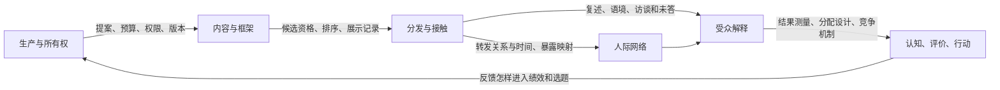

# 新闻传播：从一条报道走到可检验的社会解释

沿同一架空的河湾图书馆事件，先核事实与框架，再查为什么选了这条新闻、谁能参与解释、什么结果可能改变。读者应能提出竞争解释并指出需要哪份证据，而不是从一张点击表跳到“公众被说服”。材料身份、理论前提和现实未验层随正文保留。

1. [[社会科学/69-新闻传播/01-新闻框架触达与受众解释|01：原材料、框架、三种触达分母与更正]]。完整M1–M4、两报道、同源转载及有限更正；原有2000行教学日志复用，不冒称新受众研究。
2. [[社会科学/69-新闻传播/02-所有权商业模式与新闻生产|02：所有权、收入与生产把关]]。以新增合成编辑记录计算候选取舍，区分干预、工时、核验与平台候选机制；从标题回查过程，而非倒推动机。
3. [[社会科学/69-新闻传播/03-公共领域文化实践与受众解读|03：公共领域、文化实践与解读]]。Carey、Habermas、Fraser及Hall的不同问题；用六段完整表达比较事实掌握、协商与对抗，不把规范要求写成已实现的平等。
4. [[社会科学/69-新闻传播/04-传播网络说服机制与效果识别|04：网络、加工与效果研究]]。给一般设计条件和HT期望证明，再用16种分配与6种反例检验直接/邻居暴露；分开知识、态度、行为及缺失边界。

## 每条连接需要不同证据

图是要取证的分析路线，不宣称每条因果边都已由本案证实。生产→内容去02，分发→解释去01/03，干扰与结果去04；工程传输保真仍由[[计算机知识/60-数据编码与媒体系统/17-媒体工程安全许可隐私与可复现性|媒体工程17]]负责，不能证明意义、真假或公共性。

## 材料与实际练习

先读[原事件和两报道](80-实践/01-框架与触达材料/原材料与两篇报道.md)，再读[新增生产与表达材料](80-实践/02-生产解释与网络效果/生产与受众材料.md)。新包的[15道迁移题及答案](80-实践/02-生产解释与网络效果/迁移题与答案.md)要求改预算、改分析单位、改分配及测量条件；[实践入口](80-实践/02-生产解释与网络效果/README.md)给运行、同公式图及未执行的现实研究接口。[[社会科学/69-新闻传播/81-生产与网络效果复算|源码镜像]]便于在Obsidian中对照，规范源仍是实际Python文件。

## 从相邻课程带什么回来

- 从[[社会科学/40-公共政策与社会学/16-模糊许可审查与文化生态|准入与文化生态]]带回权限、风险和拒绝机制，再问02是哪一个生产工序筛掉候选，不把低可见性都叫审查。
- 从[[AI/18-推荐与排序/03-候选列表时间拆分与冷启动|推荐与排序]]带回资格、候选与分发策略，再问04的效果是整个策略还是固定邻居状态的比较。
- 从[[AI/35-传统NLP/10-语言结构与任务/03-实体事件角色与共指篇章|语义和篇章]]带回说话者、角色、引用与否定，再检验03是否把被反驳的引述当受众本人误信。
- 从[[社会科学/68-教育学/04-评价效度班级研究与实施证据|评价与研究效度]]带回构念、缺失与分配单位，再为新闻改写理解、态度、行为的独立指标，不能把课堂分数当传播效果。

这条路线满足基础理论—材料分析—方法—反例的学习闭环。真实受众理解/态度、平台分发/更正覆盖、长期行为和真人迁移尚未实施；实践页给出了输入、权限、观察与失败界，当前合成结果不替代它们。它也不宣称穷尽全部新闻史、媒介制度或传播研究。
