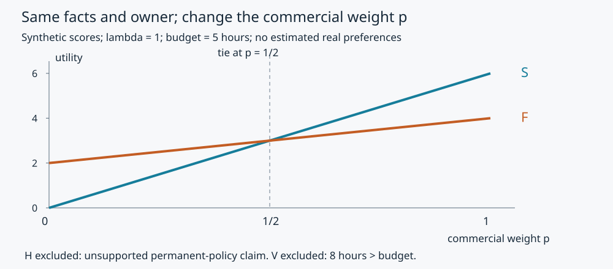

# 为什么这篇报道进入版面：所有权、收入与生产把关

同一图书馆事件，有编辑先问晚间借书是否方便，有编辑先问预算怎样交代。标题不同，足以开始查生产过程，却不足以宣判谁收了钱。本课把“资本决定一切”和“记者完全自由”这两个省事答案，拆成可以检查的权利、资源、工序与取舍。

事件事实继续使用[[社会科学/69-新闻传播/01-新闻框架触达与受众解释#同一材料，先问究竟在比较什么|01的河湾图书馆M1–M4]]。新增[R1–R5生产材料](80-实践/02-生产解释与网络效果/生产与受众材料.md)全部是教学合成记录；它们没有补出真实所有人、广告商、采访或受众。请先读原件，再比较以下解释。

## 所有权通过什么起作用

所有权先是一个权利问题：谁有表决权，谁任免负责人，谁承担损失，谁可以否决预算或转让资产？收入来源另问谁付费、按什么条件付费；编辑日常再问谁定选题、调记者、审证据和签发。三张名单可能相交，也可能分开。“公营”“民营”“公益”标签不能代替这三张名单。

| 机制假说 | 生产过程应出现什么 | 单凭什么还不够 |
| --- | --- | --- |
| 所有者直接干预 | 有权限者在决策前提出具体要求，版本/选题随之改变；查其他同时变化的条件 | 股东身份、标题语气或一次匿名指控 |
| 广告或订阅依赖 | 合同、收入占比及续约风险进入预算/绩效；不同受众价值改变资源分配 | 文章旁边恰有广告，或读者多 |
| 专业常规 | 截稿、核实门槛、值班人手、消息源可达性持续筛选素材；有被拒稿的理由和未选候选 | “新闻价值”四字，或把记者自述当全部过程 |
| 平台分发激励 | 候选准入、检索、排序目标、位置和反馈改变可见性；可见性反馈再影响选题 | 最终点击表或只看已展示内容 |

R1显示教学报社由一个信托持60%表决权、合作社持40%；信托能任免总编辑。R2显示收入情景中广告、订阅、拨款各占多少，并不显示某一广告合同已经下令。R3的核实规则和工时限制可以挡住一篇预计高点击却无依据的“永久开放已定”标题。R4只记录本轮选题、候选和时间；只有看到这些过程资料，才能把“可能机制”往“本次有证据的机制”推进。

广告支持可以扩大免费获取，也可能让可出售受众更有商业价值；订阅可能支持稳定深度报道，也可能把无力付费者排在外面；捐赠和公共拨款可能支持不易变现的议题，也可能形成捐赠者或预算控制依赖。这些是有条件的收益/风险，不是对所有组织的统一因果排名。要比较效果，须固定时期、受众和反事实方案，分别看读者、记者、出资者与被报道者承担的成本。

Hall在1973年原稿的“professional code”讨论中指出，视觉质量、呈现、消息源准入等专业操作可以有相对自主性，也可能在未公开表态时复现主导定义；他同时承认冲突。这个理论提供要查哪些工序的线索，**不是对河湾报社的实证结论**。[原稿印刷pp16–17](https://epapers.bham.ac.uk/id/eprint/2962/)。审查、许可和拒绝风险的具体制度机制继续读[[社会科学/40-公共政策与社会学/16-模糊许可审查与文化生态|文化准入16]]；不能把一切未入版面都叫审查。

## 有限决策模型：把一条机制算到底

令每个候选报道有公共问题价值分数 $v_j$、预计商业回报分数 $r_j$、记者工时 $c_j$，编辑在预算 $B$ 下选择

$$
J^*(\lambda,p,B)=\operatorname*{argmax}_{j:\ c_j\le B,\ q_j=1}
U_j,\qquad U_j=\lambda v_j+p r_j-c_j.
$$

$q_j=1$ 表示本练习的关键事实通过核验门槛，未核实的永久开放断言 $q_H=0$。

这里 $v,r$ 是**人为设定的评分**，不是调查得来的社会价值与人民币；$\lambda,p\ge0$ 把两类评分换成同一效用分单位，工时的负系数归一为每小时1效用分。不能把这个式子当所有真实编辑都执行的心理定律。空选项O成本/分数为0且合格；并列时返回全部最优候选，不偷偷设一个偏好的破平局规则。

| 候选 | 核心问题 | $v$ | $r$ | $c$（小时） | $q$ |
| --- | --- | ---: | ---: | ---: | ---: |
| S | 哪些人能在下班后借书 | 4 | 6 | 4 | 1 |
| F | 预算上限与后续决策怎样问责 | 7 | 2 | 5 | 1 |
| V | 延长观察并补充独立访问 | 9 | 1 | 8 | 1 |
| H | “永久开放已定”吸睛稿 | 1 | 10 | 3 | 0 |
| O | 本轮不发 | 0 | 0 | 0 | 1 |

固定$\lambda=1,B=5$，V超时、H未核，比较S与F有
$U_S=6p$、$U_F=2+2p$，因此$U_S-U_F=4p-2$。$p<1/2$ 时F胜，$p>1/2$ 时S胜，等号时两者并列；在$p\ge0$下O不超过二者。商业权重提高能改变本模型的优选，即使所有权和事实没有变。$p=0$选F（2分），$p=1$选S（6分）。若错误地移除核验约束，$p=1$的H为8分而被选中；“更赚钱”没有使它更真。

反过来，一次观察到S**不能识别p**。预算只有4小时时，F、V已不可行；即使保持B=5，也可因不同的公共价值判断、截止时间或可达消息源而选S。固定模型中改变$p$的比较是条件推演；它没有估计真实所有权的因果效应。见[实际精确输出](80-实践/02-生产解释与网络效果/results/communication.json)和[[社会科学/69-新闻传播/81-生产与网络效果复算|规范源码镜像]]。

## 从一次选题走向制度证据

R4写明：10:00提供S/F/V/H/O五候选及相同的事实截止，11:00给定B=5，11:10情景P0按$p=0$选择F，情景P1按$p=1$选择S。这两条是**另造的对照世界**，不是真实报社发生两次。模型还预测：在这组评分和约束下把p降到1/2应出现并列；若据同组评分仍断言S严格胜F，就与计算矛盾；现实只发S则也可能是另有破平局规则，不能仅据此认定p>1/2。

真实研究可先抽取某段时间内全部选题提案，包含未发稿；按报道/编辑决策轮次记录提出时间、候选、理由、工时、核验、版本和签发者。再选择有反例价值的过程个案：商业价值高却被核验挡住、同所有者却改了风格、换了所有者但工序未变。编辑访谈能解释行动者的理由，须与同期文书、版本和可核时间互证；受访者回忆不自动等于原因。

若利用所有权变更前后比较，必须处理同期编辑换人、平台规则、受众和地方事件；只做前后差不能分离这些变化。比较组织的样本也可能只留下成功存续者，忽略倒闭、未获得许可或不愿提供档案者。可以提出平行趋势或准随机冲击设计，但必须逐案说明为何可信，不能把制度难题交给回归按钮。

平台还有第二次把关：编辑发出了F，推荐候选却没召回它，受众仍看不到；反馈少又可能被编辑理解成“公众没兴趣”。回到[[AI/18-推荐与排序/03-候选列表时间拆分与冷启动|候选与排序主解释]]时，须把具体假说改成“在同样可入池的报道中，排序是否降低F的展示概率”，并保留未入池记录。只优化展示后的点击无法回答这个问题。

## 带着问题继续

01已完成同材料A/B框架与同源更正；本课完成产生候选和选择报道的机制。选中的报道怎样进入公共讨论、怎样被相同事实的读者接受或反对，接[[社会科学/69-新闻传播/03-公共领域文化实践与受众解读|03]]；是否改变了什么，接[[社会科学/69-新闻传播/04-传播网络说服机制与效果识别|04]]。迁移题见[题1–5](80-实践/02-生产解释与网络效果/迁移题与答案.md#生产制度题)。
