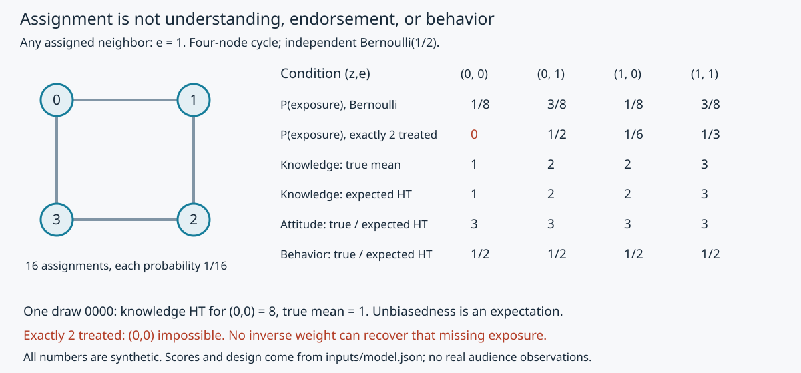

# 看见、理解、赞同、行动：传播网络中的效果怎样识别

01的A/B日志已经说明：曝光、曝光后点击与全体点击可以给出不同排序，相同日志还可与不同因果世界相容。本课不再重算旧2000行；它增加两个问题：受众为什么会用不同方式加工同一报道？消息从朋友那里再到达时，怎样定义“处理组”？

## 先让效果理论作不同预测

议程假说预测议题的重要性判断变化；框架假说预测同一议题被什么考虑组织；说服假说预测评价方向或强度变化；行为假说预测指定行动。对河湾报道，可以分别测“不提示时列举的重要地方问题”“解释为何支持或反对”“对试开方案的评价”“规定两周内是否实际借阅”。这些不在同一条必然上升的传送带上：事实掌握更多的人可能更反对，支持者也可能没有时间来馆。

精细加工可能性模型（ELM）把对论据的思考程度看作连续变化，受动机与能力共同影响。高相关性不保证深思：时间压力、既有知识、强烈防卫和重复疲劳都可能改变加工；深思也可能产生反驳。来源的专业身份可以充当简便线索，也可以成为与议题相关的理由或改变加工方式，不能给所有“专家消息”固定贴上边缘路径。[Petty与Cacioppo原作者理论章pp127–139、147–148](https://doi.org/10.1016/S0065-2601(08)60214-2)；本包实际所用[公开节选](https://fsnagle.org/files/petty1986elaboration.pdf)只到p162，不冒称重核全章或其每项实验。

用于河湾的可反驳预测是：在预先约定的加工条件下，**支持同一结论但证据充分程度不同**的材料，其态度差异是否随加工机会而改变？若只提高“知名来源”标签就改变评价而事实理解不变，则与只经由理解改变的机制不同；但也可能是信任或合理的信息压缩，不能直接骂读者“不理性”。“充分论据”需独立于本次结果预先界定/预试，并保持事实准确、长度、结论、可读性和新颖性尽量相当。错误材料不是伦理上免费可用的“弱论据”。本例原A/B事实相同，只变标题和顺序，**没有自动实现论据质量操纵**。

研究可分别随机化框架、核验说明和可阅读时间，预先写理解、态度和行为结果及交互预测；在各处理里按同一窗口取结果，不按处理后的“确实理解者”再筛一遍估总效果。先前态度/可达时间用于处理前分层及异质性分析；把看完后的态度叫“控制变量”会改变问题。思考列表、回忆和访谈可以辅助区分机制，但自身不证明中介因果；原理论章p137也提醒思考列表的相关证据限制。具体实施仍需招募、同意与独立评估，本包没有运行受众实验。

## 两级传播不是每条消息必走两步

Katz（1957）回顾投票、Rovere、Decatur和医生采用新药等研究，讨论大众媒体与人际联系。他指出，早期自报“给过建议的人”与其他人的比较，**不等于把每位领导者与实际跟随者配对**；后续研究努力追踪关系与时间，意见领导也随议题、群体及社会位置变化。[原论文pp61–78；本次实读UPenn重排稿PDF pp1–9](https://doi.org/10.1086/266687)。这是研究链的批判性回顾，不是每次影响恰好两跳的定理，也不是随机化证明。

在河湾，某人可能从报纸得知时间、从同事处确认是否值得去，再因自己排班决定行动。转发路径测的是消息流，采纳变化测的是行为，二者不能互换。朋友圈的人都支持夜间开放，还可因为相似作息的人先成为朋友，或同时遇到新排班通知。即使观察到朋友先改变，也须考虑未记录的共同信息与关系选择；已建[[社会科学/40-公共政策与社会学/05-网络社会资本制度与文化|网络主解释]]提供同质性与影响混淆的入口。本课接下来用**预先固定的网络和已知随机分配**，展示什么时候能够识别一个明确效果。

## 一般对象：分配、网络暴露与潜在结果

固定有限人群 $i=0,\ldots,N-1$、处理前已知无向简单图 $G$，邻居集$\mathcal N_i$。$Z_i=1$表示被分配到一份指定报道的接收机会，不偷换成真的看懂。全部分配向量$\mathbf Z$按已知设计$P$产生；定义二元邻居暴露

$$
E_i(\mathbf z)=\mathbf1\{\exists j\in\mathcal N_i:z_j=1\},\quad
D_i(\mathbf z)=(z_i,E_i(\mathbf z)).
$$

假设**同一人的结果仅由这个映射决定**：若$D_i(\mathbf z)=D_i(\mathbf z')$，则该人的两个潜在结果相同，记为$Y_i(z,e)$。它允许朋友的分配影响本人，但不允许结果另依赖哪位朋友、两位与一位的差别、二阶邻居或未记的渠道。研究者必须提出并检查这种约束的实质理由；称它“暴露”不等于已经测到了真实转发或心理路径。另要求结果记录一致：$Y_i^{obs}=Y_i(D_i(\mathbf Z))$，版本和观察窗口已固定。

要估的是有限人群平均
$\mu(z,e)=N^{-1}\sum_iY_i(z,e)$，不是全世界的传播规律。直接对比为$\tau_D(e)=\mu(1,e)-\mu(0,e)$，邻居对比为$\tau_S(z)=\mu(z,1)-\mu(z,0)$；它们可以不同，也不自动等于由朋友说服的纯中介效应。

令已知暴露概率$\pi_i(d)=P\{D_i(\mathbf Z)=d\}$。若对目标人群每人都有$\pi_i(d)>0$，定义Horvitz–Thompson均值估计

$$
\widehat\mu(d)=\frac1N\sum_i\frac{\mathbf1\{D_i=d\}Y_i^{obs}}{\pi_i(d)}.
$$

**一般无偏证明。** 在指示函数为1的分配下，一致性给$Y_i^{obs}=Y_i(d)$；故第i项的期望为$Y_i(d)\pi_i(d)/\pi_i(d)=Y_i(d)$。有限求和并除N即得$\mathbb E\widehat\mu(d)=\mu(d)$，两个可估均值作差也无偏。这个证明不假设各人的观测结果独立；它依赖已知设计、正确映射、正概率与一致测量。网络中方差通常含跨人协方差，不能套独立样本标准误。这里不由四个人给正态置信区间。

在独立Bernoulli(p)分配、$0<p<1$、度数$k_i>0$下，令$a_z=p^z(1-p)^{1-z}$，则
$\pi_i(z,0)=a_z(1-p)^{k_i}$、$\pi_i(z,1)=a_z[1-(1-p)^{k_i}]$。因为本人分配与邻居分配独立，且所有邻居未分配的概率是$(1-p)^{k_i}$。孤立点$k_i=0$永远没有e=1，不能估包含它的全人群邻居对比；给零概率加一个小数不会创造信息。

上述对象/条件与[Aronow和Samii的原论文§3–4](https://arxiv.org/abs/1305.6156)对应；本包自行给出有限均值期望证明。未复现其学校现场试验，也没有把下面的人工分数当成它的原数据。

## 四节点环的完整反例与实际复算

取环0—1—2—3—0，独立p=1/2，16种分配各1/16。每人两邻居，故$\pi_i(z,0)=1/8$、$\pi_i(z,1)=3/8$。给每个人四个**人工潜在结果**：

$$
K_i(z,e)=b_i+z+e,\ b=(1,2,1,0);\quad
A_i(z,e)=3+d_i z+s_i e,
$$
$$
d=(1,1,-1,-1),\quad s=(1,-1,1,-1);\qquad
R_i(z,e)=r_i,\ r=(0,1,0,1).
$$

K为0–4的事实题分数，A为1–5的评价分，R为0/1的指定行动。它们只在此合成练习中有这些含义，不是由实际心理规律推出来的。

直接求和得$\mu_K(z,e)=1+z+e$、$\mu_A(z,e)=3$、$\mu_R(z,e)=1/2$。因此知识的直接/邻居平均对比都为1，态度和行为两种平均对比都为0；但态度个体效应有+1与−1，平均0不表示人人不受影响。源码从输入生成全部16次分配、每次观测/估计与精确有理期望，实际输出与此解析结果吻合。

一次抽到0000，四人都在(0,0)，$\widehat\mu_K(0,0)=8$，而真均值为1；其余三个条件的估计为0。这并未打败无偏定理：无偏是对16次可能分配加权的期望，不是每次估计都正确或落在0–4之内。事后把8裁成4会改变估计器，不能继承刚才的证明。图中将真均值和16种设计平均分开画。

**换条件：每次必须恰好两人分配到报道。** 只有6种等概率分配。某人未被分配时，另外三人中有两人被分配，不可能两位邻居全0；故$\pi_i(0,0)=0$。其余概率为$\pi_i(0,1)=1/2$、$\pi_i(1,0)=1/6$、$\pi_i(1,1)=1/3$。因此不能由这项设计无模型地估$\mu(0,0)$及用它的直接/邻居对比。随机化解决分配混淆，**并不自动给所有目标暴露正概率**。需要改设计、缩目标或增加清楚的结果模型；不能拿同一六条记录强补一个“未暴露基线”。

## 从方法到可执行的研究接口

实际研究先固定接收机会的内容、目标人群、关系定义/测量时间、观察窗和结果。平台只给已曝光日志时，应先查候选/资格与随机化记录；没有它们就不能宣称已知$P$。点击既受先前兴趣影响，也受排序位置影响；以点击者为分析样本还可能破坏原随机化。共同政策冲击要用同一时期的对照，不能把全城同时变化叫报道效果。干扰则需网络/群组设计和映射，不能只加一句“控制社交关系”。

例如事实题0–4分，A组20人中16人交卷，总分40，B组20人中18人交卷，总分45。不假设失访者表现，全体均分界为A[2,2.8]、B[2.25,2.65]，差A−B在[−0.65,0.55]；可由两端把所有缺失分别填0或4构造达到，故是**尺度约束下的逻辑界**，不是置信区间。若按完成者算40/16与45/18都是2.5，仍不能证明全体相等。更多效度、失访与按组分配原则复用[[社会科学/68-教育学/04-评价效度班级研究与实施证据|教育研究主解释]]，但从课堂转到新闻还须重写结果构念和曝光/关系单位。

对竞争机制，研究方案应预先给“什么结果使我改解释”：只有重要性变化而没有态度变化，不能叫说服；理解提高但态度相反，可能反映权衡而非传输失败；好友同时转发但随机邻居暴露对比为0，不能仅凭路径坚持人际影响。即便有邻居分配效应，也未分离信息、可信度与社会压力，须进一步有理论约束的设计。跨到[[AI/18-推荐与排序/03-候选列表时间拆分与冷启动|推荐主解释]]时，目标应写清是平台分配策略的总效果还是固定邻居状态的直接效果，而非把CTR换个名字。

[实践README](80-实践/02-生产解释与网络效果/README.md)给真实运行、具体断言的重要性、失败条件与尚未实施的受众/平台/更正接口。[迁移题11–15](80-实践/02-生产解释与网络效果/迁移题与答案.md#网络与效果题)要求换设计再判断，不能仅背“相关不等于因果”。
