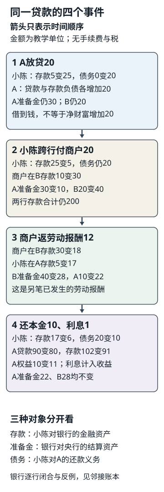

# 社会认知32问与四个贯穿案例

学会一个词以后，要能在条件变化时重新判断。本页的目标是交出可以检查的账本、机制和保留条件。基础读法：依次完成四个案例，再做八组题；快进读法：先做一组题，遇到缺口沿[[社会科学/00-开始/01-社会认知学习路线与32个问题|学习路线]]回到具体主解释，再返回同一题。两条入口用同一材料与答案。

所有金额和制度安排都是明确标注的教学设定；现实法律以所链接主文的已读版本及范围为准。本页不增加现行税率、贷款产品、国家制度效果或汇率预测。允许等价算法、合理竞争解释、依据明确的不同价值判断与有理由的未知；只有背术语而没有对象、证据或条件不能兑现任务。

## 案例A：小林的工资怎样成为生活资源

小林、伴侣与孩子是本例共同生活单位。沿[[社会科学/20-经济流动与宏观/08-工资劳动关系税费与生活成本#一张工资单的完整账本|工资页原账本]]回访同一个月，金额元/月：雇主成本12000，其中税前工资10000、雇主另付2000；个人扣款800，扣除额度5000后教学应税所得4200，虚构10%税420，到手8780。雇主成本不能当作家庭可花的12000。

伴侣收入4000、来自单位外的转移500、财产收入200，家庭现金收入13480。共同消费9000，消费后4480；还本金1000不叫新增消费，现金增加3480。若600元公共服务成本另列，它不是可领现金600，也不证明家庭效用增加600。[[社会科学/20-经济流动与宏观/11-家庭共同生活与内部资源分配#工资到账以后，分配仍没有结束|家庭内部安排]]再问谁控制3480、谁照护孩子，避免从总额推出所有人相同处境。

第二个月只改工资：税前11000、其他工资参数不变，税520、到手9680，增加900。只比较小林到手与同一篮子价格1000→1120：能买8.78→约8.643篮，下降约1.56%。这不是整个家庭福利下降1.56%的证明；伴侣收入、住房、照护和公共服务未同时测量。再把“涨薪改善生活”拆为事实、价格机制、因果问题和价值标准，返回S0.1、S0.3、S3.3、S4.1。

## 案例B：一笔贷款经过两家银行后怎样闭合

本例是对既有[[社会科学/20-经济流动与宏观/06-货币信用银行与通胀#一笔贷款怎样同时创造资产和负债|贷款创造存款]]与[[社会科学/40-公共政策与社会学/10-财政货币与分配/03-银行信用利率与分配传导#一笔新增贷款的四个时刻|贷款四时刻]]的跨行扩展。金额为抽象货币单位，所有步骤在同一期间，无现金提取、手续费、违约、准备金利息、其他收益费用或资产重估；全部表中存款是银行负债，贷款是银行资产。央行只提供结算账户，本例无央行新放款；两行期初准备金合计50。

借款人小陈在A存款5，商户在B存款10；A其他客户存款85、B其他客户80，本期间不动。A期初准备金30、既有贷款70、存款90、权益10；B为准备金20、既有贷款80、存款90、权益10。准备金是商业银行对央行资产，不是小陈可用存款。




图中箭头仅表示时间顺序，不表示只凭前一项就必然产生后一项。存款是小陈对银行的金融资产，准备金是银行对央行的结算资产，债务是小陈对A的还款义务；三者不能互换。图与下表使用同一四事件、金额和边界，完整资产负债仍以下表逐行核对。图为本课原创教学账本的可视化，不描述所有支付系统。原Mermaid保留用于编辑；上方SVG提供无需Mermaid渲染器的阅读图。

商户付12是本例另一笔已发生的劳动报酬，不从购买20自动推出；不涉及税费。为了同时追踪小陈和商户，其余客户存款保持固定。

|事件完成后|A准备金|A贷款|A存款|A权益|B准备金|B贷款|B存款|B权益|小陈存款/债务|商户存款|
|---|---:|---:|---:|---:|---:|---:|---:|---:|---|---:|
|期初|30|70|90|10|20|80|90|10|5 / 0|10|
|A新增贷款20|30|90|110|10|20|80|90|10|25 / 20|10|
|小陈跨行付款20|10|90|90|10|40|80|110|10|5 / 20|30|
|商户跨行付报酬12|22|90|102|10|28|80|98|10|17 / 20|18|
|还本金10、付利息1|22|80|91|11|28|80|98|10|6 / 10|18|

每一行每家银行都满足准备金+贷款=存款+权益。A期末22+80=91+11；B为28+80=98+10。所有存款由期初180，经放款增为200，付款和报酬只是两行之间转移，最后还本付息降为189。贷款本金还10，使贷款和存款各减10；利息1使小陈存款减1、A本期利润与权益加1。本例没有把利息留成另一位客户存款，也没有股息派发，故须保留权益增加这一项。

同一笔支付在小陈是支出、在商户是收到资金；发放贷款先增加小陈存款和债务，不是凭空增加小陈净金融财富20。购买所得的实物或消费须另记；表没有实物价值信息，不能从存款下降推出总财富同幅下降。若利息改为2且其他条件不变，小陈期末5、A存款90权益12。若贷款和购买都改35，小陈放款后存款40，足够付款，但A付款前只有准备金30，本设定无法直接照表完成，需要融资、其他流入或改变支付，不可擅自填负准备金。制度现实中哪些工具可用，要另查实际条件。

本表兑现S5.1、S5.2，也让S6.1练习同一工具的两面。流动性短缺与资不抵债的区别去[[社会科学/30-金融市场与风险/07-银行期限转换流动性与挤兑#2. 一张小额合成资产负债表|银行压力表]]带回；它采用另一张期初表，不能当作本例同一期交易续接。

## 案例C：同一甲乙生产链、关税与跨境付款

沿[[社会科学/20-经济流动与宏观/09-贸易供应链关税与分配#同一甲乙之间：总贸易额与增加值为何不同|甲乙生产链]]：甲生产部件100卖给乙，乙装配后160卖回甲，甲零售给最终消费者200。无其他中间投入、库存变化与运输费用，各环增加值100、60、40；甲合计140、乙60，全链200。两次跨境总货物流260不是增加值260，更不是两国GDP都增加260。甲进口160、出口100，NX为−60；乙为+60。价格单位是该模型统一计价单位，未自行换为人民币或美元。

先只追甲支付160给乙的同一笔货款。约定交货和所有权转移当期，甲是甲国居民、乙是乙国居民；甲在乙国银行已有存款160，直接支付给乙。甲取得货物资产160、对外存款−160；乙出售货物并存款+160；该银行对甲负债−160、对乙负债+160，总负债不变。按[[社会科学/20-经济流动与宏观/10-汇率跨境支付与国际收支#同一支付，两边如何闭合|BPM6教学呈现]]，仅这一笔甲CA=−160、FA=−160，乙CA=+160、FA=+160；链上其余出口与付款另外记，不在这一行重记。居民判断不由国籍或收款地址替代。

为了练汇率，只增加明确的合同条件：上述甲进口账单约定160美元，E=CNY/USD从7到7.7，人民币付款值1120→1232。若甲另有应收100美元且同期兑回，对应人民币收入700→770；这两项净现金流由−420→−462，差−42，其他成本、税、销量未知，不能宣称净利润一定降42。美元与人民币核算表需在各自期间汇率下完整换算，不把链上原计价数直接与人民币相加。

最后让同一甲国面对另一种政策选择：对进口制成品加关税。为分离机制，完整沿用贸易主文的小国市场D=100−P、S=P−20、世界价40，与上面单批生产链分别核算。税10令国内价50、消费50、生产30、进口20；无税消费60、生产20、进口40。消费者损失550、生产者增益250、政府收入200、无谓损失100。生产者剩余不是会计利润。若税参数提高到20，国内无贸易均衡价60、需求和供给都是40，进口与税收0；税30也不能将价格抬成70，此时消费者和生产者剩余各800，相对无税合计2000，无谓损失400。参数和条件都与主文相同，禁止性关税之后不继续套进口为正的公式。

关税的补偿若可筹集并实施，谁得谁失可能改变；“总量上可以补偿”不等于已经支付。比较优势也要回到机会成本，不从部件价值100断定甲在任何产品上都更高效。这个案例接回S3.1、S6.2、S7.1—S7.4。

## 案例D：同一阅览室从建议到实施和纠正

阅览室每天6小时，晚班劳动者希望8小时。先沿[[社会科学/40-公共政策与社会学/10-政治制度公共决策与问责#跟踪一次延长开放时间|公共决策六个检查点]]辨认提出者、未被听见者、目标、替代方案、权限、预算和执行；再用[[社会科学/40-公共政策与社会学/12-代表产生司法监督与执行#一次投诉的五步回访|投诉五步]]回到同一设施检查。延长2小时是产出记录，晚班者能否实际使用是结果，因果改善与正当性还需不同依据。

与设施合作的会员协会仍是独立主体：100名会员各120元会费，共12000，购书8000、其他3000、预留1000。若购书8500，结余500，算术不授权超预算。理事、管理员、非会员儿童与邻居分别有什么权利和代价？按[[社会科学/40-公共政策与社会学/09-社会组织公司协会与公共机关#一次买书，读出整套组织|购书全过程]]查批准、签约、验收、记录、退出与责任。协会选理事和聘管理员不等于产生公共机关，协会钱与公共预算不能因服务同一场所直接混账。

现有公共预算批准一笔服务支出，仍需付款、人员与运行记录。为识别中央地方重复计算，用[[社会科学/40-公共政策与社会学/11-税制公共预算与中央地方关系#从收入到服务：两级预算怎样合并|独立的两级预算示范表]]检查中央税80、地方税20、内部转移30合并税收仍100，服务110、赤字与新债10。它是全体服务的示范预算，不是这间阅览室实际获得110；把一项设施决定与全国汇总数字混成同一观察会错。

公告称“满意度90%”，若实际120份自愿回答有108份赞成，只能先说回答者赞成比例90%。未回应者、未使用者、职工与夜班人群覆盖如何，转到测量抽样；来自同一采访的报道和转发不能算两份独立证言，转到过程追踪。异议增加可能是服务变差，也可能是表达门槛降低，必须回访机制。这让S0与S1、S2、S4接到一项真正可检查的公共问题上。

## 八组迁移任务与参考答案

每题先独立写出判断、算式或需要补的材料，再看答案。答案给出最低可兑现结果，不要求照抄句子。四案例不覆盖所有社会现象，题目中的额外数据会注明是另一个既有算例或条件改变。

### S0.1 事实解释价值
任务：案例D的公告写“开放8小时，所以政策成功且公平”。拆句并提出一项能推翻其机制的观察。

答：8小时是待核实际开放记录；“提高可及性”是效果主张，“成功”需目标，“公平”需受益者、职工和财政负担及价值标准。晚班人群仍无法到达或实际停开，可反驳部分机制。合理替代观察与不同明确价值标准合格。

### S0.2 指标与分布
任务：另一个既有收入样本[1,1,2,2,14]中14改为24（万元/年），均值和中位数变化？能否据此说典型家庭改善50%？

答：均值4→6，中位数仍2；上端变化不证明中间家庭收入增加，更不能由此推出家庭内部资源或实际购买力。须保留人数、期间、价格和总体边界。

### S0.3 存量流量和名义实际
任务：案例A的本金1000、工资涨1000、现金结余3480分别是什么？用篮子检验到手现金增长是否等于购买力增长。

答：还本是金融交易，使现金资产与债务各减1000；工资和当月现金结余是期间流量，期末现金余额才是存量。到手8780→9680，篮子1000→1120，8.78→8.643，约−1.56%；不等于全部家庭福利变化。

### S0.4 相关因果与来源依赖
任务：案例D里同一管理员采访被三家媒体转发，同时开放后人次增加。现有材料支持什么，还要查什么？

答：采访仍是一条生产链，不是三个独立来源；核原话、时点、统计是否改口径、材料产生关系。人次增加是描述，须查季节、成员构成与同期措施等反事实。允许提出不同识别策略或判未知，不能把无独立材料当已证明因果。

### S1.1 家庭企业协会国家
任务：案例A小林领工资并缴协会会费，是否可把雇主、家庭、协会与公共机关收入汇成小林自己的资源？

答：不可。分别画个人、共同生活单位、公司、会员组织和公共权力边界；成员与受影响者不同，税/会费/工资有不同权限和交易。孩子和非会员使用者无工资或会费仍可能受影响。

### S1.2 规则与组织
任务：案例D买书8500，其他3000，会费12000，全体理事支持即可证明合法且有效吗？

答：结余500。算术、权限、程序、采购质量和效果分开；须查章程、代表签约、预算调整、验收。无这些材料只能保留未知，支持人数不能自动补权限。

### S1.3 集体行动和公共品
任务：另一个公共灯算例，两人愿付6和5、费用9，为何“谁都不愿独付9”不证明不值得提供？用于阅览室还需查什么？

答：非竞争公共品假设下总意愿11>9，净2，但筹资协调和搭便车可使供给失败。阅览室座位和时段可能拥挤，可排他，不能直接套纯公共品；要查成本、受益与排除规则。

### S1.4 职位资源身份与网络权力
任务：同年收入20的人，一个控制500预算、一个有高声望、一个有200净资产。谁“最有权力”？若两群之间C—D是唯一联系，又能推出什么？

答：问题缺任务与关系对象。预算职位影响配置，资产提供退出或投资资源，声望可能影响动员；还需身份、网络位置和规则。允许对具体任务作有依据比较，不能收入相同就说权力相同。C、D在给定网络中有桥接位置，但信息能否经过、是否能绕路、双方是否信任仍需查；位置不自动等于有效控制。

### S2.1 国家政府政党行政机关
任务：某部长宣布阅览室方案，能否说“国家法律已经改变”？

答：先辨认行政职务、机关与公告授权；国家整体、政府、政党与具体机关不互换。行政安排与全国立法是不同事项，需法律文本和程序事实，照片或宣布不足。

### S2.2 代表选举任命协商
任务：案例D的协会选理事、聘管理员、征求邻居意见，是哪种动作？20名会员全赞成意味着什么？

答：选举、按权限任命、协商分别处理职位与材料。20人赞成不能独自证明法定人数、程序或全部利益被代表；先查章程及意见覆盖。不能套成三国同一种公共职位产生程序。

### S2.3 立法行政司法监督
任务：预算获批、审计提出问题、法院作出付款裁判，能在记录中写“设施已改善、钱已付”吗？

答：均不足。批准是授权，审计是检查，裁判是法律结论；行政实施和裁判后执行另看人、钱、实际履行。查拨付、排班、银行付款或执行结果；不假定所有渠道能处理同一争议。

### S2.4 中央地方问责与救济
任务：公共项目由地方执行、中央给转移，发生停开。应先找哪三类材料？

答：决定及事权/支出责任，批准拨付和实际执行，说明/审查/纠正与救济渠道。上级给钱不等于每个执行决定由上级作，报告义务不证明有效纠正；程序和期限须按具体法域查。

### S3.1 分工企业
任务：既有面包企业销售1000、买中间投入400，能说本企业生产贡献1000吗？流水线更快又为何可能不采用？

答：本企业增加值600，不能重复计中间投入；三人每小时45件与单人10件的技术收益还受市场、协调、质量和管理成本约束。销量很小或交付需要变化，技术快不保证安排更好。

### S3.2 价格供需与市场势力
任务：D=100−P、S=P的价格50变60，分别给一种量增与量减的模型；能仅凭涨价判断垄断吗？

答：需求改120−P得P60、Q60；供给改P−20得P60、Q40。两模型其他条件固定。价格一项不识别原因或市场势力；还需替代、进入、成本、行为和市场定义。

### S3.3 工资利润租金财产收入
任务：既有面包增加值600，工资360、生产税40、经营剩余200，另有利息30，是否总分配630？

答：不能在初次形成的600上再加后来由已有剩余或相应收入支付的利息30而重复算同一价值。经营剩余需分清折旧、后续利息/租金与利润口径；家庭收取财产收入不等于企业又生产30。具体账缺数据时留未知。

### S3.4 教育住房地域与累积优势
任务：搬迁机会随机提供后平均结果62，对照58，提供组仅半数使用、对照均未使用。能否直接说所有搬家者提高8？

答：提供机会的ITT为4；除以0.5得8还需相关性、排除限制、单调性等条件，目标是相应服从者而非所有搬家者。住房、学校、网络与选择可同时变化；并非年龄或资源自动决定命运。

### S4.1 征税税基税率
任务：案例A有10000工资，税基为何不是10000？企业会计利润50、另有教学不可扣费用10、税率20%应怎样算？

答：工资先依设定扣800与5000得到4200；后例税基60、税12，税率虚构，不能当现行申报。税基、平均率、边际率、扣缴和归宿分别回答不同问题。

### S4.2 主要税种计税
任务：VAT三环税外100/160/200、10%完整抵扣，政府多少？若零售改240呢？

答：净税10、6、4合计20，消费者220；改240则零售8、总24、消费者264。利润或全链销售额460不是本表最终消费税基；无有效抵扣时须重算。个人累进税与公司应税利润也不能套成这张表。

### S4.3 法定责任与经济归宿
任务：商店依法缴VAT，是否说明商店承担全部负担？给一个改变答案的条件。

答：不说明；价格、工资与收益调整可传递，取决于供需、竞争、期间等。需求更难替代、供给可调整等可能增加消费者承担；要求与已设模型相容的方向，不能把缴款人等同最终负担者。

### S4.4 预算转移社保与公共债务
任务：两级预算税80/20、内部转移30、服务50/60，合并结果？地方改收到20，其他不变怎样闭合？社保基金与商业保险能混称同一余额吗？

答：合并税100、服务110、赤字10，新债10为模型融资；转移改20使地方缺口20，须融资、用已有现金或减支出并查授权。社保预算、待遇规则、商业保单责任各异，不把收到保费或财政转移自动当可任意支配净收入。

### S5.1 货币存款信用支付
任务：案例B银行准备金50不变，放款后存款为何由180到200？付款后两行变化是什么？

答：A新增贷款资产20与存款负债20；存款是银行承诺，准备金是两行结算资产。付款A准备金−20、存款−20，B相反；合计存款仍200，合计准备金50。不是把存款200全部换成准备金200。

### S5.2 贷款结算还款
任务：案例B利息改2、其他不变，算期末两行与小陈；若贷款和支付都改35，哪一步缺条件？

答：A准备金22、贷款80、存款90、权益12；B仍28、80、98、10；小陈存款5、债务10，商户18。贷款与支付都改35时，小陈存款40足够支付，但A在本设定只有准备金30，不能无融资照做；列清借款或其他流入条件的替代方案合格。

### S5.3 股票债券基金保险
任务：公司发行股票收100，投资者随后转卖给别人120，公司是否又收到120？损失40、免赔5、按剩余损失80%赔付的虚构保单付多少？

答：后次交易款归卖方，公司不再获发行款；债权、股权、基金份额及保险责任不同。保单赔(40−5)×80%=28，个人未覆盖12，另计保费且须属保险责任事故；这不是所有保单通则，也不是社会保险待遇公式。

### S5.4 利率现值风险与流动性
任务：一年后105以5%贴现，现值多少？物价同期涨4%，实际增长呢？现金不足能否直接认定资不抵债？

答：PV100；若本期投入100且无其他流，实际1.05/1.04−1约0.962%。现金短缺与资产低于负债不同，变现折价和等待时间都有关；到期承诺、违约、尾部损失与流动性不能被平均收益抹去。

### S6.1 部门支出与收入
任务：案例B小陈付20、商户收20，是全社会新增金融资产20吗？国内部门净借出分别80、−60、10、−14，国外须多少？

答：支付是存款持有人和银行间结算转移，不新增存款合计。国内合计16，配套国外−16使余额和为0；须对齐期间与口径，不能把每项负余额都解释为同一种失败。

### S6.2 GDP储蓄投资核算
任务：案例C全链增加值为何200？另一国民账户算例S195、I180、NX0，为什么CA仍可15？

答：100+60+40=200，销售总额不是GDP。国民账户例净初次收入20、净二次收入−5，CA=NX+20−5=15=S−I；资本转移与非生产资产调整可令B9进一步不同，储蓄需声明所用收入与折旧口径。

### S6.3 增长就业通胀周期
任务：实际GDP100→104、就业60→61、劳动力67→68.5，增长了为何失业率也可能增？

答：GDP增长4%，失业率7/67约10.45%→7.5/68.5约10.95%；就业增加赶不上劳动力增加。水平、增长率、趋势缺口和物价分别核算，不能将某个历史相关式当恒定因果规律。

### S6.4 财政货币传导与分配
任务：利率上升先增加债权人利息、减少债务人现金，零和为何仍可能影响总支出？

答：第一轮收入转移与第二轮支出不同；群体消费倾向、流动性约束、续贷、投资、资产价和就业会改变结果。预算或恒等式本身不能识别政策效果，需明确闭合条件和反事实；不能把财政批准等同央行已经创造货币。

### S7.1 比较优势规模供应链
任务：甲做1布需3小时、1酒6小时，乙两种都需1小时。乙有绝对效率优势，甲为何仍能出口布？改为1布换1.2酒，双方优势仍在吗？

答：甲一布机会成本0.5酒，乙1酒，甲有布的比较优势；0.75酒在双方成本之间，交易可行。换1.2酒时乙买布比自产放弃1酒更贵，不能沿用双方获利结论。规模、配送、转岗和分配条件另查；案例C价值100/60不能直接替代劳动机会成本。

### S7.2 贸易政策与分配
任务：案例C关税市场税改30，为什么国内价不升到70？无谓损失多少？是否已有补偿？

答：封闭均衡60已阻止进口；需求与供给40，税收0，消费者和生产者剩余各800，相对自由贸易总剩余2000损失400。补偿要有资金、授权与实际支付记录；可能补偿不等于已经发生。

### S7.3 汇率制度和资本流动
任务：案例C E7→7.7，倒数变化多少？央行要固定价格，可以只发公告吗？远期价格是否保证未来即期？

答：E+10%，倒数−9.09%，需带CNY/USD。固定安排需兑换、储备、结算资金及资本流动条件，干预和抵销有资产负债对应项。CIP约束锁定合约路径，UIP依预期风险，PPP依物价篮子，都不保证单次未来即期。

### S7.4 国际收支与海外资产负债
任务：案例C甲进口160改为赊购，当期CA、FA怎样记？后来储备仅市价涨5，可以填CA+5吗？

答：甲CA−160、对外贸易信用负债+160，FA=资产取得0−负债发生160=−160；付款另记金融交易，不重记进口。储备重估5进入存量桥，不是当期CA或资产交易FA；须注明BPM6历史符号与实际表头，当前发布口径未核可留未知。

## 怎样判断答案已经兑现

数值题须给式子、单位与条件；机制题至少给对象、途径和一种失败条件；制度题区分权限、实际执行与正当性；证据题能指出来源怎样产生、支持哪一步及尚未识别什么。错误可局部回到路线中的主解释复做，不用等全部32题才继续。这里没有替读者记录掌握、学习时长或真人验收。


## 贷款图源与镜像

[可编辑标准库图源](assets/loan_four_events.py)生成上方SVG，导入无输出或写入；运行时必须显式指定输出位置：

```bash
python3 -B 社会科学/80-实践/assets/loan_four_events.py --output /tmp/loan-four-events.svg
```

<!-- code-sync: 社会科学/80-实践/assets/loan_four_events.py -->
```python
"""Original loan timeline figure; standard library, silent import, explicit output."""
import argparse
from pathlib import Path
from xml.sax.saxutils import escape

def make_svg():
    parts=['<svg xmlns="http://www.w3.org/2000/svg" width="360" height="1080" viewBox="0 0 360 1080" role="img" aria-labelledby="title desc">',
           '<title id="title">同一贷款的四个事件</title>',
           '<desc id="desc">竖向箭头表示时间顺序。小陈存款是对银行资产，债务是还款义务，银行准备金用于跨行结算。四事件为放贷20、付款20、返报酬12、还本10并付利息1。</desc>',
           '<rect width="360" height="1080" fill="white"/>',
           '<g font-family="PingFang SC, Heiti SC, sans-serif" fill="#16202a">']
    def text(x,y,label,size=18,bold=False):
        weight=' font-weight="600"' if bold else ''
        parts.append(f'<text x="{x}" y="{y}" font-size="{size}"{weight}>{escape(label)}</text>')
    text(22,35,'同一贷款的四个事件',23,True)
    text(22,65,'箭头只表示时间顺序',18,True)
    text(22,91,'金额为教学单位；无手续费与税',17)
    events=[
        ('1  A放贷20', ['小陈：存款5变25，债务0变20','A：贷款与存款负债各增加20','A准备金仍30；B仍20','借到钱，不等于净财富增加20']),
        ('2  小陈跨行付商户20', ['小陈：存款25变5，债务仍20','商户在B存款10变30','A准备金30变10，B20变40','两行存款合计仍200']),
        ('3  商户返劳动报酬12', ['商户在B存款30变18','小陈在A存款5变17','B准备金40变28，A10变22','这是另笔已发生的劳动报酬']),
        ('4  还本金10、利息1', ['小陈：存款17变6，债务20变10','A贷款90变80，存款102变91','A权益10变11；利息计入收益','A准备金22、B28均不变'])]
    for i,(title,lines) in enumerate(events):
        top=115+i*192
        parts.append(f'<rect x="14" y="{top}" width="332" height="169" rx="9" fill="{["#eaf2fa","#f4f1e8","#eaf3ee","#f0edf7"][i]}" stroke="#334452" stroke-width="1.4"/>')
        text(26,top+29,title,20,True)
        for j,label in enumerate(lines):text(26,top+58+j*28,label,17)
        if i<3:
            y=top+170
            parts.append(f'<path d="M180 {y} V{y+13}" stroke="#334452" stroke-width="2.5"/><path d="M175 {y+10} L180 {y+18} L185 {y+10}" fill="#334452"/>')
    text(22,927,'三种对象分开看',20,True)
    text(22,959,'存款：小陈对银行的金融资产',17)
    text(22,987,'准备金：银行对央行的结算资产',17)
    text(22,1015,'债务：小陈对A的还款义务',17)
    text(22,1052,'银行逐行闭合与反例，见邻接账本',16)
    parts.extend(['</g>','</svg>'])
    return '\n'.join(parts)+'\n'

def main():
    parser=argparse.ArgumentParser()
    parser.add_argument('--output',type=Path,required=True)
    args=parser.parse_args()
    args.output.parent.mkdir(parents=True,exist_ok=True)
    args.output.write_text(make_svg(),encoding='utf-8')
if __name__=='__main__':main()
```
