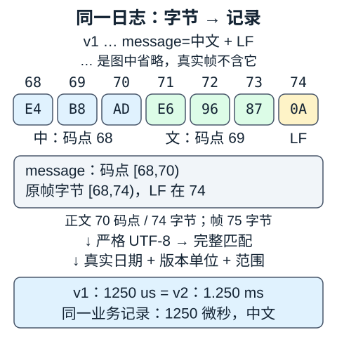

# 同一日志从字节到业务记录

读者问题：一条日志“正则匹配成功”，为什么还可能不能作为业务记录？本课沿同一份原创短日志往前追到字节，往后追到带 UTC 时间与微秒单位的记录；每一步都保留它处理的对象和拒绝条件。

有两个入口，汇入下文同一例子：从 [[编程知识/30-实践/01-正则表达式实验区/03-练习答案与解释#任务 A · 日志|日志字段答案]] 来，把“捕获了一段时间字符串”带入第 3 节，继续验证真实日期；从 [[计算机知识/60-数据编码与媒体系统/02-字符编码Unicode-UTF-8与换行#1. 码点与 UTF-8：变长，但有明确边界|UTF-8 的变长编码]] 来，把一份 `bytes` 带入第 2 节，继续追踪捕获 span 与业务对象。两条路线使用下面完全相同的日志，不另设一份演示数据。

## 1. 先声明这份格式的契约

下面代码块显示正文；真实帧在末尾另有一个 LF 字节 `0A`。`\n` 是实验源码中表示 LF 的写法，线上不是反斜杠与字母 n 两个字符。

```text
v1|2026-10-07T08:09:10Z|level=INFO|code=I200|latency=1250us|message=中文
```

这是教学格式，不是已有练习任务 A 的替换接口。它固定字段顺序、分隔符和版本，业务单位也由版本规定：

| 对象 | 契约 |
|---|---|
| 帧 | `bytes`，1 到 256 字节（含末尾 LF）；恰好一个最终 LF，无 CR；无 BOM |
| 正文 | 严格 UTF-8 解码；不替换坏字节、不默认正规化 |
| 字段顺序 | `version|timestamp|level=…|code=…|latency=…|message=…`，整段完整匹配 |
| 时间 | ASCII `YYYY-MM-DDTHH:MM:SSZ`，真实公历日期与时钟，UTC；本格式不接受闰秒 |
| level 与 code | INFO/WARN/ERROR；code 是一个 ASCII 大写字母及三位 ASCII 数字；首字母应与 level 首字母一致 |
| 延时形状 | 非负普通十进制；整数部分是 `0` 或不带前导零的 1 到 8 位数字；小数若有则为 1 到 3 位；形状层允许 `us` 或 `ms` |
| 版本与单位 | v1 只接受整数 `us`；v2 只接受 `ms`，最多三位小数；已知版本仅这两种 |
| 业务范围 | 延时 0 到 60 秒，含两端；统一存为整数值的 `Decimal` 微秒 |
| message | 1 到 64 个码点；不含 C0 控制字符、DEL、`|`、`=`；保留空格与 Unicode 原文 |

这些限制是设计选择。例如本格式没有转义规则，message 不能包含 `|`；若要支持它，须版本化地增加转义/结构化格式及对应解析规则，不能随手把最后一段改为 `.*`。本课的 ASCII code 不是 Unicode 字母类别。

同一业务记录也可由 v2 表达：

```text
v2|2026-10-07T08:09:10Z|level=INFO|code=I200|latency=1.250ms|message=中文
```

两份原始帧不相同，版本与数量字符串也不相同；验证与换算后它们表示同一业务时间、级别、代码、延时和消息。

## 2. 沿字节走：LF 定界、严格解码、位置映射



v1 正文的前 68 个字符全是 ASCII，所以每个占一个字节。后面“中文”各占三个 UTF-8 字节：

| 部分 | Python 字符串码点区间 | 原始帧字节区间 | 十六进制 |
|---|---|---|---|
| ASCII 前缀，含 `message=` | `[0,68)` | `[0,68)` | 每字符一个 ASCII 字节 |
| 中 U+4E2D | `[68,69)` | `[68,71)` | `E4 B8 AD` |
| 文 U+6587 | `[69,70)` | `[71,74)` | `E6 96 87` |
| 最终 LF（不进入正文） | 正文无此位置 | `[74,75)` | `0A` |

手算：正文码点数 `68+2=70`，正文字节数 `68+3+3=74`，帧字节数 `74+1=75`。所有区间从零开始、右端不包含。Python `str` 的 `match.span('message')` 是 `[68,70)`；拿它直接切 `bytes[68:70]` 只得到 `E4 B8`，连“中”都不完整。对本课严格解码且未修改的文本，映射规则是

```python
byte_start = len(text[:char_start].encode('utf-8'))
byte_end = len(text[:char_end].encode('utf-8'))
```

该规则能成立，是因为无 BOM、严格 UTF-8，且没有替换、正规化或改写文本。若中途调用 `errors='replace'`、NFC 或换行转换，就不能再假定重新编码等于原字节证据。需要这种处理的产品应另外保留原文及映射策略。严格错误策略会抛出错误，不能解码的字节应停在边界。[Python codecs 的错误处理](https://docs.python.org/3/library/codecs.html#error-handlers)

网络的一个 chunk 不保证是一行，甚至不保证是完整码点。例如第一块只收到到字节 68（含）为止，即最后一个字节是 `E4`；第二块从 `B8 AD` 接上。把每块独立严格解码会误报第一块非法。实验的 `LFFramer` 先缓冲字节，遇到 LF 后才交出完整帧解码；每帧达到 257 字节就拒绝，不必等 LF 才检查长度。UTF-8 的有效多字节序列内部不会含 ASCII 的 `0A`，所以本契约可按 LF 字节定界，随后仍须检查编码有效性。

实验枚举这 75 字节帧的全部 76 个单切分位置，包括“中”的三个字节内部，均得到同一记录；一块中连续放两帧也应得到两条记录。这证明本例的切分不改变结果，没有证明真实网络性能或任意传输协议正确。教学 framer 每次 `feed` 还限制 chunk 为 4096 字节；宿主可以预先切小块。`finish` 必须检查最后是否留着未结束帧。错误后 framer 不可继续复用。单次 `feed` 遇错会抛出并不返回该调用的部分结果；此前成功调用返回的记录仍存在，这不是跨调用的事务承诺。

## 3. 沿字段走：形状通过之后还有什么

完整可运行模式在 [[编程知识/30-实践/01-正则表达式实验区/08-同一日志边界实验|实验源码镜像]]。它没有大小写忽略标志，使用 `[0-9]`、`[A-Z]` 和 `fullmatch`，而不是从任意文本里 `search` 一小段成功形状。`fullmatch` 要求整个字符串匹配；日期解析 API 的接受集合可能比本格式宽，所以须先收窄形状，再做日期解析。[Python re 的完整匹配](https://docs.python.org/3/library/re.html#re.fullmatch)、[datetime.fromisoformat](https://docs.python.org/3/library/datetime.html#datetime.datetime.fromisoformat)

同一 v1 行的逐步追踪如下。区间都针对去掉 LF 的正文；版本只在验证和换算时消费，原始材料由 `Parsed.raw` 保留。

| 关口 | 输入对象 | 输出或检查 | 本例结果 |
|---|---|---|---|
| 长度、LF | 75 字节帧 | 字节限额与定界 | 通过 |
| 解码 | 正文 74 字节 | 严格 UTF-8 → `str` | 70 码点 |
| 完整匹配 | `str` | 命名捕获 `dict[str, str]`（可选 fraction 为 None） | version=v1、message=中文 |
| 时间 | timestamp 字符串 | 日期库校验、绑定 UTC | 2026-10-07 08:09:10 +00:00 |
| code | INFO、I200 | ASCII 形状及级别首字母关系 | I 与 I 一致 |
| 单位 | v1、1250、us | 版本约束、Decimal 换算、范围 | 1250 微秒 |
| 业务记录 | 已验证的值 | 构造 `Record` | 同下方记录 |

`2026-02-30T08:09:10Z` 是形状匹配的直接反例：每处都是正确位数，但二月没有 30 日。`2026-10-07T25:09:10Z` 同理不能成为时刻。源码先显式检查小时 0 到 23、分钟和秒 0 到 59，再由日期库检查真实日历并捕获 `ValueError`。因此 `24:00:00`、`24:00:01` 与分秒 60 都会拒绝，不依赖日期 API 是否把一天终点归一为次日；本课不靠一次正则匹配认证日历。也不把缺少时区的 datetime 默认为 UTC。

延时既要有数值，也要有单位和版本。用定义 `1 ms = 1000 us` 手算：

\[
1250\ \mathrm{us}=1.250\ \mathrm{ms},\qquad
\operatorname{Decimal}("1.250")\times1000=1250.000.
\]

v2 最多三位毫秒小数，所以换算后正好是整数微秒；源码最后量化到 `Decimal(1)` 不需要舍弃非零小数。这与允许 `1.2501ms` 再偷偷四舍五入不同，后者在形状层就拒绝。不能只删掉 `us/ms` 后对比数字，更不能把 v1 的 `1250ms` 当作迁移成功：它违反版本的单位契约。`60000001us` 则违反 60 秒上限。

Decimal 从十进制字符串构造，不先经过二进制 float；这保留声明的十进制量。换算在精度 32 的局部上下文进行，已限制的至多 8 位整数加三位小数及乘 1000 足以精确计算，避免宿主设置低精度导致静默改变本例。[Decimal 构造及精度说明](https://docs.python.org/3/library/decimal.html)

```text
Record(
  timestamp = 2026-10-07T08:09:10+00:00,
  level = INFO, code = I200,
  latency_us = Decimal('1250'), message = 中文
)
```

`Record` 是结果载体；其 `datetime`/`Decimal` 注解不承担运行时输入验证。直接构造 dataclass 可以绕过验证，应用应从 `parse_frame` 这一边界取得可信记录，或在自己的构造器中重复必需验证。Python 运行时不自动执行类型注解约束。[Python typing 的说明](https://docs.python.org/3/library/typing.html)

## 4. 拒绝边界要能拿一份输入复核

以下均从 v1 帧只做所列改动，其余字节保持相同。实验输出每个案例最先失败的关口；输入若同时违反多项，只保证拒绝，不保证列出所有错误。

| 改动 | 应拒绝的原因/关口 |
|---|---|
| `v1` → `v3` | 形状能捕获，未知版本在 version 关口拒绝 |
| 再插入 `level=INFO|` | 固定顺序、重复字段，shape 拒绝 |
| “中”的三字节替换为 `FF`，或只留 `E4` 后接 LF | encoding 拒绝，不能用替换字符抹掉错误 |
| 行首加 `xx`，或 LF 前加 `|extra=1` | 完整匹配拒绝额外前缀/字段后缀 |
| 日期改为 `2026-02-30` | date 拒绝，正则只认形状 |
| `1250us` → `1250ms` 或 `1.250us` | v1 单位/整数契约，unit 拒绝 |
| `1250us` → `60000001us` | range 拒绝 |
| 帧 257 字节 | limit 拒绝，早于复杂解析 |
| 删除 LF 或改为 CRLF | framing 拒绝 |
| code 改为 `I２００` / `E200` | 分别在 shape / code 关口拒绝 |
| message 加 NUL / 帧前加 UTF-8 BOM | 分别在 shape / shape 拒绝 |

“拒绝后缀”须有格式含义。如果把 `message=中文` 改成 `message=中文abc`，这是一条合法的新消息，解析器无法知道 abc 是作者故意添加还是外部噪声。本课拒绝的是位于格式之外的前缀，以及另加字段/控制字符等非法后缀；不要许诺识别所有可打印字符尾随污染。字段乱序不被此版本接受，不能顺便改成 `split` 字典而让重复键覆盖旧值。

`é`（U+00E9）与 `e` 加 U+0301 都可作为 message，原字节与记录的 message 保持不同。本课的“同一记录”只针对版本化的单位换算；它不默认合并看起来相同的 Unicode 文本，也不把规范等价自动当成业务相等。

## 5. 跨域读什么，再把什么带回来

- 要推导三个字节为何对应“中”，读 [[计算机知识/60-数据编码与媒体系统/02-字符编码Unicode-UTF-8与换行#1. 码点与 UTF-8：变长，但有明确边界|码点与 UTF-8]]；带回 U+4E2D 与 `E4 B8 AD` 的对应。该页第 3 节解释正规化，第 5 节解释 BOM/换行；带回“处理前字节不能自动视为处理后字节”的约束。
- 要把本课的 span 迁入编译器错误定位，读 [[计算机知识/70-编译原理/02-词法分析正则自动机Unicode与源位置#5. source location：span 是证据，line/column 是一种视图|源位置契约]]，并对照第 4 节的单位区分；带回 byte span `[68,74)` 与 codepoint span `[68,70)`，决定诊断 API 公布哪一种。
- 要把已验证记录交给 Python 业务层，读 [[计算机知识/10-编程语言/01-Python/10-系统课程/07-类型协议数据边界与安全#类型注解在哪个阶段起作用|类型注解的阶段]] 与该页“字符串、字节与路径不要混淆”；带回 `bytes → Parsed → Record` 的边界及显式单位，避免让注解冒充验证。

这些链接负责更一般的解释；本页只负责这条日志的连续追踪。[[编程知识/30-实践/01-正则表达式实验区/08-同一日志边界实验|标准库实验]] 将手算预期、非法输入和全部单切分位置放在同一个可执行入口。

## 6. 六道迁移题与答案

1. `match.span('message') == (68,70)`。切原帧 `raw[68:70]` 是否得到中文？**答**：否，只得到 `E4 B8`；中文应切 `[68,74)`，或先在正文字符串按 `[68,70)` 切。
2. 第一 chunk 末尾是 `E4`，第二 chunk 开头是 `B8 AD`。第一块是否已经证明编码非法？**答**：没有；它可能是合法序列的未完成前缀。本协议先缓冲到 LF 再严格解码，结束流仍无 LF 时拒绝。另一实现可用严格增量解码器，但也必须单独管理 LF 与长度。
3. 时间改为 `2026-02-30T08:09:10Z`，正则成功，是否创建记录？**答**：不创建；日期库拒绝不存在的日期。形状、日历有效性和 UTC 约束是不同关口。
4. v2 写 `latency=0.125ms`，统一记录是什么？v1 写 `0.125us` 呢？**答**：前者为精确 `Decimal('125')` 微秒；后者虽符合通用数量形状，却违反 v1 整数微秒规则，拒绝。直接用数值字符串 `0.125` 而忘单位会差 1000 倍。
5. 将输入注解改成 `raw: bytes`，删除 `isinstance`，再传一个 str，是否由 Python 自动拒绝？**答**：不会因注解自动拒绝；下游可能以别的异常失败。可信边界须显式检查；同理 dataclass 注解不验证时间/单位关系。
6. 为“减少乱码”添加 `errors='replace'`，并给 message 自动 NFC，会改善证据追踪吗？**答**：会改变原始材料。`FF` 可变成 U+FFFD，分解 message 可合并；若随后按重新编码计算原帧偏移便可能失真。本契约拒绝非法 UTF-8、保留 Unicode 原文；新需求必须另存原始字节并声明转换/映射策略。

本课成功标准：能拿 v1 原帧说明 75 字节、两个 span、1250 微秒的由来，解释 v2 为什么得到相同业务记录，并指出各反例在哪一步停下。实验运行、来源核对和人的实际阅读掌握是不同证据。
