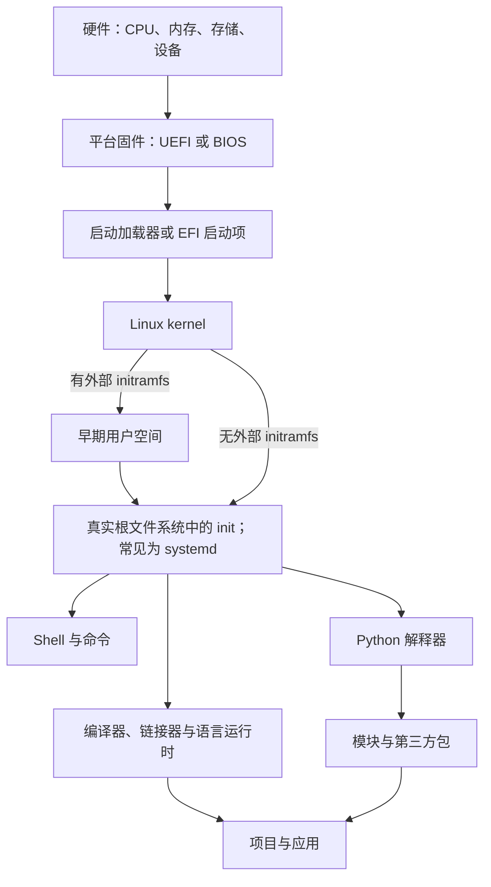

# 计算机知识

[[../../README|返回 WWL 总首页]] · [[计算机知识/Kali/00-导航与方法/00-Kali知识地图|Kali 知识地图]]

<!-- ROUND3 NAV START -->
> [!info] 深化课程入口
> [[计算机知识/00-开始/全局导航/00-总学习地图|十三学科总地图]] · [[计算机知识/00-开始/全局导航/06-跨学科机制与误区索引|跨学科机制]] · [[计算机知识/00-开始/全局导航/09-本地实验与验证入口|本地实验]]。原专题与实验在下方继续保留。
<!-- ROUND3 NAV END -->


这里是与数学、AI、编程知识、哲学与文化并列的独立知识域。它从“程序怎样被表达”、“数据怎样组织与处理”、“程序怎样被翻译和实现”、“程序怎样运行”、“系统怎样管理资源”、“字节怎样成为文件与媒体”和“工作怎样在 CPU/GPU 间分配”七个层次，建立可迁移的计算机基础。

完整学习入口见 [[计算机知识/00-开始/全局导航/00-总学习地图|计算机知识库 · 总学习地图]]。以下七条原有路线继续保留，并已与课程地图互联：

| 路线 | 入口 | 适合谁 | 完成后你能…… |
| --- | --- | --- | --- |
| 编程语言 | [[计算机知识/10-编程语言/00-编程语言-MOC\|编程语言 MOC]] | 想理解程序如何被表达、构建和运行的人 | 在 Python 与 C++ 两条路线间按目标选择 |
| 操作系统 | [[计算机知识/20-操作系统/00-操作系统-MOC\|操作系统 MOC]] | 想理解命令行、进程、文件、服务或驱动的人 | 用 Linux 建立可观察、可恢复的系统操作模型 |
| 计算机系统 | [[计算机知识/30-计算机系统/00-计算机系统-MOC\|计算机系统 MOC]] | 想解释内存、ABI、动态链接、缓存和性能的人 | 把语言层现象追到数据布局、地址空间与硬件约束 |
| 并行与异构计算 | [[计算机知识/40-并行与异构计算/00-并行与异构计算-MOC\|并行与异构计算 MOC]] | 想理解 GPU、CUDA、显存和 offload 的人 | 区分计算、搬运、同步和数值正确性证据 |
| 数据结构与算法 | [[计算机知识/50-数据结构与算法/00-数据结构与算法-MOC\|数据结构与算法 MOC]] | 想从“能写代码”走到“能选择表示并证明正确”的人 | 用不变量、复杂度和真实系统代价设计基本算法 |
| 数据编码与媒体系统 | [[计算机知识/60-数据编码与媒体系统/00-数据编码与媒体系统-MOC\|数据编码与媒体系统 MOC]] | 想理解文件格式、音视频与 FFmpeg 的人 | 从字节、采样、codec 和 container 追踪完整媒体流水线 |
| 编译原理 | [[计算机知识/70-编译原理/00-编译原理-MOC\|编译原理 MOC]] | 想理解语言、编译器、运行时或 AI 编译栈的人 | 从 token、AST、类型和 IR 追到优化、VM、机器码与链接装载 |

> [!tip] 不知道从哪条路线开始
> 如果目标是“写程序”，先学 Python 01—05，再用数据结构与算法 01—05 建立基本表示选择；如果目标是“理解系统或安装 Linux”，先学 Linux 01—10，再沿计算机系统的进程、I/O 与文件系统路线深入。想处理音视频，先读数据编码 01、03、06、08、10，再进入 FFmpeg。想理解编译器，先会函数、栈/树/图和基本构建命令，再从编译原理 01 开始。只想理解 LLM 时不必预先学完 C++/CUDA；需要阅读 `llama.cpp`、分析显存或优化 kernel 时，再沿“C++ → 计算机系统 → CUDA”递进。

## 从单个程序走向协作服务

- “需求写清楚了，为什么仍会做错产品？”进入 [[计算机知识/75-软件工程与人机交互/00-软件工程与人机交互-MOC|软件工程与人机交互]]：沿预约服务连接需求、接口权衡、测试维护、任务反馈和职业责任。原型与单元测试分别检查交互和模型，不替代真实用户可用性研究。
- “复制到三台机器，为什么仍可能旧读或重复执行？”进入 [[计算机知识/65-分布式系统/00-分布式系统-MOC|分布式系统]]：先明确故障与消息模型，再读一致性历史、共识、分区和跨资源事务。单进程消息实验用于解释失败，不代表完整生产级 Raft 或容灾系统。

这两条是已有语言、网络和数据库路线后的问题入口；更多编程语言、真实团队交付和生产运维仍须按目标补课，不能据目录或实验数量判断本科全域已覆盖。

## 一张共同的系统地图



Python 和 Linux 并不是两套互不相干的知识：

- Linux 为进程、文件、网络和设备提供系统调用与用户空间环境；
- shell 负责启动程序、组合命令和传递环境变量；
- Python 解释器也是一个进程，会读取文件、环境变量和模块搜索路径；
- pip、Conda、uv、apt、dnf、pacman 都叫“包管理工具”，却管理不同层次的对象。
- C++ 程序要经过编译、链接并遵守 ABI，运行时同样要使用进程、文件和动态库；
- CUDA 把部分工作交给 GPU，但宿主内核、驱动、用户态 runtime、数据搬运和同步仍属于同一系统证据链。
- 数据结构与算法规定程序怎样组织、查找和变换数据；真实代价还会受到内存布局、缓存、I/O 和输入分布影响；
- 媒体系统把文件字节解释为 packet、frame 与 sample；FFmpeg 只是在操作系统、文件系统、codec 和容器之间编排数据流。
- 编译器把源文本逐步变成带语义的中间表示、字节码或目标代码；优化必须同时满足语言语义、运行时、ABI 和硬件成本边界。

> [!note] 地图是主路径，不是唯一实现
> 某些系统不使用外部 initramfs，PID 1 也不一定是 systemd。课程会把“常见 Arch Linux 路径”和“Linux 允许的其他实现”分开说明。

学习时可以沿着这些跨课程问题来回跳转：

| 共同问题 | Python 入口 | Linux 入口 |
| --- | --- | --- |
| 程序究竟由谁运行？ | [[计算机知识/10-编程语言/01-Python/01-安装配置与运行模型#心智模型：先找解释器，再运行代码\|解释器运行模型]] | [[计算机知识/20-操作系统/01-Linux/01-计算机系统与Linux分层\|Linux 分层]] |
| 命令为什么能被找到？ | [[计算机知识/10-编程语言/01-Python/01-安装配置与运行模型#PATH、python 与 python3\|Python 与 PATH]] | [[计算机知识/20-操作系统/01-Linux/07-环境变量Shell启动与PATH\|环境变量与 PATH]] |
| “包”到底是什么？ | [[计算机知识/10-编程语言/01-Python/07-模块包导入与项目结构\|模块、导入包与分发包]] | [[计算机知识/20-操作系统/01-Linux/08-pacman-apt-dnf与yum包管理\|发行版软件包]] |
| 隔离为什么重要？ | [[计算机知识/10-编程语言/01-Python/09-venv与虚拟环境原理\|Python 虚拟环境]] | [[计算机知识/20-操作系统/01-Linux/06-用户权限进程与作业控制\|进程与权限边界]] |
| 出错后从哪里找证据？ | [[计算机知识/10-编程语言/01-Python/14-测试调试与代码质量\|测试与调试]] | [[计算机知识/20-操作系统/01-Linux/10-网络存储日志与故障排查\|日志与分层排错]] |

另外两条横向问题直接从系统层进入：

| 共同问题 | 算法或编码入口 | 系统入口 |
| --- | --- | --- |
| 为什么理论上的 $O(1)$ 仍可能很慢？ | [[计算机知识/50-数据结构与算法/01-复杂度模型渐近分析与摊还分析\|复杂度与摊还分析]] | [[计算机知识/30-计算机系统/04-缓存局部性带宽与延迟\|缓存、局部性、带宽与延迟]] |
| 为什么源码能解析，却仍不能生成程序？ | [[计算机知识/70-编译原理/03-上下文无关文法AST-CST与歧义\|文法、CST 与 AST]]、[[计算机知识/70-编译原理/06-类型系统约束求解泛型与语义检查\|类型与语义检查]] | [[计算机知识/70-编译原理/01-编译器流水线诊断与可复现构建\|阶段化诊断]] |
| 文件名存在，为什么进程仍读不到文件？ | [[计算机知识/60-数据编码与媒体系统/03-二进制文件格式魔数字节序对齐与校验\|文件格式与字节结构]] | [[计算机知识/30-计算机系统/12-VFS文件描述符Inode目录与路径解析\|VFS、FD、inode 与路径解析]] |
| 视频能解码，为什么音画不同步？ | [[计算机知识/60-数据编码与媒体系统/11-流媒体时间戳同步Seek与协议边界\|时间戳、同步与 Seek]] | [[计算机知识/30-计算机系统/14-网络栈Socket与端到端数据路径\|网络与背压]]、[[计算机知识/30-计算机系统/15-性能分析可观测性与系统设计\|性能证据链]]；[[计算机知识/30-计算机系统/10-IO设备总线DMA与中断\|I/O 与 DMA]]是可能的底层因素 |
| FFmpeg 返回 0，为什么仍不能宣布任务完成？ | [[计算机知识/60-数据编码与媒体系统/13-ffprobe媒体诊断与可复现检查\|ffprobe 诊断]] | [[计算机知识/30-计算机系统/15-性能分析可观测性与系统设计\|性能分析与可观测性]] |

## 从源代码到模型推理

| 你正在追的问题 | 主要层次 | 相关路径 |
| --- | --- | --- |
| 为什么命令能启动，却 `import` 失败？ | 解释器、虚拟环境、`PATH` 与安装位置 | [[计算机知识/10-编程语言/01-Python/09-venv与虚拟环境原理\|venv 原理]] ↔ [[计算机知识/20-操作系统/01-Linux/07-环境变量Shell启动与PATH\|Shell、环境变量与 PATH]] |
| 为什么 C++ 能编译，却在另一台机器加载失败？ | 编译链、ABI、动态库和平台 | [[计算机知识/10-编程语言/02-C++/01-编译链接与CMake\|编译、链接与 CMake]] ↔ [[计算机知识/30-计算机系统/03-ABI调用约定与静态动态链接\|ABI 与动态链接]] |
| 为什么一项 IR 优化“看起来等价”却仍可能改错程序？ | 语言语义、别名、副作用、数值与验证证据 | [[计算机知识/70-编译原理/10-优化Pass别名分析与阶段排序\|优化 Pass 与别名]] ↔ [[计算机知识/70-编译原理/11-优化正确性语义保持与验证测试\|语义保持与验证]] |
| GGUF 为什么能很快打开，但内存和首 token 时间仍会变？ | 文件格式、内存映射、page cache、后端放置 | [[AI/20-LLM/60-模型格式与量化/03-GGUF结构转换与验证\|GGUF 结构]] ↔ [[计算机知识/30-计算机系统/02-进程虚拟地址空间与内存映射\|虚拟地址空间与内存映射]] ↔ [[AI/20-LLM/50-实现/04-llama.cpp构建后端与调用链\|llama.cpp 调用链]] |
| 为什么显存还有空闲，kernel 却没有加速？ | 数据布局、带宽、同步、occupancy 与数值验证 | [[计算机知识/30-计算机系统/04-缓存局部性带宽与延迟\|缓存、带宽与延迟]] ↔ [[计算机知识/40-并行与异构计算/01-CUDA/09-Roofline与Nsight性能方法\|Roofline 与 Nsight]] |

## 目录与边界

```text
计算机知识/
├── 00-开始/              # 本首页
├── 10-编程语言/          # Python、C++ 与后续语言课程
│   ├── 01-Python/
│   ├── 02-C++/
│   ├── 03-C语言/
│   ├── 04-Rust/
│   └── 05-TypeScript/
├── 20-操作系统/          # Linux 与后续操作系统课程
│   └── 01-Linux/
├── 30-计算机系统/        # 数据表示、内存、ABI、缓存与并行基础
├── 35-计算机网络/      # 链路、IP、传输、应用与安全
├── 40-并行与异构计算/    # CUDA 与后续计算平台
├── 50-数据结构与算法/    # 数据表示选择、基本算法、证明与复杂度
├── 55-数据库/          # 模型、SQL、索引、事务与恢复
├── 60-数据编码与媒体系统/ # 文件格式、压缩、音视频与 FFmpeg
├── 70-编译原理/          # 前端、IR、优化、运行时、后端与 AI 编译栈
├── 80-实践/              # 可修改、可重置的实验
│   ├── 01-Python/
│   ├── 02-Linux/
│   ├── 03-C++/
│   ├── 04-CUDA/
│   ├── 05-数据结构与算法/
│   ├── 06-计算机系统/
│   ├── 07-媒体编码与FFmpeg/
│   └── 08-编译原理/
└── 90-资源/              # 速查表、选择矩阵与术语
```

| 边界 | 约定 |
| --- | --- |
| 文件 | 本域内容只写入 `计算机知识/`；用户自己的项目和系统配置不放进课程目录 |
| 属性 | 使用 `domain: computer-science` |
| 标签 | 使用 `computer-science/...` |
| 实验 | 可修改内容只放在 `80-实践/`；课程页保持稳定 |
| 系统安全 | Arch 分区、格式化、bootloader、驱动和权限操作先在虚拟机练习，不把示例设备名当成真实设备 |
| 软件版本 | Python、uv、Conda、Arch 与包管理器持续变化；执行前回看页面中的官方文档入口 |
| 媒体安全 | 默认只用合成样本与新输出路径；不扫描媒体库、不信任外部协议输入、不覆盖原文件 |
| 证据 | 证明、单元测试、CPU toy、真实媒体解码、GPU 路径与感知质量分别报告，不能互相替代 |

在 Obsidian 中只查看本域：

```text
path:"计算机知识"
```

只查看 Python 或 Linux：

```text
path:"计算机知识/10-编程语言/01-Python"
path:"计算机知识/20-操作系统/01-Linux"
path:"计算机知识/50-数据结构与算法"
path:"计算机知识/60-数据编码与媒体系统"
path:"计算机知识/70-编译原理"
```

## 与其他知识域的连接

- 想把 Python 用于文本匹配：[[编程知识/10-基础/01-正则表达式/00-正则表达式-MOC|正则表达式 MOC]]；
- 想理解编译、内存与原生程序：[[计算机知识/10-编程语言/02-C++/00-C++-MOC|C++ MOC]]；
- 想继续追踪 ABI、缓存、并行或 GPU 执行：[[计算机知识/30-计算机系统/00-计算机系统-MOC|计算机系统 MOC]] → [[计算机知识/40-并行与异构计算/00-并行与异构计算-MOC|并行与异构计算 MOC]] → [[计算机知识/40-并行与异构计算/01-CUDA/00-CUDA-MOC|CUDA MOC]]；
- 想系统学习基本表示、搜索与优化方法：[[计算机知识/50-数据结构与算法/00-数据结构与算法-MOC|数据结构与算法 MOC]]；
- 想理解字符、文件格式、音视频与 FFmpeg：[[计算机知识/60-数据编码与媒体系统/00-数据编码与媒体系统-MOC|数据编码与媒体系统 MOC]]；
- 想理解一门语言如何从 token、AST 和类型走到 IR、优化、运行时与机器代码：[[计算机知识/70-编译原理/00-编译原理-MOC|编译原理 MOC]]；
- 想把这些基础用于模型与数据工作流：[[AI/00-开始/00-AI-首页|AI 首页]]；
- 想检查数值精度、概率、优化或矩阵 shape：[[数学/00-数学-首页|数学首页]]；
- 想追问平台、算法或数据系统在制度、分配和公共治理中怎样发生作用：[[社会科学/00-开始/00-社会科学-首页|社会科学首页]]；技术实现本身不构成社会效果的因果证明；
- 想学习如何阅读代码块、Wikilink 和反向链接：[[Obsidian知识/00-开始/00-Playground-首页|Obsidian 教学地图]]；
- 返回仓库总入口：[WorkWithLLM Knowledge Vault](../../README.md)。

---

**开始语言学习**：[[计算机知识/10-编程语言/00-编程语言-MOC|编程语言 MOC]] · **开始系统学习**：[[计算机知识/20-操作系统/00-操作系统-MOC|操作系统 MOC]] · **学习算法**：[[计算机知识/50-数据结构与算法/00-数据结构与算法-MOC|数据结构与算法 MOC]] · **学习编译器**：[[计算机知识/70-编译原理/00-编译原理-MOC|编译原理 MOC]] · **处理媒体**：[[计算机知识/60-数据编码与媒体系统/00-数据编码与媒体系统-MOC|数据编码与媒体系统 MOC]] · **进入 GPU 路线**：[[计算机知识/40-并行与异构计算/00-并行与异构计算-MOC|并行与异构计算 MOC]] · **现场速查**：[[计算机知识/90-资源/00-计算机知识资源-MOC|计算机知识资源 MOC]]
