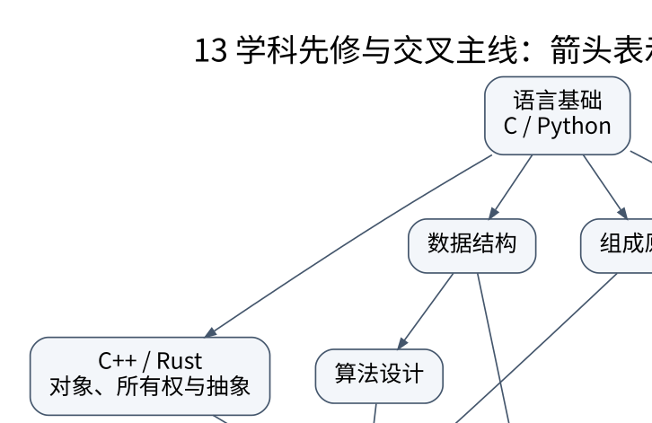

# 学习方法与阶段验收

新增难点采用“规则 → 完整推演 → 撤掉前提的反例 → 独立参照测试”四步。具体路线见 [[计算机知识/00-开始/全局导航/11-难点导读与研究证据|难点导读]]；计算或编译通过只是证据的一部分。


## 不要把阅读进度当成理解进度

每讲完成四步：先在不看公式时说出要解决的问题；沿例子手算一次状态变化；构造违反前提的反例；最后运行或设计能区分正确与错误实现的测试。答不出来就回到前置概念，不靠继续翻页掩盖缺口。

同一内容至少区分四种证据：规范说允许什么，证明在什么模型下成立，教学测试验证哪些输入，真实系统测到了什么。它们相互补充，不能互相冒充。

## 推荐节奏

先选 C 或 Python 作为主语言，配合数据结构；掌握函数、对象和不变量后进入算法。组成原理与操作系统交替推进，Linux 实验帮助观察进程与 I/O。网络、数据库分别连接传输边界与持久状态；编译原理在语言、图算法和机器模型有基础后更易贯通。C++、Rust、TypeScript 可以按项目需要学习，不必同时背五套语法。



[PNG 备用](../../_assets/diagrams/round3/course-dependencies.png) · [图源](../../_assets/diagrams/round3/course-dependencies.dot)

## 三次阶段验收

**第一阶段：独立写一个可靠程序。** 程序必须说明输入范围、错误返回、对象生命周期、数据结构不变量和测试方式。不能仅用一组正常输入证明可用。

**第二阶段：解释程序为什么如此运行。** 能从源代码到目标程序、从虚拟地址到缓存和存储、从系统调用到调度与 I/O 画出路径。遇到版本差异时知道去查语言规范、ABI、内核接口还是工具文档。

**第三阶段：设计会失败但能恢复的服务。** 请求可以拆分、超时、重复，事务可以冲突，进程可以崩溃；系统仍有清晰的状态与恢复协议。正确性先于性能，性能结论用可复现实验支持。

## 错误笔记模板

```text
我原来以为：
最小反例：
真正的适用前提：
状态在哪一步改变：
修正后的规则：
可以回归检查的断言：
连接到的相邻知识：
```

不要给每个概念都复制一份定义。稳定定义留在对应课程，个人记录重点保存误解、反例和证据，通过链接回到正文。公式本身是压缩语言，读不懂时应展开变量、单位、边界条件与一步算例，而不是再抄一遍。

## 题目的答案不只一个数字

算出 AMAT 还要说明各级命中率是局部还是全局；算出吞吐量还要说明 bit/s 与 B/s；给出 O(n) 还要说明 n 是元素数、位数还是输入编码长度；证明贪心正确还要说明交换操作保持可行性。解释这些前提，才是能迁移的理解。
