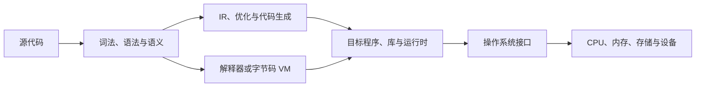

# 编程语言 · MOC

<!-- ROUND3 NAV START -->
> [!info] 深化课程入口
> [[计算机知识/00-开始/课程地图/01-C语言-课程地图|C语言课程]] · [[计算机知识/00-开始/课程地图/02-C++-课程地图|C++课程]] · [[计算机知识/00-开始/课程地图/03-Rust-课程地图|Rust课程]] · [[计算机知识/00-开始/课程地图/04-Python-课程地图|Python课程]] · [[计算机知识/00-开始/课程地图/05-TypeScript-课程地图|TypeScript课程]]。原专题与实验在下方继续保留。
<!-- ROUND3 NAV END -->

这里组织“程序如何被表达、构建和运行”的课程入口。C、C++、Rust、Python 与 TypeScript 提供五条互相连接但各自独立的语言路线；编译原理则追问一门语言的文本、结构与语义怎样被实现为解释器、虚拟机或目标程序。不要把某一门语言或某一个编译器的习惯当作所有程序的通则。

## 先按问题选择语言

| 你现在想弄清什么 | 语言路线与入口 | 读者入口问题 |
| --- | --- | --- |
| 数据如何布局，指针、内存与系统接口怎样工作？ | [[计算机知识/00-开始/课程地图/01-C语言-课程地图\|C 课程地图]] · [[计算机知识/10-编程语言/03-C语言/10-系统课程/00-C语言系统课程索引\|C 系统课程索引]] | 一个地址代表什么？数组越界、对象生命周期和操作系统接口分别由谁负责？ |
| 原生程序怎样表达资源所有权、值语义和泛型？ | [[计算机知识/00-开始/课程地图/02-C++-课程地图\|C++ 课程地图]] · [[计算机知识/10-编程语言/02-C++/10-系统课程/00-C++系统课程索引\|C++ 系统课程索引]] | 资源离开作用域时怎样释放？值、引用和移动分别改变什么？ |
| 如何让类型与借用规则约束内存和并发错误？ | [[计算机知识/00-开始/课程地图/03-Rust-课程地图\|Rust 课程地图]] · [[计算机知识/10-编程语言/04-Rust/10-系统课程/00-Rust系统课程索引\|Rust 系统课程索引]] | 所有权、借用与生命周期如何限制别名和并发访问？ |
| 怎样快速写脚本、自动化、数据处理或服务？ | [[计算机知识/00-开始/课程地图/04-Python-课程地图\|Python 课程地图]] · [[计算机知识/10-编程语言/01-Python/10-系统课程/00-Python系统课程索引\|Python 系统课程索引]] | 对象、模块、依赖和运行环境如何共同决定程序行为？ |
| 如何用类型检查组织大型浏览器或服务端程序？ | [[计算机知识/00-开始/课程地图/05-TypeScript-课程地图\|TypeScript 课程地图]] · [[计算机知识/10-编程语言/05-TypeScript/10-系统课程/00-TypeScript系统课程索引\|TypeScript 系统课程索引]] | 静态类型怎样约束 JavaScript 程序？类型信息在哪些边界会消失？ |

表中的问题用于选择本次要学的语言，不要求依次学完五门。每条路线的“系统课程索引”是该语言唯一的累计主线，负责连接基础入口、已建系统课与深化主题；课程地图保留为兼容入口，供旧链接和原专题回查，不要把两份目录当成两套必读路线。比较不同语言中的所有权、错误、并发与类型边界，可继续看[[计算机知识/90-资源/11-跨学科概念辨析|跨学科概念辨析]]。想研究语言实现，再进入[[计算机知识/70-编译原理/00-编译原理-MOC|编译原理 MOC]]：词法、语法、语义、IR、优化、运行时与代码生成。

## 共同的系统地图

- 程序启动、进程、文件、环境变量和系统包：[[计算机知识/20-操作系统/00-操作系统-MOC|操作系统 MOC]]；
- 数据表示、内存、ABI 和缓存等共同底座：[[计算机知识/30-计算机系统/00-计算机系统-MOC|计算机系统 MOC]]；
- 容器、索引、搜索、排序和状态转移背后的表示与正确性：[[计算机知识/50-数据结构与算法/00-数据结构与算法-MOC|数据结构与算法 MOC]]；
- 从 token、AST 与类型进入 IR、优化、运行时和后端：[[计算机知识/70-编译原理/00-编译原理-MOC|编译原理 MOC]]；
- 需要把程序扩展到 GPU 时，再进入 [[计算机知识/40-并行与异构计算/01-CUDA/00-CUDA-MOC|CUDA MOC]]；
- AI 任务的模型、数据与工程路线从 [[AI/00-开始/00-AI-首页|AI 首页]] 进入，语言课程不重复其模型知识。

## 导航

- 返回：[[计算机知识/00-开始/00-计算机知识-首页|计算机知识首页]]；
- 先学 Python：[[计算机知识/10-编程语言/01-Python/00-Python基础-MOC|Python 基础 MOC]]；
- 先学 C++：[[计算机知识/10-编程语言/02-C++/00-C++-MOC|C++ MOC]]；
- 学语言实现：[[计算机知识/70-编译原理/00-编译原理-MOC|编译原理 MOC]]。
