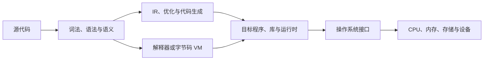

# 编程语言 · MOC

<!-- ROUND3 NAV START -->
> [!info] 深化课程入口
> [[计算机知识/00-开始/课程地图/01-C语言-课程地图|C语言课程]] · [[计算机知识/00-开始/课程地图/02-C++-课程地图|C++课程]] · [[计算机知识/00-开始/课程地图/03-Rust-课程地图|Rust课程]] · [[计算机知识/00-开始/课程地图/04-Python-课程地图|Python课程]] · [[计算机知识/00-开始/课程地图/05-TypeScript-课程地图|TypeScript课程]]。原专题与实验在下方继续保留。
<!-- ROUND3 NAV END -->

这里组织“程序如何被表达、构建和运行”的课程入口。C、C++、Rust、Python 与 TypeScript 提供五条互相连接但各自独立的语言路线；编译原理则追问一门语言的文本、结构与语义怎样被实现为解释器、虚拟机或目标程序。不要把某一门语言或某一个编译器的习惯当作所有程序的通则。

## 课程入口

| 路线 | 入口 | 先解决的问题 | 与系统的连接 |
| --- | --- | --- | --- |
| Python | [[计算机知识/10-编程语言/01-Python/00-Python基础-MOC\|Python 基础 MOC]] | 解释器、对象、模块、项目与依赖 | 进程、PATH、文件、系统包和虚拟环境 |
| C++ | [[计算机知识/10-编程语言/02-C++/00-C++-MOC\|C++ MOC]] | 编译、类型、对象生命周期与构建 | ABI、内存、链接和性能模型 |
| 编译原理 | [[计算机知识/70-编译原理/00-编译原理-MOC\|编译原理 MOC]] | 词法、语法、语义、IR、优化、运行时与代码生成 | 数据结构、语言语义、ISA、ABI、VM 与 AI 编译栈 |

> [!tip] 怎么选第一门
> 想尽快写脚本、自动化或数据处理，从 Python 开始；想理解内存、原生程序和性能边界，可按 C++ MOC 的先修说明学习；想知道编译器内部怎样从 token 走到 IR、优化、机器码或 VM，再进入编译原理。这些路线都应回到操作系统、算法和计算机系统概念，而不是只背命令或语法。

## 共同的系统地图

- 程序启动、进程、文件、环境变量和系统包：[[计算机知识/20-操作系统/00-操作系统-MOC|操作系统 MOC]]；
- 数据表示、内存、ABI 和缓存等共同底座：[[计算机知识/30-计算机系统/00-计算机系统-MOC|计算机系统 MOC]]；
- 容器、索引、搜索、排序和状态转移背后的表示与正确性：[[计算机知识/50-数据结构与算法/00-数据结构与算法-MOC|数据结构与算法 MOC]]；
- 从 token、AST 与类型进入 IR、优化、运行时和后端：[[计算机知识/70-编译原理/00-编译原理-MOC|编译原理 MOC]]；
- 需要把程序扩展到 GPU 时，再进入 [[计算机知识/40-并行与异构计算/01-CUDA/00-CUDA-MOC|CUDA MOC]]；
- AI 任务的模型、数据与工程路线从 [[AI/00-开始/00-AI-首页|AI 首页]] 进入，语言课程不重复其模型知识。

## 导航

- 返回：[[计算机知识/00-开始/00-计算机知识-首页|计算机知识首页]]；
- 先学 Python：[[计算机知识/10-编程语言/01-Python/00-Python基础-MOC|Python 基础 MOC]]；
- 先学 C++：[[计算机知识/10-编程语言/02-C++/00-C++-MOC|C++ MOC]]；
- 学语言实现：[[计算机知识/70-编译原理/00-编译原理-MOC|编译原理 MOC]]。

## 本轮新增入口

五门语言独立路线：[[计算机知识/00-开始/课程地图/01-C语言-课程地图|C语言 · 课程地图]]、[[计算机知识/00-开始/课程地图/02-C++-课程地图|C++ · 课程地图]]、[[计算机知识/00-开始/课程地图/03-Rust-课程地图|Rust · 课程地图]]、[[计算机知识/00-开始/课程地图/04-Python-课程地图|Python · 课程地图]]、[[计算机知识/00-开始/课程地图/05-TypeScript-课程地图|TypeScript · 课程地图]]。所有权、错误、并发与类型边界的横向比较见 [[计算机知识/90-资源/11-跨学科概念辨析|跨学科概念辨析]]。
