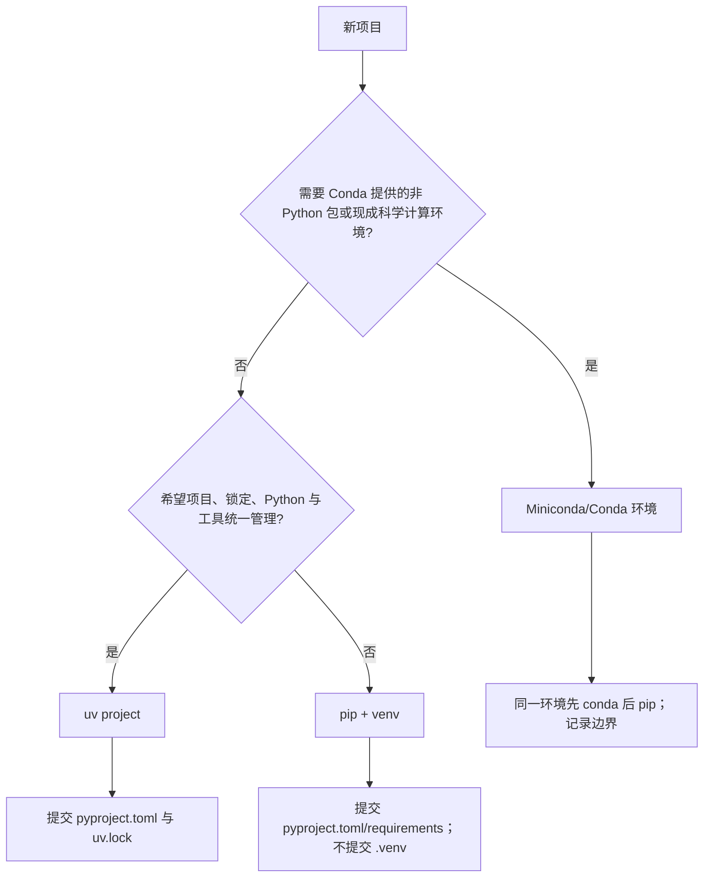

# Python 基础 · MOC

<!-- ROUND3 NAV START -->
> [!info] 深化课程入口
> [[计算机知识/00-开始/课程地图/04-Python-课程地图|Python课程]]。原专题与实验在下方继续保留。
<!-- ROUND3 NAV END -->


Python 不只是“一套语法”。真正稳定的基础包含五层：语言对象、控制流程、模块导入、解释器环境和项目依赖。本路线先让代码跑起来，再解释环境与包管理为什么会出错，最后建立可测试、可重建的项目习惯。

> [!abstract] 学完后的能力
> 你将能读写常见 Python 程序，解释名称与对象、函数与作用域、迭代与异常；能够判断 `python` 和 `pip` 是否指向同一环境，理解模块、导入包、分发包与项目的区别，并按场景选择 pip + venv、Conda 或 uv。

## 零基础的第一个程序

把下面内容保存为 `hello.py`：

```python
from pathlib import Path

name = "Python"
message = f"Hello, {name}!"
Path("hello.txt").write_text(message + "\n", encoding="utf-8")
print(message)
```

在文件所在目录运行：

```bash
python hello.py
```

如果系统只有 `python3`，使用 `python3 hello.py`。不要靠猜测判断解释器，先完成 [[计算机知识/10-编程语言/01-Python/01-安装配置与运行模型|安装、配置与运行模型]]。

## 学习路线

| 顺序 | 课程 | 重点 | 完成后你能…… |
| --- | --- | --- | --- |
| 1 | [[计算机知识/10-编程语言/01-Python/01-安装配置与运行模型\|安装、配置与运行模型]] | 解释器、REPL、脚本、`-m`、PATH、IDE | 找到真正运行代码的 Python |
| 2 | [[计算机知识/10-编程语言/01-Python/02-基础语法与数据类型\|基础语法与数据类型]] | 名称、对象、字符串、数值、真值 | 解释赋值、比较、可变性和基础输入输出 |
| 3 | [[计算机知识/10-编程语言/01-Python/03-控制流函数与作用域\|控制流、函数与作用域]] | 分支、循环、参数、LEGB | 把重复逻辑封装成可理解函数 |
| 4 | [[计算机知识/10-编程语言/01-Python/04-容器迭代器生成器与推导式\|容器、迭代器、生成器与推导式]] | list/dict/set/tuple、迭代、`yield` | 选择数据结构并处理序列 |
| 5 | [[计算机知识/10-编程语言/01-Python/05-异常文件IO与上下文管理\|异常、文件 I/O 与上下文管理]] | `try`、`pathlib`、编码、`with` | 可靠地处理错误和文件资源 |
| 6 | [[计算机知识/10-编程语言/01-Python/06-面向对象数据类与类型标注\|面向对象、数据类与类型标注]] | class、组合、dataclass、typing | 建模数据而不过度设计 |
| 7 | [[计算机知识/10-编程语言/01-Python/07-模块包导入与项目结构\|模块、包、导入与项目结构]] | import、`-m`、src layout、pyproject | 组织多文件程序并诊断导入错误 |
| 8 | [[计算机知识/10-编程语言/01-Python/08-pip与PyPI依赖管理\|pip、PyPI 与依赖管理]] | wheel/sdist、requirements、PEP 668 | 在正确环境中安全安装和检查依赖 |
| 9 | [[计算机知识/10-编程语言/01-Python/09-venv与虚拟环境原理\|venv 与虚拟环境原理]] | `sys.prefix`、site-packages、激活 | 创建、诊断和可重建地删除环境 |
| 10 | [[计算机知识/10-编程语言/01-Python/10-Conda-Anaconda与Miniconda\|Conda、Anaconda 与 Miniconda]] | 跨语言包、channel、environment.yml | 判断何时需要 Conda 生态 |
| 11 | [[计算机知识/10-编程语言/01-Python/11-uv项目依赖与工具管理\|uv 项目、依赖与工具管理]] | project、lock、sync、run、tool | 用锁文件重建现代 Python 项目 |
| 12 | [[计算机知识/10-编程语言/01-Python/12-包管理器选择锁定与迁移\|包管理器选择、锁定与迁移]] | 职责矩阵、选择树、迁移 | 不把不同工具混成同一种“包管理器” |
| 13 | [[计算机知识/10-编程语言/01-Python/13-常用Package生态与用法\|常用 Package 生态与用法]] | HTTP、数据、绘图、测试、Web、CLI | 从场景选择常用库并找到官方入口 |
| 14 | [[计算机知识/10-编程语言/01-Python/14-测试调试与代码质量\|测试、调试与代码质量]] | assert、pytest、logging、debugger、lint | 用可重复证据判断程序是否正确 |

> [!tip] 零基础第一遍的主线
> 第 3 课先掌握 `if`、循环、函数参数与返回值，`match` 和 LEGB 可第二遍再看；第 4 课先掌握 list、dict、set、tuple 与普通迭代，哈希、复杂度和生成器细节属于深入理解；第 5—7 课也已在正文中标出基础闭环与进阶边界。先让一个小程序可读、可运行、可验证，再追求完整工程结构。

## 三条可选路线

### 只想尽快写脚本

按 `01 → 02 → 03 → 04 → 05` 阅读，然后进入 [[计算机知识/80-实践/01-Python/01-语法与文件练习|语法与文件练习]]。第 6 课以后按需回看。

### 已有语言基础，总被环境和导入问题卡住

这条诊断捷径面向已经掌握第 `02—05` 课基础语法、控制流、容器、异常与文件操作的读者；零基础仍应按主路线顺序学习。按 `01 → 07 → 09 → 08 → 12` 阅读：第一次使用 venv 时先读第 9 课理解环境边界，再用第 8 课处理 pip 与依赖，之后完成 [[计算机知识/80-实践/01-Python/02-环境与依赖实验|环境与依赖实验]]。第 10 课与第 11 课是读完第 12 课选择树后的情境分支，并非两者都必修：需要 Conda 提供的非 Python 二进制依赖或现成科学计算环境时读第 10 课；选择 uv 项目工作流时读第 11 课。

### 想建立项目工程习惯

先完成 `01—09`，再读第 12 课并根据选择树按需进入第 10 课或第 11 课，然后读第 14 课；最后用第 13 课按场景选择依赖。第 10、11 课不是需要连续完成的共同前置。不要先安装几十个包再决定项目结构。

## 最容易混淆的五组概念

| 不要混为一谈 | 一句话区分 | 深入阅读 |
| --- | --- | --- |
| Python 语言 / CPython 解释器 | 前者是规则，后者是执行这些规则的一种实现 | [[计算机知识/10-编程语言/01-Python/01-安装配置与运行模型#心智模型：先找解释器，再运行代码\|运行分层]] |
| 名称 / 对象 / 类型 | 名称指向对象；对象拥有身份、值和类型 | [[计算机知识/10-编程语言/01-Python/02-基础语法与数据类型#1. 心智模型：名称指向对象\|名称与对象]] |
| 模块 / 导入包 / 分发包 / 项目 | 源码单元、导入命名空间、安装制品和工作目录分别回答不同问题 | [[计算机知识/10-编程语言/01-Python/07-模块包导入与项目结构\|模块与项目]] |
| 包管理 / 环境管理 / 解释器管理 / 项目管理 | pip、venv、Conda、uv 覆盖的职责并不相同 | [[计算机知识/10-编程语言/01-Python/12-包管理器选择锁定与迁移\|职责与选择矩阵]] |
| 版本声明 / 已安装快照 / 锁文件 | 允许范围、当前环境清单和可重建解析结果不是一回事 | [[计算机知识/10-编程语言/01-Python/08-pip与PyPI依赖管理\|pip 与依赖]]、[[计算机知识/10-编程语言/01-Python/11-uv项目依赖与工具管理\|uv 锁定]] |

## 环境选择的最短答案



这只是起点。团队既有规范、部署平台、二进制依赖、许可和 CI 支持可能改变选择，最终以 [[计算机知识/10-编程语言/01-Python/12-包管理器选择锁定与迁移|包管理器选择、锁定与迁移]] 为准。

## 配套实践与参考

- [[计算机知识/80-实践/01-Python/00-Python实验室|Python 实验室]]：只在实验目录创建临时项目；
- [[计算机知识/80-实践/01-Python/01-语法与文件练习|语法与文件练习]]：语法、容器、函数、异常和文件；
- [[计算机知识/80-实践/01-Python/02-环境与依赖实验|环境与依赖实验]]：比较解释器、环境和包的位置；
- [[计算机知识/80-实践/01-Python/03-练习答案与解释|练习答案与解释]]：完成后再对照；
- [[计算机知识/90-资源/01-Python语法与项目速查|Python 语法与项目速查]]；
- [[计算机知识/90-资源/03-Python环境与包管理选择矩阵|Python 环境与包管理选择矩阵]]。

## 完成标准

- [ ] 我能解释名称指向对象，而不是把赋值误解成自动复制。
- [ ] 我能把一段逻辑拆成函数，并说明参数、返回值和作用域。
- [ ] 我能区分模块、导入包、分发包和项目。
- [ ] 我能用 `sys.executable`、`sys.prefix` 和 `python -m pip` 判断安装目标。
- [ ] 我能说明 venv、Conda 和 uv 的职责差异，而不是只比较命令长短。
- [ ] 我能从空目录重建项目，不依赖提交 `.venv` 或复制整套环境。
- [ ] 我会写至少一个失败测试，再修复代码并让测试通过。

> [!info] 与编程知识域的连接
> Python 是执行 [[编程知识/10-基础/01-正则表达式/00-正则表达式-MOC|正则表达式课程]] 的一种宿主语言；正则的语法与引擎边界仍留在 `编程知识/`，不会在这里重复一套。

> [!info] 与后续路线的连接
> 想比较解释器与编译型语言、继续学习内存和 ABI，可从 [[计算机知识/10-编程语言/02-C++/00-C++-MOC|C++ MOC]] 进入；其共同系统底座见 [[计算机知识/30-计算机系统/00-计算机系统-MOC|计算机系统 MOC]]。需要模型与数据工作流时，再转向 [[AI/00-开始/00-AI-首页|AI 首页]]。

---

**上一站**：[[计算机知识/10-编程语言/00-编程语言-MOC|编程语言 MOC]] · **下一站**：[[计算机知识/10-编程语言/01-Python/01-安装配置与运行模型|安装、配置与运行模型]] · **实验区**：[[计算机知识/80-实践/01-Python/00-Python实验室|Python 实验室]]


<!-- revision-2-navigation -->
## 本轮课程定位与机制补充

课程顺序与原稿入口：[[计算机知识/00-开始/课程地图/04-Python-课程地图|Python · 课程地图]]。进一步的机制推演与反例：[[计算机知识/10-编程语言/01-Python/15-对象协议描述符闭包与类型边界|Python 深化：名字、对象、协议与类型边界]]。跨学科辨析：[[计算机知识/90-资源/11-跨学科概念辨析|跨学科概念辨析]]。
