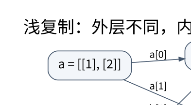

# 对象图、复制与数值语义：把名字和对象分开

> **学习位置**：[[计算机知识/00-开始/课程地图/04-Python-课程地图|Python课程地图]] · **适用边界**：Python 3.11+；CPython 实现细节明确注明。



[PNG 备用图](../../../_assets/diagrams/round3/python-object.png) · [可编辑图源](../../../_assets/diagrams/round3/python-object.dot)

## 先画箭头，再讨论“传值还是传引用”

Python 的赋值把名字绑定到对象；函数调用把形参绑定到实参所指的对象。重新绑定形参不改变调用者的名字，但经由形参修改同一个可变对象，调用者能够观察到。把这种机制叫“共享对象传递”比套用 C++ 引用的规则更准确。

```python
rows = [[1], [2]]
alias = rows
shallow = rows.copy()
shallow[0].append(9)
shallow.append([3])
assert rows == [[1, 9], [2]]
assert alias is rows and shallow is not rows
```

逐句推演：第一次赋值只有一个外层列表；`copy()` 新建外层列表，但内部两个列表仍被共享；因此向内部列表追加会同时可见，而向新的外层列表追加不会改变旧外层长度。`[[0] * 3] * 4` 也只重复了同一个行对象的引用，不是四次构造。二维初始化应使用推导式逐行构造。

`deepcopy` 按对象图复制，并用备忘录维护循环和共享关系；它不是“使一切独立”的魔法。文件、锁、网络连接的复制通常没有合理默认含义。设计更新操作时，先决定哪些对象拥有独立身份、哪些应该共享，再选不可变值、浅复制或显式重建。

## 相等、身份与哈希是三个契约

`is` 检查身份，`==` 请求值比较；小整数或字符串驻留属于实现细节，不能用 `is` 判断业务值。若两个可哈希对象相等，它们必须有相同哈希；反方向不成立。作为字典键期间，参与相等和哈希的状态不能改变，否则对象可能“还在字典里却找不到”。冻结数据类也只阻止字段重新绑定，不会递归冻结其中的列表。

`bool` 是 `int` 的子类，因此 `isinstance(True, int)` 为真。这会影响 `match`、JSON 数据验证和字典键：`True`、`1`、`1.0` 比较相等并使用兼容哈希，不能指望它们作为三个独立键。如果业务要求“整数，但不是布尔值”，应明确排除 `bool`；若要求恰好内建整数，可写 `type(x) is int`，代价是拒绝整数子类。

## 数值模型决定算法是否仍然正确

Python 整数没有固定机器字长上限，但计算量和内存不是免费：对含 $b$ 位的整数进行运算不能一律按 $O(1)$ 计费。`//` 向负无穷取整，例如 `-7 // 3 == -3`，余数满足 `a == (a // b) * b + a % b`，与 C17 的向零截断不同。

二进制浮点无法精确表示多数十进制小数。`math.isclose` 比较的是相对误差与绝对误差的组合；接近零时只设置相对容差往往不足。容差应来自测量误差或算法误差预算，不能随意写一个 `1e-6`。`NaN` 与自己不相等，`x < lower` 也无法排除它。物理量输入应先验证有限性，再验证范围。

金额可按最小货币单位使用整数，或用从**字符串**创建的 `Decimal` 并明确舍入规则；`Decimal(0.1)` 会保留传入二进制浮点的实际值。`Fraction` 表示有理数，但分子分母增长会增加成本。

## 回收机制不是资源生命周期协议

CPython 常规构建主要使用引用计数并配合循环垃圾回收，但语言并不保证对象在哪一句后立即销毁。`__del__` 的异常处理、循环引用和解释器关闭顺序都不适合作为关键资源释放机制。文件、事务、锁要使用 `with` 或显式关闭；弱引用适合不应延长对象生命的缓存或观察者，而不是代替所有权设计。

## 练习与答案

解释 `a = [[]]; b = a * 2; b[0].append(1)`：`a == [[1]]`，`b == [[1], [1]]`，因为三条引用指向同一个内层列表。再构造两个相等但不同身份的自定义对象，验证集合去重依赖相等与哈希，而非内存地址。最后比较 `Decimal('0.1') * 3` 与 `0.1 * 3`，记录表示差异，而不要把一次打印形式当成所有浮点运算的误差界。

## 关联阅读

- [[计算机知识/10-编程语言/03-C语言/10-系统课程/01-整数表达式与可移植计算|从比特到表达式：整数提升为什么会改变答案]]
- [[计算机知识/10-编程语言/04-Rust/10-系统课程/01-所有权借用与切片推演|所有权和借用：把编译错误还原成一张对象关系图]]
- [[计算机知识/10-编程语言/01-Python/10-系统课程/02-描述符方法解析与元编程|描述符、方法解析与元编程：属性访问是一段程序]]

## 依据与继续查证

- [Python 3.11 语言参考](https://docs.python.org/3.11/reference/)
- [Python 3.11 标准库](https://docs.python.org/3.11/library/)
- [Free-threaded CPython 的版本边界](https://docs.python.org/3/howto/free-threading-python.html)

本页的例子、推演与练习为教学构造；语言契约、系统接口和版本相关结论应结合以上原始文档核对。

<!-- COURSE SEQUENCE -->
## 顺序导航与验证

[[计算机知识/10-编程语言/01-Python/10-系统课程/00-Python系统课程索引|本课程总索引]] · [[计算机知识/_labs/round3/PY/Python-实验说明|本课程实验]]

下一讲：[[计算机知识/10-编程语言/01-Python/10-系统课程/02-描述符方法解析与元编程|描述符、方法解析与元编程：属性访问是一段程序]]
<!-- END COURSE SEQUENCE -->
