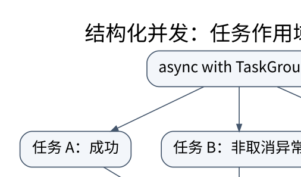

# 异步任务、取消与结构化并发：谁负责等待谁

> **学习位置**：[[计算机知识/00-开始/课程地图/04-Python-课程地图|Python课程地图]] · **适用边界**：Python 3.11+；CPython 实现细节明确注明。



[PNG 备用图](../../../_assets/diagrams/round3/python-async.png) · [可编辑图源](../../../_assets/diagrams/round3/python-async.dot)

## 并发不是把 def 改成 async def

调用协程函数只创建协程对象；需要等待它或将其交给任务调度。事件循环在任务主动挂起时切换工作，但一个 `await` 表达式不保证一定发生切换：被等待对象可能立即完成。CPU 密集循环和同步阻塞 I/O 会让同一事件循环中的其他任务停顿。

先把总时间拆开。三个彼此独立的请求各等待约 100 ms，串行等待约 300 ms；并发在资源充足且没有额外限制时可接近最大单项等待时间，而不是时间变为零。对服务端施加的负载也随并发增加，因此必须同时讨论限流、连接池和超时。

## 让任务的生命被作用域包住

```python
import asyncio

async def square(x: int) -> int:
    await asyncio.sleep(0)
    return x * x

async def calculate(values: list[int]) -> list[int]:
    async with asyncio.TaskGroup() as group:
        tasks = [group.create_task(square(x)) for x in values]
    return [task.result() for task in tasks]
```

`TaskGroup` 从 Python 3.11 提供。正常退出时相关任务已经完成；任务出现非取消异常时，组会协调取消其余任务并等待收尾，随后按规则报告异常组。与之相比，默认 `gather` 在把首个异常传播给调用者时，不承诺顺带取消其他任务。两者不是只在返回类型上不同。[精确异常规则见官方任务文档](https://docs.python.org/3.11/library/asyncio-task.html)。

## 取消是协作请求，不是时光倒流

任务取消会在可交付取消的位置表现为 `CancelledError`。通常用 `try/finally` 清理资源，显式捕获后应重新抛出，不应把取消误当成普通业务失败吞掉。取消客户端等待并不撤销服务器已经完成的写入，取消 `to_thread` 的等待也不等于杀死正在运行的线程。

超时应定义为一个操作的总预算，而非每次重试都重新获得完整预算。对“扣款请求超时”不能直接推断扣款失败；需要幂等键、查询结果或补偿流程。异步代码的正确性由任务生命周期与外部协议共同决定，不只由事件循环决定。

## 背压为什么比海量任务更重要

信号量可以限制同时进入临界工作区的任务数，但提前创建一百万个等待信号量的任务仍占用大量内存。对于大输入，更稳妥的模型是**有界队列＋固定数量工作者**。队列满时生产者等待，从而把消费端压力传递给生产端。还必须设计结束信号、失败传播和 `task_done` 的 `finally` 清理，否则 `join()` 可能永久等待。

锁不能跨越不必要的网络等待。先在锁内读取或更新有限状态，再在锁外做慢 I/O；但这可能引入“状态读取后已变化”，需版本号或重试校验，不能简单移动一行就认为并发安全。`asyncio.Lock` 只用于同一异步并发域，不可代替线程间或进程间同步。

## 定位卡顿的方法

用单调时钟记录排队时间、执行时间和端到端时间，启用事件循环调试检查慢回调。区分“请求没有启动”“正在等待连接”“远端慢”“CPU 占住循环”。上下文变量适合跟踪请求标识，但必须核对线程与任务边界中的传播规则。后台任务必须有人持有、观察异常并在退出时收尾。

## 练习与答案

为两个任务设计实验：一个在启动后抛错，另一个在 `finally` 设置清理标志。用 `TaskGroup` 验证退出后清理完成，再和默认 `gather` 的行为对照。不要用固定睡眠时间断言调度顺序，使用 `Event` 建立可重复的同步点。设计一次“服务器完成、客户端超时”的情景，答案必须包含幂等或结果查询，而不是无限重试。


<!-- ROUND4 DEPTH LINKS -->
## 继续推演本页难点

[[计算机知识/10-编程语言/01-Python/10-系统课程/10-异步取消异常组与有界流水线|超时之后，哪些任务仍在运行，谁负责收尾？]] 本专题补上可观察的查找或任务状态变化。

这不是替换本页：先掌握原理，再用补充页核对容易被一句话略过的条件。
<!-- END ROUND4 DEPTH LINKS -->

## 关联阅读

- [[计算机知识/20-操作系统/02-操作系统原理/10-系统课程/03-同步条件变量与经典问题|同步、条件变量与经典问题：保护不变量，而不是保护几行代码]]
- [[计算机知识/10-编程语言/05-TypeScript/10-系统课程/05-事件循环Promise与取消|事件循环、Promise 与取消：顺序必须按任务推演]]
- [[计算机知识/35-计算机网络/10-系统课程/07-Socket分帧背压与排障|Socket 工程：分帧、背压、超时和可解释的失败]]

## 依据与继续查证

- [Python 3.11 语言参考](https://docs.python.org/3.11/reference/)
- [Python 3.11 标准库](https://docs.python.org/3.11/library/)
- [Free-threaded CPython 的版本边界](https://docs.python.org/3/howto/free-threading-python.html)

本页的例子、推演与练习为教学构造；语言契约、系统接口和版本相关结论应结合以上原始文档核对。

<!-- COURSE SEQUENCE -->
## 顺序导航与验证

[[计算机知识/10-编程语言/01-Python/10-系统课程/00-Python系统课程索引|本课程总索引]] · [[计算机知识/_labs/round3/PY/Python-实验说明|本课程实验]]

上一讲：[[计算机知识/10-编程语言/01-Python/10-系统课程/03-生成器闭包与上下文协议|生成器、闭包与上下文协议：控制权和资源如何流动]]

下一讲：[[计算机知识/10-编程语言/01-Python/10-系统课程/05-线程进程与解释器边界|线程、进程与解释器边界：GIL 不是同步设计]]
<!-- END COURSE SEQUENCE -->

<!-- ORIGINAL DEEP LINKS -->
## 与原有长篇专题衔接

- [[计算机知识/10-编程语言/01-Python/16-异步并发取消性能与可靠工程|16-异步并发取消性能与可靠工程]]

新旧讲解采用的版本与模型可能不同，比较时先核对各自前提，不把教学简化当成实现细节。
<!-- END ORIGINAL DEEP LINKS -->
