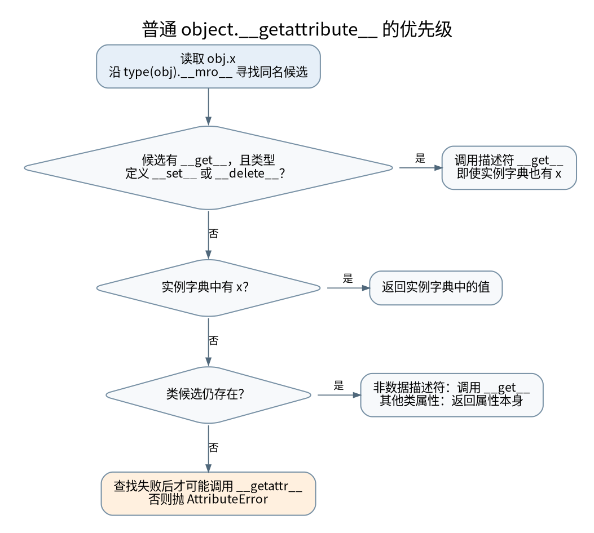

# 从一个点号到模块初始化：描述符、C3 与循环导入

> **本页要解决**：obj.x、super() 和 import 分别沿哪条查找链前进？
>
> **先修**：[[计算机知识/10-编程语言/01-Python/10-系统课程/02-描述符方法解析与元编程|描述符、方法解析与元编程：属性访问是一段程序]]；[[计算机知识/10-编程语言/01-Python/07-模块包导入与项目结构|模块、包、导入与项目结构]]。
>
> **阅读入口**：[[计算机知识/10-编程语言/01-Python/10-系统课程/00-Python系统课程索引|本学科主索引]] · [[计算机知识/00-开始/全局导航/11-难点导读与研究证据|全局难点导读]]。

**版本、模型与证据边界**：解释以 Python 3.13 文档为依据，实验运行于记录中的 Python 3.13.5；不是所有实现的内部布局承诺。

## 点号不是直接查字典

执行 `obj.x` 时，常见的“先实例字典、再类字典”只对一部分情况成立。普通 `object.__getattribute__` 的路径要先沿类的 MRO 找到同名候选，再判断它是不是数据描述符。定义了 `__set__` 或 `__delete__` 的描述符属于数据描述符；普通函数只有 `__get__`，因此是非数据描述符。读取时还要有 `__get__` 才能执行描述符取值协议：仅定义 `__set__`、没有 `__get__` 的对象不能据此抢在实例字典前面返回一个值。以下优先级中的“数据描述符”均指同时提供取值方法的候选。这个差别决定了实例属性能不能遮蔽它。自定义 `__getattribute__` 可以改变普通路径，以下讨论不假设它被任意重写。[^descriptor]



[矢量图](../../../_assets/diagrams/round4/python-lookup.svg) · [可编辑图源](../../../_assets/diagrams/round4/python-lookup.dot)

可以把规则读成四个问题：类及基类是否提供数据描述符？实例字典是否有这个名字？类及基类是否提供非数据描述符或普通属性？以上均失败时，是否有 `__getattr__` 兜底？其中 `__getattr__` 是查找失败后的后备，不是每次访问都先执行。

## 用一个能够改变结果的实验理解优先级

```python
class ReadOnly:
    def __get__(self, obj, owner=None):
        return "descriptor"
    def __set__(self, obj, value):
        raise AttributeError("read-only")

class Example:
    x = ReadOnly()
    def method(self):
        return "method"

obj = Example()
obj.__dict__["x"] = "instance"
obj.__dict__["method"] = "shadow"
assert obj.x == "descriptor"
assert obj.method == "shadow"
```

把 `__set__` 写成“总是抛出异常”，仍然使 `x` 成为数据描述符。描述符类别取决于协议是否存在，而不取决于赋值能否成功。实例字典里的 `x` 没消失，只是读取时优先级较低。普通方法则可以被实例中的同名值遮蔽。

`property` 的只读性质也不是“没有 setter 所以不是数据描述符”。只读 property 仍走数据描述符协议，只是在赋值时拒绝操作。另一方面，`len(obj)` 这类隐式特殊方法调用通常从类型寻找方法，不能把给实例临时添加 `obj.__len__` 等同于实现整个特殊方法协议。[^model]

## 绑定方法是函数加接收者，不是另存一份代码

从类中读到函数，再对实例调用它的 `__get__`，得到携带 `__self__` 和 `__func__` 的绑定方法。于是 `obj.f(a)` 能把实例作为首个参数传入。`staticmethod` 抑制这种实例绑定；`classmethod` 绑定实际访问的类而不是某个实例。

这解释了一个调试问题：调用签名“凭空多出一个参数”时，先查看这个可调用对象是否经过描述符绑定，而不是立即怀疑 Python 改变了实参。也解释了为何把任意 callable 实例直接放到类字典，不一定自动获得普通函数的绑定行为。

## C3：super 的“下一个”由完整继承图决定

考虑菱形继承：

```python
class A: pass
class B(A): pass
class C(A): pass
class D(B, C): pass
assert D.__mro__ == (D, B, C, A, object)
```

C3 计算 `L(D) = D + merge(L(B), L(C), [B,C])`。选择规则是：取一个序列的首项，但该项不能出现在任何其他序列的尾部。不是随便选“最左边的未访问结点”。[^mro]

开始时有 `[B,A,object]`、`[C,A,object]`、`[B,C]`。先选 B。随后 A 仍出现在 C 序列的尾部，不能选；所以选 C，再选 A，最后 object。这保证子类先于父类，并尊重局部父类顺序。

`super(B, d)` 的含义不是“直接找 B 的父类 A”，而是在 `type(d)` 的 MRO 中定位 B，继续向后找。因此当 `d` 是 D 实例时，下一个是 C。零参数 `super()` 在普通方法中利用词法定义类和接收者确定这个起点。

协作式多继承要共同遵守调用约定：每一层处理自己负责的参数，并将其余参数交给 `super()`；一层直接点名调用某个基类，可能跳过别的参与者。C3 能拒绝不一致的继承顺序，但不会证明你的业务初始化恰好运行一次。

## 循环导入失败的不是“循环”本身，而是初始化时序

Python 会在执行模块代码前把模块对象放进 `sys.modules`。否则递归导入无法复用正在初始化的对象。代价是其他模块可能观察到一个“存在但尚未初始化完”的模块。[^import]

假设 `a.py` 的顺序是先 `from b import y`，再定义 `x=1`；`b.py` 先 `from a import x`。执行链为：创建 a、缓存 a、执行 a 第一行、创建 b、缓存 b、执行 b 第一行。此时 a 已存在，但 x 还没绑定，因此失败。错误不等于“找不到 a 文件”。

将 `x=1` 提前可能使这个小例子成功，却通常只是把循环依赖变成对定义顺序敏感的隐含合同。更稳妥的组织是把共享数据结构或协议移入低层模块，依赖方向保持一致；确有需要时延迟导入，并解释它为何不会再次触发未完成状态。

`import a` 与 `from a import x` 的时间要求也不同：前者可以先拿到模块对象、稍后再访问 `a.x`；后者当场要求 x 可用。导入失败时，失败模块会按导入机制从缓存清理，但已经成功导入的副作用模块不保证全部撤销。导入不是一个覆盖所有外部效果的事务。

## 把组织问题转成可测试合同

对于使用插件注册的项目，建议明确“导入是否允许联网、启动线程、改全局注册表”。类和函数定义通常容易复用，隐式启动服务则让测试、命令行和文档构建被迫承担额外副作用。类型标注的循环依赖可以在适用时用 `TYPE_CHECKING` 与延迟标注处理，但运行时真正需要的对象不能仅靠标注技巧创造。

本轮实验分别检查数据描述符优先级、C3 的可接受与冲突继承图，以及临时目录内两个模块的循环导入。它不修改你的包安装环境。理解这些路径以后，再看 [[计算机知识/70-编译原理/10-系统课程/11-类型统一泛化与值限制|静态类型约束]]：类型检查可以分析“可能有什么属性”，但不能替代执行时真实发生的属性协议和模块初始化。

**自测**：把例子中的 `__set__` 整个删除，`obj.x` 变成什么？变成实例字典中的 `"instance"`。为什么仅把它改为抛异常不行？因为优先级判定观察协议，不观察函数执行结果。

[^descriptor]: Python 3.13 官方 [Descriptor Guide](https://docs.python.org/3.13/howto/descriptor.html)，实例读取优先级和绑定方法。
[^model]: Python 3.13 官方 [Data model](https://docs.python.org/3.13/reference/datamodel.html#special-method-lookup)，隐式特殊方法查找。
[^mro]: Python 官方 [C3 MRO 说明](https://docs.python.org/3.13/howto/mro.html)，合并规则、局部优先级和单调性。
[^import]: Python 3.13 官方 [The import system](https://docs.python.org/3.13/reference/import.html#loading)，模块缓存、执行及失败清理。

**诊断文字的边界**：循环导入实验直接观察 `sys.modules` 已有模块但所需属性尚未定义，再核对 `ImportError`；不依赖某一 Python 版本是否在错误信息中恰好出现 “partially initialized”。

## 知识连接：下一步应追问什么

属性和名字解析是不同查找层；后续类型和对象有效性也不能混成同一个检查。

[[计算机知识/10-编程语言/02-C++/10-系统课程/10-借用视图失效与异常提交|值还在不等于引用有效：视图、容器与异常提交]]：vector 没扩容时，erase 为什么仍会使某些引用失效？

[[计算机知识/70-编译原理/10-系统课程/11-类型统一泛化与值限制|类型推断不是猜类型：统一、泛化与可变引用的反例]]：为什么 let 绑定可以多态，可变引用却不能随便泛化？

[[计算机知识/85-综合贯通/04-跨层保证与反例矩阵|跨层保证辨析：类型、原子、隔离、一致性与持久性]]：一句“这是安全的”到底省略了哪一层前提？

## 本地核验与阅读顺序

[[计算机知识/_labs/round4/README|本轮实验：命令、检查范围与未执行项目]] 提供对应文件和记录。[[计算机知识/90-资源/维护/导入-com/_meta/round4/01-研究证据与版本边界|研究证据索引]] 区分规范、推演和实验；[[计算机知识/90-资源/维护/导入-com/_meta/round4/02-缺口回查与后续验证|仍需进一步验证的边界]] 不把概览或模型标成完整实现。

先完成主干，再按问题选择专题；不要求跳过第 1–8 讲。 下一专题：[[计算机知识/10-编程语言/01-Python/10-系统课程/10-异步取消异常组与有界流水线|让异步任务有负责人：取消、异常组与有界流水线]]。
