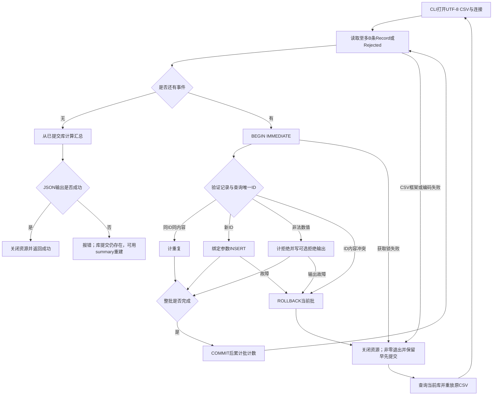

# 运行成功以后，如何知道提交了什么、还能怎样重跑？

> 本课把[[计算机知识/10-编程语言/01-Python/10-系统课程/11-记录流统计与数据语义|同一份记录的身份与统计]]放进可安装库与CLI。源码真源、固定输入、测试和说明均在[[计算机知识/80-实践/01-Python/04-测量记录导入与分析/README|测量记录实践项目]]。版本合同是Python 3.11+的标准库API；实际解释器与SQLite版本见项目验证记录。

## 阶段三：库计算，CLI拥有资源

为什么import一个包不应开始导入CSV？模块加载只建立定义和公开接口；文件、数据库以及输出何时打开由调用者决定。沿用[[计算机知识/10-编程语言/01-Python/07-模块包导入与项目结构#8. 扩展练习：从导入失败到稳定入口（完成 08、09 后）|src布局与稳定入口主解释]]，这次分发名为 `wwl-measurement-import`，导入名为 `measurement_import`，命令为 `wwl-measurements`。

`core.py` 有四个边界：Record在构造时验证；read_records消费借入文本流；import_records拥有批事务但借用连接；summarize扫描提交后的行。CLI的ExitStack拥有文本流和连接，进入后分别注册文件退出与connection.close；异常时也清理已经取得的资源。不要把 `with connection:` 当成关闭连接：Python 3.11的连接上下文处理适用事务的提交/回滚，本身不关闭连接，也不自动开始事务。本项目明确 `isolation_level=None`，使用SQL `BEGIN IMMEDIATE / COMMIT / ROLLBACK`，不调用较新版本的autocommit属性。[Python 3.11 sqlite3说明](https://docs.python.org/3.11/library/sqlite3.html#how-to-use-the-connection-context-manager)

| 谁 | 拥有什么 | 失败时负责什么 |
| --- | --- | --- |
| CLI | 已打开CSV、可选拒绝文件、数据库连接 | 关闭资源；给非零退出码；保留提交事实 |
| 解析器 | CSV读取进度 | 字段非法交出Rejected；坏框架/编码停止 |
| 导入器 | 一个至多B条事件的批、当前事务 | 冲突或插入失败时回滚该批 |
| 汇总器 | 借入连接上的只读游标 | 对选定行集给数值与单位 |
| 输出者 | JSON stdout、可选JSONL拒绝记录 | 输出失败如实报错，不虚构跨文件回滚 |

成功完成时，报告满足 `read = rejected + inserted + duplicates`。批大小按CSV数据记录计数，Rejected也占一条；CSV内部带换行字段仍是一条记录，拒绝位置记为读取器报告的物理结束行。失败批的各项计数不会加到已完成批报告；BatchFailure另带该批读入条数。编码错误、获取锁失败和输出失败可发生在这些边界之外，此时从数据库查询事实再恢复。

## 两行一批：失败之后，哪些数据已经存在

读到c以后出错，a、b还能留下吗？固定a–d输入，B=2；数据库初始为空，唯一键是sample_id。相同ID且tick_ms、code相同为重放；相同ID内容变化为冲突，拒绝当前批。

| 事件 | 当前事务 | 已提交身份 |
| --- | --- | --- |
| 开始第一批并插入a、b | 有a、b未提交 | 空 |
| 提交第一批 | 无 | a、b |
| 开始第二批并插入c | 有c未提交 | a、b |
| 故障钩子在c插入后抛异常 | 回滚当前批 | a、b |
| 重新从原CSV导入 | 第一批a、b为重复；第二批新增c、d | a、b、c、d |

在实践项目运行 `examples/recovery.py`；测试用 `on_insert` 注入故障。钩子只服务可观察实验，不是另一个提交步骤。成功首次报告为read4/rejected0/inserted4/duplicates0；正常完整重放为4/0/0/4。上述故障后的重跑为4/0/2/2。把B改4时，同位置故障会回滚四行所在批，库内为0；因此批大小属于恢复合同，不能声称整文件全有或全无。



`BEGIN IMMEDIATE`在当前批查询前取得写事务；SQL使用绑定参数。保持一个明确的提交者，不能先查询后在另一个不相关事务里插入而把竞争漏掉。数据库锁超时是需要恢复或协调的失败，GIL不是数据库事务协调器。

这是单个本地数据库内、依sample_id及内容制定的重放策略。它没有解决远端副作用、分布式exactly-once、迟到事件、删除或窗口更新；去 [#172事件流课程](https://github.com/EunsonZ/WWL/issues/172) 时必须重新核对身份与提交边界。

## 干跑：预测和真实提交分开报告

已有a、b的库上干跑完整a–d，会说新提交多少？CLI只读打开原库，把一致快照备份到内存，再执行同一导入逻辑。若原路径不存在，使用空内存库，不创建原路径。它报告inserted0、would_insert2、duplicates2；summary_scope为hypothetical database after import。真实summary仍只见a、b。读取快照可能产生锁协调或SQLite正常读者行为；这里承诺的是不创建或修改目标数据库数据，不是整个操作系统零副作用。

干跑禁止 `--rejects` 文件参数，只在stdout输出结果；对将来真实导入的并发变化不提供保证。拒绝文件采用新文件独占创建模式；输入、数据库、拒绝路径不得是同一文件或已知别名。拒绝文件与SQLite不共享事务：失败批回滚后，已经写出的拒绝原因仍可能存在，须按本次尝试解释。

`summary DATABASE`只读重建已提交统计，适用于导入成功但stdout输出失败的情况。修复输出目标后重跑summary，无需把已导入记录人为插入第二遍。若输出失败，则返回非零；命令失败不代表早先数据库提交不存在。

## 安装后从另一个目录调用

源码目录里能运行，为什么还需要异目录试验？若当前工作目录恰好暴露源码，就可能掩盖构建制品漏包。先读包与环境主解释，记录明确隔离路径；以下 `PROJECT` 指已核对的实践项目绝对路径，`LAB` 指新建且可恢复的临时练习目录。它们不能指向共享库根或个人数据，执行前应填写与核对。

```bash
python3 -m venv "$LAB/venv"
"$LAB/venv/bin/python" -m pip wheel --no-deps "$PROJECT" --wheel-dir "$LAB/wheels"
"$LAB/venv/bin/python" -m pip install --no-deps "$LAB/wheels/wwl_measurement_import-0.1.0-py3-none-any.whl"
cd "$LAB"
"$LAB/venv/bin/wwl-measurements" import "$PROJECT/data/measurements.csv" "$LAB/run.sqlite" --batch-size 2
"$LAB/venv/bin/wwl-measurements" import "$PROJECT/data/measurements.csv" "$LAB/run.sqlite" --batch-size 2
"$LAB/venv/bin/wwl-measurements" summary "$LAB/run.sqlite"
"$LAB/venv/bin/python" -I -B -m unittest discover -s "$PROJECT/tests" -v
"$LAB/venv/bin/python" -I -B -c 'import measurement_import; print(measurement_import.__file__)'
```

构建需求为setuptools>=77；标准库运行时没有第三方依赖。构建前端可能下载构建后端，安装后端/工具、网络与来源按当前授权和已有环境处理；版本范围是声明，不是锁文件。记录构建日志、解释器版本及实际wheel身份，才能说明用了哪个制品；隔离构建的后端不一定安装在运行环境，不能用运行环境的 `pip show setuptools` 替代构建日志。[Packaging User Guide](https://packaging.python.org/en/latest/tutorials/packaging-projects/)

成功标准是异目录中的CLI、公开包和测试都来自隔离环境已安装制品；若为了让测试过而加 `PYTHONPATH=src`，只能证明源码导入。首次4新增、重放0新增、库四行应与源码测试一致。路径、坏编码、数据库打开失败、真实只读快照与退出后资源关闭也需在落盘候选上验证；实际结果见[[计算机知识/80-实践/01-Python/04-测量记录导入与分析/VERIFICATION|运行记录]]。

## 阶段四：先预测空间和竞争，再决定是否并发

把import改async就能更快吗？同步源码每批最多持有B个解析事件，加CSV字段与文本缓冲；汇总器逐行累计n、和与平方和，不持有全部行。总空间还包括SQLite缓存、驱动缓冲、日志与任意用户回调，`tracemalloc`不能代表全部RSS。干跑把数据库快照置于内存，不享有“总内存只随批大小增长”的承诺。

回[[计算机知识/10-编程语言/01-Python/10-系统课程/06-测试属性验证与性能方法|性能主解释]]，分别测新库初始化、重放和实际新增，不把三种任务混成一个吞吐量。输入翻倍、改变B、改变拒绝比例后，计数与身份不应变；提交次数、耗时和峰值内存可能变化。本同步段保留推理边界，后续 [[计算机知识/10-编程语言/01-Python/10-系统课程/14-性能观察与有界取消恢复|第14讲]] 已提供有限本机性能观察及取消实验；不把其数字泛化到本段所有输入。

需要并发时，可并行解析或计算，但连接和提交事务仍由具体所有者负责。回[[计算机知识/10-编程语言/01-Python/10-系统课程/10-异步取消异常组与有界流水线#有界队列把压力向上传，而不是让内存无限接盘|有界队列主解释]]，再回答：即使第二批的两个任务都task_done，当前SQLite批回滚后仍只提交a、b。join仅说明队列记账，不证明业务提交；预先创建全部任务再加有限队列也不能证明任务总内存有界。并发故障/兄弟取消与收尾由第14讲接续，复用04、05、10主解释。

## 无步骤迁移题与答案

输入按顺序为a=(0,2)、b=(1000,4)、x=(4000,10)、a=(0,9)，B=2，初始空库。不给步骤，写出失败后行集、重跑策略、统计与CLI状态；再预测B=4的区别。

答案：第一批提交a、b；第二批先插x，再遇a内容冲突，回滚x。失败库行集为a、b，均值3，描述性方差1，RMS²10；CLI非零。直接重跑原文件将再次在第二批冲突，不能声称恢复完毕；应保留原输入及错误证据，按数据合同核对冲突来源后明确接受新输入版本。B=4时四行都在失败批，库为空。修复输入是数据政策决定，不能静默覆盖a=2。

返回[[计算机知识/10-编程语言/01-Python/10-系统课程/11-记录流统计与数据语义#阶段三：缺失与重复改变的是行集|记录与统计]]核对行集，再回[[计算机知识/10-编程语言/01-Python/10-系统课程/00-Python系统课程索引|唯一课程索引]]。第13/14讲已接续NumPy同数据、有限性能与有界取消恢复实验；完整#245仍需指定跨域回链和各应用的独立验收。本同步工程与两篇正文保留自己的验收范围。
