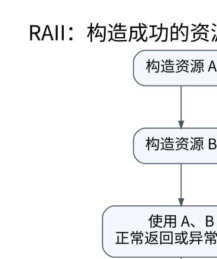

# 对象何时存在：初始化、析构和 RAII 的统一模型

> **学习位置**：[[计算机知识/00-开始/课程地图/02-C++-课程地图|C++课程地图]] · **适用边界**：C++20；ABI、容器实现与后续标准不混同。



[PNG 备用图](../../../_assets/diagrams/round3/cpp-raii.png) · [可编辑图源](../../../_assets/diagrams/round3/cpp-raii.dot)

## 先分清存储和对象

一块内存足够大，不等于其中已经存在一个可按任意类型使用的 C++ 对象。对象生命周期通常由正确的初始化开始，以析构或存储重用等事件结束。分配器、placement new、联合体和低层容器实现需要同时处理存储、对齐与对象生命周期；普通业务代码应把这些细节封装在资源管理类型中。

`new T(args)` 通常包含获取存储和构造对象两部分；`delete p` 通常包含析构与释放存储。`malloc` 只提供字节存储，不会调用普通类的构造函数；`free` 不会执行析构。C++20 对某些隐式生命周期类型有额外规则，但不能推广为“所有类型都可 malloc 后直接使用”。

## 初始化不是赋值

```cpp
std::vector<int> a(3, 7);   // 三个 7
std::vector<int> b{3, 7};   // 两个元素：3 和 7
```

圆括号和花括号可能选择不同重载，尤其当 `initializer_list` 构造函数参与时。花括号有防止某些窄化转换的优点，却不是“永远与括号同义的安全语法”。`int x;` 在某些局部自动对象场景不会初始化值，`int x{};` 则初始化为零；类类型的结果仍取决于构造函数和具体初始化类别。

成员初始化顺序按**成员声明顺序**，不是构造函数初始化列表的书写顺序。若 `size_` 先声明、`data_` 后声明，却写出相反列表，运行顺序也不会改变。基类先于派生类成员构造；析构大体沿相反方向进行。

## RAII 把资源生命周期绑定到对象生命周期

资源不仅是内存，也包括文件、锁、线程、事务和设备句柄。RAII 类型在构造成功后维持不变量，在析构中释放资源。于是普通返回和异常展开都经过同一清理机制，不再要求每个错误分支手动复制释放代码。

```cpp
#include <memory>
#include <cstdio>
#include <stdexcept>

using File = std::unique_ptr<std::FILE, decltype(&std::fclose)>;
File open_read(const char* name) {
    File file(std::fopen(name, "rb"), &std::fclose);
    if (!file) throw std::runtime_error("open failed");
    return file;
}
```

这个例子演示所有权与自动关闭，不是完整的持久化写入方案：自定义 deleter 的返回值不会自动变成可恢复错误报告；重要输出应提供显式 `close`/`commit`，让调用者处理关闭失败，析构只承担兜底清理。

构造过程中若抛异常，已经成功构造的基类和成员会析构，但**整个对象的析构函数不会运行**，因为整个对象尚未构造完成。正因此，资源应尽快交给成员 RAII 对象，不能先取得多个裸句柄，指望最外层析构收拾构造失败。

## 所有者与视图必须分开

`std::string` 拥有字符，`std::string_view` 借用字符；`std::vector<T>` 拥有元素，`std::span<T>` 描述一段现存元素。视图减少复制，但不会延长所指对象生命周期。

```cpp
// 错误示例：返回后临时 string 已析构。
// std::string_view bad() { return std::string("temporary"); }
```

引用绑定临时对象在某些语法位置可以延长生命周期，但规则不是沿任意引用链传递。把临时对象传给参数、再从函数返回它的引用，不能依赖局部引用延寿直觉。异步任务保存视图尤其危险：调用者可能在任务真正运行前销毁数据。

## 智能指针并非三种随便选择的写法

`unique_ptr` 表达独占所有权，可移动而不可复制；`shared_ptr` 表达共享所有权，控制块维护计数；`weak_ptr` 不增加强引用计数，可用来打破所有权环或观察对象是否仍存在。不要因为“不知道谁释放”就默认使用共享所有权。

从同一裸指针分别构造两个独立 `shared_ptr` 会产生两个控制块，可能双重删除。共享同一控制块也不等于所指对象的字段操作线程安全；计数管理与对象同步是两层问题。

## 自检与推演

一个对象包含 `std::vector<int> data_` 和文件资源成员，第二个成员构造失败时，第一个是否释放？会，因为它已构造成功。若文件资源只是裸 `FILE*`，则指针成员析构并不关闭文件，这就是类型选择改变错误路径可靠性的地方。

学习目标不是“从此不写 new”，而是能说明每个资源的所有者、借用者、有效期、转移点与失败清理。需要底层控制时依然可以手写分配，但应把证明义务限制在尽可能小的封装中。


<!-- ROUND4 DEPTH LINKS -->
## 继续推演本页难点

[[计算机知识/10-编程语言/02-C++/10-系统课程/10-借用视图失效与异常提交|vector 没扩容时，erase 为什么仍会使某些引用失效？]] 本专题补上逐步类型/状态变化及失败反例。

这不是替换本页：先掌握原理，再用补充页核对容易被一句话略过的条件。
<!-- END ROUND4 DEPTH LINKS -->

## 关联阅读

- [[计算机知识/10-编程语言/03-C语言/10-系统课程/04-动态内存与失败原子性|动态内存的核心不是 malloc，而是状态转移和失败恢复]]
- [[计算机知识/10-编程语言/04-Rust/10-系统课程/01-所有权借用与切片推演|所有权和借用：把编译错误还原成一张对象关系图]]

## 依据与继续查证

- [C++20 工作草案 N4861（按条款阅读）](https://timsong-cpp.github.io/cppwp/n4861/)
- [C++ Core Guidelines（设计建议，不等于标准条款）](https://isocpp.github.io/CppCoreGuidelines/CppCoreGuidelines)

本页的例子、推演与练习为教学构造；语言契约、系统接口和版本相关结论应结合以上原始文档核对。

<!-- COURSE SEQUENCE -->
## 顺序导航与验证

[[计算机知识/10-编程语言/02-C++/10-系统课程/00-C++系统课程索引|本课程总索引]] · [[计算机知识/_labs/round3/CPP/C++-实验说明|本课程实验]]

下一讲：[[计算机知识/10-编程语言/02-C++/10-系统课程/02-拷贝移动与异常保证|拷贝、移动与异常安全：为什么 std::move 可能仍然复制]]
<!-- END COURSE SEQUENCE -->

<!-- ORIGINAL DEEP LINKS -->
## 与原有长篇专题衔接

- [[计算机知识/10-编程语言/02-C++/03-指针引用const与生命周期|03-指针引用const与生命周期]]

新旧讲解采用的版本与模型可能不同，比较时先核对各自前提，不把教学简化当成实现细节。
<!-- END ORIGINAL DEEP LINKS -->
