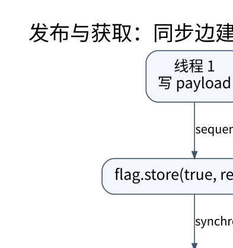

# 从数据竞争到 happens-before：并发正确性怎样建立

> **学习位置**：[[计算机知识/00-开始/课程地图/02-C++-课程地图|C++课程地图]] · **适用边界**：C++20；ABI、容器实现与后续标准不混同。



[PNG 备用图](../../../_assets/diagrams/round3/release-acquire.png) · [可编辑图源](../../../_assets/diagrams/round3/release-acquire.dot)

## 先画共享状态，再决定用几条线程

两个线程对同一内存位置进行冲突访问、至少一个写入，且没有所需的原子或同步关系时，可能形成数据竞争。C++ 数据竞争通常导致未定义行为；它不是“偶尔读到旧值”这么轻微的结果。

最稳妥的起点是线程封闭、不可变数据、消息传递或锁保护。不要因为原子类型看起来轻量，就把所有字段分别改成 atomic：业务状态跨多个字段时，逐字段原子仍可能观察到不一致组合。

## mutex 保护的是不变量

```cpp
std::mutex mutex;
std::queue<int> queue;
void push(int value) {
    std::lock_guard<std::mutex> lock(mutex);
    queue.push(value);
}
```

正确性要求所有对受保护状态的相关访问遵守同一协议。锁只覆盖 `push`、读取却不加锁，仍然可能竞争。临界区应该尽量短，但不能为了缩短时间把必须一起成立的不变量拆开。

多个锁需要统一顺序或使用适合的死锁避免工具；持锁调用未知回调可能产生重入、锁顺序反转和不可控阻塞。`recursive_mutex` 通常不能修复一个没有定义清楚的并发设计。

## 条件变量存储的不是事件

```cpp
std::unique_lock<std::mutex> lock(mutex);
cv.wait(lock, [&]{ return closed || !queue.empty(); });
```

等待谓词必须由锁保护；等待操作释放锁并等待，唤醒后重新获取锁、重新检查谓词。虚假唤醒只是使用循环的一个原因；另一个线程先消费资源也会让条件再次为假。通知不替代状态更新，不应把一次 notify 当成永久记住的令牌。

关闭协议尤其重要：消费者何时退出，生产者关闭后是否还能提交，析构怎样保证线程不再访问已销毁的队列。C++20 `jthread` 改善线程生命周期与停止请求的表达，但停止仍是合作式的，不能强制任意代码立即终止。

## release/acquire 是一条有条件的边

```cpp
int payload = 0;
std::atomic<bool> ready{false};
// 写线程：
payload = 42;
ready.store(true, std::memory_order_release);
// 读线程：
if (ready.load(std::memory_order_acquire)) {
    // 在该一次性发布协议及没有后续冲突修改的前提下，读取 payload。
}
```

只有读到符合规则的发布值，才能建立相应同步关系。`relaxed` 保证原子对象操作自身的原子性与相应修改顺序，但不自动发布旁边的普通数据。`seq_cst` 提供更强的一致排序约束，也不会把多个普通操作变成事务。

happens-before 是由线程内顺序、同步关系及其传递组合形成的逻辑关系，不是“在墙上时钟上先运行完”。两条日志时间先后，不能代替内存模型证明。

## CAS、ABA 与内存回收

CAS 比较并交换一个原子状态，失败后通常需要重新读取并重算；weak CAS 允许特定的伪失败，常用于循环。CAS 成功也不意味着你先前读过的指针所指对象仍然活着。

ABA 指状态从 A 变成 B 再变回 A，使只比较当前值的检查漏掉中间变化。版本计数可以缓解某些 ABA，但安全回收仍需要 hazard pointer、epoch 等协议或更简单的锁。无锁结构难点经常不在链表指针交换，而在对象何时可以释放。

## 性能和验证分开评估

ThreadSanitizer 能检测某些运行中发生的数据竞争，不能证明无死锁、无饥饿或线性一致。压力测试也受调度和输入覆盖限制。应先定义线性化点、操作规格和关闭行为，再用模型测试与工具验证。

伪共享、NUMA、缓存一致性流量和锁竞争决定性能；一个无锁算法可能比低争用的锁更慢。测量同时报告吞吐、尾延迟、线程数、数据规模与 CPU 拓扑，避免只展示最快的一次运行。

## 练习与答案

两个原子字段 `balance_a` 和 `balance_b`，转账时先减后加，观察者是否保证看到总额不变？不保证。各字段原子只解决单字段访问，观察者可能在中间时刻读取。要么用同一锁保护整个转账与观察，要么设计版本快照或更完整的事务协议。

## 补充边界：原子字段并不自动构成原子业务操作

`load()` 后计算再 `store()` 是多个操作，不能因为变量类型是 atomic 就当成一次不可分割的“加一”；多个 atomic 字段之间也不会自动得到一个共同快照。真正需要单一修改点时，可选合适的读改写操作或锁，并证明所需不变量。原子性、内存顺序和无锁进度保证不是同一个性质；某个原子类型是否无锁还要核对 `is_lock_free` / `is_always_lock_free` 及目标平台。固定 C++20 草案中的 [原子顺序合同](https://timsong-cpp.github.io/cppwp/n4861/atomics.order) 与 [数据竞争规则](https://timsong-cpp.github.io/cppwp/n4861/intro.races) 是本页的语言依据。


<!-- ROUND4 DEPTH LINKS -->
## 继续推演本页难点

[[计算机知识/10-编程语言/02-C++/10-系统课程/11-原子发布线性化与回收边界|所有字段都是 atomic，为什么整体操作仍可能错误？]] 本专题补上逐步类型/状态变化及失败反例。

这不是替换本页：先掌握原理，再用补充页核对容易被一句话略过的条件。
<!-- END ROUND4 DEPTH LINKS -->

## 关联阅读

- [[计算机知识/20-操作系统/02-操作系统原理/10-系统课程/03-同步条件变量与经典问题|同步、条件变量与经典问题：保护不变量，而不是保护几行代码]]
- [[计算机知识/10-编程语言/03-C语言/10-系统课程/07-未定义行为别名与优化|未定义行为不是随机结果：从优化前提理解 C 的危险边界]]
- [[计算机知识/30-计算机系统/10-组成原理系统课程/07-一致性内存序NUMA与性能|一致性、内存序、NUMA 与性能：共享内存不是瞬时广播]]

## 依据与继续查证

- [C++20 工作草案 N4861（按条款阅读）](https://timsong-cpp.github.io/cppwp/n4861/)
- [C++ Core Guidelines（设计建议，不等于标准条款）](https://isocpp.github.io/CppCoreGuidelines/CppCoreGuidelines)

本页的例子、推演与练习为教学构造；语言契约、系统接口和版本相关结论应结合以上原始文档核对。

<!-- COURSE SEQUENCE -->
## 顺序导航与验证

[[计算机知识/10-编程语言/02-C++/10-系统课程/00-C++系统课程索引|本课程总索引]] · [[计算机知识/_labs/round3/CPP/C++-实验说明|本课程实验]]

上一讲：[[计算机知识/10-编程语言/02-C++/10-系统课程/05-多态错误处理与API建模|继承、组合、variant 与异常：怎样让非法状态更难表达]]

下一讲：[[计算机知识/10-编程语言/02-C++/10-系统课程/07-内存资源布局与性能证据|零成本抽象怎样验证：布局、分配器、局部性与基准]]
<!-- END COURSE SEQUENCE -->

<!-- ORIGINAL DEEP LINKS -->
## 与原有长篇专题衔接

- [[计算机知识/10-编程语言/02-C++/13-并发内存模型与系统接口审计|13-并发内存模型与系统接口审计]]
- [[计算机知识/10-编程语言/02-C++/09-内存布局ABI缓存与SIMD|09-内存布局ABI缓存与SIMD]]

新旧讲解采用的版本与模型可能不同，比较时先核对各自前提，不把教学简化当成实现细节。
<!-- END ORIGINAL DEEP LINKS -->
