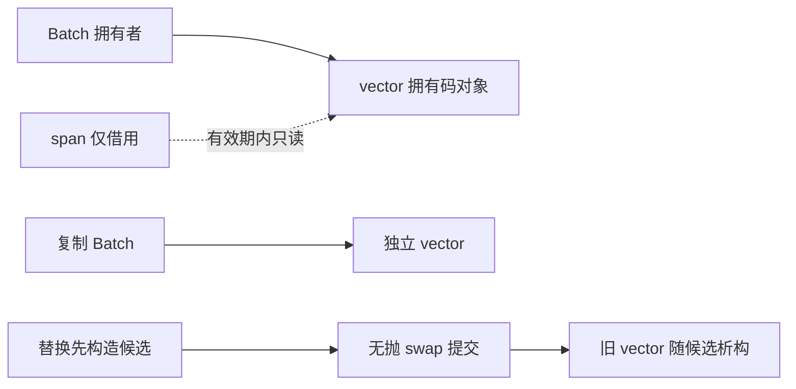
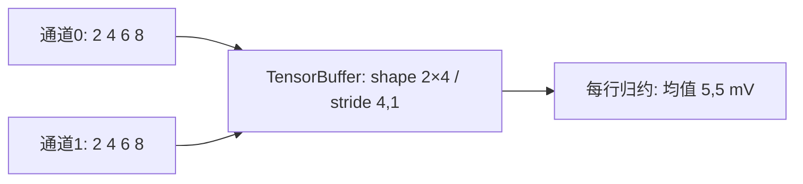

# 同一份测量记录怎样长成值类型、泛型算法和可交付组件

> C++20。第一段从完整初学程序开始，后续按需要返回已有 01–11 讲。本页的先修按段推进：第一次读取数字不要求先理解模板、借用或线程。代码真源与全部命令见 [[计算机知识/80-实践/03-C++/05-测量分析组件/README|测量分析组件]]。本页贯通阶段 0–3 的首个累计段，并提供阶段 4 的同步归约消费点；[[计算机知识/10-编程语言/02-C++/10-系统课程/13-可交付组件与并发测量工程|下一讲]]继续窗口报告、应用参数与结果PMR故障验证；[[计算机知识/10-编程语言/02-C++/10-系统课程/14-有界任务关闭取消与性能证据|第14讲]]继续有界生产/消费与本机性能报告，高级分支现由第16–18讲的各自真源和独立消费者接续，运行身份与未验层分别核对。

## 先确定一份可以手算的记录

测量不是只有一个 `double`。ADC 原码为 `[2,4,6,8]`，码范围是闭区间 `[0,4095]`，采样间隔是 `1 s`，标定是 `1000 µV/码 = 1 mV/码`，偏置是 `0 µV`。第 i 个样本的时间为 `i × 1 s`，i 从 0 起；电压是 `x_i=(g·c_i+b)/1000 mV`。四个值是 `[2,4,6,8] mV`。这是一条有限记录，先描述它；不预设随机性、平稳性或独立同分布。

| 输出 | 计算 | 单位及意义 |
| --- | --- | --- |
| 和 | `2+4+6+8=20` | mV；求和不是积分，积分还需时间权重 |
| 均值 | `20/4=5` | mV；记录的中心 |
| 描述性方差 | `(9+1+1+9)/4=5` | mV²；本记录围绕中心的均方偏离 |
| RMS² | `(4+16+36+64)/4=30` | mV²；包含均值的平方，`30=5+25` |
| 样本方差 | `20/(4-1)=20/3` | mV²；另一个估计目标，不会使时间序列自动变成 iid |

先读 [[电子电路/38-随机噪声与测量/01-RMS方差相关与谱密度#同一记录的中心与平方|中心与平方]]，再读 [[数学/30-概率与统计/02-期望方差协方差与抽样#方差与标准差|方差与标准差]]。返回这里，把 5 和 30 分别填入 `population_variance` 与 `rms_squared`；同为 mV² 并不表示同一个统计量。

## 阶段 0：完整程序先跑起来

复用 [[计算机知识/10-编程语言/02-C++/01-编译链接与CMake|编译、链接与 CMake]]：保存源码、编译为可执行文件，再把固定数据送给它。本段全部源码在 `stage0/first_measurement.cpp`，可直接执行：

```bash
c++ -std=c++20 stage0/first_measurement.cpp -o first_measurement
./first_measurement < data/codes.txt
```

输出 `count=4 sum_mV=20 mean_mV=5`。这里 `string token` 拥有输入字符，`vector<int> codes` 拥有已校验的码值；普通字符串任务由标准库管理资源。`while (cin >> token)` 反复读取以空白分隔的词，遇到 EOF 结束。函数 `parse_code` 用 `from_chars` 校验**整个**词：`4oops`、`1.0`、超出 int 的词和越界码都被拒绝。读到一半发生流错误也不能按正常 EOF 处理。

`int code = 0` 是每轮局部对象；`sum` 在循环外初始化，因此能累积所有项。分支先检查范围，成功才 `push_back`。最多 65536 项，所以和最大 `65536×4095=268369920`，此处的 `long long` 不溢出。`static_cast<double>(sum)/codes.size()` 明确要求浮点除法；直接用两个整数除法会截断小数。输入 `[1,2]` 时均值应为 `1.5 mV`，这是第一道迁移检查。

空文件输出 `count=0 sum_mV=0`，没有均值字段；空记录不能除以零。错误返回 2，成功返回 0。把 `parse_code` 的定义移到另一个 `.cpp` 后，只编译含 main 的文件将得到链接错误：声明让调用编译通过，链接器仍要找到函数定义。原工具链课解释这两步，组件的 CMake 则把实现目标加入构建图。

## 阶段 1：哪些不变量应该属于类型

当第二个调用方也要读取记录，不能要求每个人记住同一组校验。库的 `RawCode` 构造函数接收 int，拒绝 `[0,4095]` 外的值；没有默认构造和公开修改口。`Calibration` 用整数微伏，规定增益 `[1,1000] µV/码`、偏置 `[-1000000,1000000] µV`。这是课程应用的有限标定合同，不是所有仪器的通用范围。`Seconds`、`Millivolts`、`MillivoltsSquared` 是不同类型；`Batch` 再验证采样间隔有限且在 `(0,86400] s` 内，码数不超过 65536。

公开头文件给出接口，源码实现校验。`Batch` 的成员只有 `vector<RawCode>`、标定和间隔；它按 **Rule of Zero** 复用成员的复制、移动、析构，不另写裸内存管理。复制后两个批次拥有不同的码数组；移动后目标取得值，源对象只承诺可安全销毁、重新赋值以及本接口的合法空/非空观察，不假设一定为空。借用跨移动也必须按本应用合同重新取得。回到 [[计算机知识/10-编程语言/02-C++/10-系统课程/02-拷贝移动与异常保证|拷贝、移动与异常保证]]，解释 `std::move` 为什么只是重载选择的前提。

`Batch` 构造中的间隔校验在成员初始化后执行；若校验失败，已完成的 `vector` 子对象析构，整个 Batch 的析构并不运行。原因见 [N4861 except.ctor](https://timsong-cpp.github.io/cppwp/n4861/except.ctor)。这也是把资源放进成员的收益：不能指望一个尚未完成构造的对象清理裸资源。



`codes() const &` 返回 `span<const RawCode>`，从右值调用的重载被删除：`read_batch(stream).codes()` 被编译器拒绝，先把 Batch 保存为局部拥有者再取视图。`const` 只禁止通过该视图写入；不会延寿，也不会阻止另一别名替换 Batch。**借用期间本应用禁止拥有者析构、赋值、移动、swap 和 replace**；这些完成后重新取得视图。接口的一个编译拒绝不能替代完整寿命证明。

标定对象只有两个 int，`calibration()` 按值返回。因此 `const auto& c = read_batch(stream).calibration()` 绑定的是独立 Calibration 临时值，这个值的寿命延长到 c 的局部作用域；它没有借用已经销毁的 Batch 成员。若访问器返回 `const Calibration&`，同一写法会在完整表达式后悬垂。短小值按值返回与大数组返回 span 的成本、寿命合同不同，测试分别核对返回类型和临时批次销毁后保存的标定值。

返回 [[计算机知识/10-编程语言/02-C++/10-系统课程/10-借用视图失效与异常提交#返回借用还是返回拥有值|返回借用还是返回拥有值]]，回答“把 codes 的 span 存入稍后执行的任务是否安全”。如果任务期不能证明被拥有者覆盖，就传一个拥有的 Batch。当前归约在函数返回前等待全部线程，函数内部 `values` 拥有 float 数组；所有线程退出前它不会修改或析构。

`replace_from_stream` 先在局部 `next` 中解析和构造，再用默认 allocator 的 vector 及不抛的标量交换提交。解析 `2 4oops` 或输入流 badbit 会失败，旧码、标定与间隔保持；成功后 `next` 接管旧资源并析构。**输入流读取位置已经变化**，强保证针对 Batch 状态，不回滚外部流。测试实际触发这两条失败；实践的独立普通分配实验现对256码候选的全部观察请求逐点注入bad_alloc，检查旧Batch码值/标定/间隔及span地址、候选活资源；另测Batch深复制失败保来源。长token实验同时核默认流掩码转成badbit后的runtime_error与exceptions(badbit)传播bad_alloc的区别。进入[[计算机知识/80-实践/03-C++/05-测量分析组件/README#普通分配失败：候选、队列与线程分别保留什么|普通分配实验]]时携带current、输入流和旧span，返回解释为何旧对象保持而流状态不回滚；下一讲PMR结果实验是另一计数域，不代表所有allocator或所有构造已实测。

## 阶段 2：从具体循环推广到受约束接口

阶段 0 的循环只接受 `vector<int>`；应用库 `sum_codes` 接受 input range，并允许一个投影把记录变成 RawCode。可用 `vector<RawCode>`，也可用含 ID 的记录数组。源码里约束投影结果的去引用类型为 RawCode，避免把伏特 double 混作 ADC 码。这是窄而有用的泛型接口；原始码范围已经由 RawCode 构造保证，但最多 65536 项仍须在运行时逐项检查。

模板定义留在公开头文件，因为调用方需要实例化它。单遍 `O(n)`，只保持计数与整数和，额外空间 `O(1)`；不会隐式排序，不要求随机访问。容器选择、迭代器能力和失效回到 [[计算机知识/10-编程语言/02-C++/10-系统课程/04-容器迭代器算法与Ranges|容器与算法]]。concept 能拒绝 `vector<int>`，却不能从类型推断传感器的物理范围、记录是否 iid 或读到的数量是否合法。接口测试分别覆盖类型拒绝、运行时范围和投影。

`describe` 的空结果用 `optional<Statistics>`；n=1 的记录仍有均值和描述性方差，但 `sample_variance` 为空。输入错误用异常跨越库内部边界，CLI 在最外层捕获并转换成退出码和诊断。这是明确的组合选择；C++20 代码没有使用 C++23 的 `std::expected`。

## 阶段 3：统计、布局和归约各有一份合同

统计真源先在 uint64 中计算原码和、平方和，在 int64 中计算标定后的微伏和。上界分别是 `65536×4095 < 2^28`、`65536×4095² < 2^40`、`65536×5095000 < 2^39`，这些整数总量都能精确转换到 binary64。之后除法和标定不再保证精确。方差利用 `g²(E[c²]−E[c]²)`，偏置消去；`max(0,...)` 只把舍入造成的极小负值截为 0，不认证数据或算法稳定性。平方大数相减的消去会影响**相对**精度，参见 [[计算机知识/30-计算机系统/10-组成原理系统课程/09-浮点舍入消去与数值稳定性#消去：相减可能暴露此前已经存在的误差|消去的误差来源]]。大致相等的大量级记录应考虑两遍中心化参考算法，不能用这一算式冒充任意范围的稳定统计器。

详细的绝对误差界见实践 README；和的优化路径使用 float 数据、double 累加，返回基于每条合法输入计算的界。绝对界有对应单位；方差接近零时不承诺小的相对误差。本段的小例恰好精确，不推出所有标定输入位级相同。

`channel_means` 直接包含既有 `tensor_buffer.hpp`，把两个等长同步通道放进形状 `[通道数,样本数]` 的 TensorBuffer。行表示通道，列表示采样时刻；连续行优先平坦索引是 `row×sample_count+column`，stride 为 `[sample_count,1]`。它先拒绝空通道、长度/间隔不一致，才构造非空张量。Batch 的空统计合同不能用来允许 TensorBuffer 的 `{1,0}`。



返回 [[计算机知识/80-实践/03-C++/02-RAII与张量缓冲区/README#读代码时要能回答的四件事|TensorBuffer 的四个问题]]：构造期间 tensor 拥有新存储，输入 channels 的 span 只在同步调用期间借用外部 Batch；本例没有把 tensor 私有 vector 的 data 暴露出来，也没有修改旧实现以凑接口。它返回拥有的一维 `vector<Millivolts>`，长度为通道数，`result[channel]` 是该路均值；内部张量的样本轴已经归约，输出没有样本轴。

## 一个专门用于推翻位级相同假设的输入

使用 float 输入 `[2^54,1,−2^54,1]`，四个数都能精确表示为 binary32。每次相加先转换为 binary64，采用 round-to-nearest ties-to-even，无重新结合。精确实数和是 2，但两条实际算法可不同：

| 次序 | 每一步 |
| --- | --- |
| 串行左折 | `0+2^54=2^54`；`2^54+1` 舍入回 `2^54`；加 `−2^54` 得 0；再加 1 得 **1** |
| 两个连续双元素块 | 第一块 `2^54+1` 得 `2^54`；第二块 `−2^54+1` 位于两个可表示数中点，ties-to-even 得 `−2^54`；合并得 **0** |

正 `2^54` 向上间距为 4、向下间距为 2；负 `−2^54` 向零方向间距为 2。第二块为何是 tie，必须按所在一侧的间距判断。这组值不在 ADC 应用的合法范围内，所以只属于归约模型测试，不能拿它否定由有限测量合同推导的界。

测试直接消费原 `layout_math.hpp` 的 `sum_soa` 和 `parallel_sum_soa`。返回 [[计算机知识/30-计算机系统/10-组成原理系统课程/09-浮点舍入消去与数值稳定性#求和顺序改变结果，不只是最后一位的趣事|归约顺序主解释]] 后复算 1/0/2，再读 [[计算机知识/80-实践/03-C++/04-布局缓存与并行归约/README#三条路径比较什么|布局实验的三条路径]]，分别写下数值判据、SIMD 证据和计时证据。这里验证数值和同步线程完成；没有测吞吐，没有给出 SIMD 认证。

## 交付给另一个调用方

组件把公开头文件、实现库、CLI、测试和独立 consumer 分开。安装后 consumer 只包含 `<wwl/measurement.hpp>` 并链接 `WWL::measurement`；公开头文件不暴露 TensorBuffer 或 layout_math，所以用户无需包含实验室的私有头文件。CMake 目标传递 C++20 与线程链接需求，private include 路径只在编译组件时使用。[CMake 的导入与导出指南](https://cmake.org/cmake/help/latest/guide/importing-exporting/index.html)说明为何安装目标必须另给调用方可消费的路径。

源码声明同一目标的 API 不意味着稳定 ABI。此次验证是本机同一工具链的静态库安装与独立链接，跨平台、不同标准库、动态库边界另有证明义务。回到 [[计算机知识/10-编程语言/02-C++/10-系统课程/08-模块ABI协程与工程边界|模块、ABI 与工程边界]]；生产有界任务若加入取消、排队和关闭，还需按 [[计算机知识/10-编程语言/02-C++/10-系统课程/11-原子发布线性化与回收边界#一次性发布的证明应该长什么样|发布协议]] 重新画 happens-before。当前 join 归约不自称生产队列。

## 迁移练习与参考答案

1. 新输入 `[1,2,3]`，标定 `500 µV/码`，偏置 `1000 µV`。先手算再调用库。答案：电压 `[1.5,2,2.5] mV`，和 6、均值 2、描述性方差 `1/6 mV²`、RMS² `25/6 mV²`；样本方差 `1/4 mV²`。舍入判据按 README 的单位界检查。
2. 保存 `auto view = batch.codes()` 后调用 `replace_from_stream`，旧 view 能否继续使用？答案：按本应用合同禁止；即使新记录长度相同，也不能凭地址观察宣称有效。先结束借用、替换、重新取 view。复制 Batch 后从副本取 view 可以独立存在，但仍不能超过副本寿命。
3. 两通道记录长度都为 4，一路间隔 1 s，另一路 2 s，可直接配为同一 tensor 吗？答案：本 API 拒绝。内存 shape 相同不能证明物理时刻对应；若要重采样，必须定义插值、时间窗和误差，不能只放宽检查。
4. 只对固定小例作 `assert(sum==20)`，Release 成功是否说明测试通过？答案：断言可能被 `NDEBUG` 移除。本项目测试用显式失败计数和退出码，并把错误输入的退出 2 与诊断同时核对。依然需要未知输入、失败路径和独立审阅。

**回到入口**：[[计算机知识/10-编程语言/02-C++/10-系统课程/00-C++系统课程索引|C++ 唯一系统索引]]。构建、数据、误差界和验证边界见 [[计算机知识/80-实践/03-C++/05-测量分析组件/README|实践 README]]。
